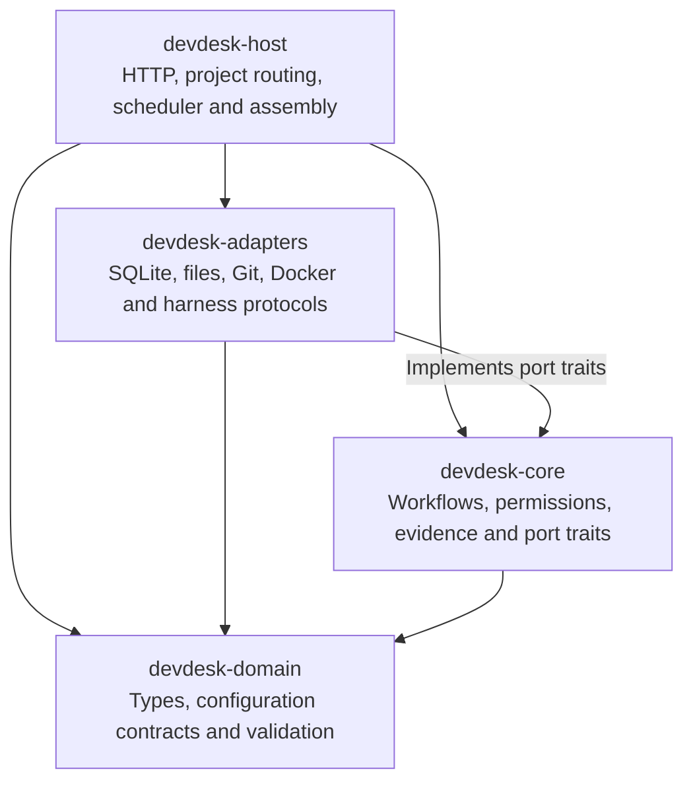
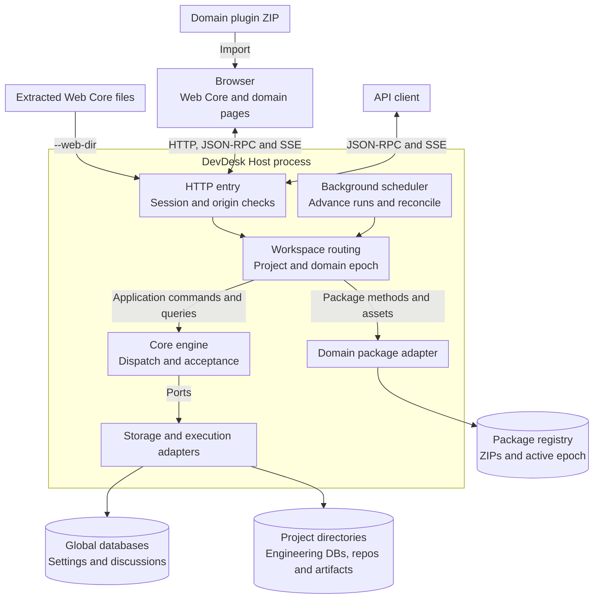
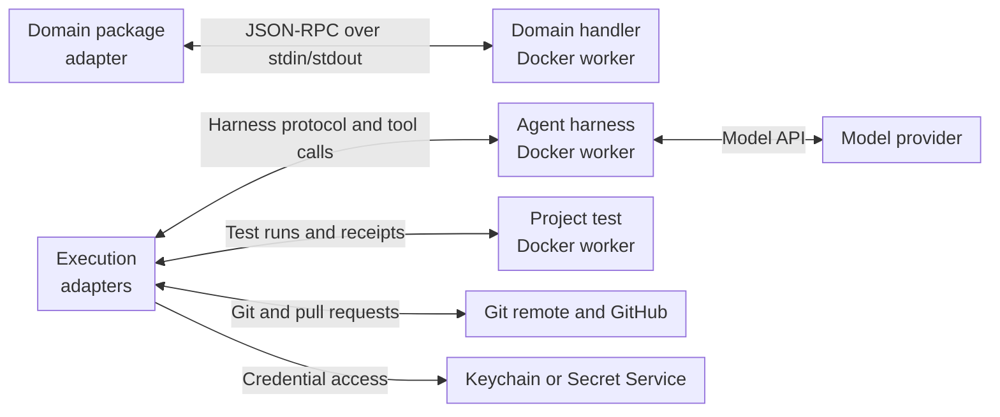
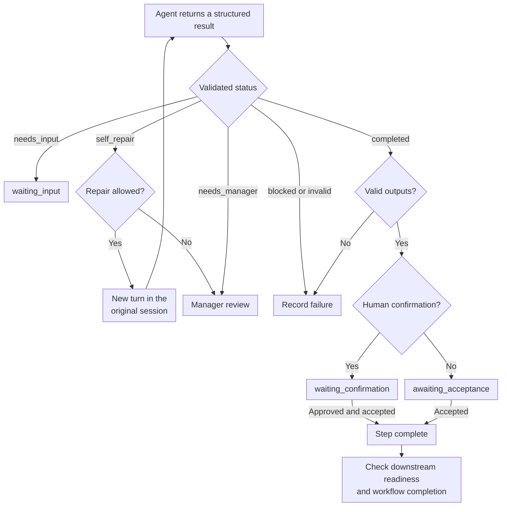

<div align="center">

# DevDesk

**A local-first workbench for building lights-out factories with autonomous agent orchestration.**

The software-development plugin implements a **lights-out software factory**. A project-manager
Agent can autonomously coordinate requirements, design, implementation, testing, review and delivery
through to a merged pull request. DevDesk verifies checkpoints, test runs, independent reviews and
merge receipts, and pauses for the human decisions required by the workflow.


**English** | [简体中文](README.zh-CN.md)

[Overview](#overview) · [Features in Depth](#features-in-depth) · [Quick Start](#quick-start) · [Deployment](#deployment-options) · [How It Works](#how-it-works) · [Protocol and Agent](#protocol-and-agent) · [Documentation](#documentation)

</div>

---

The Rust **Host** manages workflows, permissions and execution history in local SQLite databases.
The **Web Core** provides the browser workbench and shared SDK. Both ship independently of
**domain plugins**, which the Host loads from versioned ZIP packages at runtime. Other domains can
reuse the same orchestration and execution engine by packaging their own entity types, workflows,
roles, skills and validation rules, with optional runtime handlers and workbench pages. The Host
can start with an empty dataset and serve non-browser clients over HTTP, JSON-RPC and SSE.

## Overview

| Capability | What it does |
| :--- | :--- |
| **Workbench host** | One Rust service manages configuration, work items, workflows, agent sessions, permissions and history in SQLite, with artifact contents stored separately. |
| **Installable domain packages** | Business configuration, runtime handlers and UI ship as a versioned ZIP with per-file SHA-256; install, activate, switch and uninstall at runtime without rebuilding the host. |
| **Evidence-based delivery** | Steps produce receipts — workspace checkpoints, real test runs, independent review conclusions, remote source and merge revisions — so completion is verified rather than asserted. |
| **Autonomous agent orchestration** | The software-development package defaults to `agent` dispatch. `manual` and `rust` are also available, and all three share the dependency, permission, acceptance and completion rules. |
| **Replaceable agent runtime** | Codex or DSH harnesses run inside Docker sandboxes; models, providers, tools, skills and permission profiles are configuration, not code. |
| **One protocol, many clients** | Browser and non-browser clients use HTTP, JSON-RPC 2.0 and SSE. Agents access platform tools through their harness sessions. |
| **Git delivery with receipts** | Source publish, pull request, protected or unprotected merge and local sync — each confirmed against actual remote state, with unknown outcomes reconciled instead of retried blindly. |
| **Enforced permissions** | Runtime preparation verifies the required permission backends and blocks execution when a required backend is unavailable. |

## Features in Depth

### Four-layer architecture and dependencies

| Layer | Responsibility |
| :--- | :--- |
| `crates/domain` | Pure business types, source contracts and validation — no I/O, no clock, no environment access. |
| `crates/core` | Application flows, authorization, version checks and state transitions. Owns the port traits; adapters cannot advance domain state on their own. |
| `crates/adapters` | Concrete external capability: SQLite stores, artifact files, Git, GitHub, Docker, harness protocols, credential backends. |
| `crates/host` | The only binary. HTTP routing, session authentication, project scoping, domain epochs, background scheduling and port assembly. |



Arrows show direct Rust crate dependencies. `core` declares ports such as `Harness`, `Git`, `Tests`,
`PullRequests` and `ArtifactStore`. The Host passes the adapter implementations to the core engine.
An architecture linter
(`scripts/check/check-architecture.sh`) enforces the layer direction, keeps `domain` free of
environment access, and blocks the host from mutating business state directly.

### Domain plugins and versioned ZIP packages

| ZIP path | Contents |
| :--- | :--- |
| `manifest.json` | Package ID, version, manifest format, declared entity types, a SHA-256 per file, plus the runtime and presentation targets. |
| `configurations/` | Immutable source definitions and default selections, entity-type schemas, workflow bindings and the reference-usage index. |
| `runtime/` | Optional JavaScript handlers, dispatched by the Host to a restricted Docker worker over JSON-RPC. |
| `ui/` | Optional client contributions and their assets. |

On install, the Host calculates the ZIP's SHA-256 and validates the manifest, file digests and package
definitions. Activation is a separate action that advances the epoch shared by all clients. A
workbench can have one active domain or run in the empty domain. Switching or deactivating a domain
checks for in-flight workflows and repository operations awaiting reconciliation. Uninstalling a
package requires the domain's workflows to stop executing and preserves project data and history.

### Web SDK and shared React layout

`web.react` API 2 loads a package's ES modules into the *same* React instance as the core
workbench, so domain pages share the layout, the theme and the session. A contribution declares its
inputs, its fields and the query that fills it. The SDK gives the page a `DomainContext` with the
active epoch, current view and helpers for scoped queries, requests and event subscriptions.
Frontend asset requests must match both the active package digest and the current epoch.

The software-development package contributes three pages:

| Contribution | Page | Filled by |
| :--- | :--- | :--- |
| `software-development.branches` | Branch queue | `query.feature_branches` |
| `software-development.delivery` | Pull requests and diff | `query.workflow_materials` |
| `software-development.engineering-settings` | Engineering settings | `query.repository` |

### Work items, workflow drivers and receipts

The software-development plugin organizes delivery into projects, Features and Tasks. Each run
records its executions and outputs. Rework creates a new execution and retains the earlier result.

| Concept | What it is | Example |
| :--- | :--- | :--- |
| Project | Ownership scope for a repository and its engineering activity | one connected GitHub project |
| Feature | Work item for a complete requirement | add an export-report capability |
| Task | Divisible implementation work item under a Feature | implement the export endpoint |
| WorkflowDefinition | Reusable definition of steps and dependencies | requirements → design → implementation → delivery |
| WorkflowInstance | A concrete process started for one work item | the run of that report feature |
| StepDefinition | A step's task, inputs, outputs and execution method | the requirements-analysis step |
| StepExecution | One execution record of one step | the analyst generating the PRD the first time |

Data dependencies come from configuration, not from an agent guessing which document is current: a
step declares named output ports, and a downstream step references `requirements.result`. A
`Delivery` fixes the structure and provenance of an output, a `Spec` fixes the content conditions,
and a `Standard` freezes the closed set of specifications an engineering effort uses.

Who advances the flow:

| Driver | How the next step is chosen | What still has to hold |
| :--- | :--- | :--- |
| `manual` | The user operates from the workbench | dependencies, permissions, output and completion rules |
| `rust` | The program advances executable steps per configuration | the same rules — and it cannot fabricate a human decision |
| `agent` | A manager Agent reads workflow state, dispatches eligible steps and handles recoverable failures using platform tools | the same rules, plus a configured orchestration role, a supported harness and tool-call authorization |

The bundled Feature and Task workflows declare a project-manager role for agent orchestration. The
manager can request decisions and initiate rework within the configured budget. Core verifies
step outputs, acceptance and completion, and records human confirmations against the exact output
version.

Every delivery stage leaves evidence the next stage depends on:

| Stage | Key result | Why the next stage needs it |
| :--- | :--- | :--- |
| Workspace preparation | Repository, worktree, branch, base commit | Confirms which project and version the code operations belong to. |
| Checkpoint | Pinned commit and diff | Prevents the working tree changing mid-test, which would make the result ambiguous. |
| Actual tests | Candidate revision, environment, command, exit code, report | Verifies real code — model self-report is not trusted. |
| Independent review | Review target, conclusion, basis for the content check | Confirms the review targeted this artifact and met the independence requirement. |
| Source publish and target check | Remote source revision, target revision, trial-merge result | Confirms the delivered source and target were not silently swapped. |
| Merge and sync | Remote result, parent commit and tree, local workspace sync | Proves the delivery actually happened and matches the local record. |

### Permissions, credentials and sandboxes

DevDesk manages users, agents and external processes at once, so it answers two separate
questions: *who may request an action*, and *what the process executing it can actually reach*.

| Boundary | How it is constrained |
| :--- | :--- |
| Browser → Host | Connection authentication, Host/Origin validation, explicit project scope |
| Agent → platform tools | Published tools, current capability, session/turn identity, operation permissions |
| Harness process → files and commands | The harness permission backend and native tool rules |
| Container → host and network | Sandbox mounts, network, resources and platform security policy |
| Host → system credential store | The signed Host uses macOS Keychain directly. Linux uses Secret Service. |
| Automated flow → human decision | Human provenance validation — an agent cannot sign on a human's behalf |

Execution is bounded twice: a **Harness** (the model program and its protocol) and a **Sandbox**
(the container it runs in). A `Profile` is the source of the permission rules and a `Binding`
chooses which profile applies to which harness or sandbox; a step may override the default binding
for its layer, but the real operation must satisfy *both* layers. A rule that cannot be enforced
blocks the run — DevDesk never degrades to "restrict as much as possible" and calls it success.
Note that the default full-access binding treats the whole harness container as the trust scope:
tools in that container may reach that run's model credentials and state.

DevDesk stores saved API keys and integration tokens in the **system credential store** and keeps
opaque references in configuration. On macOS, `devdesk-host` verifies its own signature and the
credential's service and account scope. Linux requires `secret-tool` and an unlocked Secret Service
session over D-Bus. Codex OAuth uses separate private authentication files in the dataset. Rotating
a model API key produces a new reference for future runs. Existing runs use their frozen reference
and fail if that credential becomes unreadable.

### Data, concurrency and recovery

| Storage scope | Main contents | Boundary |
| :--- | :--- | :--- |
| Global configuration DB | Configuration sources, default selections, project directory, global settings | Provides the definitions available for adoption by projects. |
| Domain package registry | Installed ZIPs, active domain epoch, domain storage settings | Stored in the Host dataset. |
| Project engineering DB | Domain objects and relations, sessions, workflows, executions, events, domain records | The request must explicitly select a project. |
| Global conversations DB | Sessions and discussion material that belongs to no project | Never falls back to any project database. |
| Artifacts directory | Documents, structured output and other content | The database stores identity, ownership and digest; contents are verified on read. |
| Runtime resources | Containers, state directories, Git worktrees, private auth material | Lifecycle is linked to business records, but not by the same transaction. |

Each Host dataset has an exclusive lock. In the domain workbench, **Settings → Data and Runtime**
can select a separate domain data directory. Different Hosts can use that directory with their own
settings and credentials. When opening an active domain or saving its storage setting, the Host
can discover compatible projects by their original IDs and skips projects locked by another Host.
Changing the directory sets the location for new projects and can reconnect projects already moved
there. Existing projects keep their recorded locations until reattached.

The current production layout is `single-host-domain-packages-v1`, the data profile marker is
`devdesk-profile-runtime-v2`, and the SQLite baselines are global `24` and project `62`. Versioned
write commands carry a `command_id` and the versions of the objects they read. Core prepares a
bounded read set and write set, the storage adapter checks those versions inside a short
transaction and commits. Two people starting from Feature revision 5 produce revision 6 and a
`revision_conflict` for the second — the page keeps the draft and the original version so the
change can be inspected and re-decided. Replaying the same command ID with the same parameters
returns the original result; the same ID with different parameters is rejected.

External operations follow an **intent-first** protocol: core persists the execution identity,
the input version and the operation it is about to launch, then the adapter performs the work
*outside* any transaction, and only afterwards does core verify that the observation belongs to the
original operation and advance business state. After a crash the Host queries the original
operation and the actual resources first: an existing result can be adopted, an unknown result must
be reconciled. This gives a traceable recovery path — it is deliberately *not* a unified
exactly-once transaction across SQLite, files and remote services.

| To continue | When it applies | What is preserved |
| :--- | :--- | :--- |
| Reconcile | You do not know whether the external operation completed | Original operation identity, inputs, existing observations |
| Retry | It is certain the same task can be attempted again | Original configuration and input conditions, original failure record |
| Rework | The result was rejected in review and needs business changes | Original rejection, rework reason, before/after execution relation, budget |
| Plan change | Later steps or dependencies need adjusting | Preview basis, results of stopping affected executions, old plan and history |
| Resume | The flow is paused and continuation conditions hold | Current saved state, without recreating all history |

Pausing dispatch is not the same as stopping a running process: cancel and cleanup require the
adapter to supply proof that the worker stopped, that write authority was revoked, or that the
resource was removed. Changing a status string cannot stop the original container from continuing
to write.

### Quality and limits

Different test layers prove different things, and a pass at one layer is never reported as
complete engineering acceptance.

| Layer | What it verifies | What it cannot prove alone |
| :--- | :--- | :--- |
| domain/core unit and integration tests | Rules, state, configuration, version conflicts, recovery decisions | That a real vendor protocol or Docker environment is available |
| adapters storage and protocol tests | SQL commits, process messages, permission translation, error handling | That every real account and platform works |
| HTTP and browser regression | Request contracts, project isolation, display and interaction | Model output quality or a successful remote merge |
| Docker-native protocol acceptance | Real installation and container protocol and isolation behavior | Paid model inference and real GitHub delivery |
| Real engineering acceptance | The delivery process on a named model, repository, credential and machine | Other configurations, other platforms, or every capacity requirement |

Root manager orchestration currently requires Codex. DeepSeek Harness (DSH) supports regular
sessions and step execution. The target of 100 active frontends is tracked in the
[concurrency acceptance contract](docs/plans/single-host-concurrency/ACCEPTANCE.md) and awaits
formal validation. Compatible project schemas 60 and 61 have an explicit migration command. To
move from a monolithic installation, start v0.5 with a fresh dataset and retain the original data.

## Quick Start

### Run the workbench

Download or build the Host and Web Core archives and keep their `.sha256` files alongside them.
Run the following from that directory, replacing `aarch64-apple-darwin` with your Host archive's
target if needed.

```bash
host_archive=devdesk-core-host-0.6.0-aarch64-apple-darwin.tar.gz
web_archive=devdesk-core-web-0.6.0.tar.gz
if command -v sha256sum >/dev/null; then
  sha256sum -c "$host_archive.sha256" "$web_archive.sha256"
else
  shasum -a 256 -c "$host_archive.sha256" "$web_archive.sha256"
fi &&
  tar -xzf "$host_archive" &&
  tar -xzf "$web_archive" &&
  "./${host_archive%.tar.gz}/devdesk-host" --data ./data --web-dir "./${web_archive%.tar.gz}"
```

Open **<http://127.0.0.1:4317>**. The terminal prints the listening address. On first run you can omit
`--data` and choose a dataset directory in the Web setup page. To serve API clients alone, omit
`--web-dir` and pass `--data` to open or initialize the dataset.

On an empty domain the workbench offers the basic components, the global history, settings and
**domain management**.

| Artifact | Contents |
| :--- | :--- |
| `devdesk-core-host-0.6.0-<target>.tar.gz` | The Rust Host, the core configuration and runtime assets. Supports an empty domain and API-only operation. |
| `devdesk-core-web-0.6.0.tar.gz` | The Web Core, the shared React layout and UI SDK, and the domain package schemas. |
| `software-development-0.6.0.zip` | The software-development configuration, the Node.js runtime extension and the domain pages. |

> The `core` in `devdesk-core-host` / `devdesk-core-web` means the **domain-agnostic core
> distribution** — it is not the `devdesk-core` Rust crate.

### Install the software-development plugin

In a running workbench, open **domain management**, import `software-development-0.6.0.zip`, then
click **activate**. The domain workbench renders in the same browser session, sharing navigation,
layout and session with the core workbench. Domain packages can be loaded, switched and uninstalled
while the Host runs.

Before connecting a repository or running the domain handlers, pull their pinned Node image on the
Host's Docker engine.

```bash
docker pull node@sha256:4660b1ca8b28d6d1906fd644abe34b2ed81d15434d26d845ef0aced307cf4b6f
```

### Run a delivery workflow

1. In **Settings → GitHub Connection**, verify GitHub authentication, then use **Open GitHub Project**
   to connect a repository and select its main branch.
2. Set up model authentication and verify the Harness and Sandbox. In project settings, review the
   Workflow, Standard, Role → Agent bindings and test configuration. Select **Agent dispatch** for
   autonomous orchestration, or choose **Rust** or **manual** dispatch when configuring the project.
3. Create a Feature with an initial requirement and click **Start Feature** in **Execution and
   Delivery**. The run adopts the selected project dispatch mode.
4. Review the PRD, design, Task plan, independent Red/Green runs and review results. Confirm the
   exact output version at each configured human approval step.
5. Track source publication, the candidate, regression, the PR merge and the local sync receipts on
   the delivery page.

The full GitHub delivery workflow requires Docker, Git, GitHub CLI, GitHub authorization and a
working connection to the selected model provider.

### Build from source

The repository pins **Rust 1.99.1** and **Node 24**. The local Python pin is **3.12** and the Rust
checks in CI use **3.13**. See `rust-toolchain.toml`, `.nvmrc`, `.python-version` and the CI workflow.

```bash
./scripts/dev/dev.sh --data ./data --port 4317
```

`dev.sh` installs missing web dependencies, builds Web Core and a debug Host, and forwards your
arguments at startup. On macOS, configure a stable signing identity for Keychain access before
building. See [macOS signing and Keychain](docs/crates/devdesk-adapters/signing-and-keychain.md).

Build each release artifact independently.

```bash
./scripts/release/package.sh host
./scripts/release/package.sh web
./scripts/release/package.sh software-development
```

Output lands in `dist/`, each artifact accompanied by a `.sha256` file. The Host builds on its own,
without the Node or web build outputs and without the domain sources.

The Host defaults to the size-optimized profile. Use `host --profile speed` for normal speed
optimization, or `host --profile symbols` to keep symbols for diagnostics.

The full regression suite also needs Docker and Chromium. See the [test index](tests/README.md) for
suite-specific runtime requirements.

```bash
python3 -m venv .venv
source .venv/bin/activate
python3 -m pip install -r scripts/check/requirements.txt
npm --prefix web ci
(cd web && npx playwright install chromium)
./scripts/check/check.sh
```

## Deployment Options

By default the Host listens on loopback and exclusively manages its dataset. The same Host can
serve remote browsers or API clients when configured with a reachable address and a connection key.

| Form | Data | Processes | Remote access |
| :--- | :--- | :--- | :--- |
| Local (default) | Host dataset and optional domain data directory | Host and its workload-specific Docker workers | Loopback only |
| Remote | Same layout on the machine running the Host | Host and workers on that machine | `DEVDESK_ACCESS_TOKEN` for remote access. Set `--public-url` for wildcard binding or when the public origin differs from the listener. |

```bash
# Export DEVDESK_ACCESS_TOKEN with a random key of 32–512 printable, non-space ASCII characters.
# Run from the directory where you extracted the archives, with host_archive and web_archive set as above.
"./${host_archive%.tar.gz}/devdesk-host" --host 192.168.1.10 --port 4317 --data ./data \
  --web-dir "./${web_archive%.tar.gz}"
```

Replace `192.168.1.10` with the Host's LAN IP. Clients use **Connect Kernel** to open the workbench
and enter the same connection key. Data, Git, credentials and Docker commands are managed from the
Host machine. Behind a reverse proxy
providing HTTPS, set `--public-url https://desk.example` and pass a matching Host/Origin; binding
`0.0.0.0` or `::` requires an explicit public address. Plain HTTP is only for trusted networks or
tunnels.

On Linux with AppArmor enabled, restricted nested sandboxes need a DevDesk-specific policy. From
the extracted Host directory, review and check the policy before installing it.

```bash
./devdesk-host sandbox-policy --print
./devdesk-host sandbox-policy --check
sudo ./devdesk-host sandbox-policy --install
```

The installer loads only DevDesk-specific policies, and the Host validates the assets and
permissions. The default full-access binding does not require this nested policy.

## How It Works

### Clients, Host and data



Each browser tab selects a project and shares the workbench's active domain. The package registry
lives in the Host dataset. Project directories may also live under a configured domain data
directory. Project registration records the original domain ID and package digest. Workflow runs
freeze the applicable source revisions and package bindings for execution and recovery.

### Execution and external services



The domain handler, Agent harness and test worker have separate Docker execution environments.
Authorized agents call platform tools through the harness protocol, while core checks whether each
tool action can advance the workflow.

### Agent step lifecycle

An Agent step typically proceeds through the following stages.

1. The client posts a command to `/rpc` with a `command_id` and the versions it read.
2. Core checks dependencies, caller permission, object versions and the execution budget.
3. Core saves the input and the pending operation. A successful RPC response to a dispatch command
   acknowledges the operation, and execution continues in the background.
4. The Host's background scheduler creates the session, the adapter starts the harness, and the
   agent produces a result.
5. Core validates the output against the declared ports, `Delivery` and `Spec`, then stores the
   artifact and the output record. Valid output reaches `awaiting_acceptance`, or
   `waiting_confirmation` when the step needs a human.
6. Acceptance, human decisions and the completion rule advance the flow. Artifacts are written and
   SQL is committed separately — no external I/O happens inside a long database transaction.



## Protocol and Agent

The Host exposes a small, stable surface. `GET /connection` is the only cross-origin endpoint and
returns the product name, protocol version and whether authentication is required — it issues no
session. `POST /session` establishes one with the connection key; the key never enters the URL.

| Route | Purpose | Key constraint |
| :--- | :--- | :--- |
| `GET /connection` | Probe product, protocol and auth requirements | Cross-origin probe allowed; issues no authenticated session |
| `POST /session` | Establish a session with the connection key | `HttpOnly`, `SameSite=Strict`; the key never enters the URL |
| `POST /rpc` | Request an application command or query | JSON-RPC 2.0, `id` required; no batch, no notification |
| `GET /events` | Subscribe to events | Explicit scope; the cursor belongs only to that stream |
| `GET /domain-events` | Domain event stream | Receives the current epoch on connect, then `domain` events |
| `GET /domain-assets/{epoch}/{digest}/{path}` | Read rendering assets of the active package | Both the current epoch and the digest must match |
| `GET /artifacts/{id}` | Read a project artifact | Supply `project_id` and, for a domain project, `domain_epoch`. The Host verifies the artifact digest. |
| `GET /capabilities` | Query protocol, capabilities and lifecycle | A capability declaration does not mean a real run has passed |
| `POST /setup` | Open a dataset | Requires the original Host instance and lifecycle revision |
| `POST /shutdown` | Request shutdown | Requires a trusted user source and lifecycle preconditions |

```json
{"jsonrpc":"2.0","id":1,"method":"query.domain.active","params":{}}
```

Call `query.domain.active` to discover the current `epoch` and active package. Package operations
such as `domain.activate`, `domain.workflow.start` and `query.domain.contribution` take `epoch`.
`domain.install` takes the Base64 ZIP as `archive`.

Project-scoped calls such as `query.workspace` and `workflow.step.dispatch` take `project_id` and,
for a domain project, `domain_epoch`. The project event stream uses these same names in its query
string. Versioned write commands typically take `command_id`, `target`, `expected_revision` and
`payload`. Resource commits report the namespace, versions and cursor in `meta.commit`.

### Platform tools

An agent cannot call arbitrary RPC methods. Platform tools have an explicit registry, a published
manifest definition, and a per-session available set; those three sets are not the same thing.

| Surface | Caller and entry | Identity source |
| :--- | :--- | :--- |
| HTTP / JSON-RPC / SSE | Browser → Host | Host session and request scope |
| Dynamic platform tools | Tool requests inside the harness protocol | The associated agent, session, turn and tool definition |
| Rust internal ports | Engine and background scheduling | The execution request prepared by the application flow |

The core platform tool set includes `workflow.step.dispatch`, `workflow.step.accept`,
`workflow.outputs.read`, `workflow.inspect`, `workflow.execution.inspect`, `workflow.events.read`,
`workflow.complete` and `workflow.decision.request`. The software-development package publishes
additional definitions for configuration, workflow control and engineering delivery. Each harness
also exposes its own native tools according to the session's permissions.

## Documentation

| Task | Start here |
| :--- | :--- |
| Understand the system and its layers | [System overview](docs/design/overview.md) · [Layers and dependencies](docs/design/layers.md) · [Core concepts](docs/design/domain-model.md) |
| Install, run and troubleshoot the Host | [Run guide](docs/design/run-binary.md) |
| Build a domain package or another client | [Domain packages](docs/design/domain-packages.md) · [RPC reference](docs/design/reference/rpc.md) |
| Configure agents, roles, models and permissions | [Configuration](docs/design/configuration.md) · [Permissions and credentials](docs/design/security.md) |
| Follow a workflow from requirement to delivery | [Workflow](docs/design/workflow.md) · [Agent runtime](docs/design/agent-runtime.md) · [Engineering delivery](docs/design/engineering-delivery.md) |
| Understand the client and tool surfaces | [Tools and interfaces](docs/design/interfaces.md) · [Tools and primitives](docs/design/reference/tools-and-primitives.md) |
| Connect external services | [Integrations](docs/design/reference/integrations.md) · [Data formats](docs/design/reference/contracts.md) |
| Reason about storage, concurrency and recovery | [Data, concurrency and recovery](docs/design/data-and-recovery.md) |
| Read or change the implementation | [Code handbook](docs/crates/README.md) · [Cross-module execution flows](docs/crates/execution-flows.md) · [Repository guidelines](AGENT.md) |
| Run the tests and extend the suites | [Test index](tests/README.md) · [Testing and extension](docs/crates/testing-and-extension.md) |
| Build, check and release | [Script index](scripts/README.md) · [Rust standards](docs/crates/standards/rust.md) · [Web standards](docs/crates/standards/web.md) |
| Browse everything else | [Documentation index](docs/README.md) · [Design topics](docs/design/README.md) · [Glossary](docs/design/glossary.md) |

Everything else — mechanisms, runbooks, acceptance records and historical benchmarks — is in the
[documentation index](docs/README.md), the [plan archive](docs/plans/README.md) and the
[benchmark archive](docs/benchmarks/README.md).

## License

This repository currently provides **no root-level `LICENSE` file**. Third-party components keep
their own licenses alongside their dependencies or permission assets — for example the Moby seccomp
and AppArmor bases under `permissions/backends/docker/upstream/`, the OpenAI Codex CLI
(`Apache-2.0`) and DeepSeek Harness (`MIT`) harness definitions.
