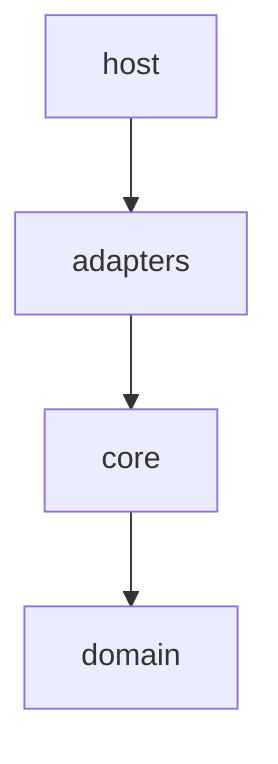
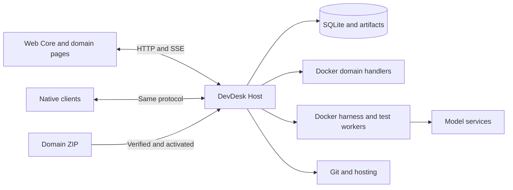
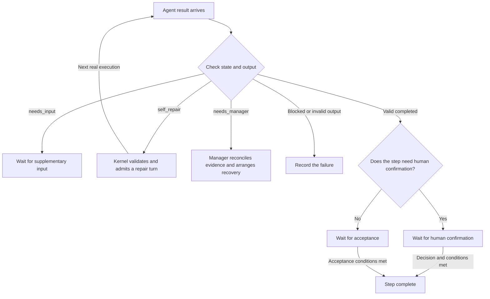

<div align="center">

# DevDesk

**A local-first workbench that runs agent-driven software delivery as verifiable workflows.**

From a requirement to a merged pull request — with every step producing real receipts (test runs,
checkpoints, independent reviews, merge confirmations) instead of an agent's summary. One Rust Host
holds configuration, workflows, sessions, permissions and history in a SQLite dataset you control.


**English** | [简体中文](README.zh-CN.md)

[Overview](#overview) · [Features in Depth](#features-in-depth) · [Quick Start](#quick-start) · [How It Works](#how-it-works) · [Protocol and Agent](#protocol-and-agent) · [Documentation](#documentation)

</div>

---

DevDesk turns requirements, agent execution, engineering verification and human decisions into a
traceable workflow. The Host owns state and execution resources, agents do the work, and the Web
workbench shows the results and lets people decide.

Three artifacts ship independently: a Rust **Host** (the workbench server), a **Web Core** (the
browser UI and the shared SDK domain packages build against), and **domain packages** — business
configuration, runtime handlers and domain pages — loaded as versioned ZIPs at runtime. The Host
starts on an empty dataset and speaks only HTTP, JSON-RPC and SSE, so a non-browser client drives
the same product without loading a single asset.

## Overview

| Capability | What it does |
| :--- | :--- |
| **Workbench host** | One Rust service owning configuration, work items, workflows, agent sessions, permissions, artifacts and history in a local SQLite dataset. |
| **Installable domain packages** | Business configuration, runtime handlers and UI ship as a versioned ZIP with per-file SHA-256; install, activate, switch and uninstall at runtime without rebuilding the host. |
| **Evidence-based delivery** | Steps produce receipts — workspace checkpoints, real test runs, independent review conclusions, remote source and merge revisions — so completion is verified rather than asserted. |
| **Three dispatch drivers** | `manual`, `rust` and `agent` decide *who* advances a flow, but share one set of dependency, permission, acceptance and completion rules. |
| **Replaceable agent runtime** | Codex or DSH harnesses run inside Docker sandboxes; models, providers, tools, skills and permission profiles are configuration, not code. |
| **One protocol, many clients** | HTTP, JSON-RPC 2.0 and SSE serve the browser, native clients and agent platform tools alike; domain pages render inside the same React tree as the core workbench. |
| **Git delivery with receipts** | Source publish, pull request, protected or unprotected merge and local sync — each confirmed against actual remote state, with unknown outcomes reconciled instead of retried blindly. |
| **Honest boundaries** | A missing permission backend fails the run instead of pretending to be isolated; a capability declaration never stands in for a verified execution. |

## Features in Depth

### Architecture: four layers, one dependency direction

| Layer | Responsibility |
| :--- | :--- |
| `crates/domain` | Pure business types, source contracts and validation — no I/O, no clock, no environment access. |
| `crates/core` | Application flows, authorization, version checks and state transitions. Owns the port traits; adapters cannot advance domain state on their own. |
| `crates/adapters` | Concrete external capability: SQLite stores, artifact files, Git, GitHub, Docker, harness protocols, credential backends. |
| `crates/host` | The only binary. HTTP routing, session authentication, project scoping, domain epochs, background scheduling and port assembly. |



Compile-time dependencies point one way. At runtime the direction inverts through traits: `core`
declares ports such as `Harness`, `Git`, `Tests`, `PullRequests` and `ArtifactStore`; `adapters`
implement them; the Host wires the concrete objects into the engine. An architecture linter
(`scripts/check/check-architecture.sh`) enforces the layer direction, keeps `domain` free of
environment access, and blocks the host from mutating business state directly.

### Domain packages: business configuration as a versioned ZIP

| ZIP path | Contents |
| :--- | :--- |
| `manifest.json` | Package ID, version, manifest format, declared entity types, a SHA-256 per file, plus the runtime and presentation targets. |
| `configurations/` | Immutable source definitions and default selections, entity-type schemas, workflow bindings and the reference-usage index. |
| `runtime/` | Optional JavaScript handlers, dispatched by the Host to a restricted Docker worker over JSON-RPC. |
| `ui/` | Optional client contributions and their assets. |

The Host verifies the package digest and every file digest on install, then activates it at runtime.
Activation bumps the active epoch for all connected clients; the workbench has exactly one active
domain, which may be empty. Uninstall is refused only while a workflow of that domain is executing —
queued, blocked, waiting-for-input and paused-but-stopped flows can all be removed, and the project
data survives.

### The web SDK: domain pages in the same React tree

`web.react` API 2 loads a package's ES modules into the *same* React instance as the core
workbench, so domain pages share the layout, the theme and the session. A contribution declares its
inputs, its fields and the query that fills it; the SDK hands the page a `DomainContext` carrying
the active epoch, the current project, an RPC call, a request helper and an event subscription.
Frontend asset requests must match both the active package digest and the current epoch.

The software-development package contributes three pages:

| Contribution | Page | Filled by |
| :--- | :--- | :--- |
| `software-development.branches` | Branch queue | `query.feature_branches` |
| `software-development.delivery` | Pull requests and diff | `query.workflow_materials` |
| `software-development.engineering-settings` | Engineering settings | `query.repository` |

### Workflows: work items, drivers and receipts

DevDesk separates *the work to be done*, *one actual execution* and *what that execution
produced*. The same task may be executed many times; a rework never erases the earlier result.

| Concept | What it is | Example |
| :--- | :--- | :--- |
| Project | Ownership scope for a repository and its engineering activity | one connected GitHub project |
| Feature | Work item for a complete requirement | add an export-report capability |
| Task | Divisible implementation work item under a Feature | implement the export endpoint |
| WorkflowDefinition | Reusable definition of steps and dependencies | requirements → design → implementation → delivery |
| WorkflowInstance | A concrete process started for one work item | the run of that report feature |
| StepDefinition | A step's task, inputs, outputs and execution method | the requirements-analysis step |
| StepExecution | One execution record of one step | the analyst generating the PRD the first time |

Data dependencies come from configuration, not from an agent guessing which document is current: a
step declares named output ports, and a downstream step references `requirements.result`. A
`Delivery` fixes the structure and provenance of an output, a `Spec` fixes the content conditions,
and a `Standard` freezes the closed set of specifications an engineering effort uses.

Who advances the flow:

| Driver | How the next step is chosen | What still has to hold |
| :--- | :--- | :--- |
| `manual` | The user operates from the workbench | dependencies, permissions, output and completion rules |
| `rust` | The program advances executable steps per configuration | the same rules — and it cannot fabricate a human decision |
| `agent` | A manager inspects and dispatches through platform tools | the same rules, plus session and tool-call authorization |

A manager can dispatch, inspect, request a decision and trigger a bounded rework. It cannot
replace a rule check with the sentence "done", and it cannot declare itself to be a human.

Every delivery stage leaves evidence the next stage depends on:

| Stage | Key result | Why the next stage needs it |
| :--- | :--- | :--- |
| Workspace preparation | Repository, worktree, branch, base commit | Confirms which project and version the code operations belong to. |
| Checkpoint | Pinned commit and diff | Prevents the working tree changing mid-test, which would make the result ambiguous. |
| Actual tests | Candidate revision, environment, command, exit code, report | Verifies real code — model self-report is not trusted. |
| Independent review | Review target, conclusion, basis for the content check | Confirms the review targeted this artifact and met the independence requirement. |
| Source publish and target check | Remote source revision, target revision, trial-merge result | Confirms the delivered source and target were not silently swapped. |
| Merge and sync | Remote result, parent commit and tree, local workspace sync | Proves the delivery actually happened and matches the local record. |

### Permissions, credentials and sandboxes

DevDesk manages users, agents and external processes at once, so it answers two separate
questions: *who may request an action*, and *what the process executing it can actually reach*.

| Boundary | How it is constrained |
| :--- | :--- |
| Browser → Host | Connection authentication, Host/Origin validation, explicit project scope |
| Agent → platform tools | Published tools, current capability, session/turn identity, operation permissions |
| Harness process → files and commands | The harness permission backend and native tool rules |
| Container → host and network | Sandbox mounts, network, resources and platform security policy |
| Host → system credential store | The platform credential interface; on macOS a verified, fixed-code-signed helper |
| Automated flow → human decision | Human provenance validation — an agent cannot sign on a human's behalf |

Execution is bounded twice: a **Harness** (the model program and its protocol) and a **Sandbox**
(the container it runs in). A `Profile` is the source of the permission rules and a `Binding`
chooses which profile applies to which harness or sandbox; a step may override the default binding
for its layer, but the real operation must satisfy *both* layers. A rule that cannot be enforced
blocks the run — DevDesk never degrades to "restrict as much as possible" and calls it success.
Note that the default full-access binding treats the whole harness container as the trust scope:
tools in that container may reach that run's model credentials and state.

API keys and tool tokens live in the **system credential store**; configuration holds only an
opaque reference. On macOS the certificate-signed `devdesk-host` talks to the Keychain directly
and verifies its own signature and the credential's service and account scope. Linux requires
`secret-tool` and an unlocked Secret Service / D-Bus session — there is no downgrade to plaintext
key files. Rotating a key produces a new reference; existing runs stay bound to the original, and a
run whose credential became unreadable fails rather than silently swapping in the new key.

### Data, concurrency and recovery

| Storage scope | Main contents | Boundary |
| :--- | :--- | :--- |
| Global configuration DB | Active domain epoch, installed packages, configuration sources, default selections, project directory, global settings | Provides the definitions available for adoption by projects. |
| Project engineering DB | Domain objects and relations, sessions, workflows, executions, events, domain records | The request must explicitly select a project. |
| Global conversations DB | Sessions and discussion material that belongs to no project | Never falls back to any project database. |
| Artifacts directory | Documents, structured output and other content | The database stores identity, ownership and digest; contents are verified on read. |
| Runtime resources | Containers, state directories, Git worktrees, private auth material | Lifecycle is linked to business records, but not by the same transaction. |

The current production layout is `single-host-domain-packages-v1`, the data profile marker is
`devdesk-profile-runtime-v2`, and the SQLite baselines are global `24` and project `62`. Every
command carries its own `command_id` and the versions of the objects it read: core prepares a
bounded read set and write set, the storage adapter checks those versions inside a short
transaction and commits. Two people starting from Feature revision 5 produce revision 6 and a
`revision_conflict` for the second — the page keeps the draft and the original version so the
change can be inspected and re-decided. Replaying the same command ID with the same parameters
returns the original result; the same ID with different parameters is rejected.

External operations follow an **intent-first** protocol: core persists the execution identity,
the input version and the operation it is about to launch, then the adapter performs the work
*outside* any transaction, and only afterwards does core verify that the observation belongs to the
original operation and advance business state. After a crash the Host queries the original
operation and the actual resources first: an existing result can be adopted, an unknown result must
be reconciled. This gives a traceable recovery path — it is deliberately *not* a unified
exactly-once transaction across SQLite, files and remote services.

| To continue | When it applies | What is preserved |
| :--- | :--- | :--- |
| Reconcile | You do not know whether the external operation completed | Original operation identity, inputs, existing observations |
| Retry | It is certain the same task can be attempted again | Original configuration and input conditions, original failure record |
| Rework | The result was rejected in review and needs business changes | Original rejection, rework reason, before/after execution relation, budget |
| Plan change | Later steps or dependencies need adjusting | Preview basis, results of stopping affected executions, old plan and history |
| Resume | The flow is paused and continuation conditions hold | Current saved state, without recreating all history |

Pausing dispatch is not the same as stopping a running process: cancel and cleanup require the
adapter to supply proof that the worker stopped, that write authority was revoked, or that the
resource was removed. Changing a status string cannot stop the original container from continuing
to write.

### Quality and limits

Different test layers prove different things, and a pass at one layer is never reported as
complete engineering acceptance.

| Layer | What it verifies | What it cannot prove alone |
| :--- | :--- | :--- |
| domain/core unit and integration tests | Rules, state, configuration, version conflicts, recovery decisions | That a real vendor protocol or Docker environment is available |
| adapters storage and protocol tests | SQL commits, process messages, permission translation, error handling | That every real account and platform works |
| HTTP and browser regression | Request contracts, project isolation, display and interaction | Model output quality or a successful remote merge |
| Docker-native protocol acceptance | Real installation and container protocol and isolation behavior | Paid model inference and real GitHub delivery |
| Real engineering acceptance | The delivery process on a named model, repository, credential and machine | Other configurations, other platforms, or every capacity requirement |

The current limits are explicit: one dataset is managed by one Host; root manager orchestration
requires the Codex harness, because DSH declares ordinary sessions and step tools but not that
capability; the workflow runtime targets at least 100 concurrent frontends as a capacity
requirement, tracked by a separate acceptance contract; and legacy dataset migration is an
explicit maintenance command rather than automatic startup behavior.

## Quick Start

### Run the workbench

The Host and Web Core ship as separate artifacts. Obtain them from your release channel together
with their SHA-256 checksum files, then verify before extracting.

```bash
sha256sum -c devdesk-core-host-0.5.0-<target>.tar.gz.sha256
sha256sum -c devdesk-core-web-0.5.0.tar.gz.sha256

tar -xzf devdesk-core-host-0.5.0-<target>.tar.gz    # → devdesk-core-host-0.5.0-<target>/devdesk-host
tar -xzf devdesk-core-web-0.5.0.tar.gz              # → devdesk-core-web-0.5.0/
```

```bash
./devdesk-host --data ./data --web-dir ./devdesk-core-web-0.5.0
```

Open **<http://127.0.0.1:4317>**. The terminal prints the address it is listening on. `--data` may be
omitted on first run — the Web setup page then asks for an empty directory. Omit `--web-dir` and the
Host serves the client protocol only, with no UI.

On an empty domain the workbench offers the basic components, the global history, settings and
**domain management**.

| Artifact | Contents |
| :--- | :--- |
| `devdesk-core-host-0.5.0-<target>.tar.gz` | The Rust Host, the core configuration and runtime assets. Supports an empty domain and API-only operation. |
| `devdesk-core-web-0.5.0.tar.gz` | The Web Core, the shared React layout and UI SDK, and the domain package schemas. |
| `software-development-0.5.2.zip` | The software-development configuration, the Node.js runtime extension and the domain pages. |

> The `core` in `devdesk-core-host` / `devdesk-core-web` means the **domain-agnostic core
> distribution** — it is not the `devdesk-core` Rust crate.

### Install the software-development domain

In a running workbench, open **domain management**, import `software-development-0.5.2.zip`, then
click **activate**. The domain workbench renders in the same browser session, sharing navigation,
layout and session with the core workbench. Domain packages can be loaded, switched and uninstalled
while the Host runs.

Pull the pinned base image the domain runtime needs:

```bash
docker pull node@sha256:4660b1ca8b28d6d1906fd644abe34b2ed81d15434d26d845ef0aced307cf4b6f
```

### Run a delivery workflow

1. Activate the software-development package, then in engineering settings configure GitHub
   authentication and connect the repository.
2. Configure model credentials, the workflow, the Standard, the Role → Agent bindings and the test
   environment. Preparing a Harness or Sandbox makes the Host verify the real Docker image and the
   permission assets.
3. Create a Feature. On the execution page choose **manual**, **Rust** or **agent** dispatch — all
   three share step inputs, artifacts, approval and acceptance rules.
4. Review the PRD, the design, the Task list, the independent Red/Green runs and the review
   artifacts; sign the exact versions at the steps that ask for a human confirmation.
5. Track source publication, the candidate, regression, the PR merge and the local sync receipts on
   the delivery page.

Running the software-development domain requires Docker, Git, the GitHub CLI, and real GitHub and
model service credentials.

### Build from source

The repository pins **Rust 1.99.1**, **Node 24** and **Python 3.12** (`rust-toolchain.toml`,
`.nvmrc`, `.python-version`; CI runs Python 3.13).

```bash
python3 -m venv .venv
source .venv/bin/activate
python3 -m pip install -r scripts/check/requirements.txt
npm --prefix web ci

./scripts/dev/dev.sh --data ./data --port 4317
```

`dev.sh` installs the web dependencies, builds the Web Core and a debug Host, signs it on macOS and
starts it with the arguments you pass through. To produce the release artifacts independently:

```bash
./scripts/release/package.sh host
./scripts/release/package.sh web
./scripts/release/package.sh software-development
```

Output lands in `dist/`, each artifact accompanied by a `.sha256` file. The Host builds on its own,
without the Node or web build outputs and without the domain sources.

The Host defaults to the size-optimized profile. Use `host --profile speed` for normal speed
optimization, or `host --profile symbols` to keep symbols for diagnostics.

The full regression suite needs Docker and Chromium:

```bash
python3 -m pip install -r scripts/check/requirements.txt
npm --prefix web ci
(cd web && npx playwright install chromium)
./scripts/check/check.sh
```

## Deployment Options

The default form is a single Host owning a single local dataset. Because the Host binds to loopback
and speaks only HTTP, JSON-RPC and SSE, the same installation also serves remote clients and
non-browser tooling.

| Form | Data | Processes | Remote access |
| :--- | :--- | :--- | :--- |
| `local` (default) | One SQLite dataset in one directory, artifacts alongside | One Host, plus Docker workers it starts | Loopback only |
| `remote` | Same layout, on the machine that holds Docker, Git and credentials | Same, on the target machine | Requires `DEVDESK_ACCESS_TOKEN` and an explicit `--public-url` |

```bash
# Remote listening requires a connection key of 32–512 non-whitespace ASCII characters.
export DEVDESK_ACCESS_TOKEN='…'
./devdesk-host --host 192.168.1.10 --port 4317 --data "/full/path/DevDesk data" \
  --web-dir ./devdesk-core-web-0.5.0
```

Clients use "connect kernel" to probe and open the target workbench, entering the same connection
key. Data, Docker, Git and credentials all stay on the target Host machine. Behind a reverse proxy
providing HTTPS, set `--public-url https://desk.example` and pass a matching Host/Origin; binding
`0.0.0.0` or `::` requires an explicit public address. Plain HTTP is only for trusted networks or
tunnels.

On Linux, a restricted nested sandbox additionally needs a DevDesk-specific AppArmor policy:

```bash
./devdesk-host sandbox-policy --print
./devdesk-host sandbox-policy --check
sudo ./devdesk-host sandbox-policy --install
```

The installer loads only DevDesk-specific policies, and the Host validates the assets and
permissions. The default full-access binding does not require this nested policy.

## How It Works



The Host runs on the machine that holds the dataset and Docker. Connected clients share the active
domain, and each browser tab selects its own project — there is no global "current project".
Domain web pages are loaded by the Web Core into the shared React layout. Domain runtime handlers
and agent harnesses execute in separate Docker processes, and every project and run stores the
exact domain package digest and configuration closure it was started with.

A request typically travels like this:

1. The client posts a command to `/rpc` with a `command_id` and the versions it read.
2. Core checks dependencies, caller permission, object versions and the execution budget.
3. Core saves the input and the pending operation, then answers — long-running work continues in
   the background. A successful HTTP call means the request was *accepted*, not that it finished.
4. The Host's background scheduler creates the session, the adapter starts the harness, and the
   agent produces a result.
5. Core validates the output against the declared ports, `Delivery` and `Spec`, then stores the
   artifact and the output record. Valid output reaches `awaiting_acceptance`, or
   `waiting_confirmation` when the step needs a human.
6. Acceptance, human decisions and the completion rule advance the flow. Artifacts are written and
   SQL is committed separately — no external I/O happens inside a long database transaction.



## Protocol and Agent

The Host exposes a small, stable surface. `GET /connection` is the only cross-origin endpoint and
returns the product name, protocol version and whether authentication is required — it issues no
session. `POST /session` establishes one with the connection key; the key never enters the URL.

| Route | Purpose | Key constraint |
| :--- | :--- | :--- |
| `GET /connection` | Probe product, protocol and auth requirements | Cross-origin probe allowed; issues no authenticated session |
| `POST /session` | Establish a session with the connection key | `HttpOnly`, `SameSite=Strict`; the key never enters the URL |
| `POST /rpc` | Request an application command or query | JSON-RPC 2.0, `id` required; no batch, no notification |
| `GET /events` | Subscribe to events | Explicit scope; the cursor belongs only to that stream |
| `GET /domain-events` | Domain event stream | Receives the current epoch on connect, then `domain` events |
| `GET /domain-assets/{epoch}/{digest}/{path}` | Read rendering assets of the active package | Both the current epoch and the digest must match |
| `GET /artifacts/{id}` | Read an artifact | Explicit `project_id`, digest verified; host file paths are not accepted |
| `GET /capabilities` | Query protocol, capabilities and lifecycle | A capability declaration does not mean a real run has passed |
| `POST /setup` | Open a dataset | Requires the original Host instance and lifecycle revision |
| `POST /shutdown` | Request shutdown | Requires a trusted user source and lifecycle preconditions |

```json
{"jsonrpc":"2.0","id":1,"method":"query.workspace","params":{"project_id":"<project-id>"}}
```

Engineering requests explicitly carry `project_id`: a missing required project returns
`project_required` and an unknown one returns `not_found` — there is no fallback to another
project. Modify commands carry `command_id`, `target`, `expected_revision` and `payload`; on
success the response keeps its original `result` shape and returns namespace, versions and cursor
via `meta.commit`. Common error codes are `revision_conflict`, `blocked`, `needs_reconciliation`,
`dataset_locked` and `domain_busy`.

Domain packages use their own method family — `domain.install`, `domain.activate`,
`domain.workflow.start`, `domain.entity.put`, `query.domain.active`, `query.domain.contribution`
and friends — all carrying the current `domain_epoch`.

### Platform tools

An agent cannot call arbitrary RPC methods. Platform tools have an explicit registry, a published
manifest definition, and a per-session available set; those three sets are not the same thing.

| Surface | Caller and entry | Identity source |
| :--- | :--- | :--- |
| HTTP / JSON-RPC / SSE | Browser → Host | Host session and request scope |
| Dynamic platform tools | Tool requests inside the harness protocol | The associated agent, session, turn and tool definition |
| Rust internal ports | Engine and background scheduling | The execution request prepared by the application flow |

The published catalog covers project reading and content checks, configuration query and change,
workflow and manager control, and engineering execution and delivery — dispatch, accept, input,
retry, rework, cancel, materials import, tests, checkpoints, source publish and merge. The
built-in set includes `workflow.step.dispatch`, `workflow.step.accept`, `workflow.outputs.read`,
`workflow.inspect`, `workflow.execution.inspect`, `workflow.events.read`, `workflow.complete`,
`workflow.decision.request`, plus native harness and DSH tools.

## Documentation

| Task | Start here |
| :--- | :--- |
| Understand the system and its layers | [System overview](docs/design/overview.md) · [Layers and dependencies](docs/design/layers.md) · [Core concepts](docs/design/domain-model.md) |
| Install, run and troubleshoot the Host | [Run guide](docs/design/run-binary.md) |
| Build a domain package or another client | [Domain packages](docs/design/domain-packages.md) · [RPC reference](docs/design/reference/rpc.md) |
| Configure agents, roles, models and permissions | [Configuration](docs/design/configuration.md) · [Permissions and credentials](docs/design/security.md) |
| Follow a workflow from requirement to delivery | [Workflow](docs/design/workflow.md) · [Agent runtime](docs/design/agent-runtime.md) · [Engineering delivery](docs/design/engineering-delivery.md) |
| Understand the client and tool surfaces | [Tools and interfaces](docs/design/interfaces.md) · [Tools and primitives](docs/design/reference/tools-and-primitives.md) |
| Connect external services | [Integrations](docs/design/reference/integrations.md) · [Data formats](docs/design/reference/contracts.md) |
| Reason about storage, concurrency and recovery | [Data, concurrency and recovery](docs/design/data-and-recovery.md) |
| Read or change the implementation | [Code handbook](docs/crates/README.md) · [Cross-module execution flows](docs/crates/execution-flows.md) · [Repository guidelines](AGENT.md) |
| Run the tests and extend the suites | [Test index](tests/README.md) · [Testing and extension](docs/crates/testing-and-extension.md) |
| Build, check and release | [Script index](scripts/README.md) · [Rust standards](docs/crates/standards/rust.md) · [Web standards](docs/crates/standards/web.md) |
| Browse everything else | [Documentation index](docs/README.md) · [Design topics](docs/design/README.md) · [Glossary](docs/design/glossary.md) |

Everything else — mechanisms, runbooks, acceptance records and historical benchmarks — is in the
[documentation index](docs/README.md), the [plan archive](docs/plans/README.md) and the
[benchmark archive](docs/benchmarks/README.md).

## License

This repository currently provides **no root-level `LICENSE` file**. Third-party components keep
their own licenses alongside their dependencies or permission assets — for example the Moby seccomp
and AppArmor bases under `permissions/backends/docker/upstream/`, the OpenAI Codex CLI
(`Apache-2.0`) and DeepSeek Harness (`MIT`) harness definitions.
