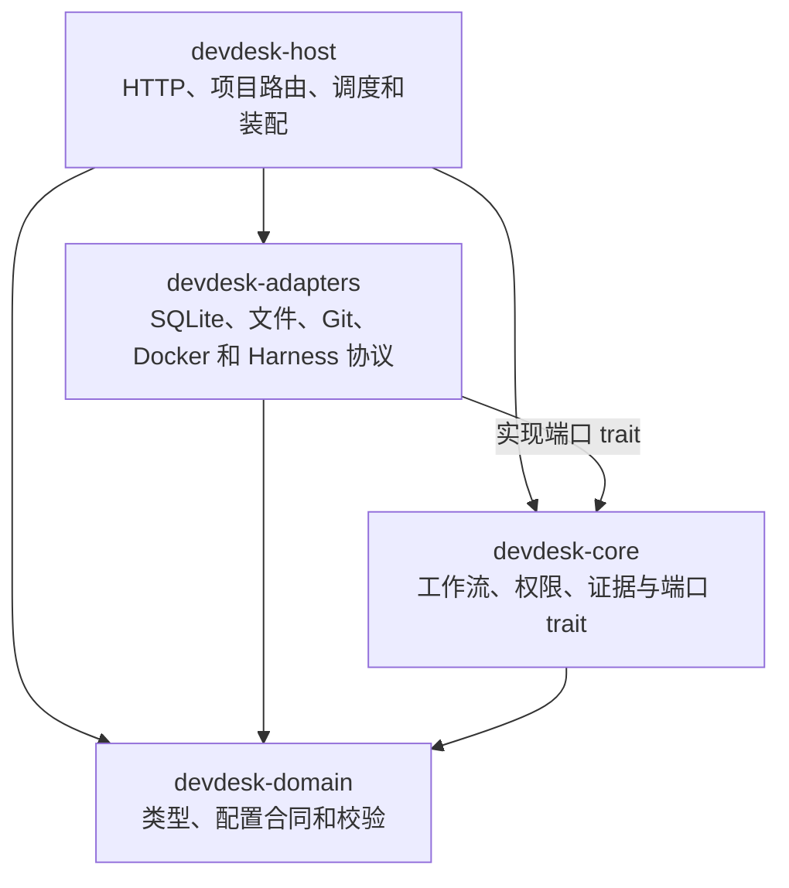
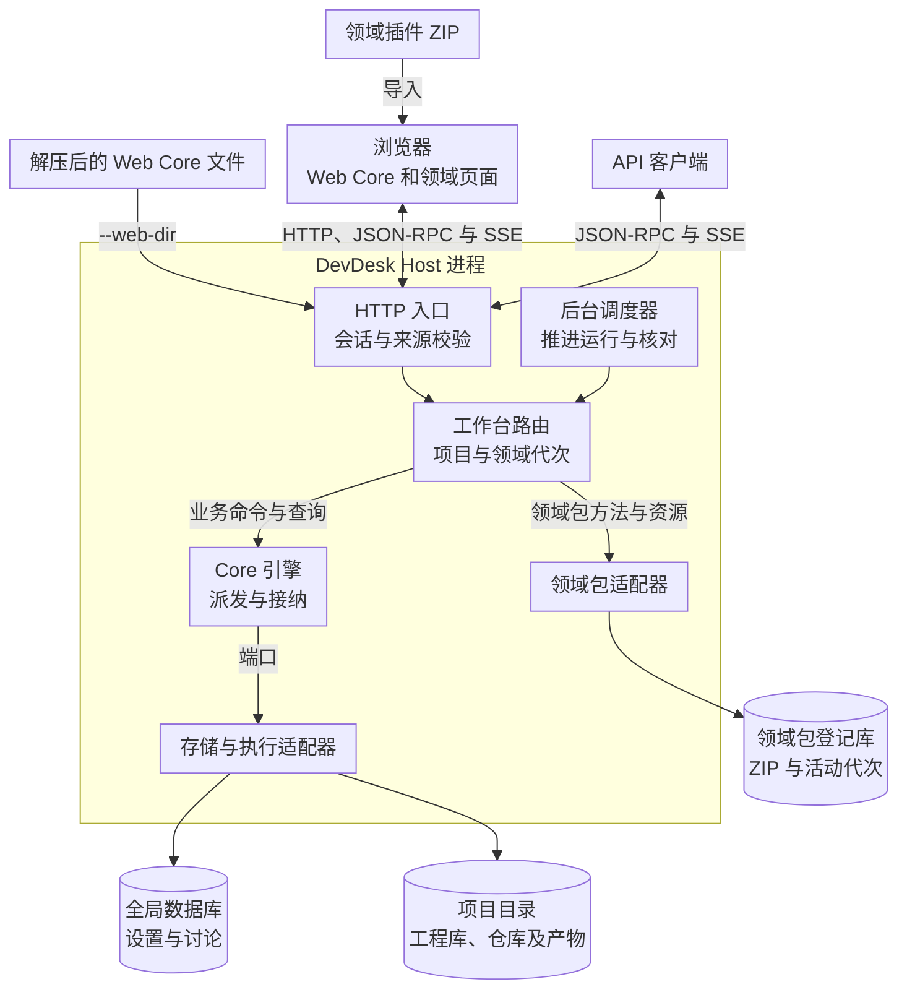
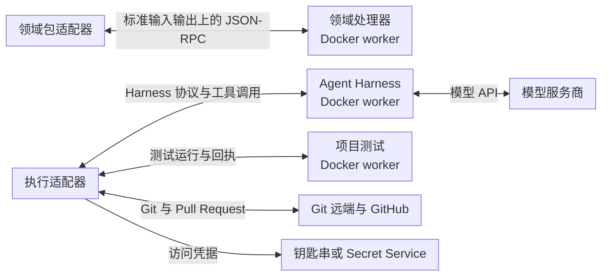
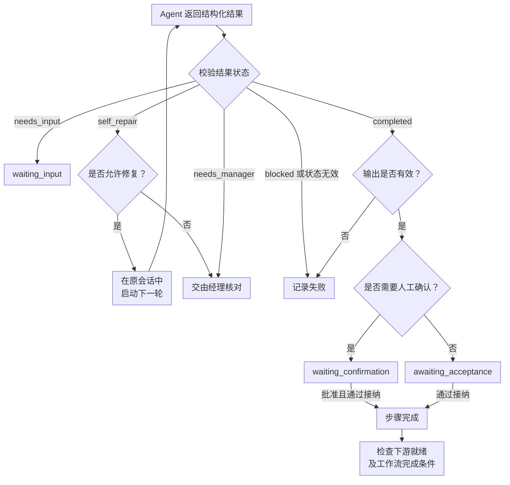

<div align="center">

# DevDesk

**一个本地优先的工作台，用 Agent 自主调度构建黑灯工厂。**

软件开发领域插件实现了**软件开发「黑灯工厂」**。项目经理 Agent 可以自主协调需求分析、设计、
实现、测试、评审和交付，把需求推进到 PR 合入。DevDesk 核验 checkpoint、测试运行、独立评审和
合入回执，并在工作流要求人工决定时暂停等待。


[English](README.md) | **简体中文**

[总览](#总览) · [深入功能](#深入功能) · [快速开始](#快速开始) · [部署形态](#部署形态) · [工作原理](#工作原理) · [协议与 Agent](#协议与-agent) · [文档](#文档)

</div>

---

Rust **Host** 在本地 SQLite 数据库中管理工作流、权限和执行历史。**Web Core** 提供浏览器工作台
和共享 SDK。两者独立发行，**领域插件**则以版本化 ZIP 在运行时安装。其他领域可以沿用同一套调度
和执行引擎，把自己的对象类型、工作流、Role、Skill 和校验规则打包，也可附带运行处理器和工作台页面。
Host 支持从空数据集启动，并通过 HTTP、JSON-RPC 和 SSE 服务非浏览器客户端。

## 总览

| 能力 | 说明 |
| :--- | :--- |
| **工作台 Host** | 单个 Rust 服务在 SQLite 中管理配置、工作项、工作流、Agent 会话、权限和历史，产物正文单独存储。 |
| **可安装的领域包** | 业务配置、运行处理器和 UI 以带逐文件 SHA-256 的版本化 ZIP 交付；运行时即可安装、激活、切换和卸载，无需重新构建 Host。 |
| **基于证据的交付** | 步骤产出回执——工作区 checkpoint、真实测试运行、独立评审结论、远端源版本和合入版本——完成状态是被核验的，而不是被宣称的。 |
| **Agent 自主调度** | 软件开发包默认采用 `agent` 调度，也支持 `manual` 和 `rust`。三种方式共用依赖、权限、接纳和完成规则。 |
| **可替换的 Agent 运行时** | Codex 或 DSH Harness 运行在 Docker Sandbox 内；模型、服务商、工具、Skill 和权限预设都是配置，不是代码。 |
| **一套协议，多种客户端** | 浏览器和非浏览器客户端使用 HTTP、JSON-RPC 2.0 和 SSE。Agent 通过 Harness 会话调用平台工具。 |
| **带回执的 Git 交付** | 源发布、Pull Request、受保护或未受保护的合入、本地同步——每一步都对真实远端状态核实，结果不明时先核对而不是盲目重发。 |
| **权限校验** | 准备运行环境时核验必需的权限后端。后端不可用时阻止执行。 |

## 深入功能

### 四层架构与依赖方向

| 层 | 职责 |
| :--- | :--- |
| `crates/domain` | 纯业务类型、源合同和校验——不做 I/O，不读时钟，不访问环境。 |
| `crates/core` | 应用流程、授权、版本检查和状态变化。持有端口 trait；适配器本身不能推进领域终态。 |
| `crates/adapters` | 具体的外部能力：SQLite 存储、产物文件、Git、GitHub、Docker、Harness 协议、凭据后端。 |
| `crates/host` | 唯一的二进制。HTTP 路由、会话认证、项目作用域、领域代次、后台调度和端口装配。 |



箭头表示 Rust crate 之间的直接依赖。`core` 声明 `Harness`、`Git`、`Tests`、`PullRequests` 和
`ArtifactStore` 等端口，Host 将适配器实现装配进 core 引擎。架构
检查器（`scripts/check/check-architecture.sh`）强制层依赖方向，保证 `domain` 不访问环境，并阻止
Host 直接修改业务状态。

### 领域插件与版本化 ZIP

| ZIP 路径 | 内容 |
| :--- | :--- |
| `manifest.json` | 包 ID、版本、清单格式、声明的对象类型、逐文件 SHA-256，以及运行端和呈现目标。 |
| `configurations/` | 不可变源定义和默认选择、对象类型 Schema、工作流绑定和引用索引。 |
| `runtime/` | 可选 JavaScript 处理器，由 Host 调度到受限的 Docker worker，通过 JSON-RPC 调用。 |
| `ui/` | 可选客户端贡献及其资源。 |

安装时，Host 计算 ZIP 的 SHA-256，并校验清单、逐文件摘要和包内定义。激活是单独的操作，会推进
所有客户端共享的活动代次。一个工作台可激活一个领域，也可以运行在空领域。切换或停用时会检查在途
工作流和待核对的仓库操作。卸载要求该领域的工作流已停止执行，并保留项目数据和历史。

### Web SDK 与共享 React 布局

`web.react` API 2 把领域包的 ES 模块加载进与核心工作台*同一个* React 实例，因此领域页面共用
布局、主题和会话。贡献声明自己的输入、字段以及填充它的查询。SDK 通过 `DomainContext` 提供
活动代次、当前视图及作用域内的查询、请求和订阅接口。前端资源请求必须同时匹配活动包摘要和
当前代次。

软件开发包贡献三个页面：

| 贡献 | 页面 | 数据来源 |
| :--- | :--- | :--- |
| `software-development.branches` | 分支队列 | `query.feature_branches` |
| `software-development.delivery` | Pull Requests 与 Diff | `query.workflow_materials` |
| `software-development.engineering-settings` | 工程设置 | `query.repository` |

### 工作项、工作流调度与回执

软件开发插件用 Project、Feature 和 Task 组织交付。每次运行记录具体执行和产出。返工会创建新的
执行并保留此前的结果。

| 概念 | 含义 | 示例 |
| :--- | :--- | :--- |
| Project | 仓库和工程活动的归属范围 | 一个接入的 GitHub 项目 |
| Feature | 面向完整需求的工作项 | 增加导出报表能力 |
| Task | Feature 下可分工的实现工作项 | 实现导出接口 |
| WorkflowDefinition | 可复用的步骤和依赖定义 | 需求 → 设计 → 实现 → 交付 |
| WorkflowInstance | 为一个工作项启动的具体流程 | 这次报表需求的执行流程 |
| StepDefinition | 步骤的任务、输入输出和执行方式 | 需求分析步骤 |
| StepExecution | 某一步的一次执行记录 | 分析师第一次生成 PRD |

数据依赖来自配置，而不是 Agent 从聊天历史里猜测哪份文档是当前版本：步骤声明命名输出端口，下游
步骤引用 `requirements.result`。`Delivery` 固定输出的结构和来源，`Spec` 固定内容应满足的要求，
`Standard` 冻结一次工程所使用的规范闭包。

谁在推进流程：

| 驱动 | 选择下一步的方式 | 仍需遵守的条件 |
| :--- | :--- | :--- |
| `manual` | 用户从工作台操作 | 依赖、权限、输出与完成规则 |
| `rust` | 程序按配置推进可执行步骤 | 相同规则——并且不能伪造人工决定 |
| `agent` | 项目经理 Agent 通过平台工具读取流程状态、派发已就绪的步骤并处理可恢复故障 | 相同规则，另需配置编排 Role、受支持的 Harness 和工具调用授权 |

发布包中的 Feature 和 Task 工作流都声明了用于自主调度的项目经理 Role。经理可以发起决策请求，
并在配置额度内安排返工。Core 核验步骤输出、接纳和完成条件，将人工确认绑定到确切的输出版本。

每一阶段都留下下一阶段依赖的证据：

| 阶段 | 关键结果 | 下一阶段为何需要 |
| :--- | :--- | :--- |
| 工作区准备 | 仓库、工作树、分支和基准提交 | 确认代码操作属于哪个项目和版本 |
| Checkpoint | 固定提交与 diff | 避免测试期间工作目录变化导致结果含糊 |
| 实际测试 | 候选版本、环境、命令、退出码和报告 | 验证实际代码，不采信模型自述 |
| 独立评审 | 评审对象、结论和内容检查依据 | 确认评审针对本次产物，满足独立性要求 |
| 源发布与目标检查 | 远端源版本、目标版本、试合并结果 | 确认交付的源与目标没有被悄悄更换 |
| 合入与同步 | 远端结果、父提交/tree、本地工作区同步 | 证明交付真实发生并与本地记录一致 |

### 权限、凭据与沙箱

DevDesk 同时管理用户、Agent 和外部进程，因此要回答两个独立的问题：*谁有资格请求某个动作*，
以及*执行这个动作的进程实际上能访问什么*。

| 边界 | 限制方式 |
| :--- | :--- |
| 浏览器 → Host | 连接认证、Host/Origin 校验、明确项目作用域 |
| Agent → 平台工具 | 已发布工具、当前能力、会话/轮次身份、操作权限 |
| Harness 进程 → 文件和命令 | Harness 权限后端和原生工具规则 |
| 容器 → 宿主及网络 | Sandbox 挂载、网络、资源及平台安全策略 |
| Host → 系统凭据库 | 签名 Host 直接使用 macOS 钥匙串，Linux 使用 Secret Service。 |
| 自动流程 → 人工决定 | Human 来源校验，Agent 不可代签 |

执行同时受 **Harness**（运行 Agent 的程序及协议）和 **Sandbox**（容纳该程序的 Docker 容器）约束。
`Profile` 定义权限规则，`Binding` 为 Harness 或 Sandbox 选择 Profile。步骤可以覆盖同层的默认
绑定，实际操作必须同时满足两层规则。无法落实必需规则时，Host 会阻止启动。默认全权限绑定以整个
Harness 容器为信任范围，同一容器内的工具可能访问该次运行的模型凭据和状态。

DevDesk 将保存的 API key 和集成 token 存入**系统凭据库**，配置只保留不透明引用。macOS 上的
`devdesk-host` 验证自身签名以及凭据的服务名和账户范围。Linux 需要 `secret-tool` 和通过 D-Bus
连接的已解锁 Secret Service 会话。Codex OAuth 使用数据集中的私有认证文件。轮换模型 API key
会为后续运行生成新引用。既有运行继续使用冻结的引用，原凭据不可读时会失败。

### 数据、并发与恢复

| 存储范围 | 主要内容 | 边界 |
| :--- | :--- | :--- |
| 全局配置库 | 配置源、默认选择、项目目录、全局设置 | 提供可供项目采用的定义 |
| 领域包登记库 | 已安装的 ZIP、活动领域代次、领域存储设置 | 位于 Host 数据集内 |
| 项目工程库 | 领域对象及其关系、会话、工作流、执行、事件、领域记录 | 请求必须明确选择项目 |
| 全局讨论库 | 不属于任何项目的会话和讨论材料 | 不会回退到任何项目库 |
| 产物目录 | 文档、结构化输出和其他内容 | 数据库保存身份、归属和摘要；读取时核对内容 |
| 运行资源 | 容器、状态目录、Git 工作树、私有认证材料 | 生命周期与业务记录关联，但不在同一事务里 |

每个 Host 数据集由一个 Host 独占锁定。在领域工作台的「设置 → 数据与运行」中，可以指定独立的
领域数据目录。不同 Host 可使用同一个领域目录，各自使用自己的全局设置和凭据。打开活动领域或保存
存储设置时，Host 按原项目 ID 发现兼容项目，并跳过已被其他 Host 锁定的项目。更改目录会设置新项目
的存储位置，也能接回已移动到该目录的项目。已有项目在重新接回之前使用其登记的存储位置。

当前生产布局是 `single-host-domain-packages-v1`，数据标记是 `devdesk-profile-runtime-v2`，SQLite
基线为全局库 `24` 和项目库 `62`。带版本保护的写命令携带 `command_id` 和它读到的对象版本。core
准备有界读写集合，存储适配器在短事务内核对版本并提交。两个人同时从 Feature
修订 5 开始：第一次提交产生修订 6，第二次不能覆盖旧草稿，系统返回 `revision_conflict`，页面保留
草稿与原版本以便核对差异并重新决定。同一条命令 ID 配同样参数重放返回原结果，换参数则被拒绝。

外部操作遵循**先记录意图**的协议：core 先持久化执行身份、输入版本和即将发起的操作，适配器在
*事务之外*完成工作，之后 core 才核对观察是否属于原操作并推进业务状态。崩溃重启后，Host 先查询
原操作和实际资源：已有结果可以接纳，结果不明必须核对。这提供可追踪的恢复路径，但刻意*不是*跨
SQLite、文件和远端服务的统一 exactly-once 事务。

| 继续方式 | 适用情况 | 保留什么 |
| :--- | :--- | :--- |
| 核对 | 不知道外部操作是否已经完成 | 原操作身份、输入、已有观察 |
| 重试 | 确定同一任务可以再次尝试 | 原配置和输入条件、原失败记录 |
| 返工 | 评审拒绝，结果需要业务上的重新处理 | 原拒绝、返工原因、前后执行关系、额度 |
| 计划变更 | 后续步骤或依赖需要调整 | 预览依据、受影响执行的停止结果、旧计划与历史 |
| 恢复推进 | 流程暂停且继续条件成立 | 当前保存状态，不重建全部历史 |

暂停调度不等于正在运行的进程已停止：取消和清理需要适配器提供 worker 已停止、写权限已撤销或
资源已移除的证据。改一个状态字符串无法阻止原容器继续写入。

### 质量与限制

不同测试层证明不同的事情，一层的通过绝不会被当作完整的工程交付验收。

| 层次 | 验证内容 | 不能单独证明 |
| :--- | :--- | :--- |
| domain/core 单元与集成测试 | 规则、状态、配置、版本冲突、恢复决策 | 真实供应商协议或 Docker 环境可用 |
| adapters 存储和协议测试 | SQL 提交、进程消息、权限转换、异常处理 | 所有真实账号和平台都可用 |
| HTTP 与浏览器回归 | 请求合同、项目隔离、显示和交互 | 模型产出质量或远端合入成功 |
| Docker 原生协议验收 | 固定安装与容器的实际协议和隔离行为 | 付费模型推理和真实 GitHub 交付 |
| 真实工程验收 | 指定模型、仓库、认证和机器上的交付过程 | 其他配置、其他平台或全部容量要求 |

根经理编排目前要求 Codex。DeepSeek Harness（DSH）支持普通会话和步骤执行。100 个活跃前端的
容量目标及判据见[并发验收合同](docs/plans/single-host-concurrency/ACCEPTANCE.md)，完整容量仍待正式
验证。兼容的项目库版本 60 和 61 可通过维护命令显式迁移。从早期单体版切换时，请用新数据目录启动
v0.5 并保留原数据。

## 快速开始

### 启动工作台

下载或构建 Host 和 Web Core 压缩包，将对应的 `.sha256` 校验文件放在同一目录。在该目录执行下列
命令，根据实际 Host 文件名替换 `aarch64-apple-darwin`。

```bash
host_archive=devdesk-core-host-0.5.0-aarch64-apple-darwin.tar.gz
web_archive=devdesk-core-web-0.5.0.tar.gz
if command -v sha256sum >/dev/null; then
  sha256sum -c "$host_archive.sha256" "$web_archive.sha256"
else
  shasum -a 256 -c "$host_archive.sha256" "$web_archive.sha256"
fi &&
  tar -xzf "$host_archive" &&
  tar -xzf "$web_archive" &&
  "./${host_archive%.tar.gz}/devdesk-host" --data ./data --web-dir "./${web_archive%.tar.gz}"
```

打开终端显示的地址，默认是 **<http://127.0.0.1:4317>**。首次运行时可以省略 `--data`，在 Web
设置页选择数据目录。只服务 API 客户端时，省略 `--web-dir`，用 `--data` 打开或初始化数据集。

空领域工作台提供基础组件、全局历史、设置和「领域管理」。

| 制品 | 内容 |
| :--- | :--- |
| `devdesk-core-host-0.5.0-<target>.tar.gz` | Rust Host、核心配置及运行资产。支持空领域和纯 API 运行 |
| `devdesk-core-web-0.5.0.tar.gz` | Web Core、共享 React 布局与 UI SDK、领域包 Schema |
| `software-development-0.5.2.zip` | 软件开发配置、Node.js 运行时扩展和领域页面 |

> `devdesk-core-host` / `devdesk-core-web` 中的 `core` 指的是**领域无关的核心发行版**，不是
> `devdesk-core` 这个 Rust crate。

### 安装软件开发领域插件

在已经启动的工作台打开「领域管理」，导入 `software-development-0.5.2.zip`，再点击「激活」。
领域工作台在同一浏览器会话中渲染，与核心工作台共用导航、布局和会话。领域包可在 Host 运行时
加载、切换和卸载。

接入仓库或调用领域处理器前，在 Host 使用的 Docker 引擎中拉取领域运行端固定的 Node 镜像。

```bash
docker pull node@sha256:4660b1ca8b28d6d1906fd644abe34b2ed81d15434d26d845ef0aced307cf4b6f
```

### 运行交付工作流

1. 在「设置 → GitHub 连接」验证 GitHub 认证，再用「打开 GitHub 项目」接入仓库并选择主分支。
2. 配置模型认证并验证 Harness 和 Sandbox。在项目设置中核对 Workflow、Standard、Role 到 Agent
   的绑定和测试配置。自主编排请选择「Agent 调度」，也可在项目配置中选择「Rust 自动调度」或「人工控制」。
3. 创建 Feature 并填写初始需求，在「执行与交付」点击「启动 Feature」。运行采用项目选定的调度模式。
4. 检查 PRD、设计、Task 方案、独立 Red/Green 测试和评审结果。在配置要求人工审批的步骤确认确切的输出版本。
5. 在交付页跟踪源发布、候选、回归测试、PR 合入及本地同步回执。

完整 GitHub 交付流程需要 Docker、Git、GitHub CLI、GitHub 授权，以及可用的模型服务连接。

### 从源码开发

仓库固定 **Rust 1.99.1** 和 **Node 24**。本地 Python 版本固定为 **3.12**，CI 的 Rust 检查使用
**3.13**。见 `rust-toolchain.toml`、`.nvmrc`、`.python-version` 和 CI 工作流。

```bash
./scripts/dev/dev.sh --data ./data --port 4317
```

`dev.sh` 在缺少前端依赖时安装依赖，构建 Web Core 和 debug Host，然后转发参数并启动。macOS 上
如需访问钥匙串，请在构建前配置稳定签名身份。见 [macOS 签名与钥匙串](docs/crates/devdesk-adapters/signing-and-keychain.md)。

分别构建发行制品。

```bash
./scripts/release/package.sh host
./scripts/release/package.sh web
./scripts/release/package.sh software-development
```

默认输出在 `dist/`，每份制品都附带一个 `.sha256` 文件。Host 可独立于 Node、Web 构建产物和领域
源码构建。

Host 默认使用体积优先的 `size` 配置。使用 `host --profile speed` 启用常规速度优化，或用
`host --profile symbols` 保留符号供诊断。

完整回归还需要 Docker 和 Chromium。各套件的运行环境要求见[测试索引](tests/README.md)。

```bash
python3 -m venv .venv
source .venv/bin/activate
python3 -m pip install -r scripts/check/requirements.txt
npm --prefix web ci
(cd web && npx playwright install chromium)
./scripts/check/check.sh
```

## 部署形态

Host 默认只监听 loopback，并独占自己的数据集。配置可访问的地址和连接密钥后，同一个 Host 也可
服务远程浏览器和 API 客户端。

| 形态 | 数据 | 进程 | 远程访问 |
| :--- | :--- | :--- | :--- |
| 本地（默认） | Host 数据集和可选的领域数据目录 | Host 及按需启动的 Docker worker | 仅 loopback |
| 远程 | Host 所在机器使用同样的布局 | Host 和 worker 在目标机器上运行 | 远程访问需要 `DEVDESK_ACCESS_TOKEN`。监听所有网卡或公开来源与监听地址不同时，设置 `--public-url`。 |

```bash
# 将 DEVDESK_ACCESS_TOKEN 导出为环境变量，值为 32–512 个可打印、不含空格的随机 ASCII 字符。
# 在制品解压目录执行，host_archive 和 web_archive 沿用上文设置。
"./${host_archive%.tar.gz}/devdesk-host" --host 192.168.1.10 --port 4317 --data ./data \
  --web-dir "./${web_archive%.tar.gz}"
```

将 `192.168.1.10` 换成 Host 的局域网地址。客户端通过「连接内核」打开工作台，输入同一连接密钥。
数据、Git、凭据和 Docker 操作都由 Host 机器管理。反向代理提供 HTTPS 时，设置
`--public-url https://desk.example` 并传递匹配的
Host/Origin；监听 `0.0.0.0` 或 `::` 必须指定公开地址。明文 HTTP 只用于可信网络或隧道。

在启用 AppArmor 的 Linux 上，受限嵌套沙箱需要 DevDesk 专用策略。在解压后的 Host 目录中查看、
检查并安装策略。

```bash
./devdesk-host sandbox-policy --print
./devdesk-host sandbox-policy --check
sudo ./devdesk-host sandbox-policy --install
```

安装器只加载 DevDesk 专用策略，Host 会校验资产和权限。默认全权限绑定不要求该嵌套策略。

## 工作原理

### 客户端、Host 与数据



每个浏览器标签页独立选择项目，并共享工作台的活动领域。领域包登记库位于 Host 数据集中。项目目录也可
位于单独配置的领域数据目录。项目登记保存原领域 ID 和包摘要。工作流运行冻结适用的配置源修订和领域包
绑定，供执行及恢复使用。

### 执行与外部服务



领域处理器、Agent Harness 和测试 worker 使用各自的 Docker 执行环境。已获授权的 Agent 通过
Harness 协议调用平台工具，core 校验每次工具操作是否可以推进工作流。

### Agent 步骤生命周期

Agent 步骤通常按以下过程推进。

1. 客户端向 `/rpc` 提交命令，带上 `command_id` 和它读到的版本。
2. core 检查依赖、调用者权限、对象版本和执行预算。
3. core 保存输入和待执行操作。派发命令的成功 RPC 响应表示操作已登记，执行继续在后台进行。
4. Host 的后台调度创建会话，适配器启动 Harness，Agent 产出结果。
5. core 按声明的输出端口、`Delivery` 和 `Spec` 校验输出，保存产物和输出记录。合格输出进入
   `awaiting_acceptance`，需要人工的步骤进入 `waiting_confirmation`。
6. 接纳、人工决定和完成规则推进流程。产物写入和 SQL 提交分开进行——长数据库事务内不做外部 I/O。



## 协议与 Agent

Host 暴露的接口面很小且稳定。`GET /connection` 是唯一允许跨源的入口，返回产品名、协议版本和是否
需要认证——它不发放会话。`POST /session` 用连接密钥建立会话，密钥不进入 URL。

| 入口 | 作用 | 关键约束 |
| :--- | :--- | :--- |
| `GET /connection` | 探测产品、协议和认证要求 | 可跨源探测，不发放认证会话 |
| `POST /session` | 用连接密钥建立会话 | `HttpOnly`、`SameSite=Strict`；密钥不进入 URL |
| `POST /rpc` | 请求应用命令或查询 | JSON-RPC 2.0，必须有 id；不支持 batch/notification |
| `GET /events` | 订阅事件 | 明确作用域；游标只属于相应事件流 |
| `GET /domain-events` | 领域事件流 | 连接时收到当前代次，后续收到 `domain` 事件 |
| `GET /domain-assets/{epoch}/{digest}/{path}` | 读取活动包的渲染资源 | 当前代次和摘要都需匹配 |
| `GET /artifacts/{id}` | 读取项目产物 | 提供 `project_id`，领域项目还需 `domain_epoch`。Host 核验产物摘要。 |
| `GET /capabilities` | 查询协议、能力和生命周期 | 能力声明不代表实际运行已通过 |
| `POST /setup` | 打开数据集 | 需要原 Host 实例和生命周期版本 |
| `POST /shutdown` | 请求停机 | 需要可信用户来源及生命周期前置条件 |

```json
{"jsonrpc":"2.0","id":1,"method":"query.domain.active","params":{}}
```

用 `query.domain.active` 查询当前 `epoch` 和活动包。`domain.activate`、`domain.workflow.start`、
`query.domain.contribution` 等领域包接口使用 `epoch`。`domain.install` 的 `archive` 参数接收
Base64 编码的 ZIP。

`query.workspace`、`workflow.step.dispatch` 等项目级请求提供 `project_id`，领域项目还需
`domain_epoch`。项目事件流在 URL 查询中使用同名参数。带版本保护的写命令通常携带 `command_id`、
`target`、`expected_revision` 和 `payload`。资源提交通过 `meta.commit` 返回命名空间、版本和游标。

### 平台工具

Agent 不能调用任意 RPC 方法。平台工具有明确的注册表、manifest 发布的定义和每个会话的可用集合，
这三份集合并不等价。

| 调用面 | 调用者与入口 | 身份来源 |
| :--- | :--- | :--- |
| HTTP / JSON-RPC / SSE | 浏览器 → Host | Host 会话及请求作用域 |
| 动态平台工具 | Harness 协议中的工具请求 | 关联的 Agent、Session、Turn 和工具定义 |
| Rust 内部端口 | Engine 和后台调度 | 应用流程准备好的执行请求 |

核心平台工具包括 `workflow.step.dispatch`、`workflow.step.accept`、`workflow.outputs.read`、
`workflow.inspect`、`workflow.execution.inspect`、`workflow.events.read`、`workflow.complete`
和 `workflow.decision.request`。软件开发包另外发布配置、流程控制和工程交付的工具定义。各 Harness
也会按会话权限提供自己的原生工具。

## 文档

| 要完成的事 | 阅读入口 |
| :--- | :--- |
| 理解系统与分层 | [系统总览](docs/design/overview.md) · [分层与依赖](docs/design/layers.md) · [核心概念](docs/design/domain-model.md) |
| 安装、运行与排查 Host | [运行指南](docs/design/run-binary.md) |
| 开发领域包或接入其他客户端 | [领域包架构](docs/design/domain-packages.md) · [RPC 参考](docs/design/reference/rpc.md) |
| 配置 Agent、Role、模型和权限 | [配置如何生效](docs/design/configuration.md) · [权限与凭据](docs/design/security.md) |
| 跟进从需求到交付的流程 | [工作流](docs/design/workflow.md) · [Agent 运行](docs/design/agent-runtime.md) · [工程交付](docs/design/engineering-delivery.md) |
| 理解客户端与工具面 | [工具和接口](docs/design/interfaces.md) · [工具和调度原语](docs/design/reference/tools-and-primitives.md) |
| 接入外部服务 | [外部接入](docs/design/reference/integrations.md) · [数据格式](docs/design/reference/contracts.md) |
| 理解存储、并发和恢复 | [数据、并发与恢复](docs/design/data-and-recovery.md) |
| 阅读或修改实现 | [代码手册](docs/crates/README.md) · [跨模块调用链](docs/crates/execution-flows.md) · [仓库指南](AGENT.md) |
| 运行测试和扩展测试 | [测试索引](tests/README.md) · [测试与扩展](docs/crates/testing-and-extension.md) |
| 构建、检查与发布 | [脚本索引](scripts/README.md) · [Rust 规范](docs/crates/standards/rust.md) · [Web 规范](docs/crates/standards/web.md) |
| 浏览其余全部内容 | [文档索引](docs/README.md) · [设计主题](docs/design/README.md) · [术语表](docs/design/glossary.md) |

其余内容——机制、运行手册、验收记录和历史基准——都在[文档索引](docs/README.md)、
[计划归档](docs/plans/README.md)和[基准归档](docs/benchmarks/README.md)里。

## 许可

仓库目前未提供根级 `LICENSE` 文件。第三方组件的许可随依赖或权限资产保留——例如
`permissions/backends/docker/upstream/` 下的 Moby seccomp 与 AppArmor 基线，OpenAI Codex CLI
（`Apache-2.0`）和 DeepSeek Harness（`MIT`）的 Harness 定义。
