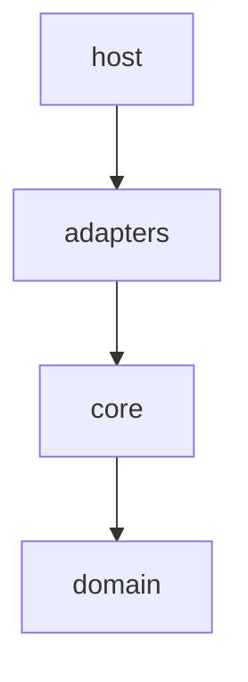
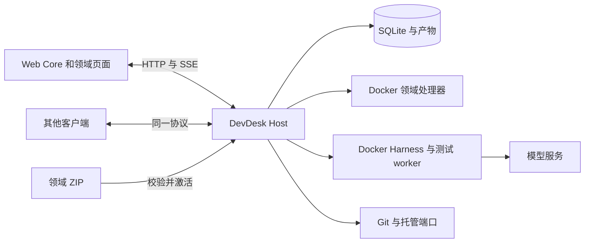
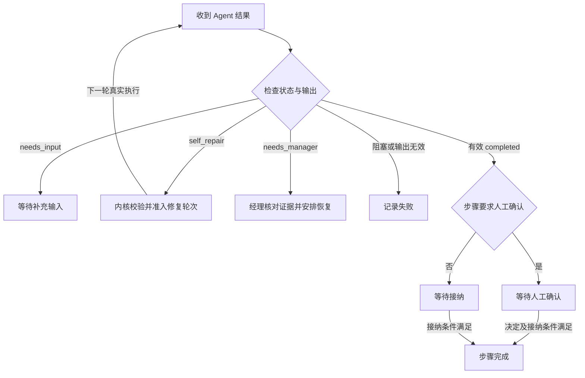

<div align="center">

# DevDesk

**一个本地优先的工作台，把 Agent 驱动的软件交付变成可核验的工作流。**

从需求到 PR 合入——每一步都产出真实回执（测试运行、checkpoint、独立评审、合入确认），而不是
Agent 的一段总结。单个 Rust Host 把配置、工作流、会话、权限和历史保存在你自己掌控的 SQLite
数据集里。


[English](README.md) | **简体中文**

[总览](#总览) · [深入功能](#深入功能) · [快速开始](#快速开始) · [工作原理](#工作原理) · [协议与 Agent](#协议与-agent) · [文档](#文档)

</div>

---

DevDesk 把需求、Agent 执行、工程验证和人工决定组织成可追踪的工作流。Host 管理状态和执行资源，
Agent 完成具体任务，用户通过 Web 工作台查看结果并作出决定。

三份制品独立交付：Rust **Host**（工作台服务）、**Web Core**（浏览器界面，以及领域包使用的共享
SDK），以及**领域包**——业务配置、运行处理器和领域页面——以带版本号的 ZIP 在运行时加载。Host
可以从空数据目录启动，只使用 HTTP、JSON-RPC 和 SSE，因此非浏览器客户端无需加载任何前端资源即可
驱动同一套产品。

## 总览

| 能力 | 说明 |
| :--- | :--- |
| **工作台 Host** | 单个 Rust 服务，把配置、工作项、工作流、Agent 会话、权限、产物和历史统一放在本地 SQLite 数据集里。 |
| **可安装的领域包** | 业务配置、运行处理器和 UI 以带逐文件 SHA-256 的版本化 ZIP 交付；运行时即可安装、激活、切换和卸载，无需重新构建 Host。 |
| **基于证据的交付** | 步骤产出回执——工作区 checkpoint、真实测试运行、独立评审结论、远端源版本和合入版本——完成状态是被核验的，而不是被宣称的。 |
| **三种调度方式** | `manual`、`rust` 和 `agent` 决定由*谁*推进流程，但共用同一套依赖、权限、接纳和完成规则。 |
| **可替换的 Agent 运行时** | Codex 或 DSH Harness 运行在 Docker Sandbox 内；模型、服务商、工具、Skill 和权限预设都是配置，不是代码。 |
| **一套协议，多种客户端** | HTTP、JSON-RPC 2.0 和 SSE 同时服务浏览器、原生客户端和 Agent 平台工具；领域页面与核心工作台渲染在同一个 React 树里。 |
| **带回执的 Git 交付** | 源发布、Pull Request、受保护或未受保护的合入、本地同步——每一步都对真实远端状态核实，结果不明时先核对而不是盲目重发。 |
| **诚实的边界** | 缺少必需的权限后端会让运行失败，而不是假装已经隔离；能力声明永远不能代替一次真实通过的执行。 |

## 深入功能

### 架构：四层，一个依赖方向

| 层 | 职责 |
| :--- | :--- |
| `crates/domain` | 纯业务类型、源合同和校验——不做 I/O，不读时钟，不访问环境。 |
| `crates/core` | 应用流程、授权、版本检查和状态变化。持有端口 trait；适配器本身不能推进领域终态。 |
| `crates/adapters` | 具体的外部能力：SQLite 存储、产物文件、Git、GitHub、Docker、Harness 协议、凭据后端。 |
| `crates/host` | 唯一的二进制。HTTP 路由、会话认证、项目作用域、领域代次、后台调度和端口装配。 |



编译期依赖只有一个方向。运行期方向通过 trait 反转：`core` 声明 `Harness`、`Git`、`Tests`、
`PullRequests`、`ArtifactStore` 等端口，`adapters` 实现它们，Host 把具体对象装配进 Engine。架构
检查器（`scripts/check/check-architecture.sh`）强制层依赖方向，保证 `domain` 不访问环境，并阻止
Host 直接修改业务状态。

### 领域包：把业务配置做成版本化 ZIP

| ZIP 路径 | 内容 |
| :--- | :--- |
| `manifest.json` | 包 ID、版本、清单格式、声明的对象类型、逐文件 SHA-256，以及运行端和呈现目标。 |
| `configurations/` | 不可变源定义和默认选择、对象类型 Schema、工作流绑定和引用索引。 |
| `runtime/` | 可选 JavaScript 处理器，由 Host 调度到受限的 Docker worker，通过 JSON-RPC 调用。 |
| `ui/` | 可选客户端贡献及其资源。 |

Host 在安装时核对包摘要和每个文件的摘要，然后在运行时激活包。激活会为所有已连接客户端推进活动
代次；一个工作台只有一个活动领域，也可以为空。只有当该领域有工作流正在执行时才会拒绝卸载——
排队、阻塞、等待输入以及已停下的暂停流程都可以卸载，项目数据保留。

### Web SDK：领域页面在同一个 React 树里

`web.react` API 2 把领域包的 ES 模块加载进与核心工作台*同一个* React 实例，因此领域页面共用
布局、主题和会话。贡献声明自己的输入、字段以及填充它的查询；SDK 交给页面的 `DomainContext`
携带活动代次、当前项目、RPC 调用、请求辅助和事件订阅。前端资源请求必须同时匹配活动包摘要和
当前代次。

软件开发包贡献三个页面：

| 贡献 | 页面 | 数据来源 |
| :--- | :--- | :--- |
| `software-development.branches` | 分支队列 | `query.feature_branches` |
| `software-development.delivery` | Pull Requests 与 Diff | `query.workflow_materials` |
| `software-development.engineering-settings` | 工程设置 | `query.repository` |

### 工作流：工作项、驱动方式与回执

DevDesk 区分*准备做的工作*、*一次实际执行*和*执行产生的结果*。同一个任务可以有多次执行，
返工不会让旧结果消失。

| 概念 | 含义 | 示例 |
| :--- | :--- | :--- |
| Project | 仓库和工程活动的归属范围 | 一个接入的 GitHub 项目 |
| Feature | 面向完整需求的工作项 | 增加导出报表能力 |
| Task | Feature 下可分工的实现工作项 | 实现导出接口 |
| WorkflowDefinition | 可复用的步骤和依赖定义 | 需求 → 设计 → 实现 → 交付 |
| WorkflowInstance | 为一个工作项启动的具体流程 | 这次报表需求的执行流程 |
| StepDefinition | 步骤的任务、输入输出和执行方式 | 需求分析步骤 |
| StepExecution | 某一步的一次执行记录 | 分析师第一次生成 PRD |

数据依赖来自配置，而不是 Agent 从聊天历史里猜测哪份文档是当前版本：步骤声明命名输出端口，下游
步骤引用 `requirements.result`。`Delivery` 固定输出的结构和来源，`Spec` 固定内容应满足的要求，
`Standard` 冻结一次工程所使用的规范闭包。

谁在推进流程：

| 驱动 | 选择下一步的方式 | 仍需遵守的条件 |
| :--- | :--- | :--- |
| `manual` | 用户从工作台操作 | 依赖、权限、输出与完成规则 |
| `rust` | 程序按配置推进可执行步骤 | 相同规则——并且不能伪造人工决定 |
| `agent` | 经理通过平台工具检查和调度 | 相同规则，另需会话及工具调用授权 |

经理可以派发、查看、请求决定和发起受限返工。它不能靠一句「已完成」替代规则检查，也不能把自己
声明为 Human。

每一阶段都留下下一阶段依赖的证据：

| 阶段 | 关键结果 | 下一阶段为何需要 |
| :--- | :--- | :--- |
| 工作区准备 | 仓库、工作树、分支和基准提交 | 确认代码操作属于哪个项目和版本 |
| Checkpoint | 固定提交与 diff | 避免测试期间工作目录变化导致结果含糊 |
| 实际测试 | 候选版本、环境、命令、退出码和报告 | 验证实际代码，不采信模型自述 |
| 独立评审 | 评审对象、结论和内容检查依据 | 确认评审针对本次产物，满足独立性要求 |
| 源发布与目标检查 | 远端源版本、目标版本、试合并结果 | 确认交付的源与目标没有被悄悄更换 |
| 合入与同步 | 远端结果、父提交/tree、本地工作区同步 | 证明交付真实发生并与本地记录一致 |

### 权限、凭据与沙箱

DevDesk 同时管理用户、Agent 和外部进程，因此要回答两个独立的问题：*谁有资格请求某个动作*，
以及*执行这个动作的进程实际上能访问什么*。

| 边界 | 限制方式 |
| :--- | :--- |
| 浏览器 → Host | 连接认证、Host/Origin 校验、明确项目作用域 |
| Agent → 平台工具 | 已发布工具、当前能力、会话/轮次身份、操作权限 |
| Harness 进程 → 文件和命令 | Harness 权限后端和原生工具规则 |
| 容器 → 宿主及网络 | Sandbox 挂载、网络、资源及平台安全策略 |
| Host → 系统凭据库 | 平台凭据接口；macOS 使用验证过的固定签名助手 |
| 自动流程 → 人工决定 | Human 来源校验，Agent 不可代签 |

执行被限制两次：外层是 **Harness**（模型程序及其协议），内层是 **Sandbox**（它运行的容器）。
`Profile` 是权限规则的来源，`Binding` 选择把哪份 Profile 应用到哪个 Harness 或 Sandbox；步骤可以
替换同层默认绑定，但实际操作必须*同时*满足两层限制。无法落实的规则会阻止启动——DevDesk 绝不
以「尽量限制」的方式假装成功。注意默认全权限绑定把整个 Harness 容器作为信任范围：同容器的工具
可能访问该次运行的模型凭据和状态。

API key 和工具 token 存在**系统凭据库**，配置中只保存不透明引用。macOS 上由证书签名的
`devdesk-host` 直接访问钥匙串，并验证自身签名和凭据的服务名与账户范围。Linux 需要
`secret-tool` 和已解锁的 Secret Service / D-Bus 会话——不降级为明文 API key 文件。更新密钥产生
新引用，既有运行仍绑定原引用；原凭据不可读时运行应报告失败，而不是悄悄换用新密钥。

### 数据、并发与恢复

| 存储范围 | 主要内容 | 边界 |
| :--- | :--- | :--- |
| 全局配置库 | 活动领域代次、已安装包、配置源、默认选择、项目目录、全局设置 | 提供可供项目采用的定义 |
| 项目工程库 | 领域对象及其关系、会话、工作流、执行、事件、领域记录 | 请求必须明确选择项目 |
| 全局讨论库 | 不属于任何项目的会话和讨论材料 | 不会回退到任何项目库 |
| 产物目录 | 文档、结构化输出和其他内容 | 数据库保存身份、归属和摘要；读取时核对内容 |
| 运行资源 | 容器、状态目录、Git 工作树、私有认证材料 | 生命周期与业务记录关联，但不在同一事务里 |

当前生产布局为 `single-host-domain-packages-v1`，数据标记为 `devdesk-profile-runtime-v2`，
SQLite 基线为 global `24`、project `62`。每条命令都携带自己的 `command_id` 和它读取的对象
版本：core 准备有界读集合和写集合，存储适配器在短事务内核对这些版本并提交。两个人同时从 Feature
修订 5 开始：第一次提交产生修订 6，第二次不能覆盖旧草稿，系统返回 `revision_conflict`，页面保留
草稿与原版本以便核对差异并重新决定。同一条命令 ID 配同样参数重放返回原结果，换参数则被拒绝。

外部操作遵循**先记录意图**的协议：core 先持久化执行身份、输入版本和即将发起的操作，适配器在
*事务之外*完成工作，之后 core 才核对观察是否属于原操作并推进业务状态。崩溃重启后，Host 先查询
原操作和实际资源：已有结果可以接纳，结果不明必须核对。这提供可追踪的恢复路径，但刻意*不是*跨
SQLite、文件和远端服务的统一 exactly-once 事务。

| 继续方式 | 适用情况 | 保留什么 |
| :--- | :--- | :--- |
| 核对 | 不知道外部操作是否已经完成 | 原操作身份、输入、已有观察 |
| 重试 | 确定同一任务可以再次尝试 | 原配置和输入条件、原失败记录 |
| 返工 | 评审拒绝，结果需要业务上的重新处理 | 原拒绝、返工原因、前后执行关系、额度 |
| 计划变更 | 后续步骤或依赖需要调整 | 预览依据、受影响执行的停止结果、旧计划与历史 |
| 恢复推进 | 流程暂停且继续条件成立 | 当前保存状态，不重建全部历史 |

暂停调度不等于正在运行的进程已停止：取消和清理需要适配器提供 worker 已停止、写权限已撤销或
资源已移除的证据。改一个状态字符串无法阻止原容器继续写入。

### 质量与限制

不同测试层证明不同的事情，一层的通过绝不会被当作完整的工程交付验收。

| 层次 | 验证内容 | 不能单独证明 |
| :--- | :--- | :--- |
| domain/core 单元与集成测试 | 规则、状态、配置、版本冲突、恢复决策 | 真实供应商协议或 Docker 环境可用 |
| adapters 存储和协议测试 | SQL 提交、进程消息、权限转换、异常处理 | 所有真实账号和平台都可用 |
| HTTP 与浏览器回归 | 请求合同、项目隔离、显示和交互 | 模型产出质量或远端合入成功 |
| Docker 原生协议验收 | 固定安装与容器的实际协议和隔离行为 | 付费模型推理和真实 GitHub 交付 |
| 真实工程验收 | 指定模型、仓库、认证和机器上的交付过程 | 其他配置、其他平台或全部容量要求 |

当前限制是明确的：一个数据集由一个 Host 管理；根经理编排要求 Codex Harness，因为 DSH 声明了普通
会话和步骤工具，但没有声明该能力；工作流运行时以至少 100 个活跃前端为容量要求，由单独的验收
合同跟踪；旧数据迁移是显式维护命令，不是自动启动行为。

## 快速开始

### 启动工作台

Host 和 Web Core 是两份独立制品。从发行渠道取得它们和对应的 SHA-256 校验文件，解压前先核对。

```bash
sha256sum -c devdesk-core-host-0.5.0-<target>.tar.gz.sha256
sha256sum -c devdesk-core-web-0.5.0.tar.gz.sha256

tar -xzf devdesk-core-host-0.5.0-<target>.tar.gz    # → devdesk-core-host-0.5.0-<target>/devdesk-host
tar -xzf devdesk-core-web-0.5.0.tar.gz              # → devdesk-core-web-0.5.0/
```

```bash
./devdesk-host --data ./data --web-dir ./devdesk-core-web-0.5.0
```

打开终端显示的地址，默认是 **<http://127.0.0.1:4317>**。首次运行时可以省略 `--data`——Web
设置页会要求选择一个空目录。省略 `--web-dir` 时，Host 只提供客户端协议，不带界面。

空领域工作台提供基础组件、全局历史、设置和「领域管理」。

| 制品 | 内容 |
| :--- | :--- |
| `devdesk-core-host-0.5.0-<target>.tar.gz` | Rust Host、核心配置及运行资产。支持空领域和纯 API 运行 |
| `devdesk-core-web-0.5.0.tar.gz` | Web Core、共享 React 布局与 UI SDK、领域包 Schema |
| `software-development-0.5.2.zip` | 软件开发配置、Node.js 运行时扩展和领域页面 |

> `devdesk-core-host` / `devdesk-core-web` 中的 `core` 指的是**领域无关的核心发行版**，不是
> `devdesk-core` 这个 Rust crate。

### 安装软件开发领域

在已经启动的工作台打开「领域管理」，导入 `software-development-0.5.2.zip`，再点击「激活」。
领域工作台在同一浏览器会话中渲染，与核心工作台共用导航、布局和会话。领域包可在 Host 运行时
加载、切换和卸载。

领域运行端需要固定的 Node 基础镜像：

```bash
docker pull node@sha256:4660b1ca8b28d6d1906fd644abe34b2ed81d15434d26d845ef0aced307cf4b6f
```

### 运行交付工作流

1. 激活软件开发包，在工程设置中配置 GitHub 认证并接入仓库。
2. 配置模型认证、工作流、Standard、Role 到 Agent 的绑定及测试环境。准备 Harness/Sandbox 时，
   Host 会验证实际 Docker 镜像和权限资产。
3. 创建 Feature，在执行页选择人工、Rust 或 Agent 调度。三个模式共用步骤输入、产物、审批与接纳
   规则。
4. 检查 PRD、设计、Task 列表、独立 Red/Green 和评审产物，在需要人工确认的步骤核对确切版本并
   签署。
5. 在交付页跟踪源发布、候选、回归测试、PR 合入及本地同步回执。

运行软件开发领域需要 Docker、Git、GitHub CLI，以及实际使用的 GitHub 和模型服务认证。

### 从源码开发

仓库固定 **Rust 1.99.1**、**Node 24** 和 **Python 3.12**（`rust-toolchain.toml`、`.nvmrc`、
`.python-version`；CI 使用 Python 3.13）。

```bash
python3 -m venv .venv
source .venv/bin/activate
python3 -m pip install -r scripts/check/requirements.txt
npm --prefix web ci

./scripts/dev/dev.sh --data ./data --port 4317
```

`dev.sh` 安装前端依赖、构建 Web Core 和 debug Host，在 macOS 上签名并启动，参数直接传给 Host。
独立生成发行制品：

```bash
./scripts/release/package.sh host
./scripts/release/package.sh web
./scripts/release/package.sh software-development
```

默认输出在 `dist/`，每份制品都附带一个 `.sha256` 文件。Host 可独立于 Node、Web 构建产物和领域
源码构建。

Host 默认使用体积优先的 `size` 配置。使用 `host --profile speed` 启用常规速度优化，或用
`host --profile symbols` 保留符号供诊断。

完整回归还需要 Docker 和 Chromium：

```bash
python3 -m pip install -r scripts/check/requirements.txt
npm --prefix web ci
(cd web && npx playwright install chromium)
./scripts/check/check.sh
```

## 部署形态

默认形态是单个 Host 独占一个本地数据集。由于 Host 默认只监听 loopback，并且只使用 HTTP、
JSON-RPC 和 SSE，同一套安装也可以服务远程客户端和非浏览器工具。

| 形态 | 数据 | 进程 | 远程访问 |
| :--- | :--- | :--- | :--- |
| `local`（默认） | 一个目录里的单个 SQLite 数据集，产物并列存放 | 一个 Host，加上它启动的 Docker worker | 仅 loopback |
| `remote` | 同样的布局，位于持有 Docker、Git 和凭据的机器上 | 同上，位于目标机器 | 需要 `DEVDESK_ACCESS_TOKEN` 和明确的 `--public-url` |

```bash
# 远程监听需要 32–512 个非空白 ASCII 字符的连接密钥。
export DEVDESK_ACCESS_TOKEN='…'
./devdesk-host --host 192.168.1.10 --port 4317 --data "/完整路径/DevDesk 数据" \
  --web-dir ./devdesk-core-web-0.5.0
```

客户端通过「连接内核」探测并打开目标工作台，输入同一连接密钥。数据、Docker、Git 和凭据均位于
目标 Host 机器。反向代理提供 HTTPS 时配置 `--public-url https://desk.example`，并传递匹配的
Host/Origin；监听 `0.0.0.0` 或 `::` 必须指定公开地址。明文 HTTP 只用于可信网络或隧道。

在 Linux 上，受限嵌套沙箱还需要 DevDesk 专用 AppArmor 策略：

```bash
./devdesk-host sandbox-policy --print
./devdesk-host sandbox-policy --check
sudo ./devdesk-host sandbox-policy --install
```

安装器只加载 DevDesk 专用策略，Host 会校验资产和权限。默认全权限绑定不要求该嵌套策略。

## 工作原理



Host 运行在持有数据集和 Docker 的机器上。已连接客户端共享活动领域，每个标签页各自选择项目——
不存在所有浏览器共用的「当前项目」。领域 Web 页面由 Web Core 加载进共享 React 布局。领域运行
处理器与 Agent Harness 分别在 Docker 进程中执行，项目和运行保存确切的领域包摘要及配置闭包。

一次请求通常这样推进：

1. 客户端向 `/rpc` 提交命令，带上 `command_id` 和它读到的版本。
2. core 检查依赖、调用者权限、对象版本和执行预算。
3. core 保存本次输入和待执行操作，然后返回——耗时工作继续在后台进行。HTTP 调用成功意味着请求被
   *接纳*，而不是已经完成。
4. Host 的后台调度创建会话，适配器启动 Harness，Agent 产出结果。
5. core 按声明的输出端口、`Delivery` 和 `Spec` 校验输出，保存产物和输出记录。合格输出进入
   `awaiting_acceptance`，需要人工的步骤进入 `waiting_confirmation`。
6. 接纳、人工决定和完成规则推进流程。产物写入和 SQL 提交分开进行——长数据库事务内不做外部 I/O。



## 协议与 Agent

Host 暴露的接口面很小且稳定。`GET /connection` 是唯一允许跨源的入口，返回产品名、协议版本和是否
需要认证——它不发放会话。`POST /session` 用连接密钥建立会话，密钥不进入 URL。

| 入口 | 作用 | 关键约束 |
| :--- | :--- | :--- |
| `GET /connection` | 探测产品、协议和认证要求 | 可跨源探测，不发放认证会话 |
| `POST /session` | 用连接密钥建立会话 | `HttpOnly`、`SameSite=Strict`；密钥不进入 URL |
| `POST /rpc` | 请求应用命令或查询 | JSON-RPC 2.0，必须有 id；不支持 batch/notification |
| `GET /events` | 订阅事件 | 明确作用域；游标只属于相应事件流 |
| `GET /domain-events` | 领域事件流 | 连接时收到当前代次，后续收到 `domain` 事件 |
| `GET /domain-assets/{epoch}/{digest}/{path}` | 读取活动包的渲染资源 | 当前代次和摘要都需匹配 |
| `GET /artifacts/{id}` | 读取产物 | 明确 `project_id`，核验摘要，不接受宿主文件路径 |
| `GET /capabilities` | 查询协议、能力和生命周期 | 能力声明不代表实际运行已通过 |
| `POST /setup` | 打开数据集 | 需要原 Host 实例和生命周期版本 |
| `POST /shutdown` | 请求停机 | 需要可信用户来源及生命周期前置条件 |

```json
{"jsonrpc":"2.0","id":1,"method":"query.workspace","params":{"project_id":"<project-id>"}}
```

工程请求显式携带 `project_id`：缺少必需项目返回 `project_required`，未知项目返回 `not_found`
——不会回退到另一个项目。修改命令携带 `command_id`、`target`、`expected_revision` 和 `payload`；
成功后响应保留原 `result` 结构，并通过 `meta.commit` 返回 namespace、versions 和 cursor。常见错误码
有 `revision_conflict`、`blocked`、`needs_reconciliation`、`dataset_locked` 和 `domain_busy`。

领域包使用自己的方法族——`domain.install`、`domain.activate`、`domain.workflow.start`、
`domain.entity.put`、`query.domain.active`、`query.domain.contribution` 等——都携带当前
`domain_epoch`。

### 平台工具

Agent 不能调用任意 RPC 方法。平台工具有明确的注册表、manifest 发布的定义和每个会话的可用集合，
这三份集合并不等价。

| 调用面 | 调用者与入口 | 身份来源 |
| :--- | :--- | :--- |
| HTTP / JSON-RPC / SSE | 浏览器 → Host | Host 会话及请求作用域 |
| 动态平台工具 | Harness 协议中的工具请求 | 关联的 Agent、Session、Turn 和工具定义 |
| Rust 内部端口 | Engine 和后台调度 | 应用流程准备好的执行请求 |

已发布目录覆盖项目读取与内容检查、配置查询与变更、工作流与经理控制，以及工程执行与交付——
派发、接纳、输入、重试、返工、取消、材料导入、测试、checkpoint、源发布和合入。内置集合包括
`workflow.step.dispatch`、`workflow.step.accept`、`workflow.outputs.read`、`workflow.inspect`、
`workflow.execution.inspect`、`workflow.events.read`、`workflow.complete`、
`workflow.decision.request`，以及 Harness 原生和 DSH 工具。

## 文档

| 要完成的事 | 阅读入口 |
| :--- | :--- |
| 理解系统与分层 | [系统总览](docs/design/overview.md) · [分层与依赖](docs/design/layers.md) · [核心概念](docs/design/domain-model.md) |
| 安装、运行与排查 Host | [运行指南](docs/design/run-binary.md) |
| 开发领域包或接入其他客户端 | [领域包架构](docs/design/domain-packages.md) · [RPC 参考](docs/design/reference/rpc.md) |
| 配置 Agent、Role、模型和权限 | [配置如何生效](docs/design/configuration.md) · [权限与凭据](docs/design/security.md) |
| 跟进从需求到交付的流程 | [工作流](docs/design/workflow.md) · [Agent 运行](docs/design/agent-runtime.md) · [工程交付](docs/design/engineering-delivery.md) |
| 理解客户端与工具面 | [工具和接口](docs/design/interfaces.md) · [工具和调度原语](docs/design/reference/tools-and-primitives.md) |
| 接入外部服务 | [外部接入](docs/design/reference/integrations.md) · [数据格式](docs/design/reference/contracts.md) |
| 理解存储、并发和恢复 | [数据、并发与恢复](docs/design/data-and-recovery.md) |
| 阅读或修改实现 | [代码手册](docs/crates/README.md) · [跨模块调用链](docs/crates/execution-flows.md) · [仓库指南](AGENT.md) |
| 运行测试和扩展测试 | [测试索引](tests/README.md) · [测试与扩展](docs/crates/testing-and-extension.md) |
| 构建、检查与发布 | [脚本索引](scripts/README.md) · [Rust 规范](docs/crates/standards/rust.md) · [Web 规范](docs/crates/standards/web.md) |
| 浏览其余全部内容 | [文档索引](docs/README.md) · [设计主题](docs/design/README.md) · [术语表](docs/design/glossary.md) |

其余内容——机制、运行手册、验收记录和历史基准——都在[文档索引](docs/README.md)、
[计划归档](docs/plans/README.md)和[基准归档](docs/benchmarks/README.md)里。

## 许可

仓库目前未提供根级 `LICENSE` 文件。第三方组件的许可随依赖或权限资产保留——例如
`permissions/backends/docker/upstream/` 下的 Moby seccomp 与 AppArmor 基线，OpenAI Codex CLI
（`Apache-2.0`）和 DeepSeek Harness（`MIT`）的 Harness 定义。
