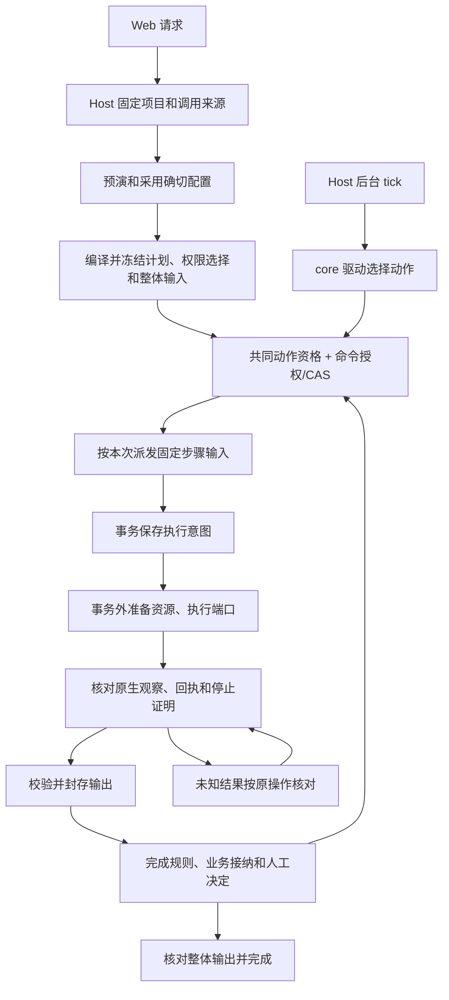

# 从配置到交付的完整执行链

[代码手册总览](overview.md) · [domain](devdesk-domain/overview.md) · [core](devdesk-core/overview.md) · [adapters](devdesk-adapters/overview.md) · [host](devdesk-host/overview.md)

下面按一次实际工作经过的边界串起文件。箭头表示用例和事实的流动，不意味着这些动作都在同一个事务里，也不意味着有后台循环就可以跳过显式派发或接纳。图中的 I/O 是 Agent/Tool 主路径，Control 和 Workflow 的分支见第 4 节。

## 1. 数据集、配置发布与工程采用

1. [HTTP 入口](devdesk-host/http-and-security.md#file-src-main-rs) 先核对 Host/origin 和会话，[Workspace](devdesk-host/workspace-and-lifecycle.md#file-src-workspace-rs) 为请求选定全局或工程 Engine。普通工程 RPC 的 project_id 用来核对预期活动项目，不同则返回 project_changed；省略才取当前项目。选定 Engine 后本次处理固定到该库，SSE 也在建立时固定范围。
2. [出厂 loader](devdesk-adapters/factory-and-configuration.md#file-src-factory-bundle-rs) 读取编译时嵌入的 manifest/正文，注入 [ConfigurationBundle](devdesk-core/configuration-and-catalog.md#file-src-templates-rs)。空库初始化与目录恢复使用资源包，不靠业务名字生成配置。
3. 自建/修订源经 [configuration preview/apply](devdesk-core/configuration-and-catalog.md#file-src-configuration-changes-rs)，以 [类型化图](devdesk-domain/configuration-and-sources.md#file-src-configuration-graph-rs) 核对完整候选。preview 不执行外部副作用，apply 重新核对基准指纹与原 Actor。
4. 共享发布加项目采用经 [跨库协议](devdesk-core/configuration-and-catalog.md#file-src-configuration-transfers-rs)：共享隐藏 stage → applying → 项目独立 receipt → 共享 completed。重启继续原操作，不能凭本地报错假定项目事务未提交。
5. [工作配置选择](devdesk-core/configuration-and-catalog.md#file-src-standards-rs) 分别记录 Project/Feature/Task 采用的 Workflow、Standard、Role→Agent 和权限。采用不等于开始运行；正在执行的工作修改计划走第 7 节的变更协议。

配置落盘由 [source_store](devdesk-adapters/storage-and-source-codecs.md#file-src-source-store-rs) 和 [source_views](devdesk-adapters/storage-and-source-codecs.md#file-src-source-views-rs) 分开保存源和运行事实。重放沿确切修订恢复，既不安装镜像，也不重新选择当前默认。

需要代码仓库的工程还先经过 [project.open_github](devdesk-host/workspace-and-lifecycle.md#file-src-github-projects-rs)：诊断 GitHub 身份/仓库 → 保留稳定项目 ID → 在工程库记录 repository.connect → [tick_repositories](devdesk-core/integrations-and-repositories.md#file-src-repositories-rs) 调用 [CliGit](devdesk-adapters/engineering-resources.md#file-src-git-rs) 克隆、核对 origin 并登记主线。Feature 和 Task 的工作副本也有独立意图；Task 要等业务依赖 Completed，再从当时 Feature head 准备 worktree，不能在依赖完成前固定旧基线。项目出现在目录中不等于仓库已经 ready。

## 2. 编译冻结计划，再装配完整会话

[compile_workflow_sources](devdesk-core/workflow-compilation.md#file-src-configured-workflows-rs) 从根 Workflow 遍历子流程，核对 DAG、Role 继承、Agent 技术组合、Skill、Tool、Delivery/Spec 和 Profile 选择。得到 ConfiguredWorkflowPlan，包含规范视图、确切源和锁；纯编译不启动模型。

启动实例时 [configured_runtime](devdesk-core/workflow-execution.md#file-src-configured-runtime-rs) 固定 owner/root、计划版本、整体输入和 queued 步骤，尚不填齐各步骤 inputs。每步有效派发后首次推进才解析输入、计算 input_digest 并保存证据清单；所依赖的产物可能此时才出现。技术 retry 保持这份步骤输入，rework 才重解析。

Agent 步骤需要 Session 时，[session assembly](devdesk-core/session-resources-and-permissions.md#file-src-session-assembly-rs) 再解析实际组合，借 [SessionResources 实现](devdesk-adapters/runtime-preparation.md#file-src-session-resources-rs) 核对安装、模型连接、凭据引用与权限合同。控制或子流程步骤不为凑齐这条链创建占位 Session。

- 安装缺失：[runtime_preparation](devdesk-adapters/runtime-preparation.md#file-src-runtime-preparation-rs) 按冻结 recipe/digest 下载或构建，保存阶段和实际安装。
- 协议未验证：[runtime_verification](devdesk-adapters/runtime-preparation.md#file-src-runtime-verification-rs) 针对实际安装、驱动及权限资产运行无模型探针；这不是推理验收。
- 权限：[Profile 编译](devdesk-adapters/credentials-and-permissions.md#file-src-permission-profiles-rs) 与 [后端 enforcement](devdesk-adapters/credentials-and-permissions.md#file-src-permissions-rs) 核对可落实范围；配置 capability 与实际授权分别检查。
- 凭据：[CredentialVault](devdesk-adapters/credentials-and-permissions.md#file-src-credentials-rs) 给出不透明引用；macOS 经 [固定签名助手](devdesk-tools/request-protocol.md#file-src-bin-devdesk-credential-helper-rs)，Codex 登录经 [私有认证 worker](devdesk-adapters/credentials-and-permissions.md#file-src-codex-auth-rs)。

安装/物化事实由 [资源回执用例](devdesk-core/session-resources-and-permissions.md#file-src-resource-receipts-rs) 保存。相同版本标签下换了实际内容也不能悄悄替换旧绑定。

## 3. 三种驱动，共同门禁

manual 来自可信 Human 请求；rust 由 [有界驱动](devdesk-core/orchestration-and-drivers.md#file-src-workflow-driver-rs) 选动作；agent 由 [Controller](devdesk-core/orchestration-and-drivers.md#file-src-controllers-rs) 的当前原生会话提出动作。经理独立工作台与根调度权分开，[知识/创作工具](devdesk-core/manager-and-platform-tools.md#file-src-manager-workspace-rs) 不自动给经理任何根实例所有权。

[共同资格](devdesk-core/orchestration-and-drivers.md#file-src-workflow-eligibility-rs) 计算 dispatch/accept/retry 以及整体 complete 的 allowed/code/reason。派发不仅看流程图依赖，还看 Task 业务 dependencies、祖先暂停、foreach 容量、输入和计划变更；未知执行仍占配额。若 condition 为 false，dispatch 可记录配置的 skipped，不先要求被跳过步骤取得不需要的输入。

[实际控制命令](devdesk-core/orchestration-and-drivers.md#file-src-orchestration-rs) 在资源级提交时继续核对 Actor、epoch/租约、revision/control_version、确切执行/输入/输出及人工权。旧 inspect 结果不能成为绕过当前门禁的许可。Rust 在每 tick 预算内跳过已拒绝候选并寻找独立工作，避免一个阻塞子流程让其他已就绪结果饥饿。

驱动决定“下一步提交什么动作”，执行器决定“这一步怎样完成”。两者分别选择：人工、Rust 或经理都可以推进下表四种步骤，不是每种驱动对应一个专用 Harness。

## 4. 保存意图，领取后执行原生任务

[task_input](devdesk-core/workflow-execution.md#file-src-configured-runtime-rs) 根据冻结 Stage/Role/Skill/Spec、端口、输入来源和授权形成 canonical JSON；[正式会话关联](devdesk-core/workflow-compilation.md#file-src-agent-tasks-rs) 将任务绑定到精确 instance/node/execution。大输入保留封存正文，通过授权 outputs.read 分块续读，不用摘要代替全部材料。

| StepExecutor | 派发后的路径 | 结果从哪里来 |
|---|---|---|
| Agent | session.open → conversation.send → Harness 原生 Turn | 当前 Turn 的协议观察及正式输出封套 |
| Tool | workflow.tool.execute → 平台或外部工具管线 | 原调用的持久化回执，随后按输出合同接纳 |
| Workflow | 建立子实例/foreach 成员及 workflow_children，不经原生模型 | 对应子实例完成后，按子流程 outputs 映射回父调用 |
| Control | 不启动外部进程，直接等待确认/接纳 | 当前配置规则及明确处置，不伪造工具输出 |

四条分支均由[工作流评估](devdesk-core/workflow-execution.md#file-src-configured-runtime-rs) 推进。work_binding 可以让子实例绑定真实 Task 并采用该工作自己的配置；子流程 ID、父 execution 和 root ID 保持可追溯。

应用命令原子保存 workflow_intent，[待执行接口](devdesk-core/workflow-execution.md#file-src-workflow-runtime-rs) 领取 prepared 意图。[tick_workflow_engine](devdesk-host/rpc-and-configuration.md#file-src-governance-rs) 在事务外准备 session.open、执行 workflow.tool.execute 或应用命令，再登记完成/完整 Error；迟到回执不能改写已固定的意图终态。

Agent 路径经 [conversation.send](devdesk-core/conversations-and-history.md#file-src-conversations-rs) 排队输入，[原生会话管线](devdesk-core/conversations-and-history.md#file-src-conversation-runtime-rs) 派发并观察。[RoutingHarness](devdesk-adapters/harness-and-protocols.md#file-src-harness-rs) 建立归属明确的容器/worker，用 [JSONL](devdesk-adapters/harness-and-protocols.md#file-src-jsonl-rs) 处理消费、文本、工具、审批和终态。代码、私有 state、Skill 和凭据挂载分别受 [Docker 合同](devdesk-adapters/engineering-resources.md#file-src-docker-rs) 约束。

Tool Step 不创建占位 Agent。平台动作走 [platform tools](devdesk-core/manager-and-platform-tools.md#file-src-platform-tools-rs)，外部 HTTP/MCP 走 [工具用例](devdesk-core/integrations-and-repositories.md#file-src-integrations-rs) 和 [NativeTools](devdesk-adapters/external-integrations.md#file-src-integrations-rs)；两者均保存原 operation 与回执。业务 Agent 的原生工具调用还必须匹配当前 Session/Turn/worker/native call 身份和冻结授权。

Agent 内的工具还要把结果交回原生 Turn：持久化调用 → 事务外 start/poll → 接纳回执 → Harness.answer_tool_call → 单独记录回复交付。外部工具的 reply_sent、平台调用的 platform_tool_reply 与实际业务结果分别保存；回复丢失只重试交付，不重新执行副作用，旧 worker 不可用时记录 worker_unavailable。经理控制工具也有 [Controller 调用管线](devdesk-core/orchestration-and-drivers.md#file-src-controllers-rs)，不能与普通业务工具的授权混用。

## 5. 自检、真实观察、产物封存与接纳

在输出前，获授权 Agent/Tool 可以调用 spec.lint。[lint_workflow_value](devdesk-core/manager-and-platform-tools.md#file-src-spec-lint-rs) 只接受当前冻结输入/输出 Delivery 的 delivery_ref/value；不能查询任意配置。经理/UI 的草稿检查有自己的创作授权，二者不能互换。

自检和实际接纳共用结构、机器 assertion 及 ContentCheckReport 证据校验。Spec 中语义判断仍需真实评审；机器章节/指针检查不自动证明结论正确。评审位置通过 [EvidenceLocation](devdesk-domain/workflows-and-checks.md#file-src-spec-checks-rs) 绑定冻结输入摘要和具体范围。调用 lint 不生成 WorkflowOutput，也不代替正式交付。

正常原生 Terminal 路径核对当前 Turn、quiescent 与输入实际消费，然后取得原 operation 的停止/writer 撤销证明，封存可取得的协议日志。取消或派发前失败不要求输入先被消费，也不能冒充正常完成。[运行事实投影](devdesk-core/workflow-execution.md#file-src-workflow-runtime-facts-rs) 只把符合自身证据条件的外层资源身份连接到后继输入，不让模型自行填写可信镜像或执行者身份。

accept_configured_outputs 核对输出封套、端口、Schema/Spec、内容报告和 producer，[FileArtifacts](devdesk-adapters/storage-and-source-codecs.md#file-src-lib-rs) 封存内容并提供 SHA 引用。随后步骤等待 acceptance 或 human confirmation；完成规则、独立评审、真实测试和人工例外分别核对。Human override 绑定确切输入/输出并保留原拒绝，不能把无效结构或未知效果改成成功。

父子调用按精确实例和 execution 聚合，Task 完成才释放后置 Task 业务依赖。最终 workflow.complete 再核对每步已处置、整体完成规则和最终输出；“所有 worker 都停了”本身不构成完成。

当前默认配置由 [defaults.json](../../configurations/defaults.json) 选择 Feature Workflow 8、Task Workflow 7、Standard 6。Feature 22 步、Task 20 步；步骤 Profile 与调度配置随 Workflow 冻结。具体 Delivery/Spec 修订按精确源引用解析，默认变化不升级已有运行。

## 6. 真实测试、候选、接纳和远端发布

工作空间和平台处理器先固定受管 worktree/目标与实际代码 revision。[CommandTests](devdesk-adapters/engineering-resources.md#file-src-tests-rs) 从 Git 导出冻结代码，以无凭据、禁网、只读测试容器运行 Node reporter；真实结构化结果区分断言失败和环境失败，保留原始 stdout/stderr。Red/Green 与独立评审是不同证据。

[CliGit](devdesk-adapters/engineering-resources.md#file-src-git-rs) 检查候选的父提交、完整 diff、写入/保护范围和实际 target；本地 git.advance 按确切候选和 CAS 接纳。生产路径不会用模型输出中的 SHA 直接修改引用。

当前 git.publish 的实际顺序是：核对本地 advance 回执 → 记录/发布 base 与独立 candidate ref → [ensure PR](devdesk-adapters/engineering-resources.md#file-src-github-rs) 并核对 marker/head/base → 按精确 expected lease 推进远端 target → 读取 PR，等待并核对 merged、head 和 merge_commit 都对应确切候选。它不调用 GitHub merge API；远端目标推进仍是显式副作用，创建 PR 不是整个发布成功的终点。政策或 lease 不满足就阻断，未知结果按原 operation 恢复。

这条链的主要实现是 [platform_tools](devdesk-core/manager-and-platform-tools.md#file-src-platform-tools-rs) 与 [仓库操作管线](devdesk-core/integrations-and-repositories.md#file-src-repositories-rs)；真实资源场景见 [工程资源测试](devdesk-adapters/testing.md#file-tests-delivery-acceptance-rs) 和 [GitHub 回执恢复](devdesk-adapters/testing.md#file-tests-github-resources-rs)。

## 7. 变更、重试、取消和重启

| 场景 | 处理边界 | 主要代码 |
|---|---|---|
| 技术 retry | 停止原尝试，归档历史，保持冻结输入，新 execution；独立计数 | [runtime](devdesk-core/workflow-execution.md#file-src-configured-runtime-rs)、[retry_count/来源链](devdesk-core/workflow-execution.md#file-src-workflow-failure-rs) |
| 补充输入 | 同一业务任务的新输入轮次 sequence，不消耗技术 retry 配额 | [会话命令](devdesk-core/conversations-and-history.md#file-src-conversations-rs)、[任务补充](devdesk-core/workflow-execution.md#file-src-configured-runtime-rs) |
| 业务 rework | 开新 round，重新解析受影响输入，保留旧产物和拒绝 | [返工与 checkpoint](devdesk-core/workflow-execution.md#file-src-configured-runtime-rs) |
| 修改运行图/采用 Standard | preview 计算影响 → quiesce 取得停止证明 → apply 新计划 | [运行计划变更](devdesk-core/workflow-changes.md#file-src-workflow-changes-rs) |
| 权限变更 | desired 与 frozen 分开，停止/快照后建立后继 Session | [权限切换](devdesk-core/session-resources-and-permissions.md#file-src-permission-switch-rs)、[发送装配](devdesk-host/rpc-and-configuration.md#file-src-permission-resources-rs) |
| 用户取消 | 保存取消请求，传播到子调用/原执行者，核对真实停止与原副作用 | [步骤状态机](devdesk-core/workflow-execution.md#file-src-configured-runtime-rs)、[工具管线](devdesk-core/integrations-and-repositories.md#file-src-integrations-rs) |
| Host 退出 | 等当前调度退出，将活动非 queued Turn 标为需核对，停止/封存 Harness writer；保留排队输入，不等同取消整个 Workflow | [停止入口](devdesk-core/workflow-execution.md#file-src-live-runs-rs)、[停止证明](devdesk-adapters/harness-and-protocols.md#file-src-harness-rs) |
| 外部结果未知 | 查原操作、容器或远端对象，核对后接纳，不换 ID 盲重发 | [bootstrap](devdesk-core/engine-and-ports.md#file-src-lib-rs)、[工具恢复](devdesk-core/integrations-and-repositories.md#file-src-integrations-rs)、[仓库恢复](devdesk-core/integrations-and-repositories.md#file-src-repositories-rs) |

[observed_failure](devdesk-core/workflow-execution.md#file-src-workflow-failure-rs) 从工具回执、失败意图或 Turn 状态事件建立可信分类。明确 Technical/NotApplied 才满足自动重试的效果前提，仍需策略允许码、max_retries、步骤 retry_limit 和停止证明；已消费输入后的未知结果不自动重发，Business/Applied 输出拒绝也不自动重跑。当前出厂 Rust 策略 max_retries 为 0。

人工显式 retry 的共同门禁是失败/取消状态、停止和步骤次数预算，未强制采用 Rust 自动重试的 Technical/NotApplied 筛选；结构化失败仍用于呈现来源和解释选择。Turn Failed 也不表示效果未应用，例如供应商超时在停止后可先结束 Turn，工作流再按 Technical/Unknown 转需核对。不能把资源已停止、业务失败和安全自动重发混成同一种结论。

重启时 [codec](devdesk-adapters/storage-and-source-codecs.md#file-src-source-views-rs) 与 [frozen views](devdesk-core/workflow-compilation.md#file-src-frozen-views-rs) 重建旧计划和任务，Workspace 恢复各工程，再按原 operation 核对外部效果。[跨项目 tick](devdesk-host/workspace-and-lifecycle.md#file-src-workspace-rs) 继续处理非活动工程；[历史查询](devdesk-core/conversations-and-history.md#file-src-history-rs) 只读组合已有事实，项目切换和查询都不会代替恢复执行。

## 8. 后台是谁在推进，全局讨论又走哪条路

[Host 主循环](devdesk-host/http-and-security.md#file-src-main-rs) 每 75ms 唤醒一次并串行等待 Workspace.tick；不是每个浏览器连接各启动一个调度器。[Workspace.tick](devdesk-host/workspace-and-lifecycle.md#file-src-workspace-rs) 处理共享工具和有 pending work 的已打开 Engine，在各工程前后调用 tick_workflow_engine，领取 workflow_intent，并推进仓库、会话及 Engine.tick。

[Engine.tick](devdesk-core/engine-and-ports.md#file-src-lib-rs) 的顺序为 Controller → 外部工具 → 平台工具 → 仓库 → 会话 → 配置流程评估 → 计划变更 → Segment → Rust 驱动 → Controller。某次 tick 只可能准备或观察下一阶段，不要求在一次函数调用里完成模型或外部作业；查询/SSE 读取已有事实，不触发这套循环。

| 限制 | 计算范围 |
|---|---|
| GlobalStore 并发与 Project.concurrency | Host/会话管线扣除其他工程已占用会话，限制新 queued Turn 的启动 |
| 工作副本 writer | 同一 source.worktree 存在未撤销写者时，不启动第二个非只读 Turn |
| Rust policy.max_concurrency | 同一根下 running/needs_reconciliation 的 Agent/Tool 步骤 |
| foreach.max_concurrency | 同一父调用的 running/needs_reconciliation 子实例，与 worker 额度分开 |
| max_actions_per_tick 与各步骤 budget | 驱动动作次数、单次工作轮次/超时/重试；等待时间按状态机单独处理 |

没有 Feature 也可以讨论：[scope=global 的会话入口](devdesk-host/workspace-and-lifecycle.md#file-src-workspace-rs) 按需打开 conversations/global/engineering.sqlite3，普通项目讨论则使用当前项目 Engine。它们复用 Session 装配、排队、原生观察和停止管线，不凭讨论消息自动创建业务 Run。全局讨论 Engine 重启后需再次访问该入口才装配并参与调度；scope=global 的 query.history 与无活动项目的 /events 则读取 global.sqlite3 的配置事实，二者不是讨论消息查询。

讨论产物若要进入正式工作，还需 [Proposal 显式采纳](devdesk-core/conversations-and-history.md#file-src-proposals-rs)；跨项目经验由 [只读来源查询](devdesk-adapters/storage-and-source-codecs.md#file-src-experience-rs) → [导入背景快照](devdesk-core/session-resources-and-permissions.md#file-src-resource-receipts-rs) → 新 Session 组成，不能恢复旧执行者或把来源成功改记为当前项目成功。

## 对照验证入口

- 配置/跨库：[候选与恢复](devdesk-adapters/testing.md#file-tests-configuration-changes-rs)、[出厂闭包](devdesk-adapters/testing.md#file-tests-configuration-resources-rs)。
- 任务/自检/失败：[配置流程场景](devdesk-adapters/testing.md#file-tests-configured-workflows-rs)；控制资格/Task 依赖/调度：[编排场景](devdesk-adapters/testing.md#file-tests-orchestration-rs)。
- 原生执行边界：[容器](devdesk-adapters/testing.md#file-tests-docker-resources-rs)、[权限](devdesk-adapters/testing.md#file-tests-permissions-rs)、[真实测试执行](devdesk-adapters/testing.md#file-tests-command-tests-rs)。
- 项目/历史隔离：[Host 跨库历史](devdesk-host/testing.md#file-src-history-tests-rs)；完整目录见 [adapters 测试专题](devdesk-adapters/testing.md) 和 [tests/README](../../tests/README.md)。
