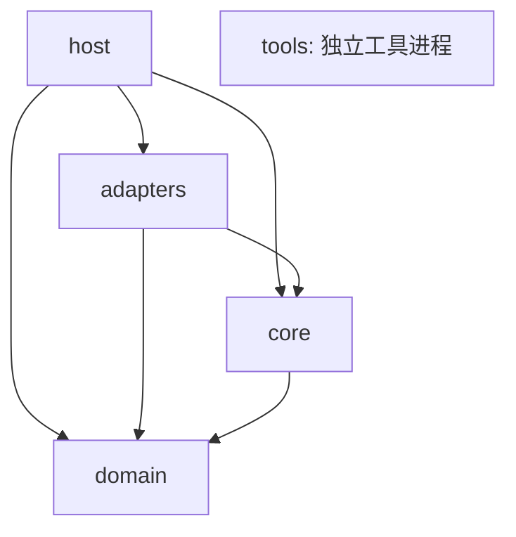

# crates 代码手册

[完整执行链](execution-flows.md) · [项目 README](../../README.md) · [现行架构](../design/design.md) · [结构合同](../design/contracts.md)

DevDesk 把“描述工作”“决定能否推进”和“实际执行”分在不同层。domain 定义合同，core 组织用例并接纳事实，adapters 落实数据库和外部操作，host 把浏览器、工程和端口接起来；tools 存放独立工具程序，当前提供 macOS 独立签名的凭据助手。本手册解释每个文件怎样参与这个过程，具体字段和分支可沿源码定位继续阅读。

## 包与文件导航

各包概览的文件索引从当前源码目录生成，覆盖源文件、合同清单、示例与测试；专题解释主要合同及执行路径。更新索引用 `python3 scripts/py/check-docs.py --write`，普通检查会拒绝遗漏或过时的条目。

| 包 | 主要内容 | 建议先读 |
|---|---|---|
| [devdesk-domain](devdesk-domain/overview.md) | 业务对象、不可变源、Workflow/Spec、执行/权限/集成合同与纯校验 | [领域入口](devdesk-domain/work-and-materials.md#file-src-lib-rs)、[工作流原语](devdesk-domain/workflows-and-checks.md#file-src-workflow-rs) |
| [devdesk-core](devdesk-core/overview.md) | 命令/查询、配置编译、冻结会话、执行状态机、控制和恢复 | [Engine](devdesk-core/engine-and-ports.md#file-src-lib-rs)、[端口](devdesk-core/engine-and-ports.md#file-src-ports-rs)、[步骤执行](devdesk-core/workflow-execution.md#file-src-configured-runtime-rs) |
| [devdesk-adapters](devdesk-adapters/overview.md) | SQLite/Artifact、出厂资源、Docker/Harness、Git/GitHub、工具/凭据和集成测试 | [存储与装配](devdesk-adapters/storage-and-source-codecs.md#file-src-lib-rs)、[原生 Harness](devdesk-adapters/harness-and-protocols.md#file-src-harness-rs) |
| [devdesk-host](devdesk-host/overview.md) | HTTP/SSE、连接认证、多项目调度、资源和 RPC 装配 | [HTTP 入口](devdesk-host/http-and-security.md#file-src-main-rs)、[Workspace](devdesk-host/workspace-and-lifecycle.md#file-src-workspace-rs) |
| [devdesk-tools](devdesk-tools/overview.md) | 独立工具程序；当前凭据助手负责严格命名空间、签名父进程与单次 Keychain 操作 | [协议](devdesk-tools/request-protocol.md)、[签名与系统访问](devdesk-tools/signing-and-keychain.md) |

## 编译依赖与实际交互

下图实线表示 Cargo 依赖。Host 是装配根，可以直接使用三个库；adapters 依赖 core 的 trait，core 不导入某个具体适配器。

运行时方向还要看端口：core 调用 Harness/Git/Tests/EngineeringStore 等 trait，由 Host 注入的 adapters 完成实际操作并返回观察。helper 不在上述 Rust 库依赖链里，adapters 通过私有管道调用其独立进程。前端通过 HTTP/SSE 看应用事实，不直接访问 SQLite 或替内核裁定终态。

## 代码共同遵守的规则

### 先明确合同，再执行 I/O

领域类型不访问文件、网络、时钟和随机数；应用通过 [ApplicationEnvironment](devdesk-core/engine-and-ports.md#file-src-environment-rs) 获得 ID/时间。core 处理合法状态变化，外层实现 [ports](devdesk-core/engine-and-ports.md#file-src-ports-rs)。外部副作用通常经过“事务保存意图 → 事务外执行 → 核对并接纳回执”；不能在数据库事务里等待模型、构建镜像或网络工具。

命令幂等由 command_id 与参数指纹共同表达，revision/CAS 防止旧请求覆盖新状态，[InvocationContext](devdesk-core/engine-and-ports.md#file-src-invocation-rs) 固定可信调用者。它们解决不同问题：同一 ID 改参数会冲突，知道 ID 也不能冒充原 Actor。

### 配置是确切源，历史不追随默认

[Definition](devdesk-domain/configuration-and-sources.md#file-src-source-rs) 的引用是 identity:revision。[类型化源图](devdesk-domain/configuration-and-sources.md#file-src-configuration-graph-rs) 只沿合同声明的引用建边，不扫描正文猜依赖。配置唯一保存到 source_definitions，运行治理记录另存；[源视图 codec](devdesk-adapters/storage-and-source-codecs.md#file-src-source-views-rs) 可以压缩可重建视图，输入、输出、参数和原始正文等事实必须无损。

发布、目录可见、项目采用和一次执行的冻结选择分别有身份。修改当前默认不原地改变已运行的 Workflow、Standard、Agent、权限或工具连接；计划变更和权限后继各有显式接续路径。已发送任务优先从经摘要核验的 User 消息账本恢复，缺少该正文时才按原源闭包纯重建。跨库发布使用 [stage/apply/recover](devdesk-core/configuration-and-catalog.md#file-src-configuration-transfers-rs)，保留项目独立回执和原 Actor，不宣称两个 SQLite 库共用原子事务。

### 把职责、能力与授权分开

| 概念 | 回答的问题 | 对应代码 |
|---|---|---|
| Role | 这个角色负责什么？ | [治理源](devdesk-domain/configuration-and-sources.md#file-src-governance-rs) |
| Skill | 用什么方法和材料做？ | [Skill 合同](devdesk-domain/integrations.md#file-src-integrations-rs) |
| Step/Workflow | 具体任务、输入输出和先后是什么？ | [工作流合同](devdesk-domain/workflows-and-checks.md#file-src-workflow-rs) |
| Spec/Delivery | 交付什么结构，怎样检查内容与来源？ | [机器检查](devdesk-domain/workflows-and-checks.md#file-src-spec-checks-rs)、[交付合同](devdesk-domain/work-and-materials.md#file-src-deliverable-rs) |
| Standard | 本次采用哪份规范闭包？ | [Standard](devdesk-domain/configuration-and-sources.md#file-src-standards-rs) |
| Capability/Agent | 角色绑定到哪个技术组合？ | [Agent 组合](devdesk-domain/configuration-and-sources.md#file-src-governance-rs) |
| Permission Profile | 本次允许什么，后端怎样落实？ | [权限 Profile](devdesk-domain/runtime-and-permissions.md#file-src-permission-profile-rs)、[实际编译](devdesk-adapters/credentials-and-permissions.md#file-src-permissions-rs) |

业务 key、标题和角色名不应成为选择隐藏执行器的开关。代码只解释 Agent/Tool/Workflow/Control 等通用原语；具体方法、默认流程和发行 pin 来自 [资源 manifest](../../resources/configuration/manifest.json) 与 [默认映射](../../resources/configuration/defaults.json)。实际驱动能力来自 [受管能力注册](devdesk-core/session-resources-and-permissions.md#file-src-driver-capabilities-rs)，Codex 与 DSH 都提供动态工具、外部工具和平台工具桥；当前仅 Codex 声明根编排能力，配置不能越过实际驱动注册。

### 执行完成、业务接纳与人工决定分别保存

Session/Turn 记录原生输入和执行，WorkflowOutput/Artifact 记录封存交付，Decision/Confirmation 记录处置。模型说“测试通过”不会生成真实 TestReport；工具结束也不保证交付结构和内容已通过。[Spec 自检](devdesk-core/manager-and-platform-tools.md#file-src-spec-lint-rs) 可提前检查草稿，但不封存输出，不替代独立评审或人类签署。

人工逐步、Rust 有界驱动和 Agent 经理共用 [动作资格](devdesk-core/orchestration-and-drivers.md#file-src-workflow-eligibility-rs) 与真实命令接纳规则。Task 的业务 dependencies 和 Step 的图依赖分别检查；foreach 的 running/needs_reconciliation 兄弟占用槽位。查询返回 allowed/code/reason，提交时继续复核权限、版本和当前状态。

失败同时记录类别与效果：[WorkflowFailure](devdesk-domain/workflows-and-checks.md#file-src-workflow-failure-rs) 的 Technical 不等于 NotApplied。[失败来源恢复](devdesk-core/workflow-execution.md#file-src-workflow-failure-rs) 从意图、原生事件和工具回执取证；未知效果先核对。自动重试另受策略、错误码、停止证明和步骤预算限制。execution_id 标记一次尝试，sequence 是输入轮次，round 是业务返工轮次，不能互相代替计数。

### 资源要核对实际内容和归属

安装检查实际文件 SHA/镜像 ID、recipe、驱动与权限资产，发行版本字符串不充当兼容门槛。准备探针只证明其实际检查过的协议，不证明推理或外部服务可用。权限策略无法落实时拒绝，不宽松降级。

容器、worktree、测试和工具操作均绑定数据集/项目/执行/operation；停止需要真实 writer 撤销或外部终态证据。Git 的候选父提交、完整 diff、本地 CAS、远端 lease 和 PR 回执逐项核对。凭据使用不透明引用，值只在授权执行边界读取。

### 测试描述必须保留证明范围

[可控工作流场景](devdesk-adapters/testing.md#file-tests-configured-workflows-rs) 可以精确制造原生时序，[真实本地 Git](devdesk-adapters/testing.md#file-tests-git-resources-rs) 验证实际引用，ignored Docker/原生协议与真实 GitHub 场景再检查外部对象。这些层次都需要，但不能互相替代。测试列表、夹具和环境条件见 [adapters 测试](devdesk-adapters/testing.md) 与 [Host 测试](devdesk-host/testing.md)。

## 按问题找代码

| 想理解的事情 | 阅读路线 |
|---|---|
| 一次 Feature 怎样从点击到完成 | [完整执行链](execution-flows.md)，再进入 core 的 [编译](devdesk-core/workflow-compilation.md) 和 [执行](devdesk-core/workflow-execution.md) |
| 为什么按钮可见但动作仍被拒绝 | [业务资格](devdesk-core/orchestration-and-drivers.md#file-src-workflow-eligibility-rs) → [Actor/CAS/确切结果](devdesk-core/orchestration-and-drivers.md#file-src-orchestration-rs) → [驱动代次与策略](devdesk-core/orchestration-and-drivers.md#file-src-workflow-driver-rs) |
| 默认修改后为什么历史不变 | [目录代次](devdesk-core/configuration-and-catalog.md#file-src-templates-rs) → [历史恢复](devdesk-core/workflow-compilation.md#file-src-frozen-views-rs) → [存储 codec](devdesk-adapters/storage-and-source-codecs.md#file-src-source-views-rs) |
| 运行卡住、取消或重启如何收敛 | [意图](devdesk-core/workflow-execution.md#file-src-workflow-runtime-rs) → [原生观察](devdesk-core/conversations-and-history.md#file-src-conversation-runtime-rs) → [实际停止](devdesk-adapters/harness-and-protocols.md#file-src-harness-rs) |
| 为什么项目切换后请求被拒，全局讨论又存在哪里 | [Workspace 路由](devdesk-host/workspace-and-lifecycle.md#file-src-workspace-rs) → [后台调度与全局讨论](execution-flows.md#scheduling-and-discussions) |
| 权限/模型/密钥如何进入一次任务 | [会话与权限](devdesk-core/session-resources-and-permissions.md) → [运行准备](devdesk-adapters/runtime-preparation.md) → [凭据](devdesk-adapters/credentials-and-permissions.md) |
| 如何新增工具或协议能力 | [合同](devdesk-domain/integrations.md#file-src-integrations-rs) → [用例](devdesk-core/integrations-and-repositories.md#file-src-integrations-rs) → [执行](devdesk-adapters/external-integrations.md#file-src-integrations-rs) → [路由](devdesk-host/rpc-and-configuration.md#file-src-integrations-rs) |

改动代码时，命名沿用 Rust snake_case/PascalCase，状态变化放在合适层，参数使用明确领域类型。源码、Schema、资源和对应说明同步；文档直接描述当前行为，不写修订日志。仓库完整约束见 [AGENT.md](../../AGENT.md)，本目录不复制所有操作指南；HTTP、存储、权限和真实工程的产品说明仍从 [README 文档表](../../README.md#文档) 进入。
