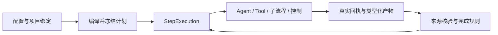

# 架构与设计决策

当前基线为 global 17 / project 48（扁平源协议）、Workflow v6。业务配置与执行边界见 [领域规范](domain.md) 和 [Harness 执行合同](plans/harness-workflow-orchestration/CONTRACT.md)。历史实施过程保存在 `docs/plans/`；本页描述当前系统。

## 模块与事实源

| 模块 | 职责 |
|---|---|
| domain | 类型、不可变修订、DAG、作用域、权限与有界规则；不执行 I/O。 |
| core | 命令、查询、编译、调度及回执接纳；定义持久化与原生执行接口。 |
| adapters | SQLite、Artifact、Codex / DSH、Docker、Git 和 GitHub 的实际实现。 |
| host | HTTP / SSE、会话、凭据、项目 Engine 装配、运行时准备及嵌入 Web。 |
| web | 配置编辑、预览、执行与历史视图；不直接设置业务状态。 |

规范化关系表保存身份、外键和索引，类型明确的配置与结果使用 JSON 列。内核加载类型化状态，在短事务内提交变化；不把整个项目作为一个可写 JSON 文档。Artifact 先封存、fsync 和 rename，再提交引用；读取时校验摘要。

## 业务变化由配置管理

Role 是自由身份，Skill 定义方法，Step 保存本次任务，Spec 定义检查，Standard 冻结 Workflow、Delivery、Spec 及关联。阶段、节点 key、内置 ID 或文档标题不选择执行器。编译器只识别 Agent、工具、子流程和控制，冻结完整依赖、权限、输入关系和完成规则。

出厂资源使用现有 `resources/configuration` 目录；空库建立数据库副本，UI 编辑写入数据库，发布形成修订。模板重置切换当前目录代次，不回写已有运行。默认 TDD、评审和人工确认使用同一套配置机制，不是内核专用分支。

## 持久化意图与事务外执行

命令以 `command_id` 和参数指纹幂等；重放先于版本检查，相同 ID 的不同参数被拒绝。派发前持久化确切意图，外部 I/O 在事务外执行，随后由 core 核验回执。适配器不能直接推进工程终态。

平台工具与外部工具都保存真实调用身份。独立 Tool Step 不创建占位 Agent 或 Session；Codex Agent 的平台调用绑定实际 worker、Turn、原生请求和冻结的工具授权。工具请求、终态回执及原生回复交付分别留痕，发送回复不改写执行回执。

原生执行核对准入、输入消费、终态和停止证明。未知结果不自动重发；取消先停止真实执行者，证据封存与容器清理分别确认。技术重试保留原执行，返工沿实际消费关系失效后继，迟到结果不能成为新执行的成功。

## 每项目数据库与全局目录

`global.sqlite3` 保存共享配置、项目索引、活动选择、偏好及全局命令记录。每个项目独立使用 `projects/<id>/engineering.sqlite3` 和 Artifact 根，不能插入其他项目。共享不可变修订按需追加复制，不改写已冻结依赖。

项目创建先预留稳定 ID，再建立项目库并发布目录；跨库没有原子事务，重开时核对摘要。打开失败保留原选择，不创建空库掩盖丢失。请求取得 Engine 后保持该实例，显式 `project_id` 过期时拒绝。SSE 固定所属 Engine，游标在项目内递增。

切换项目不终止其他项目执行；共享调度器管理全局额度。启动遍历项目索引核对原执行者，不把未知工作重新派发。全局讨论有独立命名空间，不创建假项目。

当前版本直接使用 SQL 基线初始化。过时结构明确拒绝，不自动删除、不转换，也不保留双版本执行器；此次未上线开发数据的清理由用户明确授权后单独执行。

## 代码、测试与发布

请求携带明确 GitContext、固定代码版本与实际运行实例，执行器不依赖进程全局 cwd。Task 的依赖工作副本延后到前置完成后建立。只读执行使用固定版本导出，写执行核对受管理 worktree 和当前授权；元数据路径与 symlink 边界由适配器落实。

测试在固定、无模型凭据、禁网、只读代码导出的 Docker 环境运行。Node 报告器区分断言失败和环境故障，stdout 中的伪造报告不构成证据。

候选工具返回实际父提交与确切 diff。默认配置执行独立评审、候选测试及项目经理的显式接纳，automatic 确认策略无需 Human 签署；Git 接纳核对真实候选和测试回执。本地 CAS、远端精确 lease 与 PR merged 是分别记录的事实，不存在跨系统原子事务。目标变化使旧候选不可直接接纳，未知推进必须先核对。

## 权限、运行时与供应商

RuntimeInstallation 独立于 Agent、Session 和 RuntimeExecution；同平台同版本共享固定镜像，原生线程、容器和私有状态仍隔离。运行绑定冻结实际 Model、Harness、参数、连接、权限和资产；客户端不能提交解析后的运行 binding。

Permission profile 与目标绑定分别版本化。两层权限、Scope、工具授权及操作系统隔离取交集，无法落实的策略明确拒绝。共享安装不因角色或权限复制。模型连接、工具网络、审批、隔离和资源额度分别表达。具体能力与限制见 [权限说明](../permissions/README.md) 和 [适配器合同](real-adapter-contract.md)。

实际 SDK 路由和认证属于协议代码；显示名、默认选择及端点预填值属于配置。原生接口通过 `ExecutionAdapters` 注入，测试替身只编译进测试，产品没有模拟模式或回退执行器。

## 客户端与验证

React Web 在 Rust 构建时嵌入，发布程序不依赖源码或宿主 Node。配置两列编辑器、通用阶段/步骤视图、确切任务预览、材料与确认都读取同一后端事实。讨论与经验按 AgentID 归属，选择变化使旧异步响应失效。

验证覆盖 Rust、HTTP、debug / release Chromium、真实 Git / Docker、原生模型和独立包。真实模型、SDK 本地夹具和接口替身分别报告；Linux worker 不能代替 Ubuntu 宿主验收。当前证据及限制见 [执行记录](plans/workflow-business-configuration/EXECUTION.md)。

运行计划修订按新图实际引用的角色、资源和权限/集成锁计算影响；子流程重新编译时移除未使用的父级闭包资源，不会使已完成前缀失效。`workflow.change.preview/apply` 支持单独的 `revert_change {change_id}`：只可回退本实例最近应用的纯 `upsert_step` 变更，且全部受影响的替代执行仍未启动，不包含子流程调用。core 校验原冻结计划、输入和不可变执行历史，创建新的计划修订并逐字复用原回执；原始拒绝、原变更和被撤回的 queued 执行均保留。已启动、跨实例、混合操作或存在新外部作用时拒绝回退。
