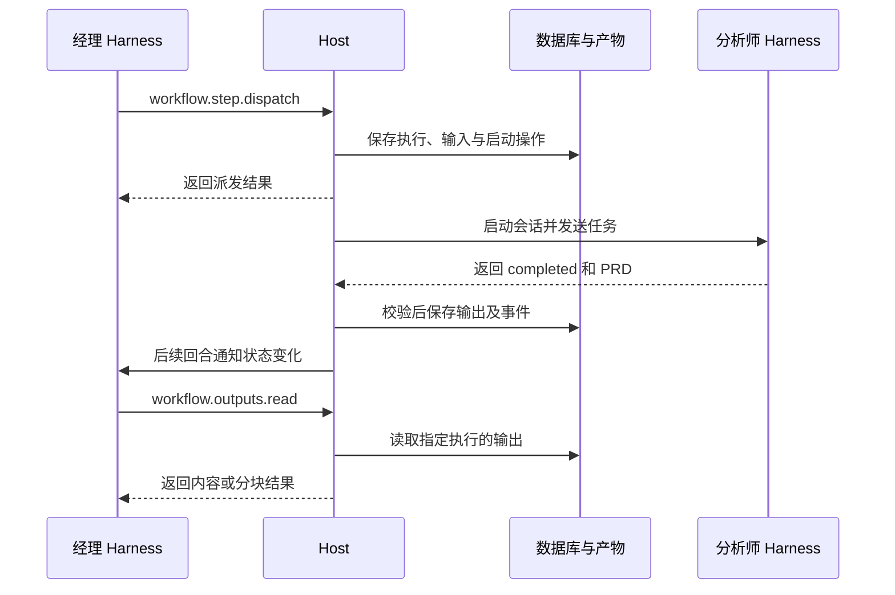

# Agent 运行与通信

Agent 通过 Harness 与模型交互，Harness 在 Docker Sandbox 中运行。Host 保持与每个 Harness 的协议连接，并管理任务、工具调用和结果。项目经理与需求分析师之间的协作由 Host 中转。

## Harness 与 Sandbox

Harness 是模型程序及其协议适配，例如 Codex app-server、DSH SDK 和 Pi RPC。Sandbox 是执行它的隔离环境，包括基础镜像、系统依赖、挂载和网络限制。

适配器把选定的 Harness 与 Sandbox 组合成执行配方，准备镜像并检查协议。共享镜像可以减少重复安装；每个会话仍有自己的状态目录、进程连接和执行身份。Agent 不获得 Docker daemon socket，不能自行创建任意同级容器。

## 经理怎样启动分析师

下面是已有经理会话派发一次需求分析的过程。图中 Host 包含 host、core 和 adapters 在同一服务进程内的协作。



经理调用工具后，core 先检查该会话是否有调度权、步骤是否就绪及版本是否一致。通过后产生 `session.open` 等持久化操作；Host 后台执行这些操作，为分析师准备运行资源和输入。派发响应不是“分析师已经完成”的同步结果。

经理可以用 `workflow.controller.wait` 等待有意义的变化。Host 保存的工作流事件会成为后续经理回合的输入；经理也可读取事件与状态，不需要持续轮询容器日志。

## Host 与容器怎样交换消息

Docker 适配器通过 `docker start --attach --interactive` 连接容器进程。JSONL 层通过标准输入/输出交换带请求 ID 的消息，并分离协议帧与日志。它不是给每个 Agent 暴露一个任意可调用的 Host HTTP 管理接口。

| 行为 | Codex | DSH | Pi |
|---|---|---|---|
| 会话准备 | `thread/start` / `thread/resume` | DSH 会话协议，由驱动转换 | 固定 `--session-id`，用 `get_state` 核对会话与模型 |
| 发起一轮任务 | `turn/start` | `session/prompt` | `prompt` |
| 动态工具请求 | `item/tool/call` | `devdesk/tool/call` | 受管扩展发送 `extension_ui_request` |
| 回复工具 | Host 回复原请求 | Host 回复原请求 | `extension_ui_response` |

适配器把供应商事件转换成统一的 ConversationObservation。core 处理这些观察结果，检查调用身份，再执行授权范围内的工具或保存会话结果。

Codex 驱动声明根工作流编排能力。DSH 和 Pi 支持普通讨论与有授权的步骤工具。支持范围见[接入参考](reference/integrations.md)。

## PRD 怎样成为正式结果

工作流 Agent 的最终回答需要符合任务指定的结果格式，简化示例如下：

```json
{
  "status": "completed",
  "summary": "完成需求说明",
  "outputs": { "result": "# PRD

用户、范围和验收条件……" }
}
```

core 从对应 Turn 的真实结果读取这段内容，核对输出端口及 Delivery/Spec，然后准备 Artifact 和 `workflow_output` 记录。输出关联原执行、输入摘要、产物及来源，不以容器中恰好存在某个 `PRD.md` 为完成依据。

经理用 `workflow.outputs.read` 读取这些已保存的结果；下游步骤按配置的输入引用使用产物。大内容通过受限分块读取，通知本身不承担全文传输。

如果分析师在停止前生成了文本，但 Host 尚未确认和保存完整结果，系统不能假定 PRD 已交付。此时需要按照执行状态进行核对或恢复。

## 讨论、经验与结束

普通角色讨论也通过 Session/Turn 运行，但不自动产生工作流完成事实。经验访问使用 `agent.experience.list/read`，模型先取得目录或引用，再按需读取；可见经验不等于可以修改其来源项目。

角色讨论中的 Agent 经验按每页 10 条显示。可以筛选、在条目内展开快照、通过来源链接打开原 Session，或用已验证的快照开启新讨论。选中的经验固定显示在讨论记录上方，可逐项清除。发送时把当前引用随消息提交，后续消息可继续使用这些引用。

删除经验会移除该 Agent 对所选快照的目录条目，也会从 Agent 的经验检索中移除该引用。其他 Agent 的目录、原会话和密封证据保留。后续工作可以生成新的经验。

角色讨论可续用仍能发送的原 Session。取消、失败或运行绑定变化后，系统可能要求后继会话。「继续此会话」会继承已保存的上下文。「从此轮次继续」创建独立讨论，按所选轮次划定上下文边界。新的讨论需要可用的 Agent 运行配置。

独立讨论支持删除 Session 或单个已结束的轮次。先结束活跃运行并完成必要的核对。删除会将选中记录从角色讨论移除，后续生成的上下文也会跳过在原会话中删除的轮次。已封存的快照、历史审计和正式流程记录用于核查原操作。

用户可以从已完成的普通讨论轮次建立提案，再编辑、拒绝或采用为材料。提案保留来源轮次和目标版本，采用需要 Human 来源；它不会生成测试、评审或工作流完成证明。工作流会话的输出继续按步骤的交付要求处理。

停止会话时，适配器要确认 worker 已停止；清理还要确认容器被移除。共享镜像不随单个会话清理。Host 重启后先核对原操作与实际资源，再继续，见[恢复机制](data-and-recovery.md)。

代码阅读：[Harness 与 Docker](../crates/devdesk-adapters/harness-and-protocols.md)、[会话应用流程](../crates/devdesk-core/session-resources-and-permissions.md)、[跨模块调用链](../crates/execution-flows.md)。
