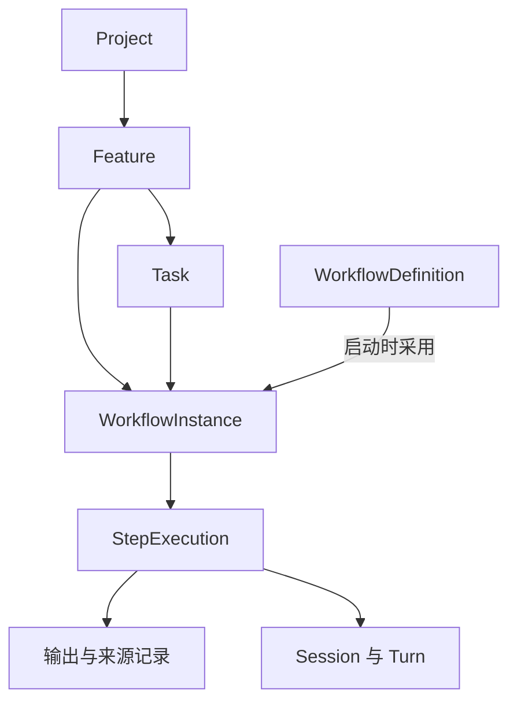

# 核心概念

理解 DevDesk 时，先区分三件事：准备做的工作、一次实际执行，以及执行产生的结果。同一个任务可以有多次执行，旧结果不会因为返工而消失。

## 工作与执行

| 概念 | 含义 | 示例 |
|---|---|---|
| Project | 仓库和工程活动的归属范围 | 一个接入的 GitHub 项目 |
| Feature | 面向完整需求的工作项 | 增加导出报表能力 |
| Task | Feature 下可分工的实现工作项 | 实现导出接口 |
| WorkflowDefinition | 可复用的步骤和依赖定义 | 需求 → 设计 → 实现 → 交付 |
| WorkflowInstance | 为一个工作项启动的具体流程 | 这次报表需求的执行流程 |
| StepDefinition | 流程中的任务、输入输出和执行方式 | 需求分析步骤 |
| StepExecution | 某一步的一次执行记录 | 分析师第一次生成 PRD |

Feature 与 Task 的类型目前由内核定义，围绕它们的流程由软件开发包提供。按[架构独立性改造计划](../plans/arch-independency/PLAN.md)，两者将迁为软件开发包的对象类型。

图中的两条工作项连线表示 WorkflowInstance 可以归属 Feature 或 Task，不表示一个实例同时归属两者。步骤也可能由平台工具或子工作流执行，并不都需要 Agent 会话。

## Agent、Session 和 Turn

Agent 定义一个角色与能力的组合。Role 说明职责，Capability 指定模型、Harness、工具和技能。Agent 的名字不会触发隐藏的执行逻辑。

Session 保存一次持续会话所需的身份和运行绑定。Turn 是会话内的一轮输入与响应。工作流派发 Agent 步骤时，会为该次执行建立关联；讨论也使用会话机制，但普通讨论没有工作流步骤的完成权限。

AgentInstance 表示实际使用的 Agent 实例。它与可复用的 Agent 配置不同，运行记录需要能够追溯到具体实例和所用修订。

## 输入、输出与产物

步骤通过命名端口表达数据关系。需求分析可以声明一个 `result` 输出，设计步骤再引用 `requirements.result`。这样数据依赖来自配置，不依赖 Agent 从聊天历史中猜测哪份文档是当前版本。

Delivery 规定输出的结构和来源要求，Spec 说明内容应满足的要求。Artifact 保存可读取的产物内容；工作流输出记录还保存执行、端口、输入摘要和检查结果。它们共同回答“这份 PRD 是谁、根据什么输入、在哪次执行里生成的”。

Material 是提供给工作项或流程使用的材料，可能来自用户或先前执行。引用材料时仍须保留来源，不能把外来文本包装成已经完成的工程验证。

## 定义版本与运行版本

配置引用采用 `identity:revision`，例如某个固定 Role 修订。修改配置产生新的修订；已经启动的执行保留原来的选择。

运行对象也有 revision，用来判断命令准备后对象是否变化。两者目的不同：前者说明采用哪一版定义，后者防止并发操作覆盖别人的修改。

具体字段见[数据格式参考](reference/contracts.md)，规则实现见 [domain 手册](../crates/devdesk-domain/overview.md)。
