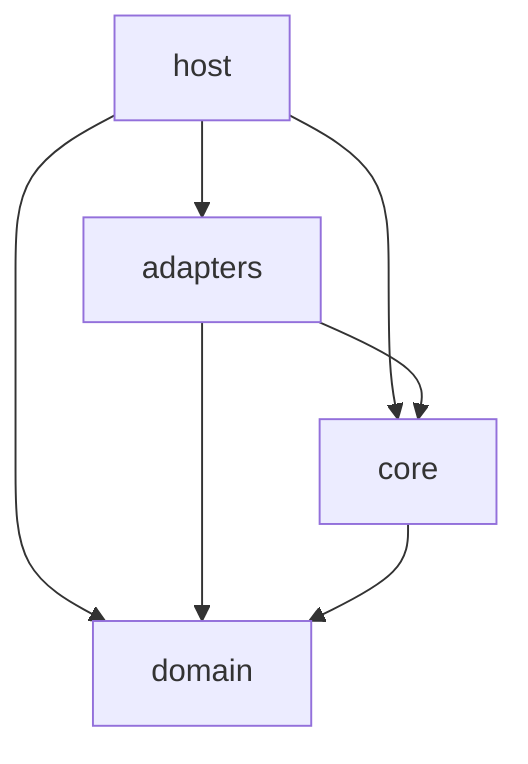

# 分层与依赖

一次“启动分析师”的请求同时包含业务判断和外部操作：先判断步骤能否执行，再准备输入，最后创建容器并启动 Harness。DevDesk 将这几类工作放在不同层中。

## 各层负责什么

| 层 | 主要责任 | 以启动分析师为例 |
|---|---|---|
| domain | 对象、配置结构及不依赖外部环境的规则 | 定义步骤、输出端口和完成条件，检查规则能否成立 |
| core | 应用流程、授权、版本检查与状态变化 | 检查依赖和额度，确定本次输入，记录待执行操作并接纳结果 |
| adapters | 外部系统的具体实现和数据转换 | 调用 Docker、与 Harness 通信、读写 SQLite 和产物 |
| host | 程序入口、接口服务、对象装配与后台调度 | 接收工具请求，为项目选择 Engine，驱动待执行操作 |
| Web | 用户交互和状态展示 | 显示分析进度，让用户阅读 PRD 和批准评审 |

core 执行平台工作流、授权和持久化规则。领域 ZIP 提供业务配置、运行处理器和客户端贡献。adapters 负责工作流与外部系统的具体交互。

## 编译时依赖

箭头表示 Cargo 依赖。domain 不依赖其余应用层；core 不导入 adapters。Web 和其他客户端通过协议访问 Host。领域 ZIP 使用配置和处理器协议接入。

## core 如何调用 adapters

core 在 `ports.rs` 声明所需能力，例如 `Harness`、`EngineeringStore`、`ArtifactStore`、`Git`、`Tests`。这些 trait 描述操作的输入、输出和失败方式。

adapters 实现 trait，例如 `RoutingHarness` 处理不同模型程序，`DockerSandbox` 管理容器，`FileArtifacts` 保存产物。Host 创建这些具体对象，再传给 `Engine::new` 和相应的 `with_*` 装配方法。运行时，Engine 调用 trait 对象，实际执行进入 adapters。

以 `Harness::dispatch_turn` 为例：core 已经确定这轮输入属于哪个会话，适配器才把它转换成 Codex 的 `turn/start` 或 DSH 的 `session/prompt`。适配器返回观察结果后，core 再判断是否可以修改会话和步骤状态。

因此，编译依赖方向与运行时调用方向不同。接口归 core 所有，使应用流程不必知道 Docker 命令或供应商协议。

## core 与 domain 如何配合

domain 可以计算规则，但不能自行查数据库。比如 `CompletionRule::evaluate` 接收 `WorkflowFacts`，判断完成条件是否成立。core 负责读出相应记录、构造这些输入、调用规则，再连同版本检查一起提交状态变化。

这也解释了为什么一些校验在 core：它们依赖当前用户、执行身份、已有记录或外部操作状态，不是单个对象能够独立决定的事情。

## 修改功能时怎样划分

| 需求 | 主要修改位置 |
|---|---|
| 增加完成条件的表达形式 | domain 的类型和求值，core 的事实采集与调用 |
| 增加领域工作流或业务约束 | 领域包的配置或证据处理器 |
| 接入另一种 Harness 协议 | adapters 的实现，必要时扩展 core 端口和驱动能力声明 |
| 增加外部请求入口 | host 路由及合同，调用已有或新增 core 用例 |
| 增加领域页面 | 领域包的贡献声明和 Web SDK 绑定 |

相关代码：[Engine 与端口](../crates/devdesk-core/engine-and-ports.md)、[Host 装配](../crates/devdesk-host/workspace-and-lifecycle.md)。
