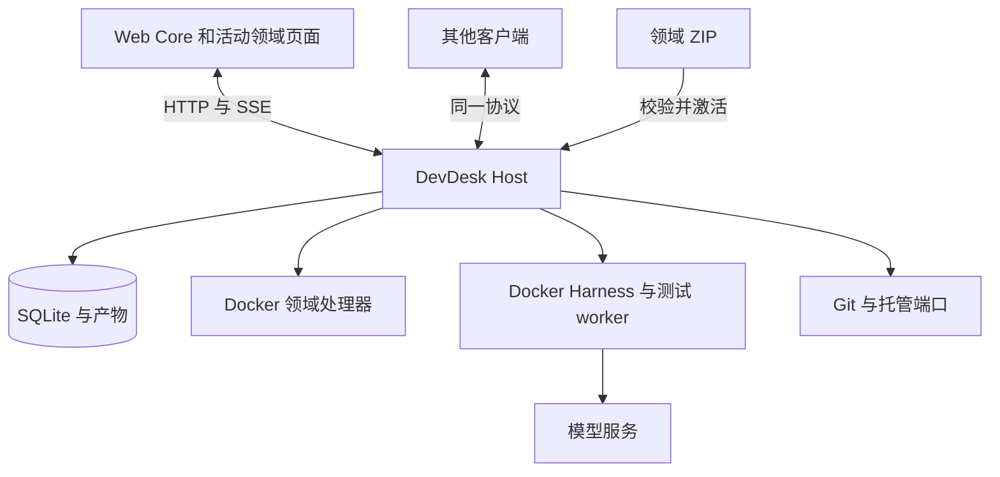

# 系统总览

DevDesk 是一个可加载领域包的工作台。Host 管理执行对象、工作流、Agent、权限、产物和历史。Web Core 与其他客户端共享同一套协议。软件开发包将 Feature、Task、评审、测试和交付组织成具体流程。

## 一次使用过程

Host 可从空数据目录启动，提供 Model、Harness、Docker 和 Git。导入并激活软件开发包后，用户接入 GitHub 项目并创建 Feature。工作流生成 PRD、设计与 Task 计划，随后执行实现、测试、评审与合入。人工、Rust、Agent 三种调度方式使用同一套派发、接纳、证据和完成规则。

## 系统在哪里运行

Host 运行在持有数据集和 Docker 的机器上。已连接客户端共享活动领域，每个标签页各自选择项目。领域 Web 页面由 Web Core 加载进共享 React 布局。领域运行处理器与 Agent Harness 分别在 Docker 进程中执行。项目和运行保存确切的领域包摘要及配置闭包。

## 运行边界

一个数据集由一个 Host 管理。多个浏览器可以连接这个 Host，每个请求明确指定项目；不存在所有浏览器共用的“当前项目”。当前实现没有多 Host 共同写入同一数据集的协调机制。

Host 以真实外部结果判断执行。Agent 说“测试通过”只是一条模型输出；测试容器的结果、Git 提交和人工批准分别记录，再由应用逻辑检查。关闭浏览器不会取消后台任务。

## 设计选择

采用单 Host 和 SQLite，便于部署并把项目数据保存在用户控制的机器上。代价是写入竞争、跨库操作和故障恢复需要明确处理，不能把数据库事务扩展到 Docker 或 GitHub。

采用可替换的 Harness 和 Sandbox，让模型程序与执行环境分别演进。代价是配置更多，兼容性必须通过实际安装、权限落实和协议探针检查，不能只看版本名称。

继续阅读[分层与依赖](layers.md)和[领域包架构](domain-packages.md)。源码入口见[Host 启动](../../crates/host/src/main.rs)和[工作区装配](../../crates/host/src/workspace.rs)。
