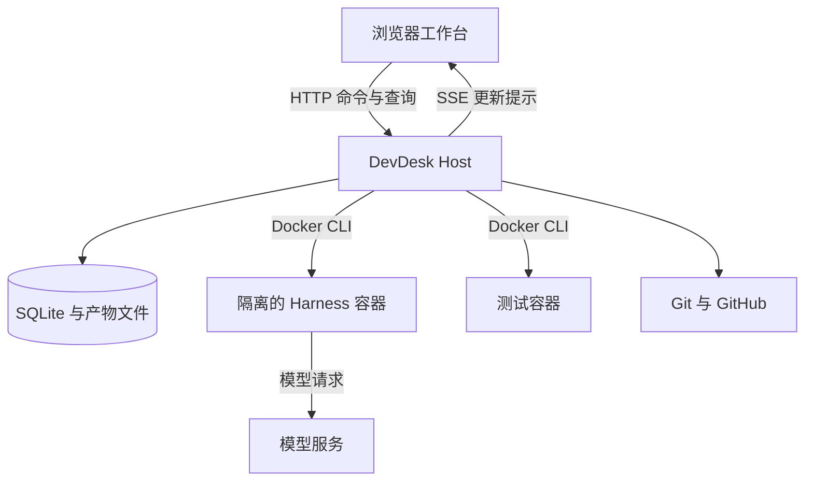

# 系统总览

DevDesk 是一个由本地或远程 Host 管理的工程工作台。用户提出需求，系统把需求组织为工作流，让不同 Agent 生成文档、修改代码、执行测试和评审，最后按配置的条件完成交付。

它需要解决三个问题：多角色工作如何衔接，模型的输出如何成为可验证的工程结果，以及长时间执行在等待、冲突或重启后如何继续。

## 一次使用过程

用户接入 GitHub 项目并创建 Feature。项目经理根据工作流派发需求分析师；分析师返回 PRD，独立评审者检查内容，需要人工确认的步骤等待用户决定。之后进入设计、计划、Task 实现、测试和交付。每次执行都保留当时采用的配置、输入、输出及来源。

这条流程来自当前出厂配置。DevDesk 的执行机制支持不同工作流，不以“需求分析师”等名称决定程序行为；执行方式由步骤定义明确指定。

## 系统在哪里运行

Host 运行在管理数据集的机器上，浏览器可以在另一台机器上。图中的 Harness 容器代表一类运行资源；不同 Agent 会话分别绑定自己的运行状态和协议连接。共享安装镜像不等于共享会话。

| 部件 | 责任 | 保存的主要内容 |
|---|---|---|
| Web 工作台 | 输入需求、展示进展、提交人工决定 | 标签页的项目选择、查询缓存和未提交草稿 |
| Host | 接收请求、检查规则、调度执行、保存结果 | 项目与配置数据库、工作流状态、产物、运行记录 |
| Harness | 与模型交互，执行模型选择的工具 | 所属会话的供应商线程和工作目录状态 |
| Docker Sandbox | 限定进程可见的文件、网络及资源 | 容器实例；安装镜像可供多个实例复用 |
| Git/GitHub | 保存和交付代码版本 | 提交、分支、PR 和远端合入结果 |

## 运行边界

一个数据集由一个 Host 管理。多个浏览器可以连接这个 Host，每个请求明确指定项目；不存在所有浏览器共用的“当前项目”。当前实现没有多 Host 共同写入同一数据集的协调机制。

Host 以真实外部结果判断执行。Agent 说“测试通过”只是一条模型输出；测试容器的结果、Git 提交和人工批准分别记录，再由应用逻辑检查。关闭浏览器不会取消后台任务。

## 设计选择

采用单 Host 和 SQLite，便于部署并把项目数据保存在用户控制的机器上。代价是写入竞争、跨库操作和故障恢复需要明确处理，不能把数据库事务扩展到 Docker 或 GitHub。

采用可替换的 Harness 和 Sandbox，让模型程序与执行环境分别演进。代价是配置更多，兼容性必须通过实际安装、权限落实和协议探针检查，不能只看版本名称。

下一篇：[分层与依赖](layers.md)。代码入口：[Host 启动](../../crates/host/src/main.rs)、[工作区装配](../../crates/host/src/workspace.rs)。
