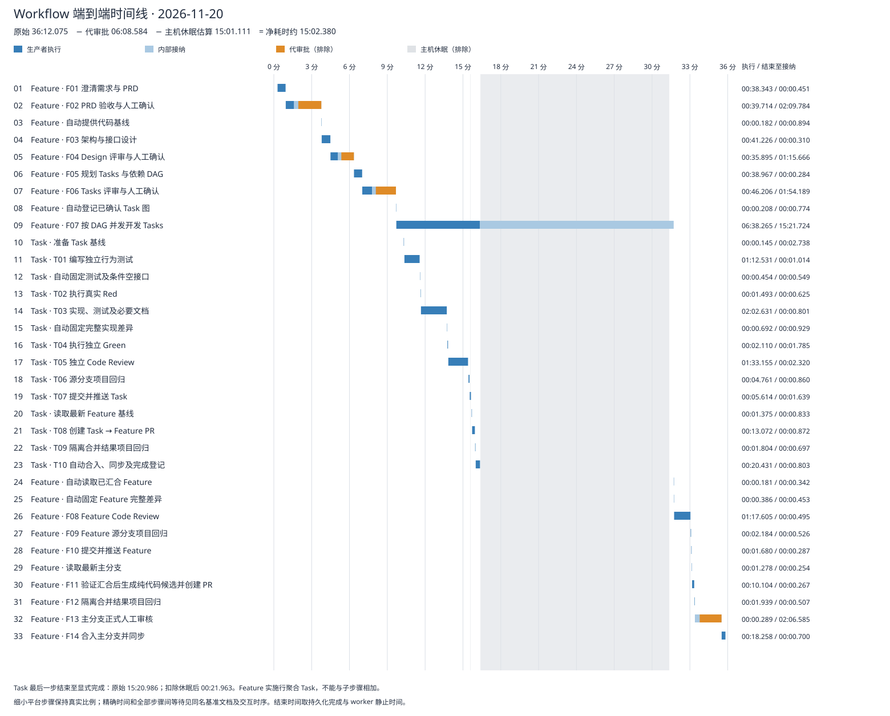

# 完整工作流回归与端到端性能基准（2026-11-20）

本轮真实工作流已完成：Feature 19/19、Task 14/14，四次项目回归均实际执行并通过 9/9。只有四次正常人工签核由外部操作者代办；未补充维护输入、修改运行中计划、人工派发、人工接纳产物或修补证据。只读验收器的 `--unassisted` 检查通过。

**修正后的 workflow 端到端净耗时约为 15 分 02 秒。** 原始墙钟为 36 分 12.075 秒，其中代审批响应 6 分 08.584 秒、有系统电源日志佐证的主机休眠按活动边界估算为 15 分 01.111 秒。二者从 workflow 净耗时中排除；经理准备审批、调度、接纳及显式完成仍计入。这个净耗时包含 Agent 开发、评审、工具与测试，并非调度器独占开销或 CPU 时间。

[原始计时与验收数据](workflow-benchmark-2026-11-20.json) · [完整时序图](workflow-timeline-2026-11-20.svg)

[保存的原始交互图](workflow-timeline-2026-11-20-raw.html) · [保存的净耗时交互图](workflow-timeline-2026-11-20-net.html) · [净耗时 SVG](workflow-timeline-2026-11-20-net.svg) · [Agent、工具与 workflow 组件拆解和优化分析](workflow-cost-breakdown-2026-11-20.md)



## 基准身份与环境

| 项目 | 本轮值 |
|---|---|
| 项目 | `d4ec7a1e-1344-4c10-9561-94b86ff7c382` |
| Feature / Root | `b56c7639-bbdb-f54e-bbc5-0139cb96cd8b` / `a7597e37-0dfe-c2e8-7456-ae9c191bea3f` |
| Task / 子流程 | `829d369e-d575-6142-6ff0-f41a76056ce2` / `36da08a4-f34d-6eaf-95e4-e077c2843662` |
| 经理 | `72b1c1de-8708-fa5f-0855-83fa87171eca`，epoch 1 |
| 需求 | 语言切换按钮按目标语言显示 title；保留现有行为和独立验收，维护项目正式测试与浏览器验收入口 |
| 项目配置 | `d4ec7a1e-1344-4c10-9561-94b86ff7c382:2`，Feature workflow 9 / Task workflow 4 |
| 起始 / 最终主线 | `c41748dceaf93abf142fff940e32065ad51ed2ab` / `b6f5a609c84ebbf7939d3bc2cb96cb033587b0eb` |
| 交付 | [Task PR 22](https://github.com/xfork24/devdesk-project-1/pull/22)、[Feature PR 23](https://github.com/xfork24/devdesk-project-1/pull/23) 均实际合入并同步 |
| 主机 | Apple M1，16 GiB，macOS 26.7.3 arm64，debug Host，HTTP `127.0.0.1:4320` |
| 本轮 Host 二进制 SHA-256 | `8f1938356f581e3f8bb383e1345a4e8793fe88f22b8bcb59ab5964b7571ab0c7` |
| 实际模型 | `gpt-6.1-sol`，effort `low`，以原生请求记录为准 |
| 容器镜像 | `sha256:cfdd13360965d846cf746bf829782d65247e5cb8e986c71271124f908e09673d` |
| 测试运行时 | Node 24.13.0，Playwright 1.58.2，Chromium 145.0.7632.0 |
| 正式回归容器限制 | 每次 2 CPU、1024 MiB、256 PIDs、128 MiB tmpfs；四个不同容器和 operation |
| 运行依赖 | 工作树外的项目专用缓存，跨项目共享关闭；已热缓存约 1,166,434,304 字节 |

运行时每次启动检查至少 4 GiB 可用空间，并用实际容器 UID 检查写入、执行权限。本轮完成后的数据卷只读抽样剩余约 30 GiB；这不是持续磁盘监控或吞吐测量。单次真实模型、热缓存运行，未隔离整台机器的其他负载，不能据此声称稳定的 p95 吞吐或冷启动性能。流程期间未同时运行本仓库编译或测试。Host 启动不在流程计时窗口中。

## 计时口径与外部延迟排除

开始取根实例持久化 `created_at`（08:53:26.961 +08:00）；结束取根流程完成、经理关闭、相关 turn 与 worker 静止的最后一个持久化时间戳（09:29:39.036）。操作者轮询、阅读完成通知、生成报告和事后核对的时间均不进入窗口。

| 时间类别 | 时长 | 处理 |
|---|---:|---|
| 原始端到端墙钟 | 36:12.075 | 保留，便于复核实际经过时间 |
| 代审批：请求创建 → 签署 | 06:08.584 | 从净耗时排除；含操作者获知、阅读与代审响应 |
| 主机休眠，按事件活动边界收窄 | 15:01.111 | 从净耗时排除；有系统电源日志佐证 |
| 两类外部区间的并集 | 21:09.695 | 只扣一次；本轮未重叠 |
| workflow 净耗时 | **约 15:02.380** | 上述原始墙钟减外部区间并集 |
| 经理准备四次审批请求 | 01:16.831 | 保留在净耗时内 |
| 完成后被操作者发现的延迟 | 未计入 | 不用外部观察时刻作为完成时刻 |

先前 `human_review_wait_ms=445415`（7:25.415）把“生产者完成 → 审批请求创建”的 76.831 秒和“请求创建 → 人工签署”的 368.584 秒合并了。该字段及旧 `non_human_wait_wall_ms` 只保留为原始诊断字段，不用作修正后的性能结论；以 JSON 的 `timing_audit` 为准。

按互斥优先级“外部排除 → 原生 turn → turn 外平台调用 → 其他内部时间”分配，净耗时中原生 turn 占 854.786 秒，turn 外平台调用 27.640 秒，其他内部或未细分时间 19.954 秒，合计 902.380 秒。原生 turn 内包含模型、工具与通信，不等于纯推理时间；平台调用可能嵌在 turn 内，不能把两者累计时长再直接相加。

### 四次审批

经理准备阶段计入 workflow；请求创建后的外部响应从净耗时中排除。这里的准备时间包括经理获知评审完成、核对结果并发起请求。所有时间为 +08:00。

| 审批 | 生产者完成 | 请求创建 | 签署 | 经理准备（计入） | 外部响应（排除） |
|---|---|---|---|---:|---:|
| 需求 | 08:55:03.295 | 08:55:23.429 | 08:57:12.880 | 00:20.134 | 01:49.451 |
| 设计 | 08:58:32.383 | 08:58:48.127 | 08:59:47.870 | 00:15.744 | 00:59.743 |
| 任务规划 | 09:01:13.989 | 09:01:32.329 | 09:03:07.985 | 00:18.340 | 01:35.656 |
| 最终交付 | 09:26:51.108 | 09:27:13.721 | 09:28:57.455 | 00:22.613 | 01:43.734 |

### Task 显式完成前的长间隔

| 节点 | 持久化时间（+08:00） | 原始来源 |
|---|---|---|
| Task 最后合入/同步工具结束 | 09:09:48.063 | Step `cd1f3035-073e-10cc-9222-1320f8ee2c1a` 的 `finished` |
| 最后一步已接纳 | 09:09:48.866 | 原始 `workflow_decision` accept |
| Task segment 已完成 | 09:09:49.237 | `workflow.runtime` event 22870 |
| 经理下一轮已排队 | 09:09:49.603 | orchestration wakeup `…:1:17` |
| 休眠前最后一条数据库事件 | 09:09:49.911 | event 22881 |
| 恢复后第一条数据库事件 | 09:24:48.934 | event 22882 |
| 经理该轮实际启动 | 09:24:49.113 | turn `3a8c9b5a-734b-4f51-b011-885436fac4e3` |
| Task 显式完成 | 09:25:09.049 | 原始 `workflow_completion` |
| Feature 实施步骤接纳 | 09:25:09.787 | 原始 `workflow_decision` accept |
| Feature 下一步开始 | 09:25:09.976 | `workspace_current.started` |

macOS `pmset -g log` 给出 09:09:48 进入 Maintenance Sleep、09:24:49 DarkWake，两条记录之间约 901 秒。经理工作已排队，主机没有执行它；这不是操作者迟迟没有点击完成，也不是已证实的 workflow 15 分钟调度退避。

OS 电源日志只有秒级精度，并描述进入/退出休眠的过渡。为避免扣掉过渡中仍实际发生的工作，只扣除与数据库无活动区间相交的 **899.023 秒**。同一运行还有 09:09:00 → 09:09:03 的短休眠，收窄后扣除 2.088 秒。合计 901.111 秒，属于有边界证据的估算，保留小数仅供重算，不意味着休眠测量有毫秒精度。只读事件空白本身不足以认定休眠。

因此，Task 最后工具结束至子流程显式完成的 **920.986 秒**中，899.023 秒排除，剩余 **21.963 秒**保留为真实接纳、恢复唤醒、经理核对与显式关闭开销。Feature 最后工具结束至根流程显式完成另有 17.147 秒（其中最后接纳 0.700 秒），之后经理关闭及 worker 静止再计 5.598 秒。

## 实际交付与回归证据

独立测试由测试角色先行编写，Red 在未实现版本中出现五项真实业务断言失败；实现后同一组文件内容未变，Green 5/5。环境故障、零用例、跳过执行和修改独立测试均不能通过本轮验收器。

| 正式项目回归 | 确切候选版本 | 结果 |
|---|---|---|
| Task 源分支 | `552b7a6eed489c03846621be6ae44c7cc8843336` | 9/9，实际容器执行 |
| Task 合并候选 | `d154cbebe351e4b13563b187a18c1dc0a1d909f8` | 9/9，实际容器执行 |
| Feature 源分支 | `d154cbebe351e4b13563b187a18c1dc0a1d909f8` | 9/9，另一个实际容器 |
| Feature 最终合并候选 | `b6f5a609c84ebbf7939d3bc2cb96cb033587b0eb` | 9/9，实际容器执行 |

项目正式配置执行 `node_test`，固定三个入口 `test/welcome-language.test.cjs`、`test/language-hint.test.cjs`、`tests/welcome.test.cjs`，超时 180 秒。每份报告核对候选、文件 Git 内容、报告摘要、operation、容器 ID、测试计数和 writer 回收证明。Task / Feature 的发布、候选生成、合入与目标同步也逐项核对，最终本地主线与已测试 Feature 候选一致。

浏览器验收真实运行 11.060 秒（09:06:11.184 → 09:06:22.244），覆盖 320/1280 两种宽度、鼠标、Tab/Enter/Space、24 次往返、24 次重复切换、中英文刷新、原有提示关联/唯一性/复用与 title 目标语言。证据保存在源候选的 `evidence/.devdesk/829d369e-d575-6142-6ff0-f41a76056ce2/title-browser/result.json`；验收器把源页面及正式入口的 SHA-256 与最终交付 Git 内容核对一致。

源分支完整快照含代码与验收证据共 14 个文件、92,487 字节，最大 blob 15,436 字节。工作树外运行依赖没有进入快照；交付投影按既有规则处理独立测试和验收材料。

31 个原生 turn 均完成，所有相关 writer 已撤销，经理关闭，无当前待签人工请求。原生命令 23 条中 21 条退出 0；另外两条为只读 AGENTS 文件发现命令遇到权限目录或 `rg` 无匹配退出 1，不是项目回归失败。独立 Red 的预期业务失败另由平台测试证据记录，不以命令退出码猜测。

第三次回归包含浏览器孤儿进程清理、证据恢复及计划维护，只作为故障诊断记录；其性能不混入本轮成功基准。本轮运行期间代码与 Host 二进制保持不变；报告、计时审计和图的生成发生在流程完成之后。

## 执行、Token 与本地查询样本

| 测量 | 值 | 解释 |
|---|---:|---|
| 原生 turn 数 / 累计 / 并集 | 31 / 1070.121 秒 / 955.753 秒 | 原始跨度，可重叠且可能含外部等待；净分配见上文 |
| 平台调用数 / 累计 | 48 / 82.385 秒 | 包含嵌套在 turn 内的调用 |
| 项目回归 | 4 次 / 9.239 秒 | `tests.project` 调用累计 |
| 独立 Red / Green | 2 次 / 3.022 秒 | `tests.run` 调用累计 |
| Git 源发布 / PR 创建 / 合入同步 | 6.476 / 22.376 / 37.891 秒 | 各两次，含外部 Git 服务 |
| checkpoint / current / target | 1.051 / 0.113 / 1.886 秒 | 各 3 / 3 / 2 次 |
| 输入 / 缓存输入 Token | 7,624,146 / 7,055,360 | 缓存输入占输入约 92.54%，是子集 |
| 输出 / 推理输出 Token | 26,938 / 422 | 推理输出是子集 |
| 总 Token / 缓存写入 | 7,651,084 / 0 | 各 native thread 最后累计值相加；不重复累加增量更新 |

| 查询 | 中位数 ms | p95 ms | 最大 ms | 响应重编码 JSON 字节 |
|---|---:|---:|---:|---:|
| `query.workflow_instance` | 4.551 | 16.208 | 17.275 | 65,742 |
| `query.orchestration` | 1.679 | 2.039 | 26.117 | 21,072 |

以上本地 HTTP 样本在完成后用一个已认证客户端，各串行读取 20 次；p95 取排序第 19 个值，包含首个样本，无预热剔除。响应字节数是客户端紧凑重编码 JSON 的大小，非压缩后线传输字节。没有采集 CPU、峰值 RSS、模型服务端纯推理延迟或真实费用，不据此作相关结论。

## 全步骤时间账本

阶段按后续阶段首步启动划界，首阶段包含初次派发，末阶段包含最终关闭；因此以下五段可以相加。Task 包含在实施阶段内。

| 阶段 | 原始跨度 | 扣除外部等待后的净跨度 |
|---|---:|---:|
| 需求 | 03:46.378 | 01:56.927 |
| 设计 | 02:34.994 | 01:35.251 |
| 任务规划 | 03:21.465 | 01:45.809 |
| 实施（含 Task） | 22:00.178 | 06:59.067 |
| Feature 交付及关闭 | 04:29.060 | 02:45.326 |
| 合计 | 36:12.075 | 约 15:02.380 |

按生产者开始时间排序。起止偏移以 08:53:26.961 为零点，格式为分:秒.毫秒。“执行后至接纳”包含产物发布、经理接纳以及适用的审批；审批外部部分已在上表拆出。“接纳至下一步”为同一层下一步骤启动的间隔，最后一行取该层显式完成时间。Feature 实施是 Task 的聚合，不能把父子跨度直接相加。原始字段、全部 wait intervals、平台调用和 turn 时间戳均在配套 JSON 中。

| # | 层 / 步骤 | 开始偏移 | 执行跨度 | 执行后至接纳 | 接纳至下一步/完成 |
|---|---|---:|---:|---:|---:|
| 1 | Feature · F01 澄清需求与 PRD | 00:17.594 | 00:38.343 | 00:00.451 | 00:00.232 |
| 2 | Feature · F02 PRD 验收与人工确认 | 00:56.620 | 00:39.714 | 02:09.784 | 00:00.260 |
| 3 | Feature · 自动提供代码基线 | 03:46.378 | 00:00.182 | 00:00.894 | 00:00.250 |
| 4 | Feature · F03 架构与接口设计 | 03:47.704 | 00:41.226 | 00:00.310 | 00:00.287 |
| 5 | Feature · F04 Design 评审与人工确认 | 04:29.527 | 00:35.895 | 01:15.666 | 00:00.284 |
| 6 | Feature · F05 规划 Tasks 与依赖 DAG | 06:21.372 | 00:38.967 | 00:00.284 | 00:00.199 |
| 7 | Feature · F06 Tasks 评审与人工确认 | 07:00.822 | 00:46.206 | 01:54.189 | 00:00.294 |
| 8 | Feature · 自动登记已确认 Task 图 | 09:41.511 | 00:00.208 | 00:00.774 | 00:00.344 |
| 9 | Feature · F07 按 DAG 并发开发 Tasks | 09:42.837 | 06:38.265 | 15:21.724 | 00:00.189 |
| 10 | Task · 准备 Task 基线 | 10:17.164 | 00:00.145 | 00:02.738 | 00:01.378 |
| 11 | Task · T01 编写独立行为测试 | 10:21.425 | 01:12.531 | 00:01.014 | 00:00.829 |
| 12 | Task · 自动固定测试及条件空接口 | 11:35.799 | 00:00.454 | 00:00.549 | 00:00.862 |
| 13 | Task · T02 执行真实 Red | 11:37.664 | 00:01.493 | 00:00.625 | 00:00.363 |
| 14 | Task · T03 实现、测试及必要文档 | 11:40.145 | 02:02.631 | 00:00.801 | 00:00.486 |
| 15 | Task · 自动固定完整实现差异 | 13:44.063 | 00:00.692 | 00:00.929 | 00:00.300 |
| 16 | Task · T04 执行独立 Green | 13:45.984 | 00:02.110 | 00:01.785 | 00:00.432 |
| 17 | Task · T05 独立 Code Review | 13:50.311 | 01:33.155 | 00:02.320 | 00:00.519 |
| 18 | Task · T06 源分支项目回归 | 15:26.305 | 00:04.761 | 00:00.860 | 00:00.410 |
| 19 | Task · T07 提交并推送 Task | 15:32.336 | 00:05.614 | 00:01.639 | 00:01.401 |
| 20 | Task · 读取最新 Feature 基线 | 15:40.990 | 00:01.375 | 00:00.833 | 00:00.386 |
| 21 | Task · T08 创建 Task → Feature PR | 15:43.584 | 00:13.072 | 00:00.872 | 00:00.310 |
| 22 | Task · T09 隔离合并结果项目回归 | 15:57.838 | 00:01.804 | 00:00.697 | 00:00.332 |
| 23 | Task · T10 自动合入、同步及完成登记 | 16:00.671 | 00:20.431 | 00:00.803 | 15:20.183 |
| 24 | Feature · 自动读取已汇合 Feature | 31:43.015 | 00:00.181 | 00:00.342 | 00:00.250 |
| 25 | Feature · 自动固定 Feature 完整差异 | 31:43.788 | 00:00.386 | 00:00.453 | 00:00.272 |
| 26 | Feature · F08 Feature Code Review | 31:44.899 | 01:17.605 | 00:00.495 | 00:00.461 |
| 27 | Feature · F09 Feature 源分支项目回归 | 33:03.460 | 00:02.184 | 00:00.526 | 00:00.233 |
| 28 | Feature · F10 提交并推送 Feature | 33:06.403 | 00:01.680 | 00:00.287 | 00:00.283 |
| 29 | Feature · 读取最新主分支 | 33:08.653 | 00:01.278 | 00:00.254 | 00:00.311 |
| 30 | Feature · F11 验证汇合后生成纯代码候选并创建 PR | 33:10.496 | 00:10.104 | 00:00.267 | 00:00.304 |
| 31 | Feature · F12 隔离合并结果项目回归 | 33:21.171 | 00:01.939 | 00:00.507 | 00:00.241 |
| 32 | Feature · F13 主分支正式人工审核 | 33:23.858 | 00:00.289 | 02:06.585 | 00:00.340 |
| 33 | Feature · F14 合入主分支并同步 | 35:31.072 | 00:18.258 | 00:00.700 | 00:16.447 |

## 复核与重建

[完整交付验收器](../../../tests/live/verify_project_regression.py) 和 [只读基准导出器](../../../tests/live/workflow_benchmark.py) 不推进流程、不代签。导出器先严格核对完整交付，再导出计时。`--host-power-log` 必须显式提供与本轮匹配的系统睡眠/唤醒证据；不提供时不会凭空从静默区间扣时间。`--host-metadata` 接受启动器的二进制身份、构建模式和缓存模式收据。系统日志中与本轮有关的四条睡眠/唤醒原文已随 JSON 保存，其余机器活动不入库。

```bash
python3 tests/live/verify_project_regression.py --url http://127.0.0.1:4320 \
  --project d4ec7a1e-1344-4c10-9561-94b86ff7c382 \
  --root a7597e37-0dfe-c2e8-7456-ae9c191bea3f --data data --unassisted \
  --report /tmp/devdesk-complete-verification.json
python3 tests/live/workflow_benchmark.py --url http://127.0.0.1:4320 \
  --project d4ec7a1e-1344-4c10-9561-94b86ff7c382 \
  --root a7597e37-0dfe-c2e8-7456-ae9c191bea3f --data data \
  --host-power-log /path/to/saved-power-events.log \
  --host-metadata /path/to/launcher-receipt.json \
  --report /tmp/devdesk-workflow-benchmark.json
python3 tests/live/workflow_timeline.py docs/design/performance/workflow-benchmark-2026-11-20.json \
  --svg docs/design/performance/workflow-timeline-2026-11-20.svg --spans /tmp/devdesk-timeline-spans.json
python3 -m unittest discover -s tests/live -p 'test_*.py'
```

时序图的真实比例由 JSON 重建；交互时序显示步骤从启动到接纳的跨度，选择步骤可查看生产者结束及结束至接纳的精确计时，并可展开审批及子流程、切换排除外部时间后的坐标。计时测试覆盖重叠排除、不把静默误认成休眠、区分经理准备与审批响应，以及保留休眠过渡期实际活动。
