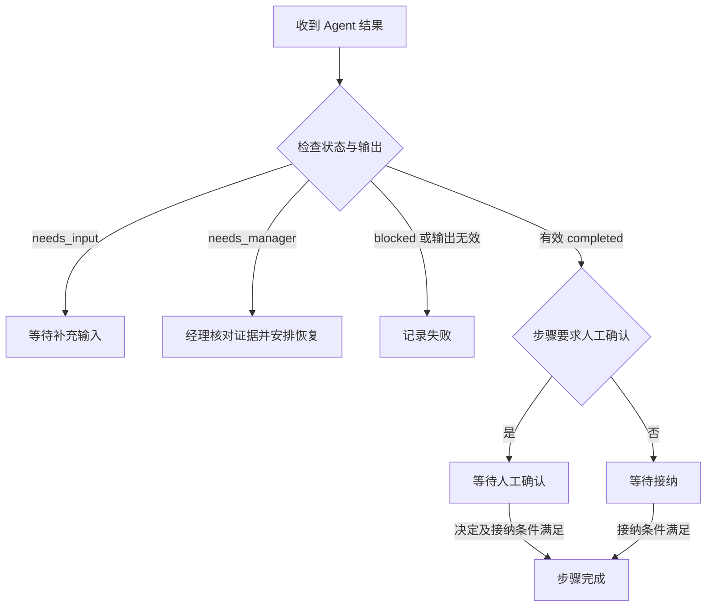

# 工作流如何推进

工作流描述步骤之间的关系和完成条件。驱动负责选择下一步，core 负责检查这一步现在是否允许执行。无论驱动来自用户、Rust 自动逻辑还是经理 Agent，都经过相同的执行检查。

## 一次需求分析

1. 用户为 Feature 启动工作流。core 解析选定配置，保存这次流程的计划。
2. 项目经理读取状态，派发 `requirements` 步骤。core 检查依赖、调用者权限、对象版本和执行预算。
3. core 保存本次输入及待执行操作。Host 的后台调度创建会话，适配器启动分析师。
4. 分析师返回结构化结果。core 校验输出端口、内容和来源，保存 PRD 与输出记录。
5. 步骤进入待接纳状态。符合条件的调用者接纳后，下游步骤才使用该结果。
6. 当前出厂流程的 `requirements_review` 由评审者检查 PRD，并要求 Human 确认。生成 PRD 与批准需求是两个不同动作。

后续设计步骤通过配置引用 `requirements.result`。经理可读取产物了解内容，但无需自己把整篇 PRD复制到分析师与设计师之间。具体通信见 [Agent 运行](agent-runtime.md)。

步骤上下文和可读取的 Agent 经验按 Feature ID 显示当前需求名称。查看实际发送的完整输入或封存快照时，仍可核对执行当时的原文。

经理页的审批材料使用原交付定义的名称，并标明实际产出步骤、轮次和本次审批用途。材料、上下文和执行记录链接指向对应产物的原始执行。

工作流步骤、材料目录、输入上下文和执行记录也以冻结交付名称标识产物。步骤的内部端口名可在配置和原始 JSON 中核对。

## 谁在推进流程

| 驱动 | 选择下一步的方式 | 仍需遵守的条件 |
|---|---|---|
| manual | 用户从工作台操作 | 依赖、权限、输出与完成规则 |
| rust | 程序按配置推进可执行步骤 | 相同规则；不能伪造人工决定 |
| agent | 经理通过平台工具检查和调度 | 相同规则，另需会话及工具调用授权 |

经理可以派发、查看、请求决定和发起受限返工。它不能靠一句“已完成”替代规则检查，也不能把自己声明为 Human。

## 步骤完成包含哪些检查

“模型停止生成”“输出格式合格”“步骤被接纳”“人工批准”“工作流完成”分别表达不同的结果。

Agent 返回 `completed` 只表明它声称完成任务。core 还要确认输出来自对应执行，满足声明的 Delivery/Spec，以及所需的检查依据。带人工确认的步骤进入 `waiting_confirmation`，其他有效输出通常进入 `awaiting_acceptance`。接纳时再核对当前状态和条件。

整个流程的完成由配置的 CompletionRule 判断。完成规则可以引用步骤结果、评审独立性、测试结果和批准事实，不等于所有模型回合都结束。

下面只画 Agent 返回结果后的主要分支，省略派发、暂停、取消和核对等路径：

## 等待与失败

| 情况 | 系统怎样处理 |
|---|---|
| 缺少须由人类提供的业务信息 | Agent 返回 `needs_input`，补充信息后按原会话继续 |
| Agent 无法自行修复技术故障 | Agent 返回 `needs_manager`，记录诊断和实际尝试，经理核对执行并安排受限修复 |
| 独立测试环境失败 | 经理从失败测试步骤请求返工，原测试作者保留用例、接口和配方，在原测试目录修复支撑环境 |
| 独立 Green 业务断言失败 | 经理从 Green 步骤请求返工，原实现 Agent 修复代码，原独立测试和冻结验收条件继续用于验证 |
| 实现 Agent 证实 Green 夹具本身有误 | 经理将修复交回独立测试作者，保留已核验的 Red 回执、用例与配方，重新运行 Green 验证 |
| 输出缺字段或来源不符 | 拒绝作为合格输出，保留失败原因 |
| 评审不通过 | 保留原拒绝，经理选择允许的返工方案或请求人工决定 |
| 外部操作结果不明 | 先核对实际进程、文件或远端状态，再决定下一步 |
| 预算耗尽 | 阻止继续执行，不无限创建新尝试 |

重试沿用同一任务条件；返工表达业务上的重新处理；计划修改会改变后续结构。三者不能互相替代，细节见[数据与恢复](data-and-recovery.md)。

经理通过 `workflow.inspect` 读取失败证据及 `recovery`。独立测试恢复使用失败步骤的原执行 ID 和当前版本调用 `workflow.step.rework`。内核核对平台原始回执与冻结依赖图，选择允许写入的原步骤。重跑前保留旧报告与检查点，重跑后独立测试生成新报告。更改需求、验收标准、计划或权限仍走各自的决策和确认流程。

每个步骤的 `budget.retry_limit` 默认为 3。首次实际执行之外，只有实际开始的替代执行计入重试。提前排队、补充会话轮次、换 Agent 和 Host 重启不会增加或重置本次流程中同一逻辑步骤的计数。额度用尽后，经理页按原失败执行显示升级事项及重试次数。

收到 `needs_manager` 后，经理还可以将经过核对的技术处理方案补充到原执行会话。原工作区检查点、权限和轮次预算继续生效。普通业务澄清仍使用真实人工回复或确切的平台材料转交。

实现入口：[工作流代码](../crates/devdesk-core/workflow-execution.md)、[当前 Feature 定义](../../configurations/workflows/simplified-workflow-feature-v9.json)。
