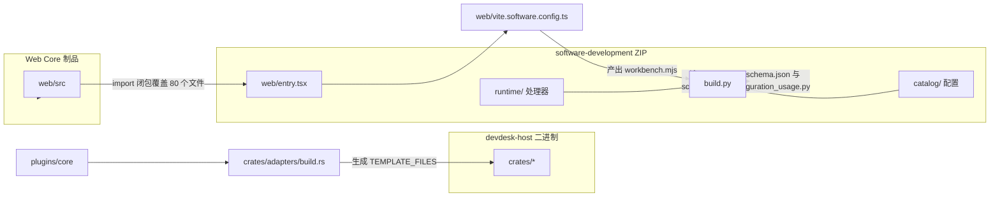
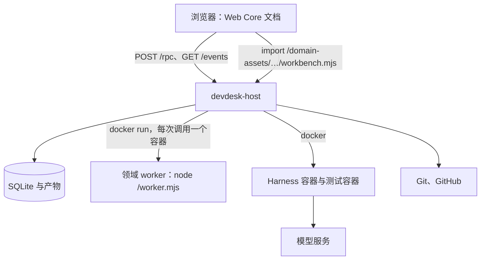

# 架构基线：改造前的组件归属与交互

本文记录改造开始前三个组件各自拥有什么、构建期与运行期谁依赖谁、关键交互流程和当时的边界守卫，基线 `main@2d8421c6`（2026-11-26），由架构审阅整理。评价见[报告](REPORT.md)，逐条问题见[审计清单](AUDIT.md)，目标见[改造计划](PLAN.md)。本文是事实记录；改造计划的状态是待实施。

阅读时注意：下文是当时的事实描述，不是目标状态。行号对应当前基线，代码改动后以符号名为准。

## 1. 组件与实际归属

仓库自述为“Rust Host、Web Core、领域 ZIP”三者独立交付。按源码的实际归属，是四块而不是三块：

| 仓库位置 | 自述身份 | 实际身份 |
|---|---|---|
| `crates/{domain,core,adapters,host}` | Rust Host（内核） | 内核。同时内置 Git、GitHub、测试、Feature/Task 等软件工程能力 |
| [plugins/core](../../../plugins/core/manifest.json) | “随 Host 构建的核心配置” | 内核的出厂资源包：由构建脚本读入并生成 Rust 常量，编译进二进制。它不是可安装的领域包 |
| [web/src](../../../web/src) | Web Core 与共享 SDK | Web Core，外加软件开发领域约 96% 的前端源码 |
| [plugins/software-development](../../../plugins/software-development/README.md) | 独立领域 ZIP | 领域配置目录、运行时处理器、14 行 Web 入口和 ZIP 构建脚本。前端源码与构建配置不在这一目录 |

“独立性”因此要分三层看。结论见 [报告](REPORT.md)，这里先给出支撑事实。

## 2. 构建期：谁编译谁

| 边 | 方向 | 性质 | 证据 |
|---|---|---|---|
| 内核 → `plugins/core` | 内核依赖资源包 | 构建脚本读取目录，校验后生成 `TEMPLATE_FILES` | [build.rs](../../../crates/adapters/build.rs) 第 8–44、46–76 行；[factory_bundle.rs](../../../crates/adapters/src/factory_bundle.rs) 第 4 行 |
| 领域前端 → `web/src` | 领域依赖核心源码 | 领域入口直接 import 核心源码 | [entry.tsx](../../../plugins/software-development/web/entry.tsx) 第 1–2 行 |
| 领域前端构建 → `web/` | 领域依赖核心的构建配置 | Vite 配置、TypeScript include、npm script 都在 `web/` | [vite.software.config.ts](../../../web/vite.software.config.ts)、[tsconfig.json](../../../web/tsconfig.json) 第 16 行、[package.json](../../../web/package.json) 第 15 行 |
| 领域 ZIP 构建 → 内核仓库 | 领域依赖内核内部文件 | 读取 RPC Schema 的 `$defs` 和引用索引脚本 | [build.py](../../../plugins/software-development/build.py) 第 48、143 行 |
| 测试 → 领域运行时文件 | 内核测试夹具包含领域文件 | 仅在测试或 fixture feature 下编译 | [adapters/src/tests.rs](../../../crates/adapters/src/tests.rs) 第 13–28 行 |

两条边值得单独指出。内核二进制的构建需要 `plugins/core` 目录存在，这是内核对“plugin 目录”的依赖，只是对方并不是真正的 plugin。领域 ZIP 的构建需要完整的 monorepo，无法脱离内核仓库完成。

## 3. 运行期：谁调用谁

运行期的方向是健康的：领域代码只能通过 Host 调用，内核在运行时不加载任何领域 Rust 代码。领域处理器在受限容器中执行，Host 校验输入、输出和运行证据（见 [内核 SDK 基线 第 1.6 节](BASELINE-kernel-sdk.md)）。

## 4. 关键交互流程

### 4.1 安装、激活、停用、卸载

1. 浏览器 `domain.install` 提交 Base64 ZIP。[domains.rs](../../../crates/host/src/domains.rs) 第 172–181 行解码后交给 `Package::read`。
2. `Package::read` 完成全部静态校验：路径与大小限制、逐文件 SHA-256、清单 Schema、命名空间、处理器与 UI 绑定、配置包、证据验证器、对象类型绑定。[domain_packages.rs](../../../crates/adapters/src/domain_packages.rs) 第 256–552 行。
3. 通过后 ZIP 原样存入 `domain-packages.sqlite3`。
4. `domain.activate` 再次读取并解析，若声明了运行时则先做 worker 握手，再检查项目可见性与在途工作，最后递增代次。同文件第 815–866 行，[worker.rs](../../../crates/adapters/src/domain_packages/worker.rs) 第 86–93 行。
5. 代次变化经 `/domain-events` 通知所有客户端，客户端重新读取贡献并重挂载页面。

### 4.2 领域配置如何进入项目

激活后项目引擎采用包内源修订（`adopt_domain_sources`，[domains.rs](../../../crates/host/src/domains.rs) 第 279、401 行）。包内源以 `{包 id}.` 为命名空间，可与 `builtin-*` 的内核能力引用混用。对象工作流专用的源闭包不进入日常配置目录（`automation_sources`，[domain_packages.rs](../../../crates/adapters/src/domain_packages.rs) 第 565–615 行）。

### 4.3 领域处理器的调用入口

领域 JavaScript 处理器共有五条被调用路径，详见 [内核 SDK 基线 第 2.3 节](BASELINE-kernel-sdk.md)：

| 入口 | 调用者 | 是否要求项目归属 | 位置 |
|---|---|---|---|
| `query.domain.invoke` | 浏览器 | 否 | domains.rs 第 481–483 行 |
| `domain.read` 平台工具 | 冻结的工作流步骤 | 是 | [platform_facts.rs](../../../crates/core/src/platform_facts.rs) 第 446 行、[platform_runtime.rs](../../../crates/core/src/platform_runtime.rs) 第 654–666 行 |
| 工程钩子 | 内核的 Git、GitHub、测试适配器 | 是 | domain_packages.rs 第 975–1093 行 |
| 证据验证器 | 交付类平台工具 | 是 | [platform_delivery.rs](../../../crates/core/src/platform_delivery.rs) 第 288–363 行 |
| `project_connection` | `domain.project.create` | 否 | domain_packages.rs 第 1165–1187 行 |

### 4.4 领域工作流与证据门禁

1. `domain.workflow.start` 解析活动包中的 Workflow 修订，要求该修订属于当前包。Agent 模式还要求它在包的 `agent_workflows` 中。domains.rs 第 348–409 行。
2. 有归属对象时，按对象类型声明的绑定冻结原对象修订，工作流完成时用已接纳的产物创建交付对象。
3. 执行 `workspace.target`、`git.source.publish`、`git.delivery.open`、`git.delivery.merge` 前，内核按 Workflow 的 `operation_evidence` 收集事实，交给领域验证器判断是否放行。
4. 验证器是只读的，放行之后真正的外部操作仍由内核的 Git 与托管端口执行。

### 4.5 工程钩子

内核在五个位置把策略让渡给活动领域包：工作树分支命名、PR 标题与正文、项目测试入口识别、测试报告器内容、项目接入解析。这些钩子由内核按名字查找，不是通用机制，详见 [内核 SDK 基线 第 1.9 节](BASELINE-kernel-sdk.md)。

### 4.6 Web 加载领域界面

1. Web Core 读取 `query.domain.active`，得到代次、活动包、贡献目录和呈现目标。[DomainWorkbench.tsx](../../../web/src/DomainWorkbench.tsx) 第 651–662 行。
2. 找到 `renderer` 为 `web.react` 且 `api` 为 2 的目标与对应绑定，向文档注入样式表，再动态 `import` 领域入口的 ES 模块。同文件第 179–211 行。
3. 页面组件在 `DomainProvider`、错误边界和 `Suspense` 内渲染，通过 `useDomain()` 取得上下文。
4. 领域资源只在其代次与摘要都匹配活动包时才由 Host 提供。[domains.rs](../../../crates/host/src/domains.rs) 第 547–567 行。

详细机制与隐式契约见 [Web 嵌入基线](BASELINE-web-embedding.md)。

## 5. 能力面速查

| 项目 | 数量 | 出处 |
|---|---|---|
| 源定义类型 | 15 种 | [template-manifest.schema.json](../../../schemas/template-manifest.schema.json) |
| 内核平台处理器 | 55 个 | [platform_tools.rs](../../../crates/core/src/platform_tools.rs) 第 4–60 行 |
| 出厂已发布的平台工具定义 | 49 个：内核 9 个，软件开发 40 个 | 两份 manifest 的 `types.tool` |
| 未被任何包发布的处理器 | 6 个：`domain.read` 及 `workspace.snapshot`、`tasks.complete`、`git.candidate`、`git.advance`、`git.publish` | 同上 |
| RPC 登记项 | 308 项，其中 11 项已退役 | [rpc_contracts.json](../../../crates/core/src/rpc_contracts.json) |
| `rpc.schema.json` 定义数 | 147 个 | [rpc.schema.json](../../../schemas/rpc.schema.json) |
| Harness provider | 2 个，闭合枚举 | [runtime.rs](../../../crates/domain/src/runtime.rs) 第 9–15 行 |
| 软件开发包的处理器 | 5 个 | [build.py](../../../plugins/software-development/build.py) 第 176–210 行 |
| `web/src` 的 TS/TSX 文件 | 86 个（含领域入口） | [Web 嵌入基线 第 1.5 节](BASELINE-web-embedding.md) |

[tools-and-primitives.md](../../../docs/design/reference/tools-and-primitives.md) 写的是“54 个平台处理器”，源码中实际为 55 个，多出的是 `domain.read`。这处漂移本身说明能力面没有单一可信的登记位置。

## 6. 现有的边界守卫

| 守卫 | 检查什么 | 没检查什么 |
|---|---|---|
| [check-architecture.py](../../../scripts/check/check-architecture.py) | 四个 crate 的依赖方向、domain 不触碰环境、core 无构建脚本、adapters 不在构建期查找运行资产、host 不直接写业务状态 | crate 与 `plugins/` 之间的一切引用 |
| [vite.core.config.ts](../../../web/vite.core.config.ts) 第 9–26 行 | 核心包不得包含 `plugins/` 下模块，以及 `App.tsx`、`FeatureBranchQueue`、`RepositorySettings` 三个文件 | 黑名单之外的任何领域模块。名单靠手工维护 |
| [vite.software.config.ts](../../../web/vite.software.config.ts) 第 11–17 行 | 把 4 个模块按文件名重定向到 SDK | 不限制领域包继续 import 其他核心源码 |
| [check-defaults.py](../../../scripts/check/check-defaults.py) | 文件归属与引用 | 不涉及内核与领域的方向 |

Rust 侧的分层守卫是完整的，领域边界没有任何机器守卫。
