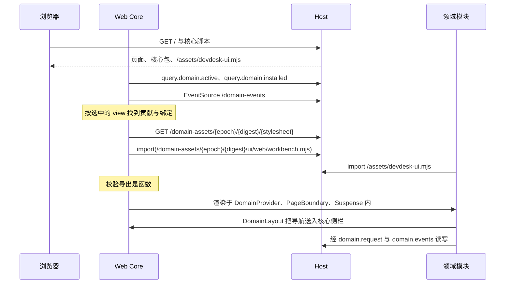

# Web 嵌入基线：改造前的事实

本文记录改造开始前领域 UI 进入前端的实际方式，基线 `main@2d8421c6`（2026-11-26），由架构审阅整理。统计数字来自对 `web/src` 与 `plugins/software-development/web` 的 import 闭包计算。目标契约见 [目标 Web SDK 契约](CONTRACT-web-sdk.md)，处理方式见 [改造计划](PLAN.md)。

阅读时注意：下文是当时的事实描述，不是目标状态。本文是事实记录；[改造计划](PLAN.md)的状态是待实施。

## 0. 结论

1. **Web Core 对领域 UI 的约束目前等于“能加载”。** 加载链路本身是清楚的：同文档、同 React 树、按代次与摘要校验资源。但入口形态、上下文、布局、插槽、路由、样式、生命周期、版本这些“如何嵌入”的规则，没有一条写成了文档。
2. **名义 SDK 只有 4 个模块，其余靠直接 import 核心源码。** 领域入口的 import 闭包覆盖 81 个文件，80 个在 `web/src`。经 SDK 进入领域的只有 `domain-sdk`、`workbench-layout`、`ActionFeedback`、`action-feedback`；另外 48 个核心模块被原样编译进领域包。
3. **领域 UI 的源码和构建配置都住在核心包里。** 软件开发的前端只有 `entry.tsx` 这 14 行在领域目录，`web/src` 约 96% 的 TS/TSX 源码被编译进领域包，构建配置、TypeScript 配置、npm script 全在 `web/`。
4. **核心与领域之间靠 DOM 探测互相挂载。** 核心用类名、`data-` 属性和中文按钮文案在领域页面里找挂载点，还用 `MutationObserver` 持续监视。这是双向耦合：核心认识领域的 DOM，领域必须维持这些 DOM。

## 1. 现状

### 1.1 加载链路

对应代码在 [DomainWorkbench.tsx](../../../web/src/DomainWorkbench.tsx)：读取目录第 651–662 行，选择目标与绑定第 179–188 行，注入样式第 189–198 行，动态导入第 200–211 行，构造上下文第 221–283 行，挂载第 284–295 行。

资源只在其代次与摘要都匹配活动包时才由 Host 提供（[domains.rs](../../../crates/host/src/domains.rs) 第 547–567 行）。CSP 为 `script-src 'self'`（[main.rs](../../../crates/host/src/main.rs) 第 115 行），领域脚本与核心同源，因此可以直接执行。

### 1.2 名义 SDK

入口是 [domain-sdk.ts](../../../web/src/domain-sdk.ts)，构建为 `/assets/devdesk-ui.mjs`。导出如下：

| 类别 | 导出 |
|---|---|
| React 本体 | `Children`、`Component`、`Fragment`、`Suspense`、`cloneElement`、`createContext`、`createElement`、`forwardRef`、`isValidElement`、`lazy`、`memo`、`startTransition`、`useCallback`、`useContext`、`useEffect`、`useId`、`useLayoutEffect`、`useMemo`、`useReducer`、`useRef`、`useState`、`useSyncExternalStore`、默认导出 |
| JSX 与门户 | `jsx`、`jsxs`、`createPortal` |
| 布局 | `DomainLayout`、`WorkbenchLayout` |
| 反馈组件 | `ActionButton`、`ActionForm`、`ActionInput`、`ActionSelect`，以及 [action-feedback.ts](../../../web/src/components/action-feedback.ts) 的全部导出 |
| 类型与上下文 | `Data`、`DomainContext`、`DomainProvider`、`useDomain` |

领域构建通过 [vite.software.config.ts](../../../web/vite.software.config.ts) 把 `react`、`react/jsx-runtime`、`react-dom` 和 SDK 路径设为 external（第 5、25 行），并把它们的 import 路径统一改写为 `/assets/devdesk-ui.mjs`（第 27 行）。另外 4 个模块按**文件名**做正则重定向到 SDK（第 13 行）。

类型声明由 [tsconfig.sdk.json](../../../web/tsconfig.sdk.json) 从 `domain-sdk.ts` 生成，随 Web Core 制品发布（[package.sh](../../../scripts/release/package.sh) 第 71 行）。

### 1.3 上下文

页面通过 `useDomain()` 取得上下文，未在工作台内挂载时抛错（domain-sdk.ts 第 55–58 行）。

| 字段 | 含义 | 实现 |
|---|---|---|
| `epoch` | 活动代次 | 直接来自目录 |
| `view` | 当前贡献 ID | 同上 |
| `projectConnection` | 活动包声明的项目接入处理器名 | 来自清单的 `runtime.project_connection` |
| `query(handler, input)` | 调用领域处理器 | `query.domain.invoke`，绑定页面的中止信号 |
| `request(method, params, options)` | 通用 RPC | 见 C8 |
| `events(projectId?)` | 事件流 | `/events?tail=true&configuration=true&domain_epoch=…` |

`projectConnection` 在上下文类型里，但领域页面并不读取它。它是核心自己用的：有这个字段时，核心才渲染“移除项目”按钮（DomainWorkbench.tsx 第 640–650、778–782 行）。一个软件工程专用的清单字段出现在通用上下文类型里，是 [内核 SDK 基线](BASELINE-kernel-sdk.md) 所述钩子在前端的投影。

### 1.4 贡献与导航

贡献是客户端中立的声明（[contributions.json](../../../plugins/software-development/web/contributions.json)），每个包含 `id`、`title`、`kind`、`context`、`query`、`projection`、`fields`、`inputs`。

- 每个贡献在侧栏对应一个导航项（DomainWorkbench.tsx 第 835–845 行）。
- `projection` 为真的贡献把 `query` 指向一个公开的 `query.*` RPC，经 `query.domain.contribution` 调用。输入必须带 `project_id`，Host 再注入 `domain_epoch`（[domains.rs](../../../crates/host/src/domains.rs) 第 468–480 行）。非投影贡献把 `query` 指向处理器名，由核心渲染一个通用表单。
- 投影贡献还有一条不显眼的作用：领域页面经 `domain.request` 发出的任何方法，只要与某个投影贡献的 `query` 同名，也会被改走 `query.domain.contribution`（DomainWorkbench.tsx 第 237–245 行）。软件开发包的三个投影贡献因此在拦截自己页面发出的 `query.repository` 等请求。
- `api` 为 2 时，`kind`、`context`、`fields`、`inputs` 在前端都不参与渲染，页面由绑定决定；`query` 只通过上面的拦截规则起作用。
- “领域工作台”首页是 `api` 为 2 的目标里的**第一个绑定**（第 623–628 行）。绑定与导出名在 [build.py](../../../plugins/software-development/build.py) 第 168–172 行按位置配对。

### 1.5 源码归属统计

| 集合 | 文件数 | 字节数 |
|---|---|---|
| `web/src` 与领域 web 目录的 TS/TSX 合计 | 86 | 约 966 KB |
| 核心入口 `core-main.tsx` 可达 | 57 | — |
| 领域入口 `entry.tsx` 可达 | 81 | — |
| 只被领域可达，位于 `web/src` | 28 | 419,210 |
| 两者都可达 | 52 | — |
| 其中经 SDK 别名进入领域 | 4 | 13,967 |
| 其中从核心源码重复编译进领域包 | 48 | 492,043 |
| 只被核心可达 | 5（另加 `style.css`） | — |

领域入口可达的源码占 `web/src` 全部 TS/TSX 的约 96%。只被领域可达的 28 个文件包括 84 KB 的 [App.tsx](../../../web/src/App.tsx) 和 [FeatureBranchQueue.tsx](../../../web/src/components/FeatureBranchQueue.tsx)、[GitHubConnection.tsx](../../../web/src/components/GitHubConnection.tsx)、[RepositorySettings.tsx](../../../web/src/components/RepositorySettings.tsx) 等。

重复编译的 48 个模块里有带模块级状态的 [runtime-state.ts](../../../web/src/runtime-state.ts) 和 [template-catalog.ts](../../../web/src/template-catalog.ts)，也有核心的统一请求边界 [workbench-request.ts](../../../web/src/workbench-request.ts)。这意味着核心页面与领域页面在同一文档里各持一份缓存与监听器。是否已造成实际缺陷本次没有运行验证，但结构上两份状态无法互相失效。

构建侧的耦合点：[tsconfig.json](../../../web/tsconfig.json) 第 16 行把领域目录纳入核心的类型检查，[package.json](../../../web/package.json) 第 15 行的 `build:software` 是领域的前端构建，同一文件第 10 行的 lint 范围也包含领域目录。

核心包靠一份三个文件的黑名单防止“领域模块混入核心”（[vite.core.config.ts](../../../web/vite.core.config.ts) 第 15–21 行）：`App.tsx`、`FeatureBranchQueue`、`RepositorySettings`。名单之外没有任何限制。

### 1.6 插槽：核心如何把自己的部件放进领域页面

有两个插槽，方向都是“核心组件挂进领域页面”，靠核心探测领域的 DOM 实现。

**设置区块。** 领域的设置页渲染一个带 `data-domain-storage-outlet` 的面板（App.tsx 第 1980 行）。核心的 `DomainLayout` 在主区内寻找它，兼容旧包时退而寻找包含内核连接组件的面板，然后把核心的 `DomainStorageSettings` 传送进去（[workbench-layout.tsx](../../../web/src/workbench-layout.tsx) 第 95–115 行）。

**项目操作。** `DomainLayout` 从领域的 `.project-selector select` 读出当前项目，检查 `nav button[aria-current="page"]` 的 `data-workbench-tab` 是否为 `projects`（或文案是否为“项目管理”），再用 `MutationObserver` 在主区内找 `[data-domain-project-save]`，找不到就找文案为“保存项目配置”的按钮，把核心的 `DomainProjectRemoval` 传送进它所在的 `.action-control`（同文件第 116–154 行）。

领域一侧对应的是 App.tsx 第 1273 行的 `.project-selector`、第 1308 行的 `data-workbench-tab`、第 1156 行的“项目管理”。

这里还有一个更深的依赖：在领域模式下，**核心并不知道当前选中的项目**，要从领域的下拉框里读。

## 2. 隐式契约清单

下表是领域 UI 要正常工作实际必须满足的全部条件。没有任何一条有文档。

| # | 契约 | 现在靠什么表达 | 证据 | 风险 |
|---|---|---|---|---|
| C1 | 入口是 ES 模块，绑定指定的导出是 React 组件 | 运行时检查是否为函数 | DomainWorkbench.tsx 第 200–208 行 | 无类型约束，props 约定不明 |
| C2 | React 必须来自 SDK | Vite external 与路径改写 | vite.software.config.ts 第 5、25–27 行 | 自带 React 会出现两个实例。别名按文件名匹配，同名文件会被误替换 |
| C3 | 上下文经 `useDomain()` 获取 | SDK | domain-sdk.ts 第 55–58 行 | 低 |
| C4 | 渲染容器 | `api` 为 2 时无包裹；为 1 时包在面板与标题里 | DomainWorkbench.tsx 第 284–325 行 | `api` 的两个值语义不同，没有文档 |
| C5 | 布局与导航 | `DomainLayout` 把导航送进核心侧栏，核心随即隐藏自己的导航 | workbench-layout.tsx 第 21–58、71–94、155–158 行 | 领域必须自带回到核心页面的导航，App.tsx 第 1156–1161 行重复了一份 |
| C6 | 首页 | 目标的第一个绑定 | DomainWorkbench.tsx 第 623–628 行；build.py 第 168–172 行 | 调整贡献顺序会改变首页或导出配对 |
| C7 | 路由 | URL 的 `view`、`project_id`、`tab`。核心在切换贡献时保留后两个 | DomainWorkbench.tsx 第 708–721 行；App.tsx 第 459–461、526–535 行 | 双方各自读写 `location.search` |
| C8 | 请求 | `domain.request` 是不带超时、缓存和失效的裸 RPC；领域再用核心的 `createRequest` 包一层 | DomainWorkbench.tsx 第 67–88、232–250 行；App.tsx 第 209–228 行 | 领域与核心页面走不同的请求路径，且为此必须 import 核心源码 |
| C9 | 请求特判 | 核心对 `query.agent_revision` 有专门逻辑；领域把 `project.open_github` 改写为 `domain.project.create`；投影贡献会拦截领域页面发出的同名方法 | DomainWorkbench.tsx 第 237–245、251–265、287 行；App.tsx 第 214–227 行 | 通用包装里嵌有具体业务方法名；贡献声明因此不只是给其他客户端的描述，还会改变领域自己页面的请求路径 |
| C10 | 事件 | `domain.events` 建流；`/domain-events` 触发整页重挂 | DomainWorkbench.tsx 第 267–275、850–855、664–698 行 | 低 |
| C11 | 样式 | 全局样式表，无作用域 | DomainWorkbench.tsx 第 189–198 行 | 领域样式可影响整个工作台；领域依赖核心类名的内部结构 |
| C12 | 设置插槽 | 领域渲染特定 `data-` 属性 | workbench-layout.tsx 第 95–115 行；App.tsx 第 1980 行 | 双向 DOM 耦合 |
| C13 | 项目操作插槽 | 领域渲染特定类名、属性与中文文案 | workbench-layout.tsx 第 116–154 行 | 双向 DOM 耦合，依赖文案，需持续监视 |
| C14 | 生命周期 | 卸载时中止请求、移除样式；代次变化时以 `key` 重挂 | DomainWorkbench.tsx 第 189–220、850–855 行 | 清理责任没有约定 |
| C15 | 版本 | 只有 `api: 1` 或 `2`；SDK 路径写死为绝对路径 | DomainWorkbench.tsx 第 179–181 行；vite.software.config.ts 第 4 行 | 领域包与核心包的版本不校验；Web Core 不能部署在子路径 |
| C16 | 资源 | 路径形如 `/domain-assets/{epoch}/{digest}/{path}` | domains.rs 第 547–567 行 | 低 |
| C17 | 类型 | `Request` 是宽类型 | [rpc-types.ts](../../../web/src/components/rpc-types.ts) | 领域拿不到核心返回结构的类型 |
| C18 | 信任 | 领域代码与核心同源、同权限执行 | main.rs 第 115 行 | 没有写明“领域包是可信代码”这一前提 |

样式方面还有两处归属错位。核心的 [style.css](../../../web/src/style.css) 共 3117 行，其中 186 行的选择器含 workflow、manager、feature、branch、repo、delivery 等词，例如第 509 行的 `.feature-row`、第 618 行的 `.task-grid`、第 1208 行的 `.feature-branch-queue`，以及第 226 行的 `.domain-project-removal`。领域自己的 [workbench.css](../../../plugins/software-development/web/workbench.css) 只有 175 行，且第一条规则就叠在核心类上。
