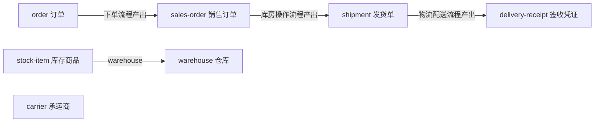

# 第二个领域：电商出库

| 项 | 内容 |
|---|---|
| 状态 | **待实施**。本文是设计稿，领域包尚未创建 |
| 日期 | 2026-11-26 |
| 所属计划 | [架构独立性改造](PLAN.md) |
| 包标识 | `ecommerce-outbound`，首版 `0.1.0` |
| 依赖的契约 | [目标内核 SDK](CONTRACT-kernel-sdk.md)、[目标 Web SDK](CONTRACT-web-sdk.md) |

## 1. 目的与边界

这个领域包的唯一目的是验证抽象。它必须只使用协议核心和内核资源，不依赖工程扩展，并且在构建和运行时都不接触 Git、GitHub、测试和代码工作区。

**范围。** 从订单接入到签收的出库履约，分三个主流程：下单、库房操作、物流配送。

**项目**对应一个店铺的履约范围。项目只凭标题创建，没有接入信息。

**不做的事：**

- 不接真实的电商平台和物流商。所有产出是文档和 JSON，处理器是无依赖的纯函数。
- 不包含退货、退款等反向流程。
- 不做库存记账。库存是只读的样本数据。
- 阶段之间不自动串联。下一阶段由人从页面发起。

## 2. 对象类型与关系

类型引用形如 `ecommerce-outbound.order:1`。

| 类型 | 用途 | 工作流 | 关系 |
|---|---|---|---|
| `order` | 人工录入的原始订单 | 下单流程 | 无 |
| `sales-order` | 已确认的销售订单，下单流程的产物 | 库房操作流程 | `order`，恰好一个 |
| `shipment` | 发货单，库房操作流程的产物 | 物流配送流程 | `sales-order`，恰好一个 |
| `delivery-receipt` | 签收凭证，物流配送流程的产物 | 无 | `shipment`，恰好一个 |
| `warehouse` | 仓库设置 | 无 | 无 |
| `carrier` | 承运商设置 | 无 | 无 |
| `stock-item` | 库存商品，带各仓库的可用数量 | 无 | `warehouse`，零到十六个 |

前三条工作流各自的交付端口绑定到下一阶段的类型，并声明指向归属对象的关系。工作流完成时，内核用已接纳的产物创建下一阶段的对象，人在页面上对它发起下一个流程。这条链验证了对象类型、带基数的关系、工作流绑定和跨对象的流程衔接。

**数据预算。** 工作流创建的对象数据不超过 16 KiB，所以对象里只放结构化的摘要；拣货单、质检报告这类长内容是产物，不进对象。

## 3. 三个流程

通用约定：

- 工具步骤调用本领域的处理器，工具定义的 `implementation` 为 `domain`。
- Agent 步骤的最终输出遵循 `status`、`summary`、`outputs`，各输出按交付物定义接纳。
- “人工确认”指步骤的 `confirmation` 为 `Human`。“人工补充”指 Agent 以 `needs_input` 请求、人通过步骤输入提供。
- 门禁是[目标内核 SDK](CONTRACT-kernel-sdk.md)第 8 节的通用证据门禁。

### 3.1 下单流程

`ecommerce-outbound.workflow-order-placement:1`。归属对象是 `order`，输入端口 `order` 装载订单数据。

| 步骤 | 阶段 | 执行者 | 产出 | 说明 |
|---|---|---|---|---|
| `validate` | 校验 | 处理器 `order.validate` | `order-check` | 必填项、金额一致性、地址完整性、商品是否存在、可售库存 |
| `review` | 审核 | 订单审核员 | `order-review` | 审核风险。发现问题且可以更正时请求人工补充，并把更正后的订单写入 `corrected-order` 端口 |
| `accept` | 确认 | 处理器 `order.accept` | `sales-order` | 用原订单和更正结果生成销售订单，含承诺发货时限和库存预留 |

- **人工确认**：挂在 `review`，确认的是审核结论。
- **门禁** `order-acceptance`：守护 `accept` 和 `$completion`。要求校验通过、审核结论为通过、人工已确认。
- **完成条件**：`accept` 完成。交付端口 `sales_order` 创建 `sales-order`。
- **异常路径**：校验不通过且无法更正时，审核结论为拒绝，流程以拒绝结束，订单留在原处，由人决定取消或新建。更正后的订单仍然不合法时，`accept` 抛出结构化错误，步骤失败并保留原因。

归属对象在流程在途期间不可编辑，所以更正只能走步骤输入，这正是本流程要验证的路径。

### 3.2 库房操作流程

`ecommerce-outbound.workflow-warehouse-operations:1`。归属对象是 `sales-order`，输入端口 `sales_order`。

| 步骤 | 阶段 | 执行者 | 产出 | 说明 |
|---|---|---|---|---|
| `allocate` | 计划 | 处理器 `warehouse.allocate` | `allocation-plan` | 按仓库库存分配，整单优先，标记缺货 |
| `pick-plan` | 计划 | 库房计划员 | `pick-list` | 拣货单：库位顺序、拆单说明、注意事项 |
| `pick` | 执行 | 处理器 `warehouse.pick` | `pick-record` | 按分配结果生成实拣记录。短拣信息由人工补充，默认没有 |
| `pack` | 执行 | 处理器 `warehouse.pack` | `packing-list` | 按体积和重量选包装，生成装箱单和面单数据 |
| `inspect` | 复核 | 质检员 | `qc-report` | 核对订单、实拣记录和装箱单 |
| `handover` | 交接 | 处理器 `warehouse.handover` | `shipment` | 生成交接单，含包裹、承运要求和交接时限 |

- **人工确认**：挂在 `inspect`。
- **门禁** `warehouse-handover`：守护 `handover` 和 `$completion`。要求分配无缺货、实拣无短拣、包装成功、质检通过且人工已确认。
- **完成条件**：`handover` 完成。交付端口 `shipment` 创建 `shipment`。
- **异常路径**：出现短拣时门禁拒绝放行，流程阻塞并保留原因。人在返工策略允许的范围内选择回到 `allocate` 重新分配，或者取消。

### 3.3 物流配送流程

`ecommerce-outbound.workflow-logistics-delivery:1`。归属对象是 `shipment`，输入端口 `shipment`。

| 步骤 | 阶段 | 执行者 | 产出 | 说明 |
|---|---|---|---|---|
| `select-carrier` | 分派 | 处理器 `logistics.select-carrier` | `carrier-plan` | 按目的地覆盖、时效和重量选择承运商与服务等级 |
| `dispatch-plan` | 分派 | 物流专员 | `dispatch-plan` | 发运计划：中转、时效风险、注意事项 |
| `dispatch` | 在途 | 处理器 `logistics.dispatch` | `dispatch-record` | 生成运单号和面单数据 |
| `scan` | 在途 | 物流专员 | `scan-events` | 向人请求扫描事件并整理成结构化记录。这是第二条人工补充路径 |
| `track` | 在途 | 处理器 `logistics.track` | `tracking-timeline` | 计算时间线，判断是否超时或有异常事件 |
| `exception-review` | 异常 | 异常处理专员 | `exception-report` | 只在 `track` 标记异常时执行：分析原因，给出处理建议和客户通知草稿 |
| `deliver` | 签收 | 处理器 `logistics.deliver` | `delivery-receipt` | 生成签收凭证 |

- **人工确认**：挂在 `deliver`，确认的是签收凭证。
- **门禁** `logistics-delivery`：守护 `deliver` 和 `$completion`。要求已发运、没有未处理的异常、人工已确认。
- **完成条件**：`deliver` 完成。交付端口 `delivery_receipt` 创建 `delivery-receipt`。
- **异常路径**：`track` 标记异常且没有异常报告时门禁拒绝放行。人可以选择返工到 `scan` 补充后续扫描事件，或者取消。

## 4. 角色、能力与 Agent

### 4.1 角色

标识形如 `ecommerce-outbound.role-order-reviewer:1`，职责正文是同名的 Markdown 文件。

| 角色 | 职责 | 用于 |
|---|---|---|
| 订单审核员 `order-reviewer` | 核对订单信息、支付和地址，判断风险，给出通过、拒绝或需要补充的结论 | 下单 |
| 库房计划员 `warehouse-planner` | 理解分配结果，编制可执行的拣货单 | 库房 |
| 质检员 `qc-inspector` | 独立核对订单、实拣和包装，不采信上游的自述 | 库房 |
| 物流专员 `logistics-planner` | 制定发运计划，整理在途扫描记录 | 物流 |
| 异常处理专员 `exception-handler` | 分析异常，提出处理方案，起草客户通知 | 物流 |
| 出库流程经理 `outbound-manager` | 推进流程，核对证据，请求人工决定。不能代替人签字 | 三个流程的编排 |

### 4.2 能力

首版每个角色一套能力，沿用内核出厂的默认 Harness 和 Model：`builtin-harness-codex-managed:2` 与 `builtin-model-gpt-6-2-sol-high:1`。这样 Agent 调度可用的编排能力开箱即得。第二套模型绑定在验证通过后按需增加。

| 能力 | 技能 | 工具 | 权限 |
|---|---|---|---|
| `capability-order-reviewer` | 订单审核、流程协同 | Harness 原生工具、工作流输出读取、规范检查、`order-validate` | 只读 |
| `capability-warehouse-planner` | 库存分配、拣货与包装、流程协同 | Harness 原生工具、工作流输出读取、规范检查 | 可在工作目录起草 |
| `capability-qc-inspector` | 出库质检、流程协同 | Harness 原生工具、工作流输出读取、规范检查 | 只读 |
| `capability-logistics-planner` | 承运商选择、流程协同 | Harness 原生工具、工作流输出读取、规范检查 | 可在工作目录起草 |
| `capability-exception-handler` | 异常处理、流程协同 | Harness 原生工具、工作流输出读取、规范检查 | 可在工作目录起草 |
| `capability-outbound-manager` | 流程协同 | 经理工具组、工作流输出读取、规范检查 | 只读 |

经理工具组是内核处理器的定义，包括 `workflow.inspect`、`workflow.step.dispatch`、`workflow.controller.wait`、`workflow.decision.request` 等。它们的定义按[目标内核 SDK](CONTRACT-kernel-sdk.md)第 5 节随内核发布。

权限使用两个本领域预设加一个内核预设：

| 预设 | 目标 | 规则 |
|---|---|---|
| `permission-read` | Harness | 文件系统只读，网络可用，全部可用工具 |
| `permission-draft` | Harness | 根目录只读，`/work` 可读写，网络可用，全部可用工具 |
| `builtin-permission-sandbox-full-access:2` | Sandbox | 沿用内核预设 |

### 4.3 Agent 与绑定

Agent 形如 `ecommerce-outbound.agent-order-reviewer:1`，由上面的角色和能力一一组合。默认选择里把六个角色都绑定到对应的 Agent，编排角色指向出库流程经理。

## 5. 交付物与规范

标识形如 `ecommerce-outbound.delivery-order-check:1`。每个交付物关联一个规范，规范里列出内容检查项。

| 交付物 | 格式 | 生产者 | 用于 | 规范检查要点 |
|---|---|---|---|---|
| `order-check` | JSON | 平台 | 校验结果 | 字段齐全，状态取值合法，问题列表与状态一致 |
| `order-review` | Markdown | Agent | 审核结论 | 引用校验结果中的问题；结论是通过、拒绝、需要补充之一并给出理由；覆盖地址、金额、库存三类风险；不编造平台没有的事实 |
| `corrected-order` | JSON | Agent | 更正后的订单 | 结构与原订单相同，只改动需要更正的字段，并列出改动 |
| `sales-order` | JSON | 平台 | 下一阶段对象 | 行项目与预留数量一致，承诺时限晚于下单时间 |
| `allocation-plan` | JSON | 平台 | 拣货依据 | 每个行项目有分配结果，缺货被显式标记 |
| `pick-list` | Markdown | Agent | 拣货执行 | 覆盖全部分配行，库位顺序明确，拆单说明完整 |
| `pick-record` | JSON | 平台 | 质检依据 | 实拣数量不超过分配数量 |
| `packing-list` | JSON | 平台 | 质检与交接依据 | 包裹数量、尺寸、重量合法 |
| `qc-report` | Markdown | Agent | 人工确认 | 逐项核对订单、实拣、包装；结论明确；不采信上游自述 |
| `shipment` | JSON | 平台 | 下一阶段对象 | 包裹与装箱单一致，交接时限不晚于承诺时限 |
| `carrier-plan` | JSON | 平台 | 发运计划 | 承运商覆盖目的地，服务等级满足重量 |
| `dispatch-plan` | Markdown | Agent | 人工确认 | 中转与时效完整，风险有依据 |
| `dispatch-record` | JSON | 平台 | 在途跟踪 | 运单号唯一，面单数据与发货单一致 |
| `scan-events` | JSON | Agent | 时间线计算 | 事件时间有序，状态取值合法 |
| `tracking-timeline` | JSON | 平台 | 异常判断 | 超时与异常标记和事件一致 |
| `exception-report` | Markdown | Agent | 人工处理 | 原因指向具体事件，方案可执行，通知草稿语气与事实一致 |
| `delivery-receipt` | JSON | 平台 | 流程终点 | 签收结果取值合法，凭证引用存在 |

机器可判断的 JSON 交付物用内容 Schema 加规范里的断言；叙述性文档用规范里的内容检查项，由评审类步骤和人工确认把关。

## 6. 技能

标识形如 `ecommerce-outbound.skill-order-review:1`。

| 技能 | 适用角色 | 内容要点 |
|---|---|---|
| `skill-order-review` | 订单审核员 | 审核顺序：先看校验结果，再看支付与金额，再看地址；什么情况该请求补充而不是拒绝 |
| `skill-inventory-allocation` | 库房计划员 | 整单优先、同省仓库优先、缺货必须显式标记 |
| `skill-pick-and-pack` | 库房计划员 | 拣货单的库位排序与拆单规则；易碎品单独包装；按体积和重量选包装 |
| `skill-quality-check` | 质检员 | 核对清单与抽样规则；如何记录不符项；独立性要求 |
| `skill-carrier-selection` | 物流专员 | 覆盖范围、时效、重量和优先级的取舍顺序 |
| `skill-exception-handling` | 异常处理专员 | 异常分类：地址、时效、破损、丢失；每类的处理方案和客户通知写法 |
| `skill-workflow-coordination` | 全部 | 怎样读取上游产物、引用证据、请求人工决定；哪些事不能代替人做 |

## 7. 规范快照与默认选择

`ecommerce-outbound.standard-outbound-fulfillment:1` 以三个流程为根流程，默认流程是下单流程。

默认选择沿用内核出厂的 Model、Harness、Sandbox 和两个权限预设，把六个角色绑定到对应 Agent，编排角色指向出库流程经理。

## 8. 处理器

全部是无依赖的纯函数，位于单文件 `runtime/worker.mjs`，按[目标内核 SDK](CONTRACT-kernel-sdk.md)第 7 节只导出处理器表。

| 处理器 | 内核输入 | 规则要点 | 可能的错误 |
|---|---|---|---|
| `order.validate` | `domain.entities`：`stock-item` | 金额等于各行数量乘单价之和减折扣加运费；地址四级齐全；商品都存在；可用库存不小于订购数量 | 订单结构不合法 |
| `order.accept` | `domain.entities`：`stock-item` | 重新校验更正后的订单；按服务等级给出承诺时限；逐行预留库存 | 更正后的订单不合法 |
| `order.authorize` | 无 | 校验通过、审核通过、人工已确认，三者齐备才放行 | — |
| `warehouse.allocate` | `domain.entities`：`stock-item`、`warehouse` | 同省仓库优先，其次库存多者；整单优先；不足时标记缺货 | 分配输入与订单不一致 |
| `warehouse.pick` | 无 | 按分配数量生成实拣记录；短拣数量不得超过分配数量 | 短拣数量非法 |
| `warehouse.pack` | 无 | 总体积超过阈值时拆包；易碎品单独成包；按体积和重量选尺寸 | 重量超过上限 |
| `warehouse.handover` | 无 | 汇总包裹与承运要求，交接时限不晚于承诺时限 | 装箱单缺失 |
| `warehouse.authorize` | 无 | 分配、实拣、包装、质检四项事实齐备且通过，人工已确认 | — |
| `logistics.select-carrier` | `domain.entities`：`carrier` | 过滤不覆盖目的地、未启用、超重的服务；优先级为时效、覆盖、启用 | 没有可用承运商 |
| `logistics.dispatch` | 无 | 生成运单号和面单数据，收件人信息脱敏 | 承运方案缺失 |
| `logistics.track` | 无 | 按时间排序事件；任一异常事件或超出承诺时限即标记异常 | 事件时间无序 |
| `logistics.deliver` | 无 | 汇总签收结果与凭证引用 | 未发运 |
| `logistics.authorize` | 无 | 已发运、没有未处理异常、人工已确认，三者齐备才放行 | — |

表中的“可能的错误”是处理器抛出的结构化错误，用来验证错误信息能传回调用者。三个验证器的拒绝是正常结果，不是错误。

## 9. 工具定义

每个作为工具步骤的处理器对应一个领域工具定义，`implementation` 为 `domain`，名称在领域命名空间下，例如 `ecommerce-outbound.order-validate`。订单审核员另外采用 `order-validate`，用来对更正后的订单重新校验。三个验证器不是工具，只被证据合同引用。

包不需要 `project_connection`，也不声明任何扩展组。

## 10. 页面

三个页面都只用 Web SDK 和组件套件。

| 贡献 | 页面 | 内容 |
|---|---|---|
| `ecommerce-outbound.orders` | 订单与出库队列，首页 | 三段队列：待确认订单、待出库销售订单、在途发货单。新建订单表单。对处于两个流程之间的对象提供“开始出库”和“开始配送” |
| `ecommerce-outbound.fulfillment` | 履约工作台 | 选中对象的流程视图，使用组件套件的工作流视图。人工确认和补充输入在这里完成 |
| `ecommerce-outbound.settings` | 设置 | 仓库、承运商、库存商品的录入与修改；核心的数据目录设置和项目操作插槽；领域配置 |

队列由新增的通用查询 `query.domain.entities` 驱动。设置页里的三类数据通过 `domain.entity.put` 保存。

## 11. 它验证什么

| 领域中的元素 | 验证的抽象 | 基线中的状况 |
|---|---|---|
| 整个包不声明任何扩展组 | 工程能力是可选的 | 协议里写死工程钩子 |
| 7 种对象类型、带基数的关系 | 对象模型是通用的 | 已通用，但只有一种对象类型在用 |
| 三个流程分别绑定三种对象并首尾衔接 | 对象工作流绑定 | 同上 |
| 10 个工具步骤 | 领域工具是一等工具 | 只有 `domain.read` 一个入口 |
| 处理器读取库存、仓库、承运商 | 内核输入 `domain.entities` | 内核输入只有 Git 两种 |
| 3 个证据门禁守护步骤和完成 | 通用证据门禁 | 只认 `git.delivery` |
| `accept` 抛出结构化错误 | 错误信息传回调用者 | 信息被丢弃 |
| 两条人工补充路径、三处人工确认 | 人工输入与确认是通用的 | 已通用 |
| Agent 调度 | 编排不依赖工程工具 | 已通用 |
| 三个页面 | Web SDK 与组件套件 | 名义 SDK 只有 4 个模块 |
| 队列页面 | `query.domain.entities` | 不存在 |
| 凭标题创建项目并移除 | 项目接入信息不透明 | 按 GitHub 校验 |
| 用命令行工具初始化、检查、构建 | 脚手架 | 不存在 |
| 在只有 SDK 制品的环境里构建 ZIP | 构建独立 | 需要内核源码 |
| 缺失依赖时安装被拒并指明原因 | 版本协商 | 不存在 |

**反向验证。** 在没有安装软件开发包的 Host 上安装并激活电商出库，三个流程走完。过程中不出现仓库接入、测试配置、分支和 PR。

## 12. 测试与验收

| 层次 | 内容 | 是否需要模型 |
|---|---|---|
| 构建与静态检查 | 用命令行工具检查并构建；在独立作业中只凭 SDK 制品构建 | 否 |
| 安装与协商 | 安装、激活、停用；构造缺失依赖的包确认被拒且错误指明原因 | 否 |
| 处理器 | 每个处理器的正常与错误分支；三个验证器的放行与拒绝 | 否 |
| 流程 | 用协议夹具驱动 Agent 步骤，把三个流程各走一遍，覆盖人工补充、人工确认、门禁拒绝和返工 | 否 |
| 页面 | 队列、发起下一阶段、设置页的增改 | 否 |
| 真实模型 | 一个订单从下单走到签收 | 是，单独验收 |

流程用例的断言对象是平台事实：步骤状态、产物是否接纳、对象是否创建、门禁是否放行。Agent 输出的具体文字不作断言。

## 13. 留到实施时确定

- 样本数据的规模与来源。首版用一组手工构造的仓库、承运商和库存商品。
- 短拣的补充输入在页面上的具体形态。
- 物流流程中 `exception-review` 的条件执行写法，以实现时的条件规则为准。
- 是否增加第二套模型绑定。
