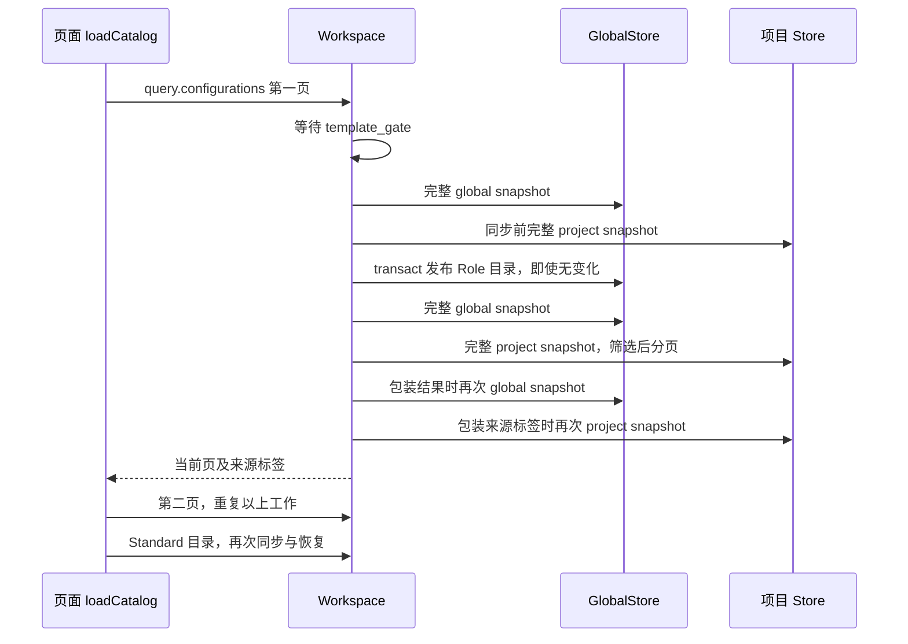

# 配置页面加载性能分析

2026-11-16，针对角色讨论、项目管理、流程与规范、角色与 Agent、基础组件的配置加载。优化设计和实施顺序见 [PLAN.md](PLAN.md)。

主要耗时来自重复恢复完整工程状态、查询中的共享目录同步、目录查询的串行排队，以及前端反复取回完整配置。基础组件的实时模型发现还有独立的秒级等待。原始配置文本的读取成本较小，优先更换 JSON 格式不能解决这些主要路径。

## 采样范围和方法

- 环境：macOS arm64，Rust 1.99.1，Node 24.13.0，Chromium。
- 全局库有 192 个源修订、213 个治理记录；项目库有 194 个源修订、224 个治理记录。数据库分别约 592 KiB、1.02 MiB。
- 项目只有 1 个会话、3 个 turn、3 个 execution、6 个 snapshot、17 条 conversation event。当前问题在小数据集上即可复现。
- 使用 SQLite 在线 backup 取得独立副本；没有在用户数据集上执行修复、迁移或工程运行。空数据集用于原生 Host 的 HTTP 采样。
- 后端探针调用实际 `Workspace::dispatch`、Engine 查询和 SQLite codec。执行端口禁止运行，装配时跳过 bootstrap/recovery，避免读取历史触发工程副作用；没有后台调度器。配置读取、目录同步和权限合同计算保留原代码。
- 项目浏览器采样使用同一离线装配的临时 HTTP Host，保留 HTTP、前端和 SSE 路径。实时模型发现被明确拒绝；其真实耗时另在空数据集原生 debug Host 测量。普通配置接口没有模拟响应。
- 后端主要查询各重复 7 次，报告中位数。浏览器按真实导航顺序采集请求瀑布；这些导航是个案采样，不代表 P95。Standard 详情与采用预览各测一次。
- 同一源码副本另以 `rustc -O` 编译业务 crate，按照 Cargo fingerprint 选择普通 release 依赖，重复后端探针。下文“优化构建”指这一对照，不是发行包浏览器验收。已有原生 release 二进制的出厂目录只有 180 源，与当前 192 源不同，不用它计算同源码加速比。
- 共享工作区在分析期间有其他未提交改动和构建。项目探针使用临时源码副本，原始差异和可执行文件摘要保存在证据目录；不把已有二进制、当前 HEAD 和源码副本视为完全相同的构建。

本轮证据目录：`/var/folders/y2/x2npypvx45d_btcdpbpw5cvr0000gn/T/devdesk-config-load-20261116-fvx1difr`。其中保存数据库副本、浏览器请求、阶段计时、探针源码和构建日志；这些是本机临时证据，不是仓库长期资产。`provenance.json` 记录可执行文件身份，`source-status.txt` 和 `source-diff.patch` 记录采样时工作区状态。

## 浏览器中的耗时和传输量

下表是已打开项目后的一轮导航，从点击开始到该轮主要配置数据返回。排除持续的 session 轮询、经验读取、运行准备状态和实时模型发现。它不是截图完成时间；脚本用于等待稳定状态的额外等待不计入。

| 页面 | 主要请求数 | 响应体合计 | 数据返回时间 |
|---|---:|---:|---:|
| 初次打开项目角色讨论 | 8 | 731 KiB | 4.04 s |
| 项目管理 | 10 | 1,503 KiB | 3.91 s |
| 流程与规范，Workflow | 5 | 633 KiB | 1.94 s |
| 角色与 Agent，Role | 2 | 204 KiB | 1.06 s |
| 基础组件，Model | 4 | 310 KiB | 1.32 s |
| 返回角色讨论 | 6 | 331 KiB | 1.95 s |
| 再次返回基础组件 | 4 | 310 KiB | 1.40 s |

同一导航脚本在空数据集上，项目管理约 0.88 s、Workflow 约 0.68 s、Role 约 0.43 s、Model 的本地配置约 0.50 s。数据规模差异不大，项目的完整状态恢复和共享同步已经显著拉长等待。

独立检查 Agent/Capability 子页时，两者各取 5 次主要查询：两页完整配置、Standard 目录、模型服务商、Integration 目录。它们不只取当前类型。目录加载完成后点击某个 Agent 对象，观察到 **0 次新增配置 RPC**：现状是提前加载过多内容，慢点主要在对象选择之前。

从 Model 快速切换到 Harness 时，上一页的配置加载仍继续，观察到两套目录分页和 Standard 查询交错执行。组件的迟到响应保护可以防止错误更新界面，但没有消除已经发出的后端工作。

### 前端执行与后端等待

另一轮直接打开项目管理的采样中，最后一个配置预览响应在 5.76 s 返回。Chromium 累计主线程 TaskDuration 为 239 ms，ScriptDuration 为 129 ms，布局约 30 ms、样式重算约 16 ms，未观察到超过 50 ms 的 long task。ScriptDuration、布局和样式属于 TaskDuration 的组成部分，不能相加作为总耗时。

这轮采样支持优先处理后端工作量和请求依赖。它没有把 JSON 解析、每次 React commit 分别计时，也不能排除大型目录下的前端瓶颈。

## 后端查询中位数

项目副本，热状态，7 次串行调用；包含业务结果的 JSON 序列化，不含浏览器传输和排队。响应大小不含 JSON-RPC 外层。

| 查询 | debug 中位数 | 优化构建中位数 | 响应大小 |
|---|---:|---:|---:|
| configurations，第 1 页 | 399 ms | 69 ms | 84 KiB |
| configurations，第 2 页 | 412 ms | 71 ms | 223 KiB |
| standard_catalog | 309 ms | 53 ms | 619 B |
| configuration_defaults | 182 ms | 30 ms | 275 KiB |
| workflows | 405 ms | 69 ms | 50 KiB |
| project_configuration | 390 ms | 68 ms | 254 KiB |
| workspace | 705 ms | 123 ms | 200 KiB |
| model_providers | 27 ms | 4 ms | 1.9 KiB |
| permission_resources | 716 ms | 128 ms | 30 KiB |

`query.standard` 单次约 312 ms、148 KiB；`query.project_standard_preview` 单次约 357 ms、169 KiB。项目管理会在目录加载后再读取 Standard，并在采用预览中再次读取 Standard。

一次 `loadCatalog` 的固有串行链为：第 1 页 → 第 2 页 → Standard 目录。仅这三个后端阶段的中位数相加就约 **1.12 s**，尚未包含其他查询的锁竞争、SSE 和传输。

同一链在优化构建中仍约 **193 ms**，保留相同的快照次数、无变化事务和响应大小。单次项目恢复降到约 **15.4 ms**。因此 debug 构建将主要查询放大约 5–6 倍；使用当前源码的优化构建可先缓解体感，但不能消除重复工作、实时目录等待和随历史增长的成本。

## 一次配置查询在做什么

依据：[`Workspace::dispatch`](../../../crates/host/src/workspace.rs)、[`governance_dispatch`](../../../crates/host/src/governance.rs)、[`sync_shared_configuration`](../../../crates/core/src/catalog_sync.rs)、[`SqliteStore::load_with`](../../../crates/adapters/src/lib.rs)。

按阶段计数，每次项目配置分页查询发生 **3 次项目完整恢复、4 次全局配置恢复**，其中一次全局恢复属于同步事务。192/194 个源修订在单次分页调用中合计经过约 **1,350 次 `SourceDefinition::into_record`**，而响应最多只有 100 条。

约 399 ms 的查询可近似拆为：

| 工作 | 耗时 | 占比 |
|---|---:|---:|
| 3 次项目完整状态恢复 | 256 ms | 64% |
| 4 次全局配置恢复，含事务内的恢复 | 102 ms | 26% |
| 无变化同步事务的其他工作 | 23 ms | 6% |
| 筛选、来源标签、复制及结果序列化等剩余工作 | 18 ms | 4% |

这些值用累计阶段均值与请求中位数做近似分解，存在四舍五入差异。`global.transact` 本身包含一次 global configuration，不能将其完整计时再次相加。

### 单次项目状态恢复

配置查询不使用的历史也被恢复。下表取配置第一页的 21 次项目恢复平均值：

| 阶段 | 平均耗时 | 占恢复时间 |
|---|---:|---:|
| 源与治理记录读取、解析、校验、摘要和前后继处理 | 20.9 ms | 25% |
| 工程基础表读取 | 1.0 ms | 1% |
| turns 恢复 | 0.1 ms | <1% |
| executions 恢复 | 13.0 ms | 15% |
| sessions 恢复 | 5.3 ms | 6% |
| snapshots 恢复 | 31.7 ms | 37% |
| 治理记录中的引用恢复和重新摘要 | 11.7 ms | 14% |
| 配置视图刷新及其他开销 | 约 1.5 ms | 约 2% |
| 合计 | 85.2 ms | 100% |

仅 `SELECT data FROM source_definitions` 并收集原始字符串，项目副本上中位数约 **1.0 ms**。这项测量不包含 JSON 解析和校验。已有 Plan memo 能复用部分闭包，但仍要重读表、解析 JSON、恢复其他对象并复制展开值；只读跨项目快照还会使用新的 memo。

## 各类放大因素

### 目录读请求共用串行锁

[`template_catalog_query`](../../../crates/core/src/command_catalog.rs) 将 workspace、configurations、roles、workflows、defaults、permission_resources 等查询纳入同一 `template_gate`。因此前端 `Promise.all` 不等于后端同时完成。

在无其他请求的项目副本上，同时发出 configurations、workflows、defaults，分别约在 **390、778、950 ms** 完成。这解释了浏览器中轻量查询也会出现秒级等待。锁还承担写入协调，不能直接删除；应缩短锁内工作并让读者取得同一已提交快照。

### 无变化同步仍使用事务

[`sync_shared_configuration`](../../../crates/core/src/catalog_sync.rs) 先恢复项目状态，再调用全局 `transact` 发布 Role，即使目录没有变化。全局事务仍恢复、克隆、校验、序列化和进入 SQLite 事务，随后再次读取全局状态进行同步比较。

独立初步测量中，全局无变化事务约 51 ms，共享配置无变化同步约 177 ms。项目配置、会话等查询和部分跨项目读取会重复进入此路径。

### SSE 持续恢复完整工程状态

[`events`](../../../crates/host/src/main.rs) 以 250 ms 间隔调用 `Engine::query("query.events")`。[`Engine::query`](../../../crates/core/src/lib.rs) 在筛选 events 前读取完整 `EngineeringState`；这段同步工作直接发生在异步流中。

在禁用后台调度器、只保留一张项目管理页面和 SSE 的临时 Host 上，页面稳定后 5 秒消耗 **1.36 CPU 秒**，关闭页面后的 5 秒为 **0 CPU 秒**，约相当于一个核的 27%。页面仍有轻量运行准备轮询；该对照没有把它与 SSE 完全单独隔离。完整状态恢复路径和耗时与此 CPU 消耗一致。

原生 Host 还以 75 ms tick 调用全局 `drive_tool_calls`，后者包含状态读取和回执恢复；项目已有 `has_pending_work` 快速判断，但不能据此认定所有后台路径都已轻量化。这部分应单独采样，不把未测得的调度器 CPU 纳入上述比例。

### 同一信息重复返回

- [`loadCatalog`](../../../web/src/components/configuration-state.ts) 总是请求 `include_history: true`，逐页取全部类型，再额外请求 Standard 目录。
- [`ProjectManager`](../../../web/src/components/ProjectManager.tsx) 同时取 workspace、完整 catalog、项目配置和 defaults，然后继续取 Standard 与预览。catalog、defaults.records、pinned_records、Standard snapshot 有大量重叠。
- [`WorkflowManager`](../../../web/src/components/WorkflowManager.tsx) 同时取完整 catalog、workflow 列表、defaults，Workflow 和选择上下文重复传输。
- [`RoleManager`](../../../web/src/components/RoleManager.tsx) 为项目选项请求完整 workspace。
- [`ResourceEditor`](../../../web/src/components/AgentCatalog.tsx) 对多种类型都请求完整目录和模型服务商；Agent、Capability、Skill 还取 Integration 目录。
- [`RoleConversation`](../../../web/src/components/RoleConversation.tsx) 先取完整 catalog，再取讨论 Agent，初始选择变化还会再次查询 sessions。
- App 要等完整 workspace 返回后才挂载配置页面；SSE 事件经 180 ms 去抖后再次刷新整个 workspace。

### 缺少共享的查询缓存与取消

`template-catalog.ts` 仅保存 generation 和订阅者，不保存目录数据。切页会卸载组件，再挂载就重新加载；请求之间也没有共享进行中的 Promise。`useDraft` 保存的是编辑草稿，不是查询缓存。

现有 catalog generation 主要表示模板重置代次，普通定义发布不保证递增。它可以保留重置语义，但不足以单独作为全量配置缓存的失效版本。配置提交、停用、绑定、实例和接入变化均要参与新的版本协议。

### 跨项目讨论与经验读取在分页前扫描项目

[`discussion_catalog`](../../../crates/adapters/src/experience.rs) 遍历项目并读取各项目完整只读快照，合成 Agent 及依赖后，Host 才执行分页。返回少量 Agent 仍可能读取全部项目历史。经验查询也扫描符合范围的项目，并在恢复状态后筛选摘要与快照。

本轮只有一个项目，不能给出多项目放大倍数；代码路径表明应把全局讨论目录改为配置专用索引，把经验摘要按 Agent/项目读取和分页，详情才恢复所需历史。这与全局场景在少数本地项目上仍出现额外等待一致。

### 实时模型发现进入初始展示路径

[`ModelFields`](../../../web/src/components/DshProviderSettings.tsx) 挂载时清空候选并自动调用 `codex.auth.models` 或 `models.list`。[`CodexAuthentication::models`](../../../crates/adapters/src/codex_auth.rs) 会取得本机 worker，并分页发送 `model/list`；其他服务商可能需要远端或本机服务访问。

在原生 debug Host 的空数据集浏览器中，首次及再次进入 Model 页面分别约 **3.10 s、2.70 s**。这不是模型推理耗时。它不需要阻塞已有配置、已保存模型 ID 和编辑字段的展示。

## 对优化方向的判断

1. **首要工作是配置专用读取和复用一致快照。** 单纯压缩响应或更换格式无法消除历史恢复与重复同步。
2. **读路径应避免同步写入和长时间持有目录锁。** 并行化前端请求之前，先消除后端串行瓶颈。
3. **前端共享缓存、轻量索引和按需详情能减少请求数及重复传输。** 预缓存应在轻量路径上实施，否则会把慢工作提前并扩大竞争。
4. **模型目录、规范闭包、使用情况和健康检查分别异步加载。** 已保存配置先展示，依赖检查独立反馈。
5. **保留 JSON 源与 SQLite 权威存储。** 目前没有证据支持优先引入 YAML、MessagePack、Protobuf 或另一份持久化展开配置；后续只有在专用读取完成后仍由 codec 主导时再做格式实验。

后续正式性能门禁需要补齐完整 debug/release 发行构建的浏览器对照、30 次以上导航的分位数、独立冷启动、多个项目、历史增长、运行中负载和配置写入竞争。当前时间表用于解释瓶颈，不作为优化已达标的证明。
