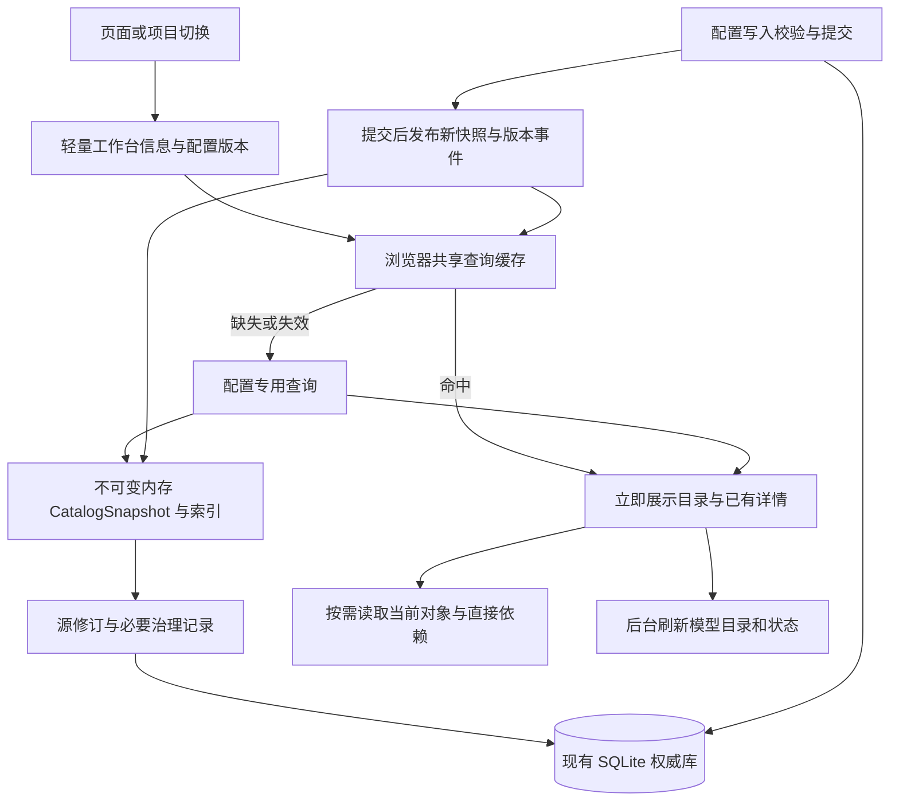

# 配置加载优化计划

状态：待实施。2026-11-16。实测依据见 [性能分析](ANALYSIS.md)。本计划覆盖角色讨论、项目管理、流程与规范、角色与 Agent、基础组件，以及切换项目后的首次配置读取。

目标是让配置页面从轻量目录及确切源修订读取，不再因工程历史增长而反复恢复整个项目。浏览器复用已经取得的目录和详情；实时模型目录、规范检查及运行状态独立刷新。保留 JSON 源文件、SQLite 权威存储、不可变修订和历史执行恢复语义。

## 目标加载流程

工程执行仍使用完整状态和原有命令事务。配置页面只在确需执行预览时请求闭包编译，普通目录读取不进入执行历史恢复。

## 必须保持的合同

- `source_definitions` 继续是配置源的唯一持久化存储；不新增展开计划或展开配置的 SQL 投影表。
- 确切 `identity:revision`、Scope、可见性、停用、模板来源、归档与历史采用保持原语义。读取当前 head 不得替换历史绑定。
- 发布、采用、执行和权限检查继续在服务端校验。缓存不是授权依据；禁止用展示缓存绕过 revision、摘要、权限或写入冲突检查。
- 配置写成功后才发布新快照和失效事件。失败、回滚、重放幂等命令不能错误推进版本。
- 共享发布与项目采用继续遵循既有跨库 transfer 协议；不宣称两个 SQLite 库原子提交。
- 保留当时交付的任务正文、事件及证据，不用当前渲染器重新生成历史任务。
- 新查询从同一个已提交配置视图读取对象、来源标签、默认选择和版本。分页过程中版本变化必须继续使用旧快照或明确要求重试，不能拼接不同时刻的页。
- 优先通过进程内索引和现有表完成改造。确需修改 schema 时另行明确合同与新数据集策略，不偷偷迁移或重建用户数据。

## P0 建立可重复的性能门禁

先将本轮临时探针整理为受控、可重复的测试入口，所有后续阶段使用同一数据集和构建身份比较。

1. HTTP/RPC 分配 request ID，记录排队、目录锁等待、连接锁等待、SQL、JSON decode、源校验/摘要、视图恢复、编译、筛选和响应序列化的独立计时，以及响应字节、快照次数和缓存命中。嵌套 span 标记包含关系，避免重复计时。
2. SSE、调度器和页面 RPC 分开记账。增加有界的性能日志或调试输出，不记录凭据和完整会话/配置正文。
3. 浏览器记录点击到列表可操作、详情字段可编辑、预览完成三个时点，结合 ResourceTiming、主线程任务与请求瀑布；不能用 networkidle 判断持续轮询页面完成。
4. 同一源码分别构建 debug/release，记录 Host 和 Web 内容身份。覆盖无缓存、已有服务端缓存、已有浏览器缓存、切回页面、切换项目、后台运行、多个标签页和同时发布配置。
5. 冷启动单独测量资源初始化、打开项目、同步与恢复。当前 `Workspace::open` 会打开所有项目，需要独立判断其收益和成本，避免把启动时间混入单次查询。

快速缓解项：当前运行的是 debug Host，本轮同源码优化探针的主要查询快约 5–6 倍。先用当前源码构建 release，并在独立数据集验证相同页面，可降低开发构建带来的额外等待；这一动作不能代替以下读取流程改造，也不能把已有较旧 release 包的成绩作为新源码验收。

验收：可以将一次慢请求归因到阶段；统计每种目录查询的完整工程快照次数；能够重放本分析中的三请求排队现象。正式导航分位数每场景至少 30 次，保存原始样本，性能比较不与构建任务同时运行。

## P1 引入配置专用读取和一致快照

这是首个收益最大的实现阶段，先保留旧 RPC 响应形状以缩小前端改造面。

### 专用读取端口

在 core ports 定义配置读取能力，由 adapters 从 `source_definitions` 和必要治理记录构造 `ConfigurationCatalogSnapshot`；domain/core 不直接依赖 SQLite。

快照包含源修订、模板成员与代次、停用/可见性记录、草稿、实例与必要选择、权限/接入绑定等配置语义。对单次查询按需求组合，不能把整个 governance 历史默认当成配置目录。配置索引不读取 turns、executions、sessions、snapshots、conversation_events，不运行 `source_views::restore` 恢复这些事实。

内存索引至少包含：确切引用、类型与 Scope、identity 的修订及当前 head、模板成员/来源、停用与归档、角色和能力引用、直接依赖及按需反向引用。替代反复 `Vec::find`、全表前后继扫描和每行重新检索模板成员。

全局讨论的 Agent 目录复用各 namespace 的配置索引，按可见性合成实例与确切依赖，不再为目录扫描所有项目的执行历史。经验列表以现有经验记录/摘要为入口按 Agent 和项目分页，读取某条详情时才取得所需快照；保留不可读项目、来源冲突和缓存实例回退的原语义。

源初次进入进程时完成结构、引用和摘要校验；提交新源时校验后增量加入。已验证的不可变修订在内存共享，不因每次页面查询重新反序列化、重新摘要。重开数据集或显式重载时重新校验，损坏输入继续拒绝。

### 读写协调

- 读者在短临界区取得 `Arc` 快照，此后释放目录门锁，筛选、计算和序列化在锁外完成。
- 一个 RPC 复用同一查询上下文。`dispatch_inner` 和外层来源标签包装不得分别读取全局/项目完整状态。
- 将 `sync_shared_configuration` 从普通配置查询移出。项目打开、配置提交/transfer 恢复和必要的明确同步负责维护共享副本；已同步项目用配置版本快速确认，无变化直接返回，不启动全局事务。
- 保留项目中的确切历史源副本。不能简单删除共享同步，再假定所有查询都可读取当前全局配置。
- 长计算使用固定快照；短暂串行写入、提交与快照发布仍有明确边界，不能只删除 `template_gate`。
- 纯目录查询不需要通过 `project_limit` 遍历其他项目完整状态计算执行配额；执行/调度入口仍按真实运行事实核对额度。

验收：同一项目的 configurations、roles、workflows、defaults、permission_resources、Standard 目录查询 **0 次完整工程 snapshot、0 次无变化同步事务**；来源与历史回归结果一致。普通目录读取时间不随会话/执行历史增加而线性增长。

## P2 轻量事件流和工作台启动

此阶段与 P1 共同消除页面外的持续竞争。

1. 事件端口增加有界 `events_after(cursor, limit)`、必要的事件水位查询或提交后通知。SSE 从事件表按游标读取，不经过完整 `EngineeringState`。若仍需 SQLite 查询，使用适当的阻塞执行边界，不能在异步流内同步恢复工程状态。
2. 提交成功后发送进程内通知，空闲时等待通知并按需补读；持久化事件游标承担断线恢复。通知丢失仍能通过游标补齐，不能只依赖内存广播。
3. 配置变更事件携带受影响 namespace、kind、reference、版本；工程事件只刷新相关列表或详情，避免每条 session/turn 事件都刷新整个 workspace。
4. 新增轻量 `query.ui_bootstrap`，只返回连接/数据集身份、活动项目与项目摘要、配置版本、默认选择引用及页面必须的状态。App 用它挂载配置页面，不等待包含工程详情和完整健康编译的 workspace。
5. Role 页面使用轻量项目目录；ProjectManager 复用已有项目目录和 bootstrap，避免再次获取完整 workspace。配置健康摘要按所选精确输入缓存，详细健康检查异步加载。
6. 审计 75 ms scheduler 的全局 tool-call 恢复及其他状态读取。无待处理工作时用轻量索引/水位判断；保持回执恢复、未知副作用核对和实际调度语义。

验收：空闲页面不持续构建完整状态；SSE 无事件也不写库。重连、游标、项目隔离、取消和恢复行为保持；多标签页不会按标签数重复恢复历史。

## P3 调整查询粒度与响应内容

采用下列接口方向，命名可在实施时按现有 RPC 规范统一。过渡期间旧查询由同一专用读取层提供，避免维护两套领域规则。

| 查询 | 返回内容 | 用途 |
|---|---|---|
| configuration_index | id/type/identity/revision/name/scope、来源、head/归档/停用状态、摘要和轻量引用 | 列表、搜索、选择器；默认当前 head |
| configuration_records | 一组确切 refs 的正文，有界批量 | 已选对象、直接依赖、固定的历史选择 |
| configuration_editor_context | 当前类型需要的选择项与对象依赖 | 编辑器首次加载，合并必要的小查询 |
| project_configuration_context | 项目选择、所需确切 refs、缓存的校验摘要 | 项目管理；不默认附带所有 pinned 源和完整闭包 |
| configuration_defaults 的 selection 视图 | 默认 refs 和基础参数 | 新建草稿；完整 records 仅显式请求 |
| standard 的 summary/detail/usage 视图 | 摘要、闭包和使用情况分别请求 | 列表不编译全部 Standard 及其使用方 |

分页采用与版本绑定的稳定游标，或有明确大小上限的单次轻量索引请求；保持排序确定性。列表默认当前 head，历史在展开版本选择器时加载。历史固定引用可直接批量读取，不必下载所有历史来保证它们可见。

项目管理共用一次 Standard 详情，预览返回已经计算的所需信息，避免先后重复读取。Workflow 列表不再同时从完整 catalog 和 workflows 传两遍。权限支持矩阵按确切目标、Profile、后端资产身份缓存；不在每次目录读取中重新计算所有 target × profile 组合。

验收：约 200 个源的全局轻量索引目标小于 80 KiB；当前对象详情只取所需正文，完整 defaults/Standard 不进入普通列表的关键路径。对权限与 Integration 等内容仍执行可见性过滤。

## P4 浏览器共享缓存与请求合并

沿用仓库的模块级 store 与 `useSyncExternalStore`，集中在配置查询模块实现，不让每个组件各自保存一份目录。

### 缓存键与失效协议

建议版本向量包含：连接/数据集身份、Host 实例身份、全局配置提交序列、项目配置提交序列、模板重置 generation。查询键还包含项目/Scope、kind、过滤条件、是否历史与归档、视图和确切 refs。

`generation` 保留模板重置含义。普通 revise、retire、draft 更新、Agent 实例变化、权限/Integration 绑定、Skill 导入、change.apply、transfer 和项目采用要按实际语义推进提交序列或局部失效。初期用单写 Host 的提交后序列加 Host 实例身份即可；重启时清空缓存，不凭旧内存序列跨进程复用。

对同一查询合并进行中的 Promise；同一不可变详情可按确切 ref 与内容摘要长期复用，head 列表和使用情况按提交版本更新。浏览器 mutation 成功时立即更新/失效对应数据，SSE 通知其他页面和标签；断线恢复时核对版本，补回遗漏失效。

### 页面行为

- 命中缓存立即展示；后台刷新保留当前内容和编辑草稿，用局部状态提示刷新。
- 列表、对象详情、依赖选择项、规范预览各自展示加载和错误，不能由一个大 Promise.all 阻塞全部字段。
- 切页取消没有消费者的请求；共享请求仍有消费者时继续。只忽略迟到响应不足以节省后端工作。
- 服务端进入昂贵计算前检查请求是否失效；`fetch` abort 本身不能停止已经运行的 `spawn_blocking`，不得把客户端取消当作服务端任务已经终止。
- 缓存限定内存与条目上限。切换连接、数据集、身份和项目时隔离数据；缓存不得跨可见性边界复用。

验收：未发生配置变化时，A → B → A 不再重拉完整 catalog。并发打开多个依赖相同目录的组件只有一次请求。换项目、重置、发布、停用、绑定、断线重连及浏览器前进后退后均正确；未保存草稿不被后台刷新覆盖。

## P5 实时模型目录与预加载

模型目录优先展示已保存模型 ID、服务商声明目录或同一账号/安装身份的最近成功结果；实时刷新独立反馈，不清空当前已选值，不阻塞编辑已有配置。

Codex 账号、Harness 安装/驱动身份，或 DSH 服务商、endpoint、连接/认证身份变化时失效。缓存只存必要目录元数据，不存密钥。建议初始 TTL 为 5 分钟并支持主动刷新；失败短暂退避，展示结果来源和更新时间。账号变更时旧账号结果不得继续复用。

本地目录/详情路径完成轻量化后，再做有界预取：工作台可用后预取活动项目的轻量配置索引；用户悬停/聚焦导航或空闲时预取可能访问的直接上下文。最多 1–2 个低优先级请求，导航和写入优先；不预载所有项目历史、所有 Standard 闭包，不自动运行安装、健康探针或远端模型发现。

验收：模型服务慢、断网、无登录时，已保存配置仍立即可读；反复切回不再启动相同模型发现。预取不能增加前台锁等待或引入外部工程副作用。

## P6 按剩余热点优化编译和编码

P1–P5 后重新测量，再决定是否需要这一阶段的各项工作。

- Standard 闭包、默认组合验证、权限合同和支持矩阵按完整语义输入缓存。编译键包含确切源及依赖摘要、采用覆盖、绑定/选择、相关驱动与权限资产身份、编译器语义版本；不能只用根 Workflow ref 或模板 generation。
- 业务检查在提交/选择变化时重算。查询只读取对应输入版本的结果；缺失时异步计算，不把旧结果当作新选择已验证。
- 全量恢复仍服务于工程执行，对其历史对象可按不可变描述符缓存并有界复用；与配置专用读取分开验收。
- 若冷加载后 JSON decode/编码仍占主要成本，比较紧凑响应、正文分离或可丢弃的构建期缓存。保留规范化 JSON 和原摘要语义，不先引入第二份权威格式。
- 只有 profile 显示 SQLite 查询占比上升时再增加必要索引；当前已有 `(type, identity, revision)` 索引，不把建索引当成本轮主解法。

## 实施顺序和交付边界

| 工作包 | 主要文件/模块 | 前置 | 可独立验证的结果 |
|---|---|---|---|
| W0 计时与基线 | host RPC、adapters codec、性能入口、Web 浏览器采样 | 无 | 请求阶段与次数可比 |
| W1 配置专用端口与索引 | core ports、adapters source/catalog、domain 索引 | W0 | 目录不恢复工程历史 |
| W2 查询复用及同步协调 | host workspace/governance、core catalog_sync | W1 | 单请求一致快照，无变化不写库，读者不长占全局锁 |
| W3 SSE 与轻量启动 | host events、事件读取端口、App/项目目录 | W0；与 W1/W2 可分别提交 | 空闲事件流轻量，页面提前挂载 |
| W4 精简查询与页面上下文 | core 查询、各配置组件 | W1/W2 | 减少正文、重复默认和 Standard 查询 |
| W5 浏览器缓存和失效 | template-catalog、configuration-state、新查询 store | W2、版本事件 | 切回与并发组件复用结果 |
| W6 模型目录与有界预取 | ModelFields、模型目录端口、导航加载 | W4/W5 | 实时发现退出初始展示关键路径 |
| W7 闭包缓存与剩余热点 | Standard、权限、配置编译与 codec | 再次 profile | 只处理已测得的剩余成本 |

首轮建议完成 **W0–W3** 并保留旧响应结构，尽早验证后端基础收益；第二轮完成 W4–W6；W7 由剩余 profile 决定。每个工作包应能单独评审、验证和回退。这里的可分别提交不要求并行修改同一工作区。

## 验收预算

以下是实施目标，不是本轮已达到的结果。浏览器时间从已经可连接的 Host 上导航开始；Host 启动另计。

| 场景 | release P95 目标 | debug P95 目标 |
|---|---:|---:|
| 约 200 个源，服务端热目录查询 | ≤50 ms | ≤100 ms |
| 浏览器缓存命中的类别/对象切换 | ≤100 ms | ≤150 ms |
| 轻量目录已缓存，首次进入项目配置上下文 | ≤300 ms | ≤600 ms |
| 浏览器无缓存，配置首屏可操作 | ≤800 ms | ≤1,500 ms |
| 当前源详情，未缓存 | ≤200 ms | ≤400 ms |

结构门禁比单机绝对数值更稳定：配置列表 0 次完整工程 snapshot、0 次读触发无变化事务；缓存切回不取全量目录；SSE 空闲不恢复状态；模型发现不阻塞既有字段。实现后结合 CI 硬件标定绝对预算，不能通过降低功能、缩减夹具或移除历史使结果达标。

## 验证矩阵

- 数据规模：约 200/2,000/10,000 源修订，多个 identity 和历史 head；保持配置规模不变，分别增加会话、执行、快照和事件，确认配置查询基本不受工程历史量影响。
- 生命周期：全新启动、服务端热缓存、浏览器热缓存、刷新、切页、切项目、跨连接、深链接、前进后退、多标签页。
- 并发：目录读取同时发布/停用/重置、项目采用与 transfer 恢复、后台工程运行、频繁事件；验证一致分页、旧视图失效、无错误跨项目响应。
- 正确性：已有源配置、模板重置、Standard 快照/采用、权限、Agent 实例、Integration、草稿与历史恢复测试；确切修订、来源标签和可见性保持一致。
- 外部依赖：模型目录慢/失败/空结果/账号改变，Codex/DSH/Ollama 的目录来源区分；不调用付费推理验证加载性能。
- 资源：进程缓存条数、字节、命中率、逐出、重复引用共享和重启重建；为全局与活动项目分别设置上限，压测切项目后不无限增长。

按实际实现范围运行 Rust、HTTP 合同和 debug/release Chromium 回归，再跑仓库要求的风格、架构与完整检查。性能报告列出 before/after 分位数、样本数、响应大小、快照/事务次数和空闲 CPU；使用真实构建身份，不以单次最快值代替验收。
