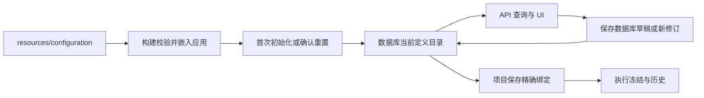

# 默认模板资源与重置模板定义

> 历史记录：未提供链接的原始文件路径仅记录当时执行；相关中间产物或已删除源码不随当前工程提供。

日期：2026-11-10。状态：已实施，已 rebase 到 main `8a16686` 并完成复验，以快进方式整合本地 main。实现合同见 [CONTRACT.md](CONTRACT.md)，结果见 [EXECUTION.md](EXECUTION.md)。

将 `resources/configuration` 建立为随应用发布的默认定义来源。首次初始化从这份资源生成数据库中的可编辑副本；UI 始终通过 API 使用数据库记录。设置页增加“重置模板定义”，确认后将当前定义目录恢复为随当前应用发布的默认内容。

本方案将“所有定义恢复默认”解释为：当前数据集内，全局及项目范围的模板定义都退出原来的当前目录，重新提供完整的默认定义。用户新增和修改过的定义保留为历史；项目已保存的绑定、执行锁和运行事实继续引用原来的精确修订。这样，重置后的可选目录与默认资源一致，已有工程仍可恢复和继续。

## 1 设计时的代码行为（历史基线）

| 问题 | 当前行为与代码位置 |
| --- | --- |
| UI 会修改资源目录吗 | 配置 UI 使用 `role.revise`、各类 `*.create/revise`、Workflow 草稿和发布 API。写入数据库，不回写该资源目录。见 [RoleManager](../../../web/src/components/RoleManager.tsx)、[治理命令](../../../crates/core/src/governance.rs)。 |
| UI 会读取这里的记录吗 | 间接读取。Markdown 通过 `include_str!` 编译进程序，`seed_configuration` 和后续播种逻辑建立数据库记录；UI 用 `query.roles`、`query.configurations`、`query.workflows`、接入查询读取数据库。见 [初始化](../../../crates/core/src/lib.rs)、正文更新（历史路径：`../../../crates/core/src/shipped_prose.rs`）、[前端目录查询](../../../web/src/components/configuration-ui.tsx)。运行时修改源码 Markdown 不会立即影响 UI，必须重新构建程序。 |
| UI 编辑是否已有数据库副本 | 已有。已发布配置按独立修订追加，Workflow 先编辑数据库草稿再发布。`governance_records` 禁止修改已发布记录和删除历史，见 全局 SQL（历史路径：`../../../sql/global/005_governance.sql`）。 |
| 其他默认定义在哪里 | Model、Harness、Tools、Role/Capability/Agent 组合主要在 [builtin_defaults](../../../crates/core/src/builtin_defaults.rs) 和 default_catalog（历史路径：`../../../crates/core/src/default_catalog.rs`）；Workflow 结构在 [governance](../../../crates/core/src/governance.rs)、default_catalog（历史路径：`../../../crates/core/src/default_catalog.rs`） 和 default_tasks（历史路径：`../../../crates/core/src/default_tasks.rs`）；Delivery 定义在 [deliverables](../../../crates/core/src/deliverables.rs)。 |
| MCP 是否已有内置默认 | 当前内置初始化没有播种 MCP 服务。MCP 使用 `integration` 定义，接入绑定、工具发布和发现另有记录，见 [接入领域](../../../crates/domain/src/integrations.rs)、[接入命令](../../../crates/core/src/integrations.rs)。 |
| 全局和项目如何保存 | 全局定义存于 `global.sqlite3`；项目数据库保存项目定义和共享修订副本。`sync_configuration` 追加同步历史以保留自包含引用，见 [Workspace](../../../crates/host/src/workspace.rs)、[GlobalStore](../../../crates/adapters/src/catalog.rs)。 |

现有源码正文更新逻辑会为部分未被用户自定义的内置正文追加修订。新设计将“应用升级带来新的可恢复默认”和“主动更改当前数据库定义”分开，已有数据集升级时保持当前选择，显式重置时才采用新的完整默认。

## 2 重置范围

| 内容 | 重置后的行为 |
| --- | --- |
| Role、Skill、Spec、Standard | 按资源中的名称、正文、规则、可见范围及引用重新生成当前定义。 |
| Workflow 与任务指令 | 恢复完整 Feature、Task、子流程结构、阶段、步骤、执行配方、任务 Markdown、Role/Spec/Delivery 引用。原有草稿退出当前编辑目录。 |
| Delivery | 恢复 `delivery_type` 定义；已经产出的 Delivery、文档和证据继续保留。 |
| Capability、Agent | 恢复能力组合与 Agent 定义，并绑定本次恢复产生的确切依赖。AgentInstance、会话及经验保留原绑定。 |
| Model、Harness、Sandbox | 恢复定义及固定版本、配方引用。安装记录、镜像物化、运行环境检测结果属于机器事实，保留原记录。 |
| MCP、HTTP Tools、Harness 原生 Tools | 恢复接入来源和静态工具定义；默认接入绑定仅含可移植配置。需要认证的绑定保留“待授权”状态。 |
| Permission 依赖 | 默认模板依赖的 Permission/Profile 定义纳入资源清单和依赖闭包；现有全局、项目权限选择与授权状态保持原值。 |
| 新项目预填配置 | 从本次恢复的 Workflow 和 Role→Agent 映射提供预填值，仍由用户保存项目配置。 |
| 自建定义和自定义修订 | 从当前目录归档，历史可查询；不会在重启或项目切换时重新成为当前可选项。 |

项目资料、仓库、项目已保存的 Workflow/Agent 绑定、Feature/Task/Run、执行锁、交付事实、会话、经验、凭据、OAuth 状态、并发额度和运行偏好均保持原值。使用旧定义的项目显示其固定引用及“来自重置前定义”的状态；用户以后显式重新选择并保存项目配置，才采用恢复后的定义。

MCP 默认清单可以为空，表示默认未配置服务。需要提供内置服务时，将经过确认的真实服务定义加入资源，声明传输方式、版本和静态工具契约。资源中不使用假地址充当可运行默认，也不自动将某个用户数据库中的服务和密钥收录为发布默认。

## 3 默认资源布局

沿用已有 Markdown，增加结构化 JSON；现有 Schema 用于验证实体内容，新增模板清单 Schema 描述文件组合和模板间引用。

```text
resources/configuration/
  README.md
  manifest.json
  roles/                 # JSON 元数据与现有职责 Markdown
  skills/                # JSON 元数据与现有 Skill Markdown
  specs/                 # JSON 元数据与现有 Spec Markdown
  standards/             # JSON 元数据与现有 Standard Markdown
  tasks/                 # 现有任务 Markdown
  workflows/             # Feature、Task、子流程完整 JSON
  deliveries/            # delivery_type JSON
  capabilities/          # Model/Harness/Tools/Skills 组合
  agents/                # Role/Capability/权限定义引用
  models/                # 默认 Model 定义
  harnesses/             # Harness 版本、能力和配方引用
  sandboxes/             # 默认 Sandbox 定义
  integrations/mcp/      # MCP 定义与可移植绑定
  integrations/http/     # HTTP 接入定义与可移植绑定
  tools/                 # HTTP/MCP 静态工具及原生工具组
  defaults.json          # 新项目 Workflow、Role→Agent 预填引用
  dsh-model-catalog.json  # 保留现有模型能力目录
```

`manifest.json` 至少包含 `schema_version`、`bundle_version`、各类型完整文件清单和默认预填入口。无默认条目的类型也显式声明空数组，避免将文件遗漏理解为产品决策。

每个条目使用稳定的 `template_key`，例如 `role.analyst`、`capability.analyst.codex`、`workflow.feature`。正文通过 `instructions_file`、`body_file`、`task_instructions_file` 引用 Markdown；这些字段只属于模板加载格式，生成数据库实体前展开为现有领域字段。依赖在 Schema 指定的引用字段使用 `template_ref`，加载器为其分配本次数据库修订 ID。禁止递归替换任意字符串，避免改写任务正文和外部工具参数。

编译阶段校验文件清单、类型、引用闭包和正文，将资源整体嵌入应用。发布程序不依赖源码目录。清单中的配方可引用仓库现有 `containers/`、`permissions/` 资产并验证摘要，保留一份源文件；容器配方和权限执行器的实现继续放在原职责目录。

Rust 保留加载、校验、引用解析和执行协议。默认 Workflow 业务结构、Delivery 说明、能力组合等迁移到资源，避免同一份默认同时在资源和 Rust 中维护。

## 4 默认资源与数据库副本



资源属于不可变默认层；数据库属于工作层。编辑默认副本时，沿用当前追加修订和 Workflow 草稿机制，保存到所属数据库。模板来源元数据单独记录，不改变现有领域 payload；UI 可标识“默认副本”“已修改”“自建”。

增加定义目录代次 `catalog_generation`。每次重置创建一个新代次，默认模板在新代次生成新的定义身份和修订 ID；`template_key` 跨代次稳定。用户编辑仍在当前代次内追加修订。旧代次定义继续存在，退出当前目录。

这个选择同时解决三个现有问题：旧删除标记按身份生效，沿用身份可能让恢复后的默认仍被隐藏；按最大版本查询可能重新选中旧自定义内容；删除历史会破坏项目和执行锁。新代次通过独立目录成员关系选择当前定义，历史读取继续按精确 ID 解析。

建议增加以下存储元数据，具体迁移编号在实施时取当前未占用序号：

| 元数据 | 所属数据库与用途 |
| --- | --- |
| `template_catalog_state` | 全局库单行状态：当前代次、初始化迁移代次、默认资源版本/摘要、状态版本。 |
| `template_catalog_members` | 全局及项目库：记录定义或草稿所属代次、定义身份、来源模板 key、来源摘要及来源类型。 |
| `template_reset_receipts` | 全局库：重置前后代次、默认资源摘要、各类型处理数量、命令 ID、时间。 |

当前版本仍由同一身份的已发布修订/草稿状态确定，但必须先限定当前代次。`ConfigurationRecord` 的既有 ID、内容摘要和不可变约束保留。SkillPackage、静态 IntegrationBinding、旧格式 Definition 等伴随记录随所属定义归入同一代次，不能变成遗漏的当前入口。

模板摘要按展开后的资源和符号引用计算；数据库内容摘要按实际修订 ID 计算。判断“恢复后与默认一致”时，用模板来源映射归一化引用再比较，不能直接比较两种摘要，也不能只按名称或 `builtin-` 前缀推断来源。

## 5 初始化与重置事务

首次建立空数据集和用户确认重置使用同一套加载、校验、实体构建逻辑。普通启动只读取当前目录并执行必要的历史兼容迁移，不重新播种当前模板。

重置按以下顺序执行：

1. 读取并展开当前应用内嵌的完整资源，验证 Schema、路径、摘要、类型及缺失依赖。
2. 在 Workspace 的定义变更协调锁内，核对预览对应的目录代次、目录摘要及默认资源摘要。期间发生过定义发布、修改、删除或草稿保存时，要求重新预览。
3. 建立新代次，先分配所有定义身份与修订 ID，再按依赖顺序构建实体，解析 Capability、Agent、Workflow、Standard、工具和默认预填映射。Workflow 引用环、子流程和实际执行配方沿用领域校验。
4. 在全局库一个事务内写入全部新默认定义、伴随记录、目录成员、重置回执与幂等命令结果，最后切换当前代次。任一步失败，整个事务回滚。
5. 提交后刷新 UI。项目按现有同步机制追加需要的新默认修订及闭包副本；历史定义和冻结引用继续保留。

全局当前代次决定各项目定义目录的可见性。项目本地旧代次成员在切换后自动退出当前目录，重置无需逐库删除或更新，因此不存在多个项目库“只重置了一半”的提交窗口。项目尚未同步新默认时，当前目录查询由全局目录补齐或先完成同步，不能回退到项目旧定义。

所有定义写入入口，包括集成导入、工具发布、权限模板导入和 Workflow 草稿保存，都通过同一协调锁校验客户端的 `expected_catalog_generation`，并在所属数据库事务中记录成员关系。重置成功后，旧页面不能再次保存到旧代次。读目录和同步也须取得一致的代次快照；翻页发现代次变化时重新读取。

同步复制只保留源成员代次，不为历史复制重新分配当前代次。已冻结项目和执行按原 ID 读取，不走当前目录过滤。“已归档”和“已撤销/禁用”分别表示目录状态与原有使用限制；归档本身不能导致原有运行失效，原有禁用和权限限制仍按既有合同执行。

同一 `command_id` 重试先读取已提交结果，再校验当前代次，避免成功后因代次已变化而误报冲突。不同命令再次重置、且当前目录语义已与同一份默认完全一致时返回 `changed: false`，不额外创建重复代次。提交后的通知失败不能将已提交重置显示为回滚，客户端可通过回执恢复结果。

重置过程只写数据库，不连接 MCP、不下载工具、不安装 Harness、不构建镜像，也不创建运行成功记录。

## 6 API 与设置界面

沿用现有 RPC 风格，新增三个接口，并将目录代次加入相关查询 DTO 与定义写入命令。

| 接口 | 行为 |
| --- | --- |
| `query.template_catalog` | 返回当前代次、当前来源、应用内默认资源版本/摘要，以及按类型统计的当前定义数量。 |
| `query.template_reset_preview` | 返回恢复默认的数量、自定义/自建归档数量、草稿数量、受影响范围和固定旧定义的项目摘要，以及 `catalog_fingerprint`。覆盖全数据集，不能受 UI 分页上限限制。 |
| `configuration.templates.reset` | 接收 `command_id`、`expected_catalog_generation`、`catalog_fingerprint`、`bundle_hash`；返回新代次、回执 ID、各类型数量和 `changed`。 |

`catalog_fingerprint` 覆盖全局和项目的当前目录及草稿。预览和提交在同一协调规则下计算，用于发现确认前的并发修改。重置命令始终作用于当前数据集，不依赖活动项目；没有打开项目时也可使用。

设置页新增“模板定义”设置项，显示随应用发布的默认版本，按钮文字为“重置模板定义”。点击后先取预览，再展示确认框：

> 将当前数据集的模板定义恢复为应用内置默认版本。自建定义、自定义修订和流程草稿将从当前目录归档。已有项目绑定、执行历史和登录凭据保留原值。此操作同时影响全局与项目范围的定义。

确认框展示各类型数量与默认版本，操作为“取消”和“确认重置”。提交期间防止重复点击；冲突时保留当前结果并要求重新预览，失败显示可重试错误，成功显示处理数量。

成功后统一更新目录代次并刷新所有配置查询、引用选择器和新项目预填值。`useDraft` 的缓存 key 增加代次，旧内存状态和浏览器草稿不自动覆盖新默认；其他浏览器页签在重新获取状态或提交时发现代次变化，提示重新载入。`latest()`、`include_history` 和页面自行筛选不能绕过代次过滤。

历史查询明确区分“当前代次内的修订历史”和“重置前代次归档”。原有项目或执行页面按精确 ID 展示旧记录，即使它不在当前下拉列表中，也能显示完整名称、版本和来源。

## 7 现有数据库兼容（以 main 当前结构为界）

最新 main `8a16686` 只支持当前协议与 10/41 数据库结构。本次追加全局 011、项目 042 索引迁移，保留当前定义、删除标记、草稿、当前选择器投影和所有精确引用，不恢复已移除的历史原型协议。首次升级将升级前可用目录登记到一个固定的迁移代次，当前内容保持原样，不自动执行重置。

未打开项目可以延迟登记，但必须归入全局记录的原迁移代次，不能使用“打开项目时的当前代次”。例如升级后未打开项目 B，用户先重置再打开 B，B 的旧自建定义仍归入重置前代次，不能重新出现在当前目录。

默认来源只通过已知旧内置 ID 映射及可验证内容补记；无法证明的记录标记 `legacy_import`。旧 `created_at == 0` 和 ID 命名不作为长期来源合同。

调整 `Engine::bootstrap`、`seed_configuration`、`shipped_prose::upgrade` 及项目同步：当前目录只在空数据集初始化或显式重置时建立；旧播种器中用于解码、旧协议和历史迁移的必要逻辑独立保留，不能再把旧默认重新登记为当前。已有数据库升级后，新资源版本可供重置采用，用户当前编辑保持原值。

`query.configuration_defaults` 从当前代次的模板映射解析预填引用；新增代次中的 Model/Harness/Sandbox/Workflow/Agent 不能继续由固定旧 revision 常量选择。历史执行仍使用旧常量和精确 ID 的兼容读取路径。新配置按当前目录选择，已有项目配置继续按其保存的完整闭包执行。

## 8 实施阶段

| 阶段 | 修改范围 | 完成条件 |
| --- | --- | --- |
| P0 固定合同 | 本目录补充 CONTRACT.md；列出实体、伴随记录、运行事实、代次过滤、归档和 API 字段 | “所有定义”覆盖清单明确，每个读写入口和历史读取都有归属。 |
| P1 默认资源完整化 | 新增 manifest/模板 Schema 与加载器，将 Rust 中的默认业务定义移入资源，保留现有 Markdown | 空库可由资源建立完整默认闭包；当前内置默认的结构和行为在搬迁前后等价。 |
| P2 目录与迁移 | domain 目录元数据，core 初始化/保存逻辑，adapters 全局及项目追加迁移 | 旧库保持当前内容，新库只初始化一次，默认来源可追踪，普通保存只写数据库。 |
| P3 重置后端 | 依赖分配、代次切换、事务回执、幂等、并发控制、项目同步与查询过滤 | 整体成功或整体失败；重启、项目切换和延迟打开项目不会重新引入旧定义。 |
| P4 设置与配置 UI | 新增 TemplateSettings，接入 main.tsx；更新 configuration-ui、Role/Agent/Workflow/Integrations 编辑器和 ProjectManager | 预览、确认、错误与成功反馈完整；旧草稿失效；目录、下拉框和预填值一致。 |
| P5 验收与文档 | Rust、Schema、HTTP、浏览器及发布包验证；更新资源说明、协议和计划索引 | 下列验收通过，完成 EXECUTION.md 并记录真实检查结果。 |

主要代码边界是 `crates/domain/src/configuration.rs`、core 的配置/默认/Workflow/接入模块、`crates/adapters/src/catalog.rs` 与项目存储、`crates/host/src/workspace.rs` 及对应 API，以及 Web 配置编辑器与设置页。同步更新 `schemas/rpc.schema.json`、模板 Schema、`docs/protocol.md` 和 `resources/configuration/README.md`。

## 9 验收标准

1. **默认来源完整**：列出的每种定义都有清单入口；Workflow 的阶段、Step、任务与引用均来自资源。缺文件、重复 key、路径越界、错误类型、悬空依赖、引用环及不合法领域组合被拒绝。
2. **编辑只写数据库**：分别修改正文、组合、Workflow、MCP 与工具，保存并重启仍能读取修改；`resources/configuration` 内容及摘要保持不变。使用只读资源/无源码目录的发布包也能编辑和重置。
3. **恢复内容完整**：修改每类内置定义，新增全局和项目自建定义、删除默认项、创建 Workflow 草稿后重置；当前目录仅包含本次资源默认，依赖全部指向本次正确修订，归一化内容与默认一致。
4. **历史可继续**：重置前创建项目绑定、Feature 锁、AgentInstance、会话、经验及真实交付记录；重置后内容摘要和引用不变。已有项目仍按原配置启动后续执行；旧 Feature 可恢复，原有禁用/权限约束仍有效。
5. **跨项目一致**：覆盖全局/项目局部定义、多个已打开项目、未打开项目、全局 Role 目录和延迟同步。重置成功后的查询不能再列出旧代次，重新启动和切换项目不会回填旧默认。
6. **原子性与并发**：依赖校验失败、写入失败、事务中断均不切换当前代次；提交后进程退出可恢复回执。并发编辑使预览失效，旧页面保存被拒绝，同一命令重试返回同一结果，再次恢复相同内容不重复建库。
7. **界面闭环**：取消不修改数据；确认期间防重入；离线、失败和冲突反馈清晰；各类型下拉、分页查询、缓存和跨页草稿使用同一代次；新项目预填使用恢复后的默认，已有项目展示其旧固定绑定。
8. **升级与外部状态**：旧库无损升级，二次升级幂等，软件升级不覆盖用户编辑；MCP 默认空清单正确处理，需要授权的默认服务显示待授权。凭据、OAuth、安装、镜像、并发和项目偏好保持原值，重置期间不发生外部调用。

实现期间补充领域、存储迁移、HTTP 与 Playwright 回归。最终运行仓库现有检查入口：

```bash
cargo fmt --all -- --check
cargo test --workspace --locked
npm --prefix web run build
./scripts/check/check-permissions.sh
./scripts/check/check.sh
```

发布包验证须在无源码目录的临时数据集中完成。执行证据写入本目录 EXECUTION.md；日志、数据库、截图和其他临时产物放在临时目录。计划编写本身不执行重置，也不改变现有产品行为。

本次 rebase 将默认资源对齐 main 当前有效目录，共 83 个资源条目、52 个逻辑定义。历史版本与 v1 Permission 不进入恢复默认；主线新增的执行约束、凭据隔离、当前 SQL 基线及前端行为保留。
