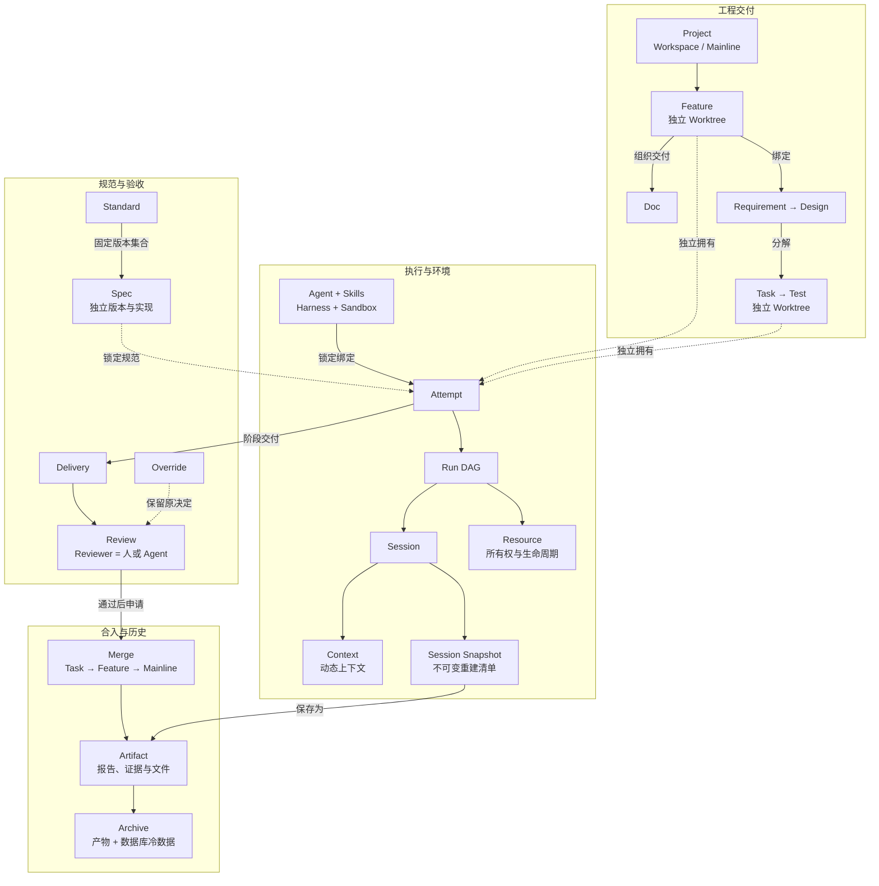
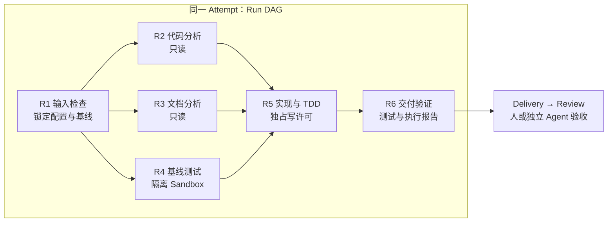
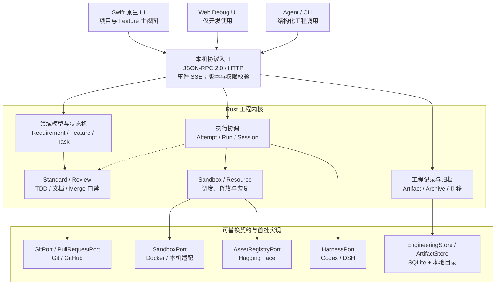
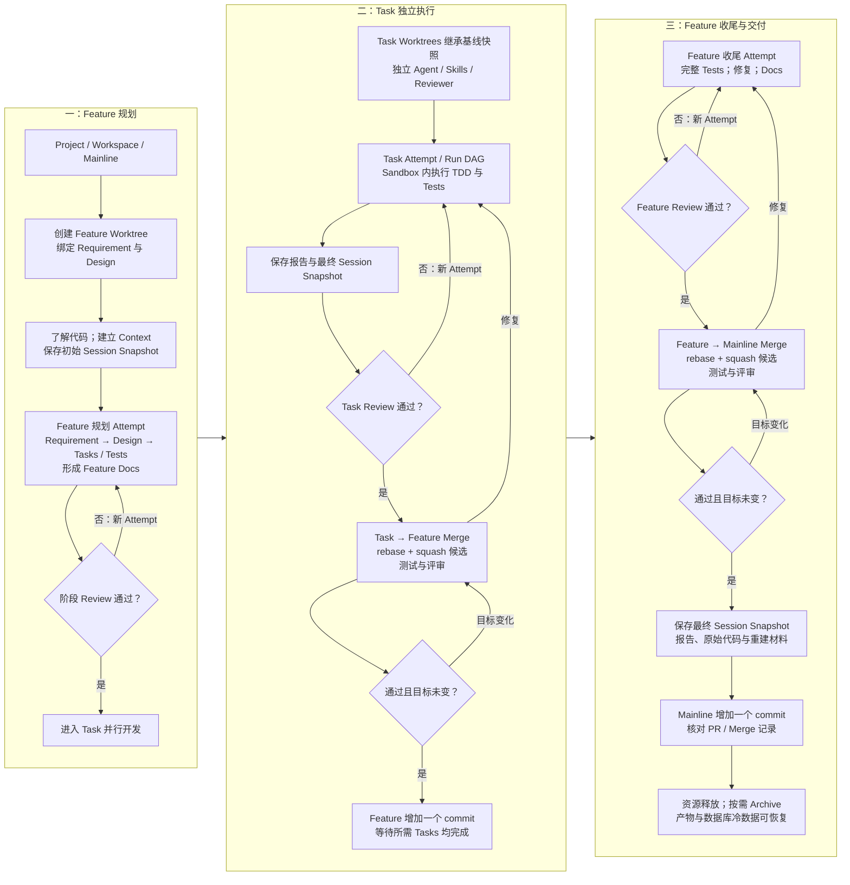

# 软件工程工作台架构设计

原生 macOS 应用与 Rust 工程内核

版本 0.2 日期 2026 年 11 月 7 日 状态 架构评审稿

## 设计结论

以 Feature 为工程交付单元，贯通 Requirement、Design、Task 和 Test，并以 Feature 为单位组织 Doc。系统主要调度 Agent 执行，由 Rust 内核控制状态、规范、评审与 Merge；人类通过原生界面查看、接管和覆盖决定。执行实例及其证据在本地持续保存，第三方运行时和执行环境可替换。

首版采用 Swift 原生 UI、Rust 内核、标准化本机协议和 SQLite 工程库。额外提供仅用于开发的 Web Debug UI。默认外部实现采用 Git、GitHub、Hugging Face 与 Docker；不在首版构建通用插件市场或远程服务平台。

## 本版主要变化

| 设计面 | v0.2 定义 |
| --- | --- |
| 领域模型 | 新增 Requirement 与 Sandbox；Resource 管理所有权和生命周期；Merge 管理代码接纳。 |
| 上下文与产物 | Context 是动态上下文；Session Snapshot 是不可变会话快照；文件与证据统一为 Artifact。 |
| 交互与执行 | 项目和 Feature 是主视图；原生 UI、调试 Web UI 与 Agent 使用同一工程 API；Feature、Task 各有状态机。 |
| 数据生命周期 | 可选择并迁移 data 根目录；Archive 同时包含产物和数据库冷数据，可加载查看或恢复为热数据。 |
| 验证与交付 | 明确并发控制、数据库选型、Harness 契约测试和分阶段验收；附 33 条批注处理记录。 |

## 阅读路径

第 1—4 章确认产品范围和领域语言；第 5—13 章定义版本、执行、评审、协议与 Merge；第 14—20 章定义开发闭环、快照、资源、存储、迁移和归档；第 21—23 章给出不变量、实施阶段及首版参数草案。附录提供技术来源和批注落实位置。

本文中的“首版建议”是待实现与验收的设计决定，不代表已有实现或已测性能。配置默认值与容量样本用于原型验证，可按实测修订；工程历史和验收规则不得因此被静默改写。

## 1 产品边界与技术原则

### 单机单用户交付

第一阶段只交付 macOS 单机单用户应用。SwiftUI / AppKit 承担呈现、交互与调用；Rust 承担全部工程规则。产品以项目与功能开发为主线，辅助提供规范、身份、运行时、技能和环境的定义页面。Web Debug UI 仅供开发验证，不作为对外发布产品，也不进入正式应用安装包。

应用是一个可直接运行的安装包。首版建议将 Rust 内核作为应用内库启动，内核在后台线程提供本机 HTTP 入口；Swift 与 Web 均通过协议访问业务。启动与关闭可以使用很薄的 C ABI，业务操作不经专用 FFI。调试时同一 Rust 内核可由开发用 CLI 托管，无需部署数据库服务器或独立常驻服务。

### 强约定与可替换边界

强制 TDD、阶段文档、每次交付 Review、独立 worktree，以及 rebase 后 squash 的 Merge 策略，属于个人工程约定。替换发生在 Spec、Agent、Harness、Sandbox 和外部适配器契约层；替换实现不能绕过 Rust 内核的工程不变量。

一个 Project 对应一个 Workspace 和一个 Git 仓库，Mainline 由项目指定。Feature 绑定独立分支和 worktree；Task 在其下建立自己的分支和 worktree。多个 Task 可以并行执行，向同一目标分支合入时协调串行推进。

### 外部能力范围

版本控制使用 Git，远端代码托管及 PR 使用 GitHub，模型和数据集等版本化资产来源使用 Hugging Face，容器环境使用 Docker。这些是各自领域首版唯一的外部适配实现；Harness 仍保留 Codex 与 DSH 两种接入，以检验运行时可替换性。Hugging Face 在本版按资产来源设计，不自动等同于推理模型供应商。

本地工程浏览、执行历史和恢复不依赖远端持续在线；调用模型、下载缺失资产、同步 GitHub PR 等操作可以要求网络。界面分别显示本地完成与远端同步状态，不能把同步失败当成工程历史丢失。

### 未来扩展的预留方式

领域 ID、版本化协议、执行位置描述、actor 字段和适配器接口预留跨平台、远程执行、团队与多租户演进空间。首版不实现远程调度、账号体系、租户数据库或分布式锁。未来多人模式需要新增认证、授权及冲突规则，不能将本机单用户身份直接作为远程信任依据。

## 2 主工作界面与审计视图

### 项目和 Feature 是主要导航

| 页面 | 核心内容与操作 |
| --- | --- |
| 项目视图 | 项目列表、主干、活动 Features、待 Review 项、运行与阻塞状态；新建 Feature、选择 Workspace、查看归档。 |
| Feature 工作页 | Requirement → Design → Tasks → Tests 的追踪链；Feature Docs；本轮交付范围、状态与 Merge 记录。 |
| 执行详情 | Feature / Task → Attempt → Run → Session 的展开路径；依赖图、日志、输入、绑定、Sandbox、Resource、报告与时间线。 |
| 评审与差异 | 交付清单、代码与文档差异、逐条 Review 结论、证据版本；人工批准、退回、接管或 Override。 |
| 定义页面 | Requirement 模板及 Spec、Standard、Agent、Harness、Skill、Sandbox 的注册、修订、兼容检查与默认绑定。 |
| 设置页面 | data 与 Archive 位置、手动并发额度、工具路径、模型连接、资源保留及退出行为；提供迁移入口。 |

### 前端只展示权威状态

界面从 Rust 获取对象状态、可执行动作与阻塞理由，不能自行判断是否符合 TDD、能否 Merge 或是否可删除热数据。每次动作都提交有目标版本的命令；版本过期时提示重新读取，而不是以旧页面覆盖新事实。Web 调试页复用同一接口和状态语义。

### 所有执行实例均可回看

每个 Attempt、Run、Session、Sandbox 实例和 Resource 都有稳定 ID、创建主体、起止时间、版本绑定、外部标识和终态。即使进程或容器已销毁，历史记录、日志片段、产物引用与清理结果仍保留。前端支持按项目、Feature、任务、状态、Agent 和时间过滤，并以游标分页读取长历史。

审计页区分“运行结束”“交付接受”“Merge 完成”和“资源已释放”。日志因崩溃只保存到某一序号时，应显示已持久化边界；不能用完整状态掩盖缺失尾部。归档对象保留摘要和定位信息，外部磁盘离线时仍能看到其存在及最近校验结果。

### 开发调试界面

首版采用轻量 TypeScript 调试页，提供项目、执行、Review、Merge 和 Archive 的关键路径即可，不追求与原生界面的视觉和导航完全一致。开发版允许启动本机调试页；发行包不打包 Web 资源，也不依赖 Node.js 运行。

## 3 领域对象与归属

### 工程对象与配置对象

| 领域概念 | 职责与关系 |
| --- | --- |
| Project | 项目身份、Workspace 绑定、Mainline、默认 Standard 与执行配置；拥有 Features。 |
| Workspace | 代码工作空间及仓库定位；管理 Feature / Task worktree。与应用 data 根目录分离。 |
| Requirement | 问题、目标、约束、范围和可验收条件。具有稳定身份及不可变修订。 |
| Design | 针对 Requirement 的方案、接口与设计决策，引用明确的 RequirementRevision 与 DesignSpec。 |
| Feature | 需求交付单元；首版绑定一个 Requirement 和一个 Design 的确定版本，产生 Tasks、Tests 和 Feature Docs。 |
| Task | Feature 下可独立执行和验收的工作单元；记录依赖、范围、Tests 与独立 worktree。 |
| Test | 测试定义及验收条件映射。Test Run 保存某一代码和环境版本上的执行结果；两者分开。 |
| Doc | 以 Feature 为单位交付的文档。Requirement、Design、测试与交付报告可形成不同文档视图。 |
| Spec | 某种工程约束的实现，例如 DesignSpec、ReviewSpec 或 TDD Spec；遵循用途明确的契约并独立版本化。 |
| Standard | 一组按用途 slot 组合的 Spec 版本。StandardLock 是解析并固定后的值对象，不是独立服务。 |
| Skill | 供 Agent 使用的能力说明和工具约定，具有版本、来源和能力需求。 |
| Agent | 承担架构、开发、测试或评审职责的身份配置；与模型和 Harness 选择分离。 |
| Harness | 执行 Agent 的第三方运行时及其能力、版本和接入描述，例如 Codex、DSH。 |
| Sandbox | 执行环境的定义与实例；规定系统、工具、目录挂载、网络和资源限制，默认使用 Docker。 |

基本需求追踪链为 Requirement → Design → Task → Test。此箭头表示派生和验证关系，不规定测试代码必须最后编写；TDD 要求仍是先定义失败测试，再实现行为。Feature 在规划中可以暂未绑定 Design，但进入开发前必须锁定已评审的需求和设计版本。

## 3 领域对象与归属 续

### 执行对象与持久历史

| 领域概念 | 职责与关系 |
| --- | --- |
| Attempt | Feature 或 Task 的一次有固定输入和范围的执行尝试；拥有 Run DAG、执行报告、Delivery 与 Review 关联。 |
| Run | 一个可调度执行节点。只属于一个 Attempt 或 Merge；技术重试创建新的 Run，不能覆盖旧实例。 |
| Session | Harness 会话身份，关联实际交互和 Context；一个 Run 可关联多个 Session，每个 Session 标识其绑定和使用范围。 |
| Context | 会话动态上下文，包括当前事实、引用、摘要与待办。更新保留修订或事件，不复制全部历史给所有任务。 |
| Session Snapshot | 某一 Session 的不可变快照，保存 Context、工具、配置、Resource 描述与重建材料引用；记录 capture_reason。 |
| Resource | 执行资源的所有权、使用者、外部标识、生命周期和释放责任。运行实例销毁后该记录仍保留。 |
| Delivery | 固定一次阶段交付的代码、文档与证据版本；是 Review 的明确目标。 |
| Reviewer | 承担评审的角色，主体可以是人或 Agent；通过 ReviewAssignment 绑定具体交付和 ReviewSpec。 |
| Review | 评审过程及其决定。保存逐条标准、证据、发现和结论；报告是决定的文档表达。 |
| Merge | 将源 PR / 变更请求以 rebase + squash 方式接纳到目标分支的领域操作，管理候选、验证和单提交推进。 |
| Artifact | 正文、报告、日志、附件、快照和清单等本地文件及其版本、哈希、来源与定位。 |
| Override | 人类新增的覆盖决定，引用原决定及目标版本，不修改原始事实。 |
| Archive | 将选定范围的 Artifact 和数据库冷数据封存为可校验包，支持离线保存、加载查看和恢复。 |

ReconstructionManifest 即“重建清单”，是 Session Snapshot 内的结构化值对象，列出需要的代码、工具、环境和产物。它不拥有独立业务生命周期，不增加顶层导航或管理服务。ExecutionBindingLock、ArtifactRef、PRRef 同样属于嵌入值对象。

Task 可继承 Feature 的规范和选定 Session Snapshot，并保存来源 ID 与版本；Agent 绑定、Attempts、Deliveries 和 Reviews 独立。修改 Feature 默认配置不回写已启动的 Task Attempt。共享的是契约和被固定的输入，不是可变运行状态。

## 4 领域关系图



图 1 v0.2 主要领域关系与独立执行归属

图中按工程、执行、验收和历史分组；省略字段与部分基数。Feature 和 Task 分别拥有 Attempts。Merge 的候选验证 Runs 直接归 Merge 所有，通过来源引用关联开发 Attempt，不双重拥有。

Sandbox 承载实际执行，Resource 记录其容器、进程、卷及共享资源的归属。Context 是动态状态，Session Snapshot 是不可变历史。所有产物统一归 Artifact，归档同时包含数据库冷数据。

## 5 需求规格与独立版本演进

### 从需求到验证的明确追踪

RequirementRevision 固定目标、范围和 acceptance_criteria。DesignRevision 引用需求版本；Task 引用其实现的设计项和验收条目；Test 映射这些条目，并区分任务测试、Feature 测试与主干回归。Feature Docs 汇总当前被接受的需求、设计、运行与验收证据。

需求或设计变化生成新 Revision，并计算受影响的 Tasks、Tests、Deliveries 和 Reviews。已有事实保留，但有效性可标为 stale，必须按影响范围重新确认。不能仅更新 PRD 正文，却保留与旧验收条件绑定的“完成”结论。

### 版本升级与替换是两种操作

SpecContract 规定用途、必需输入、交付结构和验证语义；SpecRevision 提供某一实现。Internal Design Spec v1 → v2 是同一身份的版本演进；更换另一套设计规格是实现替换。二者都需要兼容性比较，已启动 Attempt 始终使用原来的锁定结果。

| 对象变化 | 规则 |
| --- | --- |
| 升级 Spec / Skill / Agent | 建立不可变修订；新执行显式采用；历史引用继续可解析。 |
| 更换设计规格 | 确认同一 design slot 契约、章节和验收映射；不兼容时提供迁移计划并重新 Review。 |
| 更换 Harness / Sandbox | 校验能力和环境需求；新绑定生成新 Run 或 Attempt，不把旧结果迁名为新实现的结果。 |
| 修改当前需求范围 | 旧 Attempt 结束、取消或暂停处置；新 Attempt 固定新输入；明确哪些旧成果可复用。 |

### Standard 组合精确的 Spec 版本

个人基础 Standard 与项目补充 Standard 按 slot 合成 requirements、design、task_execution、tdd、review、merge、documentation 等约束。StandardLock 保存全部引用版本及哈希。冲突、缺失和不兼容必须显式报告，不采用不透明的最后写入覆盖规则。

首版基础规范要求：需求具有可验证验收条件；Design 解释关键决策；代码工作按 TDD 留证；每次正式交付有 Review；每次 Merge 绑定实际候选测试；Feature Docs 齐备；Session Snapshot 与原始 Git 对象可恢复。无代码变更的研究任务仍提交文档和评审，不制造虚假的失败测试。

## 6 Agent Harness 与 Sandbox

### 身份 运行时 环境分别绑定

Agent 表达“谁以何种职责执行”，Harness 表达“由哪个运行时驱动”，Sandbox 表达“在哪里及以什么环境执行”。一次 ExecutionBindingLock 固定 AgentRevision、Skills、Harness 版本、Sandbox 配置、模型配置、工具权限和 Reviewer 配置。三者可独立替换，但必须通过能力检查。

Sandbox 定义描述镜像或本机工具链、CPU 架构、挂载、网络、环境变量来源和限制；Sandbox 实例记录本次实际创建的环境。其容器、临时卷、端口或进程分别作为 Resource 管理，避免把环境配置和正在运行的资源混为一物。

### 默认实现与替换契约

| 契约 | 首版实现与明确边界 |
| --- | --- |
| GitPort | Git CLI；仓库、分支、worktree、候选、对象保留和预期版本推进。 |
| PullRequestPort | GitHub；PR 创建、读取、评审状态和远端结果核对。每次 Merge 固定 PRRef 或本地变更请求 ID。 |
| AssetRegistryPort | Hugging Face；模型、数据集或测试资产按仓库 revision 下载并校验，不直接承担所有推理调用。[11] |
| SandboxPort | Docker 为唯一外部容器实现；必要的 macOS 原生工具调用使用内置本机适配。 |
| HarnessPort | Codex 与 DSH；能力协商、Session、Run 事件、取消、产物导出及可选恢复。 |

### macOS 原生任务的环境边界

Docker 默认承载适合容器的开发与测试；需要 macOS SDK、签名、原生 UI 或 XCTest 的工作必须选择 macOS 本机 Sandbox 适配。它是受管理的本机执行环境，不宣称具有与容器等价的隔离强度。每个任务根据环境需求选型，不能让 Linux 容器承诺执行完整 macOS 验收。

App 仅打包核心和必要适配器；Docker 服务、Harness 二进制及大模型资产按注册路径或受管理目录使用。释放执行进程与容器，不等于卸载共享 Docker 服务、Harness 安装或缓存镜像。运行时升级只影响新的绑定，历史版本的可用性由保留策略记录。

## 7 Attempt Run 与本地审计

### 一个 Attempt 包含串并行 Run DAG

Attempt 绑定 Feature 或 Task、本轮范围、输入与 StandardLock。Run 依赖图允许串行和并行，动态增补节点必须形成有版本的计划变更。仅当依赖条件满足、并发额度可用且资源不冲突时，调度器才启动 Run。



图 2 Attempt 内的依赖 并行 写入及交付边界

### 实例与事件先登记再执行

启动前持久化 Attempt、Run、Session 与资源申请意图；返回 operation_id 后异步推进。运行期间保存序号化事件、输入哈希、工具调用摘要、日志段、环境引用、退出码和产物清单。终止时先导出已有产物，再登记结束和清理结果。

技术重试创建新 Run 并记录 retry_of，原 Run 保留 failed、cancelled 或 interrupted 等事实。改变输入、规范、Agent 责任或交付范围时创建新 Attempt。每个 Run 只属于一个容器：开发执行归 Attempt，候选验证归 Merge。

### Session 关联和恢复

一个 Run 可使用多个 Session；顺序 Run 可以复用相同绑定下的 Session，但必须记录每个调用的 Run ID。除非 Harness 明确支持并通过契约测试，同一可变 Session 不允许并发调用。跨 Harness 接手创建新 Session，导入通用快照及产物，不伪造供应商内部记忆迁移。

失败、取消和未完成的尝试也有执行处置记录。没有形成可验收交付时，记录 not_reviewable 或 pending，不能自动产生“验收通过”。运行进程结束、worktree 清理或 Archive 不会删除其历史身份。

## 8 Feature 与 Task 的独立状态机

### Feature 生命周期

| 状态或转换 | 进入条件与行为 |
| --- | --- |
| draft → planning | 需求已登记；创建 Feature worktree；进行发现、需求、设计与计划交付。 |
| planning → ready | Requirement、Design、任务与测试计划和阶段文档已 Review；确定版本被锁定。 |
| ready → developing | 启动本轮 Tasks 或 Feature 实现 Attempt；各任务按独立状态推进。 |
| developing → validating | 本轮必需 Tasks 均已合入 Feature；开始收尾、完整测试与文档核对。 |
| validating → accepted | Feature 交付通过 Review；接受的是确定候选和文档版本。 |
| accepted → merging → completed | 主干 Merge 完成、提交与证据核对成功；如果项目要求远端 PR 完成，还需满足该门禁。 |
| 退回与取消 | 验收失败回到 developing；需求变化回到 planning 并标记受影响证据失效；cancelled 保留历史。 |

### Task 生命周期

| 状态或转换 | 进入条件与行为 |
| --- | --- |
| draft → ready | 任务范围、依赖、测试、继承快照和独立绑定已定义；依赖满足才可调度。 |
| ready → running → reviewing | 启动 Attempt；正式交付已落盘后进入 Review。 |
| reviewing → accepted | 测试与评审达到任务约定；尚未代表已进入 Feature。 |
| accepted → merging → completed | 对实际 Merge 候选重新验证；成功为 Feature 增加一个提交。 |
| 失败与重做 | Review 或 Merge 需修复时回 ready，创建新 Attempt；Run 失败不会直接删除或完成 Task。 |

blocked 与 paused 是调度控制状态，附原因和恢复目标，不另建所有业务状态的笛卡尔组合。Archive 是数据存储状态，与 completed / cancelled 等业务状态正交；加载归档不会把任务重新标为 running。

Attempt 使用 prepared、running、waiting_review、accepted、accepted_with_exception、rejected、failed、cancelled、interrupted；Run 使用 queued、running、succeeded、failed、cancelled、interrupted。人工例外记录 acceptance_mode=override 及原因，不能修改测试结果。所有转换都由 Rust 校验预期状态版本并保留事件。

## 9 阶段交付 Review 与人工覆盖

### 交付边界先明确 后验收

Delivery 固定 owner、stage、输入、代码候选、Artifact 列表与哈希。Requirement、Design、任务拆分、Task 成果、Feature 收尾和 Merge 候选均须 Review。正式 Run 输出交接也需要可识别交付；一个 Review 可以覆盖多个交付，但范围必须明确。流式 token 和临时文件不是独立阶段交付。

| 交付环节 | 必需材料与评审重点 |
| --- | --- |
| Requirement | 问题与范围、事实和假设、验收条件；确认目标可验证且证据来源明确。 |
| Design 与任务拆分 | 方案、接口、风险、Tasks / Tests 映射；确认可实施性和依赖完整性。 |
| Task Attempt | 实现差异、TDD 证据、自身 Tests、报告、最终快照；确认任务标准满足。 |
| Feature 收尾 | 完整 Feature Tests、必要回归、Feature Docs、执行报告与快照；确认需求整体满足。 |
| Merge 候选 | 实际候选代码树、目标基线、验证结果、Review 与原始对象保存证明。 |

### Reviewer 可以是人或 Agent

ReviewAssignment 固定 Reviewer、ReviewSpecRevision 和 Delivery。人类提交 ReviewDecision；Agent 使用独立绑定或会话执行评审 Run。评审结果为 pass、changes_requested、inconclusive 或 not_reviewable；没有发生的评审保持 pending。评审报告不递归要求无限层评审。

首版建议指定一个主要 Reviewer，默认使用独立 Agent；允许添加人类 Reviewer。配置多个必需 Reviewer 时采用 all-of，全部通过才满足门禁，不默认多数票。增加评审者不会改变旧决定，交付版本变化后重建相应评审。

### 人类可干预 事实不可伪造

人类可以暂停、取消、改派、编辑规格、接管、覆盖结论或接受带例外交付。Override 是新增决定，记录原决定、目标版本、范围、理由、主体和时间。界面显示“人工例外接受”，不能把失败测试改成通过，也不能把尚未落盘的产物显示为已保存。

编辑文件先导入新 ArtifactRevision，再评估下游证据；修改运行中的 worktree 要先取得独占写许可并停止冲突写入。Agent 不能通过普通执行权限给自己签发人类 Override。当前人工权限来自本机用户会话，未来团队权限必须单独设计。

## 10 单机系统架构



图 3 原生界面 调试 Web 与 Agent 共用 Rust 工程入口

UI、协议适配器和第三方 Harness 都不得直接修改工程数据库。Rust 应用层将命令转成领域动作，验证状态、规范与证据后提交。图中的模块是本机边界，不要求分别部署。

Git、GitHub、Hugging Face 和 Docker 通过专用契约接入；SQLite 和 Artifact 目录通过存储契约接入。可替换性以契约测试验证，不要求首版为每个接口实现多个供应商。

## 11 标准化本机协议

### 首版统一使用 JSON RPC 与 HTTP

JSON-RPC 2.0 定义业务请求和响应，HTTP over loopback TCP 提供首版传输；事件使用 SSE，Artifact 使用单独的流式读取接口。Unix domain socket 作为可选传输扩展，不要求首版同时实现。UDP 不用于需要可靠确认和幂等控制的工程命令。JSON-RPC 本身与传输无关，应用状态语义由本项目定义。[9]

| 接口 | 契约 |
| --- | --- |
| POST /rpc | JSON-RPC 2.0；方法例如 feature.create、attempt.start、review.submit、merge.request、archive.restore。 |
| GET /events | SSE 事件流，带序号、对象版本及 operation_id；支持 cursor 续读，过期游标返回明确的重新同步要求。 |
| GET /artifacts/{id} | 按 ArtifactRef 解析读取或分段下载；不暴露任意文件路径，也不允许绕过导入直接改写文件。 |
| GET /capabilities | API major/minor、可用方法、Harness 能力和环境状态；用于原生 UI、Agent 与 Debug UI 协商。 |

### 工程命令具有业务级幂等语义

params 包含 command_id、actor、scope、target、expected_revision、input_refs。JSON-RPC id 只关联请求与响应，command_id 才用于业务去重。同一个 command_id 携带不同参数时拒绝；超时后查询原 operation，不能盲目再执行一次。耗时操作返回 operation_id，执行结果由事件和查询读取。

API 模型使用稳定 ID、结构化错误、可分页查询和不可变版本引用。请求体与字段有大小限制；日志高频输出批量持久化并背压。破坏兼容性的字段和语义变化升级 API major，旧客户端得到明确不兼容响应。未来 MCP 适配映射同一应用 API，不另建工程状态机。

### 本机入口与生命周期

仅绑定回环地址和动态端口，使用本次启动生成的访问凭据、Origin 检查与 Host 校验。单用户不等于任何网页都可以调用本机命令。Web Debug 由开发入口同源提供；凭据通过本机启动交接，不进入业务日志和归档。

Swift 负责启动、连接和关闭内核，UI 不执行同步阻塞调用。关闭窗口保留应用和执行；退出应用停止接收新工作，保存事件与快照，取消或收拢资源后退出。下次启动先核对外部进程和操作意图，再决定恢复，不自动重复有副作用的命令。

## 12 Harness 契约测试与兼容性

### 共用规范加供应商测试夹具

每个 Harness 适配器都执行同一组工程契约测试，再补充供应商事件、错误与能力差异的测试夹具。兼容对象是“旧版工作台适配器能否继续满足既有契约”，不以 SDK 能导入或进程能启动作为后向兼容依据。

| 测试组 | 必测行为与判定 |
| --- | --- |
| H01 协商与配置 | 版本、能力声明、Agent / Skills / 模型 / 工具参数映射准确；缺失必需能力明确拒绝。 |
| H02 Session | 创建、关联、连续调用和关闭；不同项目与任务的上下文、路径和权限不串用。 |
| H03 事件流 | 分片、乱序、重复、未知字段、断开与终态；原始事件保留，规范化事件不重复计为完成。 |
| H04 取消与错误 | 取消、超时、进程崩溃、鉴权失败及限流；输出可追溯终态和清理状态。 |
| H05 工具与产物 | 工具调用归属正确；产物路径、哈希、退出码可核验；不允许直接写工程权威状态。 |
| H06 Snapshot 与恢复 | 导出通用材料；支持原生 resume 时验证真实恢复；不支持时创建新 Session 并明确能力降级。 |
| H07 并行与隔离 | 多个 Run 在独立 Sandbox / worktree 执行；同一可变 Session 和目录不发生未授权并行写。 |
| H08 历史兼容 | 重放旧事件夹具与快照清单；字段新增可兼容，必需字段删除或语义变化必须阻断升级。 |
| H09 资源处置 | 成功、失败、取消和导出失败路径均保留 Resource；共享安装和服务不被误销毁。 |

### 版本矩阵与发布门禁

矩阵记录工作台版本、适配器版本、Harness 版本、Sandbox 类型、操作系统 / CPU 和能力集。至少覆盖当前固定版本、拟升级版本及上一受支持版本。使用小型固定仓库、测试用工具与模拟协议测试可重复行为，再以真实 Harness 做最小端到端验证；不比较 LLM 自由文本是否逐字一致。

每次测试产生 CompatibilityReport Artifact，包含矩阵、逐项结果、事件样本和失败原因。协议不兼容或关键行为回归则禁止自动升级；可选能力退化需要声明并阻止依赖该能力的任务。运行中的 Attempt 不切换二进制；回滚恢复旧绑定，历史记录不重写。

## 13 Merge 与代码接纳

### 一次 Merge 对应一次变更请求接纳

Merge 记录 PRRef 或本地变更请求 ID、来源 Attempt、源版本、目标分支、expected_target、候选提交、规范、Delivery、验证 Runs 和最终结果。目标分别为 Task → Feature 或 Feature → Mainline。所有成功接纳都先 rebase 对齐目标，再 squash 为一个普通单父提交。

| 步骤 | 必须满足的条件 |
| --- | --- |
| 1 固定来源 | 源 worktree、需求和设计版本、原始提交及未提交修改有明确处置；不处理不可解释的脏状态。 |
| 2 构造候选 | 隔离位置完成 rebase、冲突修复和 squash；记录源与候选映射，候选父提交是预期目标。 |
| 3 验证候选 | 运行 Task / Feature Tests 和约定回归；按 ReviewSpec 验收同一候选及文档版本。 |
| 4 保存材料 | 持久化最终 Session Snapshot、报告、原始 Git 对象或 bundle；报告元数据不反向修改已冻结代码树。 |
| 5 推进目标 | 同一目标协调串行；用旧目标值校验再更新引用。目标改变则重建候选，不复用失效验收。[13] |
| 6 完成核对 | 确认目标提交、工作树和外部 PR 状态；崩溃后查实际结果补记，不重复产生提交。 |

### 本地接纳与 GitHub 状态分别核对

首版本地 Git 分支是本机工程的权威目标。GitHub 是唯一 PR 外部实现；可在联网后创建和同步 PR，但本地 Merge 完成不等于 GitHub 已记录 merged。Merge 保存 local_state 与 remote_state；项目若要求 GitHub PR 合入作为交付门禁，Feature 必须等到远端核对成功才 completed。

GitHub 服务端合入是另一种目标推进路径，不能与本地推进并发执行同一 Merge。其 API 的 sha 校验针对 PR head，不能被当作 target base 的原子比较。[10] 首版先验证本地 Merge；远端自动合入只有在分支保护、候选测试及目标变化条件通过端到端契约验收后启用，否则明确阻塞，不降级绕过要求。

### 工作树与引用一致

引用推进不自动等于已检出的工作树同步。推进前取得目标 worktree 独占写许可并核对干净状态；更新后使索引和文件与新提交一致，再允许后续 Agent 写入。若中断，保留恢复状态并先核对引用及文件；不对用户修改执行无条件 reset。

## 14 典型 Feature 开发流程



图 4 Feature 规划 Task 并行开发及主干交付

三个阶段顺序推进；Task 阶段为多个任务独立执行。每次评审失败都保留记录并创建修复 Attempt；目标变化只重建受影响的 Merge 候选。各 Run 成功、失败或取消时都执行产物保存与资源处置。

## 15 Context 与 Session Snapshot

### 动态上下文和不可变快照

Context 组织 Session 当前使用的事实、需求与设计引用、代码认识、摘要、决策和待办，允许持续更新。Session Snapshot 冻结某一时点的 Context 及执行配置，不随后续会话改变。Snapshot 必须关联真实 Session，并记录所属 Feature / Task、Attempt / Run、capture_reason 和创建时间。

Feature 在理解代码后保存初始 Snapshot；Task 从该确定版本抽取适用的上下文和规范，创建自己的 Session，不共享可变 Context。Task 与 Feature 在交付、合入之前保存最终 Snapshot；失败、取消和接管也保存已有材料或明确快照不完整。

### 重建清单属于快照内部

| 清单部分 | 必须记录的内容 |
| --- | --- |
| 代码与状态 | 仓库标识、基线、原始提交或 bundle、未提交补丁、worktree 逻辑归属；只有 SHA 而没有对象不足以恢复。 |
| 身份与运行时 | Agent / Skills / StandardLock、Harness 及适配器版本、模型配置、Session 外部 ID 与支持能力。 |
| 工具与环境 | 工具版本、依赖锁、Sandbox 定义与实际镜像摘要、CPU / OS、目录映射和测试资产版本。 |
| 资源与产物 | Resource 描述及恢复策略、日志持久化边界、报告和 Artifact 哈希；不尝试复活旧 PID 或容器 ID。 |
| 秘密与可用性 | 仅保存凭据引用；标记材料已保留、可重新获取或缺失，缺少部分不得宣称可完整恢复。 |

ReconstructionManifest 是上述清单的结构化表示。它作为 Snapshot 的值对象保存，可序列化为 Artifact；不新增独立生命周期或配置页面。Snapshot 记录的是可核验的重建条件，不保证模型输出逐字复现，也不保证第三方 Harness 私有状态跨版本可恢复。

### 恢复步骤

校验快照及 Artifact → 还原代码与所需工具资产 → 创建新的 Sandbox / Resource → 注入允许的 Context → 建立新 Session → 执行最小验证。保留 restored_from 引用；旧实例继续作为历史存在。只有供应商能力通过测试时才使用其原生 resume，不能把重建会话伪装成原会话续跑。

## 16 Resource 调度与中断恢复

### Resource 统一管理所有权和生命期

Resource 记录 type、owner、users、provider、external_id、ownership_mode、state 和 cleanup_policy。应用创建的容器、卷、临时目录与进程可在产物导出后释放；用户安装的 Docker 服务、Harness 二进制和共享缓存只解除引用，不随 Run 结束卸载。资源状态建议为 requested、ready、in_use、releasing、released、cleanup_failed。

### 并发额度与三种约束

| 约束 | 含义与具体例子 |
| --- | --- |
| 手动并发额度 | 全局上限、每项目上限、每 Harness 上限可配置；调度时取各剩余额度的最小值。降低额度不强杀正在运行的实例。 |
| Run 依赖 | 业务前置条件。例如 R5 只能在 R2 分析完成、R3 文档准备完成、R4 测试结果可用后执行；不是数据库外键锁。 |
| worktree 独占写许可 | 同一目录只能有一个受管理写者。Feature Agent 改代码时，Task Merge 不得同时更新该 Feature 目录；只读验证使用固定副本。 |
| 目标 Merge 锁 | 以仓库和目标分支为键，串行协调候选接纳。例如两个 Task 都验证基于 F0，A 先生成 F1 后，B 必须基于 F1 重建验证。 |

写许可和 Merge 锁是 Resource / 调度模块内部的协调机制，不再增加顶层领域对象。许可包含 owner、作用域和 generation；进程失联后先核对和终止旧写者，再允许新写者。仅靠超时不能阻止旧进程继续写文件。外部人工 Git 操作不受应用锁约束，因此最终仍核对预期目标版本。

### 可恢复操作记录足够 不引入分布式系统

数据库事务不能同时覆盖 Git、文件系统和外部容器。用 operation_records 表记录 command_id、意图、阶段、预期外部状态及已确认结果；中断后先查实际外部事实，再补记或继续。该表服务于有副作用操作的恢复，不是独立工作流服务器或全量事件溯源系统。

产物导出失败保持资源待清理，不能把它显示成完整交付；应用崩溃后既不将未知进程直接视为已停止，也不重复派发同一写任务。默认退出保存并停止托管执行；下次启动展示可恢复项，由既定策略或用户明确恢复。

## 17 单机数据库选型

### 建议首版采用 SQLite 单工程库

主要负载是对象和关系查询、状态转换、短事务、历史分页及审计；日志与大文件另存。建议首版使用一个 data/app.sqlite，按 project_id 建表和索引。跨项目看板直接查询该库，归档导出冷数据后删除热历史。先不按项目分库，不引入独立搜索服务；EngineeringStore 保留替换边界。

| 候选 | 适配判断与代价 |
| --- | --- |
| SQLite | 面向应用本地存储；关系、事务、索引及迁移工具适合工程元数据。单文件写入串行，需要短事务与写队列，是首版推荐。[1][2] |
| redb | 纯 Rust 的嵌入式事务键值库。若采用它，需要自建关系约束、二级索引、查询和数据迁移工具；并非仅因纯 Rust 就更合适。[6] |
| RocksDB | C++ 的嵌入式键值引擎，采用日志结构存储。适合评估高写入 KV 负载，但当前关系查询与运维成本不支持首选它。[8] |
| DuckDB | 适合分析和批量处理；本系统主路径是小粒度状态事务，暂不作为权威状态库。未来统计需要可离线读取导出数据。[7] |
| 数据库服务器 | 首版不引入 PostgreSQL 等独立服务。团队、多实例远程写入出现后再评估部署与一致性需求。 |

### 选择依据与实现约束

数据量大和项目多不是自动否决 SQLite 的理由。热点在有效写事务速率、查询扫描量、日志写放大、检查点与长读事务。推荐单写入协调器、短事务和有限读连接；不把模型 token 逐个写进数据库。WAL 支持读写并行，但每库仍只有一个写入者，且不应把活跃 WAL 库放在网络文件系统。[1][2]

建议固定应用随附的 SQLite 版本，启用 foreign_keys、WAL 和适合持久性要求的 synchronous=FULL，设置有界忙等待；检查配置实际生效。官方记录的 WAL-reset 修复在 3.51.3 及后续版本，另有修复回移版本；实施时选择包含该修复的受支持版本并锁定，不依赖未知系统库。[2][3]

这些是基于访问模式和维护成本的选型结论，并非本项目压测结果。先验证单库；只有持续测到写队列或查询成为瓶颈，才比较按项目分库或替换引擎。分库会增加全局查询、跨库操作和恢复成本，不能作为默认性能优化。

## 18 数据库结构与性能验收

### 关系表加目录中的 Artifact

| 表组 | 主要数据与索引 |
| --- | --- |
| 工程与版本 | projects、features、tasks、requirements、designs、tests、docs 及 revision 关联。索引覆盖 project_id、parent_id、status、updated_at、id。 |
| 执行与身份 | attempts、runs、run_dependencies、sessions、contexts、session_snapshots、bindings、sandboxes、resources。按 owner、状态、时间和序号定位。 |
| 交付与接纳 | deliveries、reviews、review_decisions、overrides、merges、artifacts 及引用表。验收始终读取权威版本和哈希。 |
| 共享定义 | specs、standards、agents、harnesses、skills 及不可变 revisions；冷数据引用的精确版本可导出。 |
| 运行支撑 | operation_records、execution_events、archives、archive_members 和 schema_migrations。不再设置单独的目录索引服务。 |

各表使用稳定 ID 和显式外键；核心查询字段规范化，扩展配置可存有 schema 的 JSON，不把整个项目塞入一个任意 JSON 单元。长历史使用基于时间和 ID 的游标分页；只对真实查询建立组合索引，使用执行计划检查扫描范围。首版不默认索引每一行完整日志。

对象状态、终态和验收事实要求可靠落盘；高频日志按段写文件，数据库只登记段引用、偏移和关键事件。未封口日志可能在崩溃时损失尾部，记录最后持久化序号；封存的 Artifact 必须可校验。UI 刷新频率与磁盘写入频率分别控制。

### 压测基线与触发条件

| 场景 | 首轮测试样本与目标 |
| --- | --- |
| 日常并发 | 默认全局 4、每项目 2 个活动 Run；压力档增加到 32 个，观察排队、取消、事件延迟与文件吞吐。 |
| 长历史查询 | 样本含 100 Projects、10 万 Tasks、100 万 Runs；常用分页查询 p95 目标 200 ms 内。 |
| 短状态事务 | 完成、Review、Merge 状态提交 p95 目标 100 ms 内；不计模型、构建或大文件校验耗时。 |
| 归档与恢复 | 含 100 GB 产物的样本；测导出、校验、恢复和清理。模拟磁盘断开、空间不足及过程崩溃。 |

样本与延迟是验收草案，不是容量上限或已实现性能。固定设备、文件系统和持久性设置，分别记录冷启动与热缓存结果。先定位 SQL、批处理、文件访问和检查点；不得为达标静默降低持久性。安装包、冷启动和增量读取另行测量，不预先承诺具体包体积。

## 19 可配置数据目录

data 根目录由用户首次设置或在设置页选择；它保存应用管理的工程库、定义、产物和默认归档。Workspace 可以位于其他位置，现有代码仓库不会因迁移 data 而被自动移动。以下为首版建议布局，所有目录名使用稳定 ID。

```text
<data>/
  app.sqlite                         # 工程状态、归档索引、操作记录
  definitions/                       # Spec / Standard / Skill 等文件
  managed/                           # 应用安装的 Harness 和可清理缓存
  projects/<project-id>/
    features/<feature-id>/
      requirements/  designs/  docs/  tests/
      sessions/<session-id>/
        context/                     # 可读导出，权威版本在工程库
        snapshots/<snapshot-id>/     # 清单及材料引用
      attempts/<attempt-id>/
        manifest.json
        runs/<run-id>/input.json  result.json  logs/  artifacts/
        deliveries/<delivery-id>/
        reviews/<review-id>/
        execution-report.json
      tasks/<task-id>/
        tests/
        sessions/<session-id>/context/  snapshots/
        attempts/<attempt-id>/
          manifest.json
          runs/<run-id>/input.json  result.json  logs/  artifacts/
          deliveries/<delivery-id>/
          reviews/<review-id>/
          execution-report.json
      merges/<merge-id>/
        manifest.json  candidate.json
        runs/  deliveries/  reviews/  git/
        execution-report.json
  archives/<archive-id>.tar.zst       # 默认位置，可改为外部磁盘
  staging/                           # 导出、恢复、迁移的临时工作区

<workspace>/
  repository/                        # 已有仓库也可直接作为根
  worktrees/features/<feature-id>/
  worktrees/tasks/<task-id>/
```

Task Attempt 显式具有与 Feature Attempt 相同的 runs、deliveries、reviews 和 execution-report 结构。Session 的物理归属目录固定，多次使用由数据库引用，不在每个 Run 中复制同一会话。ArtifactRef 使用 ID、revision、hash 和相对定位，绝对路径不作为领域身份。

归档位置索引保存在 archives 表；中断恢复意图保存在 operation_records 表。二者有实际恢复职责，但不再各设 archive-catalog/ 和 operations/ 顶层目录。manifest 文件是可读导出材料，不是另一套可独立修改的权威状态。

## 19 数据目录迁移与加载 续

### 选择路径不等于复制工程数据

应用只在少量平台配置中保存 data 根目录定位和 dataset_id，凭据留在系统凭据存储。更换位置可选择“打开已有数据集”或“迁移当前数据集”，二者语义分开。目标目录不可写、已有不兼容数据集、空间不足或正在被其他内核打开时拒绝切换。

| 阶段 | 执行与恢复规则 |
| --- | --- |
| 1 预检 | 计算数据库、Artifact、受管理运行时和临时空间需求；检查外部 Archive 路径和 Workspace 引用；确认目标文件系统可用。 |
| 2 静止 | 停止派发新 Run；完成或停止现有写入，导出产物；取得数据集独占迁移锁并关闭数据库连接。 |
| 3 一致复制 | 通过数据库一致快照或确认检查点完成并关闭后复制数据库，不能在活跃 WAL 状态下仅复制主文件。[4] |
| 4 校验 | 在目标 staging 检查 schema、数据库完整性、必需关系及文件哈希；测试相对路径解析和必要查询。 |
| 5 原子切换 | 写入完成标记后更新 data 定位；仅允许一个权威数据集被打开；保留旧位置作为可回退副本。 |
| 6 恢复使用 | 从新位置打开并核对；外部 Workspace / Archive 不变；确认成功后用户可清理旧副本，不先删除源数据。 |

迁移控制状态暂存于平台 bootstrap 配置，避免切换数据库位置时失去进度。操作可重入，失败时指向原数据集；绝不让两份副本同时作为可写权威数据集。该记录只服务迁移，不扩展成第二套工程数据库。

### 路径边界

默认 data 位于用户 Application Support 下，活跃库使用本机可靠文件系统。外接磁盘可用于 Archive；若用户将活跃 data 放到可移动盘，磁盘断开时停止写入并显示不可用，不能偷偷创建空数据库替代。网络共享不作为首版活跃 SQLite WAL 数据目录。

迁移 data 包括本应用管理的 definitions、产物和 managed 目录；用户安装的 Git、Docker、Harness、已有仓库及系统凭据不随之搬迁。跨机器加载时先检查工具、权限和路径映射，补齐环境后再允许执行。

## 20 Archive 与数据库冷数据恢复

### 一个 Archive 包含完整的冷数据范围

Archive 统一封存 Artifact、关联工程记录、精确配置版本和必要 Git 对象。包内建议包含 manifest.json、metadata.sqlite、artifacts/ 与 git/；metadata.sqlite 是可独立校验的关系数据导出，不是把数据库日志文件简单压缩。包可保存在自选目录或外部磁盘，不再引入独立 Backup 领域对象。

首版支持按已结束的 Project 或 Feature 归档；Task 归档只处理已完成且无活动写者的独立范围。保留引用闭包，包括必要的 Requirement、Design、Spec、Skills、Snapshot、Review、Merge 和共享版本。仍被热数据使用的共享定义不删除；所需外部依赖未保留时明确标记恢复限制。

| 步骤 | 一致性与失败处理 |
| --- | --- |
| 冻结与导出 | 固定范围及数据序号，阻止该范围新增写者；导出一致关系数据和不可变 Artifact 清单，其他项目可继续运行。 |
| 打包与核验 | 生成临时包，验证路径、哈希、行数、外键、schema 和引用闭包；在独立目录执行一次加载及关键恢复检查。 |
| 登记与清理 | 包持久化并核验后，事务性登记 Archive、离线摘要及定位，再分批清理对应热记录与文件；崩溃后可继续，不丢唯一副本。 |
| 离线加载 | 校验后解压到 staging，以只读方式挂载导出的 metadata.sqlite；可查看历史，不启动 Run，也不恢复热状态。 |
| 恢复为热数据 | 校验 schema 并迁移副本；导入时按 ID / revision / hash 去重，同 ID 不同内容必须报告冲突；先落文件再提交可见引用。 |

热库仅保留项目 / Feature 摘要、归档对象定位和必要引用占位，所有历史详情都可以通过 Archive 加载。恢复保留原 completed / cancelled 等业务状态，重新执行需要新 Attempt。外部磁盘离线显示 offline，而不是 missing；不自动删除归档记录。

### 空间回收与保留草案

SQLite 删除行通常使页可复用，不一定立即缩小数据库文件；在空闲维护窗口评估 VACUUM 或重建压缩副本，提前检查临时磁盘空间。[5] 初版归档手动触发，默认不自动删除归档包；热数据清理是用户选择的归档选项，默认关闭，选中后也必须先通过核验。

Archive 可记录多个存储位置和校验时间，但拥有一个包不意味着有冗余副本。首版依赖本机或外部卷的系统加密，凭据不入包；独立加密包格式暂缓。所有恢复都在暂存目录校验，不直接覆盖当前工作区或执行包内脚本。

## 21 工程不变量与验收

| 编号 | 不可破坏的事实 | 验证方式 |
| --- | --- | --- |
| INV01 | Feature 绑定明确的 Requirement / Design 版本；Tasks 与 Tests 可追溯。 | 版本变更、失效传播和查询测试。 |
| INV02 | Project / Workspace 及 Feature / Task worktree 归属稳定。 | 真实 Git 工作区创建与清理测试。 |
| INV03 | Feature 和 Task 独立绑定、状态机及 Attempts；继承引用冻结。 | 改默认配置不改变旧尝试的测试。 |
| INV04 | Run DAG 无环；依赖、额度与写许可满足才启动。 | 并发、竞争、暂停和取消测试。 |
| INV05 | 执行、Session、Sandbox 和 Resource 历史本地可查。 | 崩溃、断开和清理后审计测试。 |
| INV06 | 交付逐阶段 Review；Override 追加记录，不篡改证据。 | 状态门禁与人工覆盖测试。 |
| INV07 | 每次成功 Merge 恰好增加一个目标提交；候选证据有效。 | rebase / squash、目标竞态和幂等测试。 |
| INV08 | 最终快照和原始 Git 对象在清理后仍可恢复。 | 从归档重建历史任务环境。 |
| INV09 | 产物持久化后才释放资源；只释放拥有的资源。 | 导出失败、共享资源和清理失败测试。 |
| INV10 | 所有客户端使用 Rust 权威业务入口。 | 原生、Web、Agent 的协议与权限测试。 |
| INV11 | Archive 包含冷数据库记录与产物；核验后才清热。 | 导出中断、冲突导入和离线磁盘测试。 |
| INV12 | data 迁移始终保留唯一可写权威位置。 | 每一步中断、回退和重复启动测试。 |
| INV13 | Harness 升级不改变旧 Attempt 的执行配置和事实。 | 版本矩阵、旧夹具重放和升级阻断测试。 |

### 贯穿验收案例

一个 Feature 拆成两个并行 Tasks，分别使用不同 Harness。一个 Run 中断后重试；需求变化使部分证据失效；人工对某项交付作有理由的 Override；另一 Task 先 Merge 导致目标变化。系统重建候选并验收，完成 Feature 收尾和主干单提交接纳，随后清理环境、归档冷数据、迁移 data 并从外部盘恢复历史。整个过程中不得丢失身份、伪造通过或重复合入。

验收记录包括测试输入、期望、实际结果与 Artifact 引用。本文尚未执行这些测试；实施时由不同于开发执行的 Reviewer 按对应 ReviewSpec 验收每阶段成果。

## 22 分阶段实施与交付

| 阶段 | 可验收交付及退出条件 |
| --- | --- |
| 阶段一 领域与协议 | 实现核心对象、独立状态机、Standard 解析、SQLite schema 和 Artifact 目录；提供 HTTP / JSON-RPC、事件流及最小 Web Debug UI。交付 Domain Spec、Design Doc、API 契约与状态测试。 |
| 阶段二 执行与隔离 | 接入 Codex / DSH、Docker 与必要本机适配；实现 Run DAG、Session / Context / Snapshot、Resource、并发控制与审计。两种 Harness 均通过共用契约测试，失败取消路径可恢复。 |
| 阶段三 交付与 Merge | 贯通 Requirement → Design → Task → Test、Feature Docs、Review / Override、Task → Feature → Mainline Merge；验证真实 Git 竞态与单提交历史，GitHub PR 同步有可核对状态。 |
| 阶段四 原生工作台 | 完成 Swift 项目 / Feature 主视图、执行审计、Review、定义页与设置页；所有动作复用已验证协议。原生客户端贯穿同一验收案例，Web Debug 不随正式包发布。 |
| 阶段五 数据生命周期 | 实现 Archive 导出与冷数据清理、只读加载、恢复、data 迁移和容量压测；完成断盘、崩溃、空间不足及恢复演练，形成 Performance / Recovery Reports。 |

### 每阶段都包含工程规范

阶段划分用于交付顺序，不表示可以在早期省略 TDD、文档、Review 或历史记录。最早实现的内核也按对应 Spec 提交成果；后续工作完善自动强制能力。每阶段应有可运行样例、执行报告、验收报告及明确未完成项，不能仅以页面数量或接口存在作为退出标准。

### 先验证风险 再扩展功能

阶段一先验证协议边界、数据库写入与查询；阶段二验证 Harness 和 Sandbox 兼容、退出及恢复；阶段三验证 Git 目标推进与证据一致；阶段五验证冷数据恢复和目录迁移。阶段四的界面可在前述契约稳定后逐步并行开发，但业务权威不得迁入 UI。

远端服务端 Merge 自动化如需满足严格目标条件，须先通过独立场景验收再启用。首版不同时铺开其他代码托管、资产仓库、容器引擎、团队身份系统或任意自定义流程语言。

## 23 首版参数草案与演进边界

| 事项 | 建议默认值与决策状态 |
| --- | --- |
| 系统与架构 | 产品安装目标暂定 macOS 14+、Apple Silicon arm64；Intel 后续评估。Docker 组合的最低系统另按所固定版本支持范围验证，不能由 App 目标推导。[12] |
| 执行并发 | 全局 4、每项目 2；各 Harness 可设上限；不固定低内存要求。所有值可手动调整，压力测试另设 32 并发样本。 |
| 应用退出 | 关窗口继续运行；退出应用保存并停止托管执行。后台常驻与远程运行暂缓。崩溃恢复先核对，再恢复或重试。 |
| Review | 默认一个独立 Agent Reviewer；可加人类 Reviewer，必需评审采用 all-of；人工覆盖显式记录。 |
| 主干门禁 | 完整 Feature Tests、受影响模块回归、构建与静态检查、文档和快照核验；具体命令由项目 Standard 固定。 |
| 运行时管理 | 优先注册已有 Git / Docker / Harness；应用安装的版本固定且按需更新，不在活动 Attempt 中自动升级。 |
| 归档策略 | 默认 data/archives，可选择外部盘；手动归档，自动触发与自动删除关闭；热数据清理需显式选中并通过核验。 |
| 存储与传输 | SQLite 单库为首版建议；JSON-RPC over loopback HTTP + SSE；UDS / MCP、分库及独立索引均按实际需要演进。 |

### 未来扩展的明确接口

跨平台复用 Rust、协议和数据格式，替换平台 UI 与本机 Sandbox 适配。远程执行扩展 SandboxPort / HarnessPort 的位置和 Artifact 传输，不改写 Attempt 归属。团队与多租户需新增身份与权限、审计隔离和远程并发策略，仍经统一应用入口。多仓库 Feature 需显式设计跨仓库交付与部分失败补偿，不能直接复用当前单仓库 Merge 原子性。

上述参数为本版可执行草案，后续可逐项评审。仍需通过原型确认的重点是最低系统与 Docker 组合、双 Harness 在目标环境中的能力、协议延迟与包体积、SQLite 容量以及 GitHub 服务端接纳条件。未通过验证的能力不对界面宣称已支持。

## 附录 A 技术依据

以下资料支持具体组件能力与限制；领域关系、首版默认值和实施阶段为本项目设计决定。访问日期为 2026 年 11 月 7 日。实施时需固定实际依赖版本并运行契约测试。

[1] SQLite 适用场景

<https://www.sqlite.org/whentouse.html>

[2] SQLite WAL 并发与修复说明

<https://www.sqlite.org/wal.html>

[3] SQLite 持久性与配置选项

<https://www.sqlite.org/pragma.html>

[4] SQLite 一致数据库快照 API

<https://www.sqlite.org/backup.html>

[5] SQLite 空间回收与 VACUUM

<https://www.sqlite.org/lang_vacuum.html>

[6] redb 嵌入式键值库

<https://github.com/cberner/redb>

[7] DuckDB 工作负载与并发

<https://duckdb.org/docs/stable/connect/concurrency>

[8] RocksDB 存储模型

<https://rocksdb.org/>

[9] JSON RPC 2.0 规范

<https://www.jsonrpc.org/specification>

[10] GitHub Pull Request API

<https://docs.github.com/en/rest/pulls/pulls#merge-a-pull-request>

[11] Hugging Face 版本化资产下载

<https://huggingface.co/docs/huggingface_hub/guides/download>

[12] Docker Desktop macOS 支持范围

<https://docs.docker.com/desktop/setup/install/mac-install/>

[13] Git 引用的预期旧值校验

<https://git-scm.com/docs/git-update-ref>

## 附录 B 批注处理记录 0 至 16

编号对应源文件中的批注 ID。处理结果表示已进入本版设计，尚不表示实现完成或评审通过。

| ID | 批注意图 | 处理与落实位置 |
| --- | --- | --- |
| 0 | 项目 / Feature 主视图与辅助页面 | 采纳。第 2 章定义导航、执行审计、定义页与设置页。 |
| 1 | 保留四类图示 | 采纳。第 4、7、10、14 章分别更新领域、Run、架构与流程图，保持 Mermaid 风格。 |
| 2 | 仅开发使用的 Web 前端 | 采纳。第 1、2、10、11 章加入 Debug UI；不纳入正式发布包。 |
| 3 | 固定首批外部依赖并保留抽象 | 采纳。第 1、6 章固定 Git / GitHub / Hugging Face / Docker；Hugging Face 暂按版本化资产来源定义。 |
| 4 | 预留扩展 首阶段单机单用户 | 采纳。第 1、23 章列出跨平台、远程、团队与多租户边界，不提前实现。 |
| 5 | 增加 Requirement 与基本追踪链 | 采纳。第 3、5、14 章定义绑定、派生及测试映射；Feature 组织 Docs。 |
| 6 | Sandbox 执行环境 | 采纳。第 3、6 章区分定义与实例，Docker 默认；macOS 专有工作使用本机适配。 |
| 7 | 资源对象单独列为 Resource | 采纳。第 3 章单列，第 16 章定义所有权、使用者、状态与清理。 |
| 8 | Integration 改为 Merge | 采纳。全文业务模型、图、接口和目录统一为 Merge；第 13 章补充 PR 与本地目标边界。 |
| 9 | Context 与 Session Snapshot 分开 | 采纳。第 3、15 章紧邻 Session 定义；动态状态与不可变快照分别管理。 |
| 10 | 去除 Content 顶层概念 | 采纳。文件、正文、日志和证据统一使用 Artifact。 |
| 11 | 继承配置但执行历史独立 | 采纳。第 3、5、7、8 章固定继承来源，独立绑定、Attempts、Delivery 与 Review。 |
| 12 | 重画领域图 | 采纳。第 4 章更新新增、改名与删除后的关系。 |
| 13 | 身份 运行时 执行环境三分 | 采纳。第 6 章说明 Agent / Harness / Sandbox 与 Binding。 |
| 14 | 实例本地持久化与前端审计 | 采纳。第 2、7 章定义登记、事件、日志、终态与审计路径。 |
| 15 | Feature / Task 独立状态机 | 采纳。第 8 章列出状态、门禁、失败回路及归档正交状态。 |
| 16 | 架构图更新并加入 Web UI | 采纳。第 10 章展示原生、Web、Agent 共用协议入口。 |

## 附录 B 批注处理记录 17 至 32

编号对应源文件中的批注 ID。处理结果表示已进入本版设计，尚不表示实现完成或评审通过。

| ID | 批注意图 | 处理与落实位置 |
| --- | --- | --- |
| 17 | 标准协议与 HTTP 未来 MCP | 采纳。第 11 章使用 JSON-RPC / HTTP / SSE；UDS 可扩展，不对可靠命令使用 UDP。 |
| 18 | 章节操作名改为 Merge | 采纳。第 13 章重写候选、验证、推进、恢复与远端核对。 |
| 19 | 保留基本流程 后续细化阶段 | 采纳。第 14 章保留规划、并行开发和收尾三段，更新领域名及快照环境。 |
| 20 | 解释 ReconstructionManifest | 明确为 Session Snapshot 内的重建清单值对象；第 3、15 章列明，不增加顶层领域对象。 |
| 21 | Resource 管理所有权和生命期 | 采纳。第 16 章涵盖共享安装、临时实例和清理失败。 |
| 22 | 手动额度与三个并发概念解释 | 采纳。第 16 章用 R5 前置、Feature 写入和两个 Task Merge 的例子解释。 |
| 23 | 重点评估本地数据库与冷归档 | 采纳。第 17、18、20 章给出 SQLite 单库建议、替代比较、表与索引、冷数据导出和回收。 |
| 24 | 整个 data 可配置可迁移 | 采纳。第 19 章区分 data 与 Workspace，定义迁移阶段、回退和单一权威位置。 |
| 25 | 展开 Task Attempt 同形目录 | 采纳。第 19 章明确列出 runs、deliveries、reviews 与 execution-report。 |
| 26 | 目录改为 merges | 采纳。第 19 章更新目录及候选验证 Runs 的归属。 |
| 27 | 解释并简化两个支撑目录 | 采纳。归档索引与操作恢复收敛为数据库表，不再设独立目录或服务；第 16、18、19 章说明。 |
| 28 | 统一 Archive 并包含数据库冷数据 | 采纳。第 20 章定义包结构、热清理、只读加载和恢复；不设 Backup 对象。 |
| 29 | 重组实施 phases | 采纳。第 22 章按领域协议、执行、交付、原生 UI、数据生命周期五阶段组织。 |
| 30 | 技术决策加入 Web UI | 采纳。第 1、10、11、22 章一致加入，仅开发使用。 |
| 31 | 为待定产品参数给草案 | 采纳。第 23 章给最低平台、退出、并发、Review、门禁、运行时和归档默认建议，待原型验收。 |
| 32 | 各 Harness 的兼容性契约测试 | 采纳。第 12 章提供 H01—H09、版本矩阵、报告、升级门禁与回滚规则。 |
