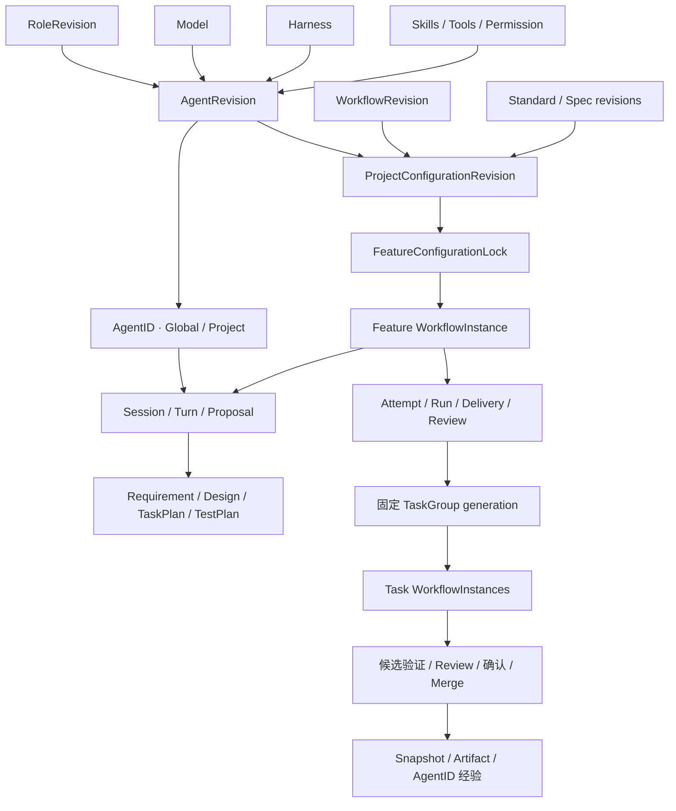

# DevDesk v0.3 架构与实现基线

日期：2026-11-09。本文承接 [v0.2 架构设计](../devdesk-v0.2/PLAN.md) 的章节与工程原则，以当前源码、迁移和验收结果描述实际产品。本文的 v0.3 是领域及工作台基线；不是已发布安装包或新平台验收的声明。

v0.2 中的 Swift 主界面、单工程数据库、Hugging Face 资产接入和完整 Archive 是当时的设计方向，不能作为当前已实现能力。当前交付采用 React Web 工作台、Rust 本机 Host、全局库加每项目 SQLite、Git/GitHub、Docker 和 Codex/DSH 原生 Harness。Archive 仍只有只读范围预览。

## 设计结论

以 Workflow 定义软件开发及人与 Agent 的交互机制，以 Feature 作为交付单元。Project 动态选择默认配置的精确修订；Feature 从创建时冻结配置闭包和编译计划。之后新增 Task、Attempt、Session、Review 和 Merge 都沿用该锁。

Agent 是包含职责及指令的完整组合：Model + Harness + 显式 Skills / Tools / Permission。AgentID 是组合的实例，固定 AgentRevision 与 Global/Project Scope。实例经验按 ID 积累；定义版本和实例范围分别演化。

前端展示和提交意图，core 决定业务终态。模型回答、原生进程退出、测试回执、Review 和代码接纳分别形成事实，互不代替。

## 1 产品边界与技术原则

- 单机、单用户、本地数据；Host 只监听回环地址，提供同源 HTTP、JSON-RPC 和 SSE。
- Web 是正式界面，构建产物嵌入 Rust Host；当前没有 Swift 客户端。
- Feature / Task 使用独立 Git worktree；同 worktree 写互斥，同目标接纳串行并进行精确版本核对。
- 强制保留 TDD、独立 Review、冻结输入、单父 squash 候选和真实来源。Workflow 编辑不能豁免这些规则。
- 外部接入为 Git、GitHub、Docker、Codex app-server 和 DSH native SDK；没有通用插件市场、任意代码工作流或远程多租户调度。

## 2 主界面与审计视图

导航依次为工作总览、执行与交付、角色讨论、工作流程、规范与身份、历史记录、设置。

工作总览使用项目汇总计数，卡片打开带筛选条件的 Feature 队列。执行与交付承载主要工程信息，按 Feature / Task 选择对象，分为总览、执行、交付与评审、文档、上下文、测试。文档和上下文不再是顶层页面。

地址保存项目、Feature、Task、详情页签、筛选和分页；已选对象不必出现在列表当前页。工作流管理的版本地址可直接重读对应草稿或发布修订。跨项目工程跳转通过正式打开项目操作，经验浏览保持当前项目。

运行视图只读展示流程定义及配置锁，活动流程提供内核允许的确认、暂停/恢复、重试、返工和讨论入口。已结束的流程只读；新工作创建后继 Feature。定义编辑放在工作流程页面。

## 3 领域对象与归属

| 对象 | 当前职责及不变量 |
|---|---|
| Project / Workspace | 项目身份、仓库/Mainline、并发和默认配置修订；项目目录与工程库分别保存 |
| Feature | 项目内交付单元；创建即冻结配置，可关联前序 Feature，完成后只读 |
| Task | Feature 下独立工作树、范围、依赖、Context 和交付；汇合成员来自 TaskPlan generation |
| Requirement / Design / Test / Doc | 不可变文档修订，保留 Feature 归属、Task 来源和输入引用；测试定义不等同于执行结果 |
| Workflow / WorkflowRevision | 稳定定义身份、可编辑草稿、不可变发布正文；驱动交互、执行、评审、合入与处置 |
| WorkflowInstance / Step | 使用冻结编译计划的运行投影；步骤轮次、输入摘要、输出引用、状态、理由和决定 |
| ProjectConfigurationRevision | 精确 Workflow、Standard 和各职责完整 Agent 的默认绑定；追加修订 |
| FeatureConfigurationLock | 精确依赖摘要、解析后的 Feature/Task 计划、来源 Project 配置及编译器版本；不可变 |
| Model | 提供方、模型标识、可选发布信息、参数及能力定义；不提供执行授权 |
| Harness | 协议和运行工具能力；原生执行固定精确安装构建，不以模糊版本替换 |
| Role / RoleRevision | 可管理的角色名称、职责、执行职责和 Scope；编辑追加版本，删除保留历史引用 |
| DefaultsBundle | 完整内建配置集合的不可变修订，Project 自动采用，Feature 创建时冻结 |
| AgentRevision | 职责、指令和 Model/Harness/Skill/Tool/Permission 的完整不可变组合 |
| AgentID | 固定 AgentRevision 与 Global/Project 范围的具体实例；同组合允许多个实例 |
| Skill / Tool / Permission | 分别描述工作方法、可执行能力契约、允许的权限；Skill 不自动安装或授权工具 |
| Standard / Spec | 固定 Spec 用途及精确版本；Spec 的检查规则由已有检查器执行 |
| Attempt / Run | 正式执行轮次和节点；冻结输入，技术重试生成带来源的新 Run |
| Session / Turn / Interaction / Proposal | 范围固定的原生对话、一次输入、待回答/审批请求和待采纳内容；讨论不伪造工程 Run |
| Context / Snapshot | 可编辑上下文与不可变捕获；工程材料、实际运行环境和来源均保留引用 |
| Delivery / Review / Override | 冻结交付、独立评审和有理由的人工质量例外；例外不改原测试与评审事实 |
| Merge / MergeAdvance | 候选、源、预期目标、接纳意图及远端 PR 核对；通过验证和确认后才能推进 |
| RuntimeExecution / Resource / Artifact | worker/测试容器生命周期、资源所有权、密封文件与完整性摘要 |
| Archive | 只读范围预览；尚不导出、删除冷数据或恢复 |

## 4 领域关系

## 5 Scope、精确版本与独立演化

Scope 是带 kind 的值对象：Global、Project(project_id)、Feature(project_id, feature_id)。定义可保存于 Global 或 Project；Feature Scope 用于配置锁、运行事实等归属，不提供可变的 Feature 局部治理定义。

Global 定义对项目可见；Project 定义仅对本项目及其 Feature 可见。定义 Scope、绑定目标、实例 Scope、材料来源分别记录。Global Agent 可以创建 Global 或 Project 实例；Project Agent 不能创建跨项目或 Global 实例。

定义使用稳定 definition_id 和不同的 revision ID；修订包含 version、supersedes、content_hash。发布及实例绑定不可原地更新或删除。Project 换绑生成新配置修订；Feature 创建在同一事务中验证指定默认修订并写入完整锁，draft Feature 同样不能换绑。升级采用创建后继 Feature。

已停用版本保留历史读取；新绑定受停用检查约束。模型、工具、权限或指令变化生成新 AgentRevision 和新 AgentID，旧实例不改名换芯。

## 6 Agent、Model、Harness 与执行权限

Model 定义与 Harness 定义分离，同一 Harness 可以形成不同 Model 的 Agent。运行锁记录 AgentID、AgentRevision、composition_hash、Model/Harness 修订、实际请求模型、安装镜像、适配器和权限摘要。

当前原生映射为 Codex → OpenAI、DSH → DeepSeek。支持的参数分别为推理强度及 max_tokens；不支持的提供方、参数、自定义 endpoint 或模糊运行版本在派发前阻塞，不静默忽略。Model 的发布字段是配置元数据，不能据此声称供应商模型权重可以离线复现。

工具处理器首版支持显式声明的 Harness 原生工具组，以及 AgentID 经验检索。不是任意 Tool 名称都存在处理器。权限由冻结的 Harness 和 Sandbox 两层策略、审批及工程范围共同限制；Reviewer/讨论使用只读代码视图，测试作者只写指定测试目录，Developer 只写所属 Task，测试在独立无模型凭据容器中运行。

会话不能单独覆盖完整 Agent 的 Model、Harness 安装或 Permission。共享运行时安装可复用，但组合身份和经验不会因此合并。

### 当前内建默认配置与 Role 管理

默认套件使用 GPT-6.1 Sol High（模型标识 gpt-6.1-sol、reasoning_effort=high）和 Codex 0.167.0，完整包含 Feature/Task Workflow、Spec、Standard、五种 Role 及其 Agent/全局实例、Skills、Tools、Permission 和 Docker Sandbox。新 GitHub Project 无需手工组合，Feature 自动冻结精确依赖。

Role 是独立身份，Agent 通过 role_ref 采用其修订。自定义角色可新增、修改和删除，并自动获得默认完整 Agent。角色名称不再是固定枚举；五种执行职责仍用于已有 TDD/Review 门禁。编辑当前默认 Role 会追加 Role/Agent/实例及默认套件；默认 Project 为新 Feature 采用新版本，旧 Feature 保持原锁。删除当前默认角色需要同执行职责的替代角色，保留历史版本及使用事实。

固定 Harness 构建配方在无需 Docker 时即可保存；首次物化到本机实际镜像后，记录不可变的安装/镜像关联。该镜像不可用时拒绝静默替换。数据重置及验收见 [默认套件与 Role 记录](../builtin-defaults-and-roles/EXECUTION.md)。

## 7 Workflow 定义、草稿及编译

WorkflowDocument v1 保存用途、阶段、五种规范职责 slot、步骤及精确 Task 子流程引用。步骤具有稳定 key、动作及契约版本、依赖、可选的上游输入端口、参与职责、交互目标/主题/输出、条件、推进模式、执行配方、返工入口和重试上限。

首版动作目录为：agent.interact、proposal.adopt、attempt.execute、delivery.review、merge.prepare、merge.review、merge.apply、snapshot.capture、resource.cleanup、tasks.foreach、branch、join。只执行有版本的固定处理器，不运行用户表达式或任意脚本。

首版编译器使用 analyst、architect、developer、tester、reviewer 五个规范 slot；不是任意职责别名执行器。支持 Feature 引用精确 Task 子流程；更深层的任意子流程递归不属于当前运行器能力。Project intake 可保存定义，当前项目需求入口主要由 Project 默认配置选择完整 Analyst，不宣称已经运行独立 Project intake 实例。

草稿可保存不完整状态，保存携带 edit revision；发布校验图、引用、角色、能力、TDD 及交付顺序。发布追加不可变修订，不自动修改 Project。Feature 编译解析全部 Agent 及依赖并保存 compiler_version=1 的计划；未知契约不会静默换成新解释。

## 8 WorkflowInstance、Attempt 与 Run

工作流求值器读取工程事实，先持久化幂等 intent，再在事务外派发原生命令并接纳回执。等待用户、等待前置条件、技术失败和业务退回分别呈现。无浏览器时，后台仍可处理自动步骤。

讨论步骤各自记录初始 Turn；即使复用同一原生 Session，也发送该步骤目标和当前材料 ID/摘要，不能把前一个步骤的回答当作新产物。提案必须被明确采纳后才能进入正式文档。

正式 Feature 阶段为 requirement_definition、solution_planning、closure；Task 阶段为 implementation。旧 planning 阶段为历史兼容保留。StageInputLock 保存该阶段文档、上下文、绑定及步骤来源；有效性按具体依赖判断，设计变化不会推翻未变的需求评审。

技术重试保留冻结请求及旧结果，并受步骤上限约束。业务返工保存旧步骤历史，产生新的步骤 ID 与轮次，失效受影响后继；重新展开 TaskPlan 时停止旧 writer，创建新 generation。旧 Tasks 不会混入新汇合条件。

## 9 状态、交付、Review 与人工决定

Feature/Task 的权威终态仍由既有 core 状态规则决定，不能通过“步骤完成”按钮设置。工作流全部节点结束也不能凭空宣布尚未接纳的 Feature 已完成。

Review 使用冻结 Delivery、来源证据、代码和对应 Standard/Spec。需求只评审需求边界，方案只评审规划完整性，Task 只要求自身范围及测试，Feature 收尾验证完整套件；不能把之后阶段的证据提前当作当前阶段缺陷。

每步可配置 automatic 或 human_confirmation。确认发生在步骤结果齐备后、后继副作用之前；默认主干流程在候选验证及 Review 之后等待确认，再执行 merge.apply。确认绑定步骤轮次及输入/输出摘要；候选或目标变化拒绝旧决定并要求重建。

Review 退回保留原事实，通过新 Attempt / 新业务轮次修复；质量 Override 保留理由和原检查结果，不能豁免 stale、来源、权限或目标版本冲突。

## 10 单机系统架构

- domain：领域类型、Scope、版本、图校验和证据有效性，不执行 I/O。
- core：命令、查询、工作流求值、执行意图、调度、Review、Merge 与权威终态。
- adapters：SQLite、密封文件、Git、GitHub、Docker、原生 Harness 和可注入模拟端口。
- host：本地鉴权、全局配置与项目选择、共享安装/凭据、跨库只读经验查询、HTTP/SSE 和嵌入 Web。
- web：React/TypeScript 工作台及结构化配置编辑器。

外部调用遵循“持久化意图 → 事务外 I/O → 接纳回执”。未知消费、CAS 或发布回执首先核对原 operation，不能盲目重复副作用。

## 11 本机协议

JSON-RPC 协议保持 v1；命令携带 command_id、target、expected_revision、payload 及可选 project_id。相同 ID/参数重放返回原结果，不同参数复用被拒绝。项目指针变化产生 project_changed。

新增配置接口覆盖 Model/Harness/Tool/Skill/Spec/Standard/Agent 修订、AgentID 注册、Workflow 草稿/发布/校验/预演/差异、Project 默认绑定、流程实例控制，以及实例经验查询和恢复。精确结构见 [领域规范](../../domain.md)、[协议](../../protocol.md)及 `schemas/rpc.schema.json`。

SSE、查询及浏览器刷新使用同一事实源。工作流变化和治理命令写入历史事件；前端不维护第二套工程状态机。

## 12 Harness 兼容性与验证

原生 Codex app-server / DSH SDK 保留安装、会话、输入消费、终态、停止、日志导出和写许可撤销证据。Agent 组合版本不能替代真实 RuntimeExecution；原生成功也不能替代真实独立测试。

默认离线回归涵盖领域、SQLite、注入式执行、真实本机 Git、HTTP 和 Chromium。需要外部资源的 Docker、模型和 GitHub 验收单独运行，不把 ignored 当通过。当前轮实际结果及平台边界见 [执行记录](../workflow-and-workbench/EXECUTION.md)和 [原生记录](../workflow-and-workbench/NATIVE.md)。

## 13 Merge 与代码接纳

Task → Feature、Feature → Mainline 使用固定源和预期目标构建单父 squash 候选。独立候选测试与 Review 通过后才可申请接纳；人工步骤还需精确确认。

远端主干前进时，可显式观察远端 SHA 并提交 repository.refresh 意图，仅对干净的所属 mainline worktree 做快进；不推送或覆盖远端。同步回执更新主干事实，旧候选及确认失效，重新构造并验证候选。

本地 CAS、远端精确 lease、PR 创建/merged 观察分别记录。目标变化或未知回执保持可核对状态；不覆盖他人远端变更，不通过平台 merge endpoint 偷换候选。源交付及本次候选的证据均保留。

## 14 当前默认 Feature 开发流程

1. Feature 创建时锁定 Project 配置并准备独立 worktree，保存初始上下文。
2. Analyst 按流程目标讨论需求，用户采纳 Requirement；执行 requirement_definition，并独立评审需求交付。
3. Architect 讨论并采纳 Design、TaskPlan；Tester 讨论并采纳 Feature TestPlan，TaskPlan 内各 Task 有独立配方。
4. 执行 solution_planning，独立评审计划交付，准备 Task 继承基线。
5. 按已采纳 TaskPlan 固定 generation 和成员；各 Task 运行独立子流程：测试作者 → 真正的断言 Red → 实现 → Green → docs / verify → Delivery / Review。
6. 为 Task 构建 Feature 目标候选，执行候选测试和 Review，接纳后核对远端并保存快照。
7. 固定成员全部权威完成后，Feature 执行完整测试与文档收尾，再做 Delivery / Review。
8. 构建主干候选，完成同候选测试与 Review；默认等待人确认后执行接纳。
9. 核对主干 PR/远端回执，保存最终上下文及来源，释放资源。

这是可编辑、可发布的内置 v1 定义，不再只是 UI 中的一段流程说明。修改产生新版本，旧 Feature 全程保留原语义和配置。

## 15 上下文、经验与场景恢复

Context 独立属于 Project、Feature 或 Task。Snapshot 固定材料引用、捕获时间、运行绑定和会话来源；文档历史不被新输入覆盖。

经验投影按 AgentID 建立，主要筛选为项目名称、Feature 名称、工作时间，保留稳定 ID、捕获名称和捕获时间。Global 实例可跨项目读取自身历史；Project 实例只在所属项目积累和读取，名字相同不合并。

浏览器先读索引，再取选中快照及证据引用；正文经密封清单哈希校验。原生经验工具在 Session 开始时准备该实例专属的只读目录：先读 index，再读相关 detail 文件。它是冻结的文件工具投影，不是任意数据库或凭据访问接口。

跨项目查询以只读连接读取工程库，不启动 worker、不迁移源库、不切换活动工程；全局目录保存可重建的元数据投影。不可用项目保留来源及可用性边界。

场景恢复创建新的来源引用和 Session，导入历史材料作为上下文；当前代码、正式文档和配置锁保持当前事实。不能据此声称任意旧容器、凭据或模型内部状态可完全复现。

## 16 调度、资源与中断恢复

全局及项目额度继续限制运行；同一逻辑工作树写许可独占。流程先等待 worktree、代码头和 Task 依赖就绪，再分配正式执行。暂停阻止后续调度，在途调用仍需真实停止/导出边界。

Run/Turn、仓库操作、接纳 intent 和工作流 intent 各自幂等。重启时恢复原身份，未确认消费不自动重新发送；仓库和远端接纳回执按原 operation 核对。资源清理失败留存事实并提供重试。

## 17 数据库与数据目录

全局 `global.sqlite3` 保存共享定义、实例注册、安装、偏好、项目目录和经验目录投影。每个 Project 使用 `projects/<id>/engineering.sqlite3` 及其 artifacts/execution 目录。当前 schema 为全局 v5、项目 v34。

Workflow 等治理对象采用 `governance_records` 类型化记录集合：kind、身份、Scope、版本、摘要、JSON 正文和 revision；草稿、发布、锁、运行实例、步骤历史、决定、TaskGroup、意图和经验为不同 kind。选择记录集合而非另建一套可写节点/边表；步骤与边从同一 WorkflowDocument 派生。

SQL trigger 阻止已发布记录改写、历史删除、Scope/身份及 AgentID 绑定变更。运行投影可更新；发表、冻结和人类决定追加保存。旧迁移顺序保留，不删库重建。

## 18 完整性与性能边界

Artifact 密封后保存 SHA256，读取验证路径和摘要。跨项目历史使用只读事务，分页返回目录；主体按需读取。配置发布与 Project 换绑独立事务，Feature 与其配置锁同事务提交。

项目摘要由服务端事实计算，不能用浏览器当前 50 条历史推算项目总数。当前仍有整状态序列化和较大历史的扫描成本，没有据本轮功能验证宣称容量或延迟 SLA；大规模历史、可搜索全局目录和 Native 经验目录构建需单独做容量验收。

## 19 数据目录、凭据及升级

保持可配置 data 根目录、进程锁、路径/符号链接约束、旧单库保留及多库迁移。选择数据目录不等于复制工程目录，不在程序启动时删除旧数据。

凭据采用专用账户引用和平台凭据存储，遵循 [系统凭据说明](../../system-credentials.md)。不把密钥、运行数据、模型协议正文或构建产物提交到源码库。未知历史组合不猜测 Model、权限或 AgentID，不改写原 Artifact/hash。旧 live Feature 保存 legacy_feature_lock 及可证明的原 Binding/Session；不再用最新偏好分配新工作，缺少完整组合的新执行需创建后继 Feature，已有冻结执行和回执仍可读取、核对。

## 20 Archive 的真实现状

当前仅查询可归档对象、产物范围和阻塞原因，`executable=false`。没有冷数据迁移、文件删除或 Archive 恢复。离线经验的来源目录和上下文导入不等于 Archive 实现。

## 21 核心不变量与验收入口

- AgentID 的组合和实例 Scope 不变；经验只按 ID 归属。
- Project 默认可变，Feature 配置锁及未来执行不变；创建冲突原子拒绝。
- 需求先交付并评审，再做方案；TDD、独立 Review 和精确候选不可绕过。
- Task 汇合只使用固定 TaskPlan generation；返工保留旧任务和证据。
- 人类确认在实际合入前，依据变化则失效；直接 RPC 与 UI 使用同一门禁。
- 模型声明不产生交付、评审、完成或授权事实。
- 旧历史不重标来源，未知结果先核对；新定义不改旧组合。

验收命令：`cargo fmt --all -- --check`、`cargo test --workspace --locked`、`npm --prefix web run build`、`./scripts/check.sh`。原生工作流使用 `tests/live/probe_workflow_workbench.py`，要求专用测试仓库和数据集，最终仅保留 Markdown execution report。

## 22 本轮实施与证据

本轮阶段为 Scope/版本基础、Workflow 编译及推进、AgentID 经验、执行工作台、配置编辑器、迁移与验收；对应 [实施计划](../workflow-and-workbench/PLAN.md) W0–W7。

Workflow 与工作台结果记录于 [执行记录](../workflow-and-workbench/EXECUTION.md)，后续默认套件、Role CRUD 与数据重新初始化记录于 [默认套件与 Role 执行记录](../builtin-defaults-and-roles/EXECUTION.md)。历史 v0.2、Ubuntu 和 Permission 报告是其执行日期的事实，不自动证明 v0.3 的新能力已在那些平台重跑。

所有计划目录只保留 Markdown。日志、JSON、截图和临时测试脚本已按用户要求清理；源码回归测试继续位于 crates、tests、web/tests。历史报告里的临时路径或 SHA 仅记录当时执行，原中间文件不再作为交付物。

## 23 后续边界

当前不包含任意 BPMN/代码执行引擎、任意职责别名或无限嵌套子流程、模型 endpoint 自由路由、精细原生 Tool 安装市场、跨进程分布式调度、完整 Archive、Swift 客户端或 Hugging Face 接入。新平台和容量保证需要独立验收。

后续演进继续沿用精确修订和 Feature 冻结原则：新编译语义使用新版本，已有流程不可被升级静默重解释。
