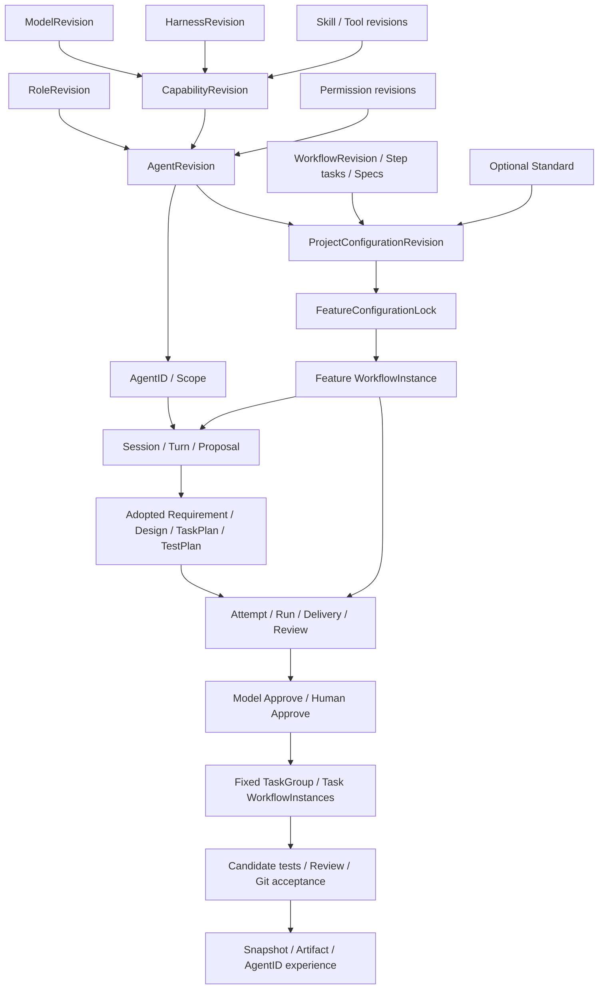

# DevDesk v0.4 架构与实现基线

日期：2026-11-10。本文承接 [v0.3 基线](../devdesk-v0.3/PLAN.md) 的 23 章结构，以源码提交 `e4fbcae855ce59ce44695724d969a195c4c2228a` 为依据，描述当前已经实现的产品、领域关系、运行合同和验证边界。源码依据与验收记录见 [基线核对与验证记录](EXECUTION.md)。

v0.4 是本文档的架构基线版本。Cargo、Web、Host 能力接口和运行包的产品版本仍为 `0.2.0`；数据库、Workflow Schema、发布修订、编译器、任务渲染器和输出合同各自独立版本化。

## 设计结论

Workflow 定义阶段、人与 Agent 的交互、业务任务和推进规则，Feature 是工程交付及配置冻结单元。Project 显式选择 Workflow、可选 Standard 和 Role→Agent 映射；Feature 创建时固定整个依赖闭包、展开计划及摘要，后续 Task、Attempt、Session、Review 和 Merge 使用该锁。

Role 描述职责，Capability 组合 Model、Harness、Skills 和 Tools，Agent 组合精确 Role、Capability 与权限。AgentID 是采用某个 AgentRevision 的具体实例，固定身份及经验范围。创建或编辑 Role 只改变 Role；其他资源独立修订。

阶段业务提示词属于 Workflow 配置。模型依据冻结的任务、Skill、Spec 和实际材料判断内容，输出模型 Approve；人类作出独立 Approve，也可以保留理由覆盖模型拒绝。模型结论、人工决定、实际测试、独立评审和 Git 接纳分别留存，core 决定权威终态。

### 相对 v0.3 的主要变化

| 方面 | v0.4 当前基线 |
|---|---|
| 配置模型 | Role、Capability、Agent 独立管理，Project 是 Role→Agent 绑定入口；Standard 可选 |
| Workflow | Schema/编译器 v3，显式 Role/Spec、可复用子流程、公共任务及 Agent 节点任务 |
| 默认资源 | 六个 Role、分阶段 Skill/Spec、22 份任务 Markdown；默认 Feature/Task 发布修订 v4 |
| 输出与内容判断 | 正式检查使用 `evidence-checks/v2`，模型判断内容并给出 Approve，随后由人类确认 |
| 运行恢复 | 待采纳输出跟随后继提案和 Session；取消等待保留可继续的意图；已消费输入继续冻结 |
| 工具与模型 | HTTP/MCP/静态 Skill 接入，DSH 四种服务商路由，精确绑定与调用回执 |
| 工作台与存储 | 九个顶层入口、独立全局角色讨论；全局库 v8、工程库 v39 |

## 1 产品边界与技术原则

- 单用户工程工作台，React Web 为正式界面，Rust Host 嵌入构建后的 Web，SQLite 保存配置与工程事实。
- 默认监听 loopback，提供同源 HTTP、JSON-RPC 和 SSE；显式配置监听地址与连接密钥后，可从浏览器连接远程内核。
- Project 通过 GitHub 仓库接入；Feature/Task 使用独立 Git worktree。同 worktree 写许可互斥，同目标接纳按精确版本串行核对。
- 工作流编辑受固定动作合同约束。TDD、独立 Reviewer、真实来源、冻结输入和候选 Git 门禁由内核执行。
- 配置定义、执行输入、模型判断、测试回执、人工决定与代码接纳各有来源和版本，未知副作用先核对。

远程内核仍采用原有单用户数据集与权限模型。当前支持 macOS 和 Linux 的既有适配路径；各平台及模型的验证范围见第 12、22 章。

## 2 主界面与审计视图

顶层导航依次为：工作总览、执行与交付、角色讨论、项目管理、流程与规范、角色与 Agent、基础组件、历史记录、设置。

配置按对象分组：项目管理保存项目配置；流程与规范包含 Workflow、Spec、Standard；角色与 Agent 管理 Role、Capability、Agent 和实例；基础组件包含 Model、Harness、MCP、Skills、Tools（HTTP API）、Harness 原生工具。Permission 在设置中管理，工具调用记录位于历史记录。

执行与交付按 Feature/Task 选择对象，包含总览、执行、交付与评审、文档、上下文、测试。阶段各占一行，编译展开的子流程保留在调用阶段内，Task 子流程按需展开；折叠状态按项目和流程实例保存在本机。工作流定义编辑采用阶段/步骤树与所选节点表单两列布局。

地址保存对象、页签、版本和筛选；分页外已选对象可按 ID 读取。草稿、Markdown 源码与预览、动作就近反馈及内核允许的确认/重试/返工入口均属于正式交互。运行视图展示冻结计划、实际模型报告及人类决定，页面提交意图，由内核验证。

设置、首次初始化和连接失败页面均提供“连接内核”。连接先发现目标能力，再完成目标内核鉴权；切换连接不搬迁原数据集。

## 3 领域对象与归属

| 对象 | 当前职责及不变量 |
|---|---|
| Project / Workspace | 仓库、主干、并发、项目身份与配置修订；仓库、配置、运行环境的就绪状态独立 |
| Feature / Task | Feature 冻结工程配置；Task 固定所属 Feature、范围、依赖及 TaskGroup generation |
| Requirement / Design / Test / Doc | 不可变文档修订，保存验收、来源和输入引用；规划文档与实现说明分别维护修订链 |
| Workflow / WorkflowRevision | 稳定定义、可编辑草稿、不可变发布正文；Step 定义任务、Role、Spec、依赖和动作 |
| WorkflowInstance / Step | 冻结计划的运行投影，保存 round、input_hash、输出引用、状态、理由及确认 |
| RoleRevision | 名称、职责、执行职责和可见范围；独立修订 |
| CapabilityRevision | 精确 Model、Harness、Skill 和 Tool 组合 |
| AgentRevision / AgentID | Agent 组合 Role、Capability、权限和指令；实例固定组合、Scope 及经验归属 |
| Spec / Standard | Spec 是显式阶段判准；Standard 是可选的规范覆盖基线 |
| ProjectConfigurationRevision | Workflow、可选 Standard、Role→Agent 映射、规范审计及依赖摘要 |
| FeatureConfigurationLock | 精确配置闭包、Feature/Task 编译计划、编译器与任务定义；创建时冻结 |
| Session / Turn / Interaction / Proposal | 原生会话、一次输入、用户交互及待采纳提案；Proposal 采纳产生正式对象 |
| Attempt / Run | 正式业务轮次及执行节点；技术重试保留旧请求、结果和来源 |
| Delivery / Review / Override | 冻结交付、独立模型评审、人工质量例外；保留原始证据 |
| Merge / MergeAdvance | 源交付、候选、预期目标、接纳意图与远端核对 |
| Integration / Tool / Binding / ToolCall | 接入源、动作契约、确切授权及持久化调用/回执 |
| Context / Snapshot / Artifact | 可编辑上下文、不可变捕获及密封文件，保留来源和摘要 |
| RuntimeExecution / Resource | 实际进程、容器、工具及测试生命周期，包含停止和写许可证据 |

旧 DefaultsBundle 和旧组合记录继续用于历史兼容。新项目从普通的默认定义中选择配置并显式保存，已有项目不追随默认目录变化。

## 4 领域关系



Task 子流程也包含正式执行、模型判断、人工确认和候选接纳。图表示主要配置及事实关系，具体执行依赖以冻结计划为准。

## 5 Scope、精确版本与独立演化

Scope 使用 Global、Project(project_id)、Feature(project_id, feature_id)。定义的存储 Scope、Role 的 `visibility`、AgentID 的实例范围与材料来源分别记录。Role 可全局可见或只对明确项目集合可见；Agent 及其依赖不能越过可见范围。

`definition_id` 表示稳定身份，记录 `id` 表示精确修订；`version`、用于并发核对的 `revision` 与 `content_hash` 各有职责。Role、Capability、Agent、Skill、Spec、Tool、Permission 或 Workflow 的编辑都追加修订，历史实例和摘要保留。

Project 配置保存 `schema_version=2`、`workflow_ref`、可空的 `standard_ref`、`role_agent_bindings`、规范审计和基线检查。绑定必须匹配实际 Role 身份；两个 Role 的底层执行职责相同，不能据此互换。

Feature 创建在同一事务中验证 Project 配置并冻结依赖闭包及计划。更新项目默认、任务文本或 Skill 后，新配置用于后续 Feature；旧 Feature 继续使用原锁。`predecessor` 仅表示同项目 Feature 的前后关联，代码基线仍来自项目主干。

## 6 Agent、Model、Harness 与执行权限

Capability 固定 Model、Harness、Skills 和 Tools，Agent 引用精确 Role 与 Capability，并冻结权限及有效指令。AgentID 固定 AgentRevision；会话不能单独覆盖完整 Agent 的模型、安装或 Permission。更换组合形成新修订及新实例，经验继续按实例身份归属。

当前执行后端为 Codex app-server 与 DSH native SDK。Codex 对接 OpenAI/ChatGPT；固定 DSH 版本支持 DeepSeek、智谱国内编程订阅、MiniMax 国内订阅和 Ollama。云服务使用受支持的固定路由；Ollama 可配置受校验的服务地址。Model 的容量声明、实际请求预算、服务商连接快照与 profile 摘要在派发前核对。目录读取、容器连接成功与真实推理成功分别显示。

运行绑定保存 Agent/实例、Model/Harness 修订、实际模型、精确安装/镜像、权限和接入锁。本机 Codex 可用于登录及模型目录，正式工程使用受支持的 Docker worker；运行时偏好明确选择安装及模型。

权限由 Harness/Sandbox 两层策略、审批、Tool 授权和工程写范围共同限制。讨论和 Reviewer 使用只读代码视图，测试作者只写指定测试目录，Developer 只写所属 Task；真实测试在独立执行环境运行。原生工具组必须匹配 Harness，配置工具名称本身不产生授权。

### 当前默认目录

默认采用 GPT-6.1 Sol High（`gpt-6.1-sol`、`reasoning_effort=high`）及固定 Codex `0.167.0`，提供六个 Role：需求分析师、架构师、项目经理、开发、测试、独立评审。项目经理独立使用规划 Skill/Capability，底层执行职责复用 architect；五种底层执行职责继续服务 TDD 和独立评审门禁。

默认资源以普通不可变定义播种，项目页可直接采用并保存；Role 编辑不自动生成其他资源。Skill、阶段 Spec、任务及权限的具体目录见 [默认配置说明](../../../resources/configuration/README.md)。

### HTTP、MCP 与静态 Skill

HTTP/OpenAPI 和 MCP 接入经过发现、动作发布、凭据绑定及项目映射形成精确 Tool。静态 Skill 包保存指令、UTF-8 材料和工具依赖；脚本或工具依赖不能自动安装、执行或扩大权限。

Feature/Session 冻结 IntegrationLock。ToolCall 由 core 持久化意图，适配器在受控 Docker 环境执行，回执保留原生 callId、Session/Turn/Run 和 operation 来源。未知结果进入核对，迟到的真实持久化回执可以被正常调度接纳，未确认的写调用不能盲目重发。认证秘密通过专门引用解析。范围见 [接入契约](../tool-skill-integrations/CONTRACT.md)。

## 7 Workflow 定义、草稿及编译

当前新默认使用 Workflow Schema v3。Step 保存稳定 key、阶段、动作/合同版本、依赖与端口、`role_ref`、精确 `spec_refs`、条件、推进模式、执行配方、返工入口和重试上限。`workflow.call` 引用确切子流程修订；`tasks.foreach` 使用固定 Task 集合及 Task 子流程。

动作目录为 `agent.interact`、`proposal.adopt`、`attempt.execute`、`delivery.review`、`merge.prepare`、`merge.review`、`merge.apply`、`snapshot.capture`、`resource.cleanup`、`tasks.foreach`、`workflow.call`、`branch`、`join`，均由版本化处理器解释。定义用途支持 Feature、Task、project_intake 和 subworkflow；独立 Project intake 的完整运行未列为本版已验收能力。

| 版本对象 | 当前新配置/输出 | 历史兼容 |
|---|---|---|
| JSON-RPC | v1 | 保持原命令信封 |
| ProjectConfiguration | Schema v2 | 可证明的旧配置转换 |
| Workflow / compiler_version | Schema v3 / 编译器 3 | v1、v2 原锁按其语义读取 |
| 默认 Workflow 发布修订 | Feature/Task v4 | 已发表旧修订继续保留 |
| Agent 动作 / 系统动作合同 | v2 / v1 | 由各动作声明校验 |
| 冻结任务渲染器 | `agent-task/v3` | v1、类型化 v2 及既有本地 v1 Approve 载荷 |
| 正式内容检查输出 | `evidence-checks/v2` | 旧冻结报告按原合同读取 |

Agent 动作 `agent.interact`、`attempt.execute`、`delivery.review`、`merge.review` 必填公共 `task_instructions`；执行配方的六种 Agent 节点分别必填节点任务。真实测试节点、`merge.prepare` 等系统动作执行固定处理器，不能填写 Agent 业务任务。

业务任务、检查重点及阶段边界全部从对应 Step/节点配置读取。22 份默认任务 Markdown 在编译时嵌入并播种为发布正文；用户通过 Workflow 编辑器修改、预览和发布。兼容路径读取冻结的 `interaction.goal` 与 `parameters.agent_prompts`。运行器保留结构合同、安全和执行协议，业务提示词不在派发时隐藏追加。

单字段上限 32 KiB UTF-8，展开任务正文合计上限 1 MiB，冻结任务及基础上下文合计上限 512 KiB。任务、Role、Skill 和 Spec 不静默截断。子流程递归解析精确修订，拒绝循环，深度上限 8，展开计划总节点上限 1000；完整调用路径参与身份、输入和任务来源核对。

草稿可不完整保存；发布校验图、端口、Role/Spec、作用域、能力、基线覆盖及工程顺序。Standard 的覆盖规则检查实际匹配数量和全部匹配节点的 Spec，不向步骤隐式注入规范。预演与配置预览不产生模型、Git 或测试事实。

## 8 WorkflowInstance、Attempt 与 Run

求值器读取工程事实，先持久化幂等 intent，再在事务外派发命令并接纳回执。等待材料、依赖、用户确认、技术失败和业务返工分别呈现；后台可以在无浏览器时推进自动步骤。

v3 讨论默认采用独立 Session，每个步骤记录自己的起始 Turn。每次输入冻结任务、有效 Role、按声明顺序提供的 Skill、显式 Spec、Context、材料和授权，形成可查询的 `execution_task` 与 Artifact。技术重试及排队输入不读取最新 Workflow；实际任务与预览使用共享组装规则。

待采纳步骤沿确切输入端口和编译后的子流程输出寻找有效提案，跟随后继 Session 及提案修订，排除拒绝、失效和被替代引用。Requirement、Design、TaskPlan、TestPlan 使用一致的关联规则；无关 Session 的回复不能被借用。新提案或有效输入变化使旧确认失效。

采纳仍原子核对 Proposal 的目标 revision 和依赖，`accepted` 表示正式对象已生成，求值器据此继续推进。已被完成的采纳步骤消费的输入保持冻结；之后出现的未采纳草稿不会替换正式输入。启动时重新求值未结束流程，可以修复旧投影停留在过期引用的等待状态。

正式 Feature 阶段为 `requirement_definition`、`solution_planning`、`closure`，Task 阶段为 `implementation`；旧 `planning` 保留兼容。StageInputLock 按具体文档依赖、上下文和步骤来源冻结输入。

技术重试保留原请求与旧事实；业务返工产生新步骤 ID/round，并清理受影响后继的 Review、Merge、Snapshot 等输出和确认。TaskPlan 重新展开时停止旧 writer、固定新 generation，旧成员不进入新汇合条件。

## 9 状态、交付、Review 与人工决定

内容校验分为结构接纳和模型判断。结构检查要求字段类型、四个唯一检查项、非空证据以及结论一致；具体质量由模型依据冻结 Skill/Spec、作者 Skill、任务边界和实际材料评估。新合同不再把硬编码标题或关键词探测当作内容质量门禁。

正式检查的 `evidence-checks/v2` 输出为单个 JSON 对象：

| 字段 | 约定 |
|---|---|
| `approve` | 布尔值，等于四项 `passed` 是否全部为 true |
| `summary` | 非空字符串，解释本阶段的内容判断 |
| `checks` | 恰好四项：`traceability`、`scope`、`tests`、`failure_paths`；每项包含 `key`、布尔 `passed`、非空字符串 `evidence` |

完整结构见 [正式检查 Schema](../../../schemas/stage-answer.schema.json)。解析错误指向具体字段；结构合法本身不代表内容通过。讨论提案继续采用 ProposalContent，工作完成和实现说明分别采用 `work-summary/v1`、`implementation-document/v1`；正式检查不会再次作为需求提案提取。

当前 Skill 可作为测试用方法继续调整。系统不把测试版章节名称或固定质量评分写成永久门槛；必需内容、章节、检查深度和阶段边界在任务与 Skill/Spec 修订中表达。修改、发布并明确选择新配置后生效，旧输入保留。

| 模型或人类事实 | 运行及推进含义 |
|---|---|
| 模型报告结构有效、Approve=true | Run 成功，保存判断；等待人类 Approve |
| 模型报告结构有效、Approve=false | Run 同样成功，保存内容缺口；允许返工或人类覆盖后 Approve |
| 输出结构错误、执行异常或缺少真实停止证据 | 按技术失败处理，不能借人类 Approve 伪造有效报告 |
| 人类 Approve | 核对当前 round、input_hash、报告及实际工程条件后推进 |
| 人类覆盖拒绝 | 要求 `overwrite_model:true` 和非空理由；保留原模型报告及不可变确认记录 |

内容校验和独立评审取得有效模型报告后，即使步骤配置 automatic，也进入 `waiting_confirmation`。人工确认摘要包含配置锁、输出和模型报告；报告、轮次或有效输入变化会使旧确认失效。独立评审被覆盖时额外保存 Review Override，原 Review 不改写；不能在模型尚未完成时以 Override 跳过评审。

Review 按当前交付边界判断：需求只要求需求清晰和可验收，方案要求跨材料一致，Task 要求自身范围与真实测试，Feature 收尾要求完整套件。人类质量决定继续受输入新鲜度、来源、权限、测试及 Git 目标门禁约束。Feature/Task 的权威终态由 core 的接纳规则决定。

## 10 单机系统架构

| 层 | 职责 |
|---|---|
| domain | 领域对象、Scope、精确版本、Workflow/输出合同、权限、来源及有效性规则；不执行外部 I/O |
| core | 命令查询、配置编译、任务组装、工作流求值、模型报告与人工门禁、调度、接纳及权威终态 |
| adapters | SQLite、Artifact、真实 Git/GitHub/Docker、原生 Harness、工具执行及可注入测试端口 |
| host | HTTP/SSE、鉴权、数据集和项目管理、运行环境准备、共享凭据及跨库查询 |
| credential-helper | macOS 专用凭据助手及身份/协议边界 |
| web | React/TypeScript 工作台、配置与任务编辑、模型报告、人类操作及历史呈现 |

外部调用采用“持久化意图 → 事务外 I/O → 核对并接纳回执”。Workflow、Tool、仓库、测试和接纳各自保留 operation 身份。未知输入消费、写调用、CAS 或远端回执先核对原操作，避免重复副作用。

## 11 本机协议

JSON-RPC 保持 v1。命令携带 `command_id`、`target`、`expected_revision`、`payload` 及可选 `project_id`；相同请求重放返回原结果，同 ID 不同参数被拒绝。跨项目切换、SSE 游标和只读查询遵守项目隔离。

配置接口覆盖 Role、Capability、Agent/实例、Model/Harness、Tool/Skill、Permission、Spec/Standard、Workflow 草稿/发布/预览/差异及 Project 配置。运行查询提供冻结定义、实际任务、模型报告和可用动作；`workflow.step.confirm` 额外核对当前 `input_hash`，覆盖模型结论时使用第 9 章字段。

Session 查询可在分页前按 AgentID 过滤，保留历史关联元数据。全局讨论通过 `scope:global` 打开，不同时提供 `project_id`；全局 Session 使用全局 AgentID，工程提案需要进入具体项目后采纳。

HTTP 提供 `/capabilities`、同源会话、JSON-RPC、SSE 和受控 Artifact 访问。远程发现接口不授予会话，目标内核通过连接密钥完成鉴权，Cookie 使用独立端口名称；Host/Origin 保护继续执行。监听所有网卡时需要明确 `--public-url`，连接密钥通过 `DEVDESK_ACCESS_TOKEN` 配置。

前端与直接 RPC 经过同一业务门禁。精确接口及字段见 [协议](../../protocol.md)、[RPC Schema](../../../schemas/rpc.schema.json)。

## 12 Harness 兼容性与验证

Codex/DSH 的安装、原生 Session、输入消费、终态、停止、协议导出及 writer 撤销分别留存。组合版本、原生成功退出和模型自述都不能替代实际 RuntimeExecution、真实测试或代码接纳。

新冻结任务使用 `agent-task/v3`，保留 Ubuntu 改造加入的类型化输出，并使正式检查的 `schema` 与 `output_schema` 一致。历史 v1/v2 及已存在的本地 v1 Approve 快照继续按原载荷/摘要验证；已准备和完成的轮次不重渲染。旧绑定中新追加的轮次使用当前明确版本化输出描述，原定义来源仍保留。

默认自动化覆盖领域、SQLite、注入端口、本机 Git、HTTP 和 Chromium；需要外部环境的测试明确忽略并单独验收。真实模型、Docker、GitHub、平台凭据、模拟协议和发布包结果分别记录，不能互相代替。

`41ff58c` 包含 Ubuntu 六项改造和真实 Codex 闭环证据；`e4fbcae` 在其上增加本次工作流修复与 Approve 门禁，并通过 macOS 自动化。Ubuntu 的既有通过结论保留，新增双重 Approve 尚未在 Ubuntu 真实工程中重跑。详细矩阵见 [本版记录](EXECUTION.md)。

## 13 Merge 与代码接纳

Task→Feature、Feature→Mainline 使用冻结源和预期目标构建单父 squash 候选。候选测试、独立候选 Review 及人类决定针对同一候选，满足真实工程条件后执行接纳。

协调器通过 Git 端口读取候选实际 parents，要求唯一父节点等于冻结 `expected_target`。候选评审输入包含 `candidate_provenance`、Merge 及相应已完成仓库操作回执，模型据此判断真实来源。

远端主干前进时，`repository.refresh` 接受已观察的精确远端 SHA，只对所属干净 mainline worktree 做快进；回执更新主干事实。旧候选和旧确认失效，需要重新准备并验证。源交付证据和旧操作记录保留。

本地 CAS、远端精确 lease、PR 创建及 merged 观察分别记录。接纳核对候选、源和目标，不覆盖其他远端变更，不以未经核对的平台合并结果替换候选。人工 Override 不豁免这些条件。

## 14 当前默认 Feature 开发流程

默认 Feature Workflow 分为八个阶段，Task 使用独立子流程；公共任务和 Agent 节点任务均可在对应配置中编辑。

| 阶段 | 主要行为与推进条件 |
|---|---|
| 需求分析与 PRD | Analyst 讨论并产出提案；用户采纳 Requirement；正式内容校验和独立需求 Review 各取得模型结论及人类 Approve |
| 架构设计与 Design Doc | Architect 依据已采纳 PRD 讨论，用户采纳 Design |
| 项目管理与 Task Plan | 项目经理拆分范围、AC 责任、依赖 DAG 及 Task TestRecipe，用户采纳 TaskPlan |
| 测试设计与 Test Plan | Tester 设计独立 Feature 用例与配方，用户采纳 TestPlan |
| 方案交付与评审 | 正式验证方案/测试方案的内容和一致性，经人类 Approve 后形成交付，再进行独立 Review 和人类 Approve |
| Task 并行开发 | 固定 TaskPlan generation 及成员；各 Task 执行独立 TDD、Review、候选汇合和快照子流程 |
| Feature 收尾与验收 | 成员权威完成后，补全 Feature 测试与文档，执行完整真实测试、交付 Review 及人类 Approve |
| 候选、确认与交付 | 构建主干候选，测试、独立 Review 与人类 Approve；执行精确接纳、核对远端、保存快照并释放资源 |

Task 子流程依次包含：独立测试作者 → 协调器实际断言 Red → Developer 实现 → Green → 文档/verify → Delivery/独立 Review → 人类 Approve → 候选验证/Review/人类 Approve → 接纳到 Feature → 快照。系统测试按配方运行，模型不能以完成报告替代 Red/Green/verify。

内容判断位置与可配置任务对应如下；讨论产物由其后正式阶段统一验证，不为每种讨论虚构额外独立校验节点。

| 产物或检查 | 任务资源（`resources/configuration/tasks/`） |
|---|---|
| PRD、Design、TaskPlan、TestPlan、Feature 讨论 | `prd`、`design`、`planning`、`discussion-tests`、`feature` |
| 需求正式校验 | `attempt-requirement`、`validate-requirement` |
| 方案与测试方案校验 | `attempt-planning`、`validate-plan`、`validate-tests` |
| Task TDD / Feature 收尾 | `attempt-implementation`、`attempt-closure`、`author-task-tests`、`author-feature-tests`、`implement`、`docs` |
| 四种交付 Review | `review-requirement`、`review-plan`、`review-task`、`review-feature` |
| 两种候选 Review | `review-candidate-task`、`review-candidate-feature` |

默认发布修订 v4 使用上述内容判断任务和双重 Approve。已有 Feature 的 Workflow/Skill/Spec 正文仍以其冻结引用为准。

## 15 上下文、经验与场景恢复

Context 属于 Project、Feature 或 Task，独立全局讨论也有自己的来源上下文。Snapshot 固定材料、实际绑定、会话来源及捕获时间，Artifact 读取验证密封摘要；恢复创建新的来源引用及 Session，工程代码和当前正式文档仍按当前事实核对。

AgentID 经验用于检索、定位历史 Feature/Task 问题和恢复上下文。应用保留 `query.agent_experience`、`experience.restore`，按项目/Feature 名称、时间和分页查询，同时保留稳定 ID、历史名称、工作时间、捕获时间和可用性。Global 实例可跨项目读取自身历史；Project 实例限所属项目，名字相同不合并。

经验归属已经从 Tool 修正为应用历史上下文。新 Tool/Capability 不提供 `experience.lookup`，旧经验 Tool 引用只作兼容元数据，不启用模型工具或挂载 `/experience`；旧冻结组合保留。

全局角色讨论使用独立 `conversations/global/engineering.sqlite3`，不创建 Project。切换 AgentID 后按新身份读取会话；独立讨论完成保存 `conversation_completed` 快照及真实终态来源。

跨项目经验查询使用只读连接，不启动源 worker、不迁移源库、不切换活动工程。目录可重建，正文按需验证读取；不可用项目保留可用性边界。

## 16 调度、资源与中断恢复

全局及项目额度共同限制运行，同逻辑 worktree 的写许可独占。派发前核对仓库、配置、依赖、代码头、权限及工作树；首次真正需要 Harness 时按固定配方准备，后续复用确切安装。

业务返工或取消后，新 Attempt 必须等待旧 Run 和实际 writer 停止。`run_cancellation_pending` 表示启动前等待，意图保持 `prepared`，条件满足后继续；旧版遗留的同类 failed 意图可以重新核对并排队。Host 在准备新执行会话前做相同预检，停止证据仍须来自真实执行边界。

Run/Turn、ToolCall、仓库操作、接纳及工作流 intent 各自幂等。重启恢复原身份，输入消费不明时先核对；迟到回执按原 operation 接纳。暂停阻止后续调度，在途进程仍需实际停止、导出及撤销写许可。

Permission 运行时切换以确切绑定、停止、后继 Session 和冻结输入延续形成边界。尚未开始执行的 Feature，仅在预检证明权限 profile/目标一致时追加合同重新验证记录；原锁及摘要保留。资源释放失败留下记录并允许重试。

## 17 数据库与数据目录

当前全局 schema v8、工程 schema v39。工程迁移入口实际包含 `039_global_discussions.sql`；本文以源码执行入口为准。

```text
<data>/global.sqlite3
<data>/projects/<project-id>/engineering.sqlite3
<data>/projects/<project-id>/artifacts/
<data>/projects/<project-id>/execution/
<data>/conversations/global/engineering.sqlite3
```

全局库保存共享配置、安装、权限、项目目录及可重建的经验目录投影；工程库保存项目事实。全局讨论采用独立工程库存储布局，其兼容执行命名空间不作为 Project 出现在项目目录。

Workflow、配置、锁、步骤、TaskGroup、接入及 ToolCall 等使用 `governance_records` 的不同 kind：身份、Scope、版本、正文、摘要和 revision 在同一记录模型中维护。已发表定义、冻结输入、任务 Artifact、历史与人类决定按不可变规则保存，运行投影可更新。

旧单库迁移保留原库/产物和幂等记录，增量迁移按既有编号执行。升级不删库重建，也不以新正文覆盖已发表修订或原 Artifact/hash。

## 18 完整性与性能边界

Artifact 密封后保存 SHA-256，读取校验路径、所有权和摘要。配置发布、项目换绑、Feature/配置锁创建分别遵守事务边界；任务载荷校验定义来源、输出合同、Spec、授权及实际文本的一致性。

`Structured Task Plan` 与普通实现说明虽然都使用 doc，修订链分别维护。普通说明不能经 `supersedes` 隐藏正式规划输入；历史跨链记录原样保留，新 Attempt 的有效输入投影区分两类文档。

项目汇总由服务端计算，不根据浏览器当前页推算总量。列表分页、经验目录和正文按需读取降低 UI 负担；内核仍存在整状态处理、序列化及历史扫描成本。当前功能回归没有建立大规模容量或延迟 SLA。

## 19 数据目录、凭据及升级

数据集由 `.devdesk-dataset` 标记并使用独占写锁，初始化核对空目录/合法已有数据集、路径和符号链接边界。更换 data 根目录需要按明确的运行配置重新启动，不在启动或恢复时清理已有工程。

macOS 使用稳定签名与专用凭据助手，Linux 使用 Secret Service。DSH 服务商、工具及 OAuth 凭据使用独立引用/命名空间；Ollama 为免密类型。Model、Tool 和普通查询只保留凭据引用，秘密不进入任务、配置导出或普通日志。

新配置、Skill 和任务通过追加修订演进；旧 v1/v2 Workflow、任务快照、权限与 AgentID 保持原来源。缺少可证明历史信息时报告具体阻塞，不猜测模型、权限或身份。新执行若无法满足当前合同，需要显式配置或后继 Feature。

## 20 Archive 的真实现状

当前提供 Snapshot、Artifact、历史查询和场景恢复。设置中的 Archive 和 data 迁移预览入口已移除；完整 Archive 导出、冷数据删除/恢复及数据目录搬迁仍未实现。Task 阶段中的快照保存按现有上下文合同执行，不扩展为完整归档产品。

## 21 核心不变量与验收入口

- Role、Capability、Agent 独立修订；AgentID 的组合和实例 Scope 固定，经验按 ID 归属。
- Project 显式保存配置，Feature 冻结完整闭包；任务和 Skill 的后续编辑不改写既有输入。
- Workflow 业务提示词从对应阶段/节点配置读取；结构接纳与内容判断分别执行。
- 模型 Approve 和人类 Approve 都留存；覆盖拒绝保留理由和原始模型结论。
- 待采纳引用跟随确切后继，已消费输入保持冻结；输入或报告改变使旧确认失效。
- 需求/方案按自身阶段评审；TDD、独立 Reviewer、真实测试及 Git 来源继续由内核核对。
- Task 汇合只接受固定 generation 的权威完成成员；取消必须取得真实停止和 writer 撤销证据。
- 候选、源、预期目标及远端回执精确核对；人工质量决定不扩大权限或豁免陈旧输入。

标准检查从仓库根目录执行：

```bash
./scripts/check/check.sh
```

脚本覆盖权限资产、Web 构建、Rust、debug HTTP/运行准备/浏览器、release 构建及 standalone HTTP/浏览器。针对性回归入口：

```bash
cargo test -p devdesk-adapters --test workflow_references --locked
cargo test -p devdesk-adapters --test workflows --locked
cargo test -p devdesk-adapters --test agent_tasks --locked
cargo test -p devdesk-adapters --test schema_contracts --locked
```

浏览器内容 Approve 回归为 `web/tests/model-approvals.spec.ts`。原生与平台探针使用独立数据集、明确外部前提和专用测试仓库；入口及事实边界见 [测试索引](../../../tests/README.md)。全局 Rust 格式检查在既有代码中存在历史差异，不能据标准检查通过推断 `cargo fmt --all -- --check` 已通过。

## 22 本轮实施与证据

v0.4 汇总 v0.3 之后的配置重构、权限确切绑定、HTTP/MCP/Skill 接入、DSH 多服务商、任务冻结、设置与工作台改进、Ubuntu 六项验收，以及本次引用恢复/输出合同/双重 Approve 修复。

当前代码提交 `e4fbcae` 的父提交为 Ubuntu 修复 `41ff58c`。本次合并保留候选真实 parents、规划/实现文档分链、工具迟到回执核对、Linux 凭据探针及验收文档；Workflow 使用本次提示词与 Approve 实现，并保留旧冻结合同兼容。

同一产品源码在上一轮 macOS 完整检查中：Rust 179 项通过、16 项依赖外部环境的测试默认忽略；debug/release 浏览器各 33 项通过；权限资产、Web/Host 构建、HTTP、安全连接、按需准备和 standalone 通过。本次仅整理文档并核对源码、链接和记录，未重新执行产品测试或真实工程。

Ubuntu 报告记录其当时版本：Rust 165 项、debug/release 浏览器各 31 项、16 项忽略用例另行通过、真实 Codex 完整工程和独立 Linux 包通过；MiniMax 完整闭环未通过。该报告早于本次双重 Approve，范围和原结论均保留。

各实现入口、回归对应关系和后续待验内容列于 [基线核对与验证记录](EXECUTION.md)。计划目录只保存 Markdown；源码回归仍位于 crates、tests、web/tests，临时日志和截图不作为计划交付物。

## 23 后续边界

当前未包含多用户/多租户权限、分布式调度、任意代码/BPMN 引擎、无限子流程展开、任意云模型 endpoint、任意 Skill 脚本安装、完整 Archive、Swift 客户端或 Hugging Face 接入。已有 HTTP/MCP 和静态 Skill 接入按受支持合同执行。

后续验收应覆盖：新增模型/人类 Approve 在 Ubuntu 的真实工程闭环、当前合同在实际供应商模型上的输出稳定性、第三方真实 OAuth 账户，以及大历史容量。MiniMax 的已知结构化输出限制仍需独立验证，模拟协议成功不能代替真实模型能力。

后续修改 Skill、任务或内容检查策略继续使用精确修订、显式采用及 Feature 冻结。新增编译或输出语义需要版本化，并保留旧请求、摘要、模型结论和人工决定。
