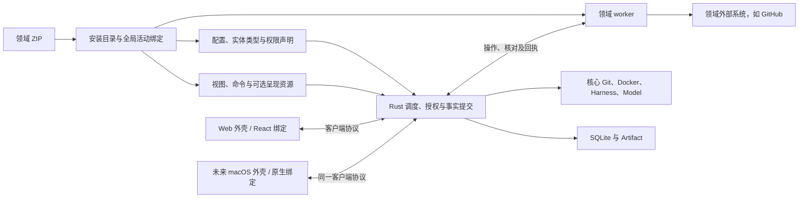

# DevDesk 领域插件化改造计划

2026-11-24 · **待实施** · 代码基线 `22040ec`。本文给出目标设计、实施依赖和发布验收。文中的目录、接口名及存储模型均为提案。

## 1. 什么算完成

一个 Host 同时只激活一个领域，切换对后台调度及连接它的所有客户端生效。每个客户端窗口自行选择项目。第一份正式产品包封装现有软件开发领域。新平台从空数据集开始。首版产品客户端是 Web，客户端协议同时面向未来的 macOS 等原生客户端。本轮交付用无浏览器协议客户端验证可移植性，macOS 产品界面留到后续实现。首版运行端和界面扩展按团队维护的软件开发包设计。第三方插件分发的信任模式尚未选定。

发布验收从分别构建的 Rust Host、核心 Web 和一个空数据集开始。两个核心制品组成可操作的空领域工作台，可管理 Model、Harness、Docker Sandbox、通用 Git 及其他平台能力。用已打开的浏览器导入并激活软件开发 ZIP，打开包提供的页面，读取其 Skill、Spec、Workflow 和 Agent，通过这些定义执行并完成一次工作流。运行时卸载该包后，浏览器回到空领域，仍可操作原来的核心能力。再装入同一 ZIP 可重新使用其项目和历史。全程核对同一 Host 启动实例及 PID、同一对核心制品摘要，无需重启、重新构建或手动刷新浏览器。

另用只供验收的文稿审校 ZIP 检验全局切换。它提供不同的对象、角色、工具和页面，以同一对核心制品执行自己的工作流。

客户端独立性单独验收。一个不加载 HTML、React 或 Web SDK 的协议客户端连接同一 Host，发现当前领域提供的入口、查询其数据、启动工作流并观察切包。安装的 ZIP 可以只带 Web 专属界面，也可以只带配置和运行端。客户端显示能力的差异不会产生第二份领域状态或第二个活动包。

每个领域的同一份流程都可以由人逐步推进、由 Rust 在预算内推进、或由该流程选定的调度 Agent 推进。三者复用派发、证据接纳和完成规则。切换领域后，执行中的操作有明确归属，历史能解释当时使用的配置、程序、输入、权限和回执。这个实验同时检验独立发布、动态扩展和数据正确性。

## 2. 从当前实现出发

| 路径 | 核对到的行为 | 对设计的影响 |
|---|---|---|
| [配置打包](../../../crates/adapters/build.rs)、[资源加载](../../../crates/adapters/src/factory_bundle.rs)、[内核目录](../../../crates/core/src/templates.rs) | 构建读取整个 `configurations`，加载器展开正文、校验引用索引，内核将一个 `ConfigurationBundle` 装入进程级 `OnceLock`。Harness 驱动能力也在出厂加载入口初始化 | 保留正文、引用和摘要校验。驱动探测移到基础设施启动，包目录按数据集管理，编译 Host 和启动空业务都要能独立成功 |
| [源目录清单](../../../configurations/manifest.json)、[默认选择](../../../configurations/defaults.json)、[角色授权](../../../crates/core/src/configuration.rs) | 当前清单有 2 个 Workflow、1 个 Standard、6 个 Role 和 51 个 Tool。默认设置还指定 Task 流程和经理角色，Workflow 声明的编排者也会被拿来与全局默认角色比对 | 按包和项目采用默认值，按当前流程冻结编排角色。项目级管理权限另行绑定 |
| [工作归属](../../../crates/core/src/work_owners.rs)、[工作流启动](../../../crates/core/src/workflow_start.rs)、[项目 SQL](../../../sql/project/schema.sql) | 查归属时读 Project、Feature、Task 三种资源。Task 继承父 Feature 的作用域。会话、材料、产物的外键及检查约束也编码了这一层级 | 先建立通用工作对象、归属与可见性，再迁移各读写入口。只换 UI 名称或放宽枚举会破坏归属校验 |
| [引擎端口](../../../crates/core/src/lib.rs)、[平台工具](../../../crates/core/src/platform_tools.rs)、[运行核对](../../../crates/core/src/platform_reconciliation.rs) | Engine 必配 Git 和 Tests，后台有仓库调度阶段。工程工具由 Rust 按名分派，副作用已有持久化意图与核对路径 | 把现有可靠执行协议扩展到进程外处理器，并使工程包拥有工具实现及其恢复逻辑 |
| [任务派发](../../../crates/core/src/workflow_dispatch.rs)、[Harness 工作目录](../../../crates/adapters/src/harness.rs)、[失败恢复](../../../crates/core/src/workflow_recovery.rs)、[输出校验](../../../crates/core/src/workflow_outputs.rs) | Harness 会直接导出 Git 修订或接入工作树，调度会查 Task 前置依赖。接纳返工输出时还识别 `red_coverage`、`test_support` 和测试配方 | 通用执行输入需要有版本的资源句柄。工程包还要提供修复分类与验收规则。移走 `git.*` 分派只能解决其中一部分 |
| [流程类型](../../../crates/domain/src/workflow.rs)、[流程完成](../../../crates/core/src/workflow_controls.rs)、[GitHub 合入](../../../crates/adapters/src/github_delivery.rs) | `delivery_policy` 固定了七种工程步骤职责。完成命令核对真实 PR 合并及本地同步，并写 Task/Feature 终态。GitHub 适配器还负责目标版本竞态 | 配置显式声明完成所需的证据，工程处理器负责核对 Git 事实，内核在同一提交中接纳回执和对象状态 |
| [Host 入口](../../../crates/host/src/main.rs)、[项目装配](../../../crates/host/src/workspace.rs)、[前端外壳](../../../web/src/App.tsx)、[工作范围页](../../../web/src/components/WorkflowScope.tsx)、[发行脚本](../../../scripts/release/package.sh) | 整个 Web 嵌入 Host。外壳 URL、初始查询、SSE 失效和项目过滤用到了 Feature、Task 和 GitHub。Host 在打开数据集时装配 GitHub | 核心 UI、插件 UI 和专属查询一起拆，包含浏览器直达、事件刷新、空状态和命令权限 |

当前 `CliGit::new` 会构造 GitHub 客户端，克隆接口要求 GitHub 的 `owner/repo`，worktree 创建还检查 Feature、Task 等归属。拆分时应抽出可按仓库资源句柄调用的通用 Git 操作，由软件开发包提供 GitHub 接入和工作项映射。Skill 的 Git 导入也有独立的 Host 入口，可以复用这套核心服务。Harness 提示文本中的工程测试和分支约定随领域配置发布。[Git 适配器](../../../crates/adapters/src/git.rs) · [Git 端口](../../../crates/core/src/ports.rs) · [Harness 执行上下文](../../../crates/adapters/src/harness.rs) · [Skill 导入实现](../../../crates/adapters/src/integrations.rs)

沿用现有源修订、Standard 快照、资源级版本检查、SQLite 分库、Artifact、SSE 和调度内核。基于 `review/` 的调研，调整了两个实施取舍。第一，新工作项种类属于首版必需能力，应尽早用第二领域夹具验证。第二，工程处理器可以在迁移中短期封装为 Rust 模块，最终发布必须从 ZIP 加载。评估工作量以这些调用链和验收覆盖面为准。

## 3. 平台和领域的责任

| 边界 | 平台发布 | 领域 ZIP 发布 |
|---|---|---|
| 配置和定义 | Role、Capability、Agent、Skill、Workflow、Delivery、Spec、Standard 的结构和校验。源引用、冻结、采用与版本治理 | 实际角色、调度与功能 Agent、能力组合、技能正文、工作流、交付及其规范、标准、MCP 接入、工具合同、领域默认与权限预设 |
| 数据和执行 | Project 作为隔离边界。可扩展的对象与关系。DAG、子流程、租约、预算、返工、人工签署、回执、讨论、经验与历史 | Feature、Task、仓库、候选、文稿等类型与字段。父子关系、合法状态转移、业务输入和完成判据 |
| 运行设施 | Docker Sandbox、模型服务、Harness、凭据托管、权限执行、文件挂载、Artifact、通用 Git。通用内部工具如 `spec.lint`、工作流控制、经验查询。HTTP/MCP 调用设施 | GitHub 项目接入、Feature/Task 分支和 worktree 分配规则、候选与 PR 交付、工程测试探测与配方、特定 MCP 服务和凭据用途 |
| 客户端与呈现 | 客户端共用发现、查询、命令、事件及审批协议。Web 和未来的原生外壳分别提供布局、导航、通用配置编辑、列表/详情及人工决策界面 | 声明项目入口、实体视图、操作和证据面板，绑定领域查询/命令。可分别提供 PR、Diff 等视图的 Web 或原生专属实现 |

下图的箭头表示调用或加载方向。业务定义从 ZIP 进入当前活动目录，处理器和页面分别通过运行协议和 UI 协议接入。



### 空领域中的核心能力

Host 制品必须带有可独立解析的核心配置清单。按当前出厂 manifest 逐项归属，先纳入 3 个 Model、5 个 Model Provider、1 个 Model Catalog、2 个 Harness 和 1 个 Docker Sandbox，以及它们所需的驱动、权限后端和安装资产。其余定义按正文、引用和实际处理器判断归属，包括通用权限 Profile、内部工具与可独立使用的 Skill。拆分混合的 `defaults.json` 和引用索引，分别校验核心闭包及领域对核心的显式引用。空领域的默认选择允许没有业务 Workflow、Standard 或编排角色。[出厂清单](../../../configurations/manifest.json) · [当前默认选择](../../../configurations/defaults.json)

| 空领域工作台 | 用户可执行的操作与验收证据 |
|---|---|
| Model / Provider | 浏览模型与供应商，配置连接及凭据引用，创建或修订一份模型配置，从核心 UI 重新打开并回读已提交修订 |
| Harness / Docker Sandbox | 查看并选择确切 Harness、Sandbox 及适用权限 Profile。在已具备 Docker 的测试机上准备组合运行环境，通过真实驱动探测并查看镜像标识和准备回执 |
| 通用 Git | 从核心工具页选取获准的本地仓库，解析 HEAD、比较两个修订，查看实际 OID 与 diff。插件也可按权限申请 clone、指定修订的导出和 worktree 的创建与释放。平台负责租约、作用域和回执，软件包决定哪一项工作采用哪个分支以及何时满足交付条件 |
| 通用权限与工具 | 查看平台工具合同及所需权限，创建可用的 Profile 修订并回读。以上操作均能从核心 UI 和相应平台接口进入，不依赖业务项目或领域 Agent |

空领域、激活领域和卸载后均使用同一个核心目录。领域包只增加其命名空间内的定义和入口。缺少 Docker 服务、模型凭据或 Git 执行环境时，核心 UI 展示具体准备状态，其他已具备条件的能力仍可操作。

### 包形状与独立发布

建议在仓库用 `configurations/<domain-id>/` 作为每个领域的源码根，含配置、运行端源码、页面源码及各自构建输入。领域包维护者在独立仓库也可以使用同一结构。打包器只收发布文件。下面是软件开发 ZIP 的示意目录。

```text
manifest.json                 包标识、版本、协议需求、入口和文件摘要
configurations/               源清单、默认选择、引用索引、正文
configurations/entity-types/  领域对象、关系、约束和查询索引定义
configurations/integrations/  包拥有的 MCP、工具合同、凭据槽和权限需求
runtime/                      已构建的 JS 处理器、锁定的运行资产
ui/contributions.json         各端共用的入口、数据、操作及上下文
ui/web/                       可选 Web 绑定、React 组件 ES 模块与 CSS
ui/macos/                     将来可选的原生呈现描述和专属资源
```

分别产生 Host、核心 Web 和领域 ZIP 三种制品。Host 构建只消费 Rust 源码、平台合同、核心配置与运行资产，移除 `web/dist` 和领域源码也能发布并以 API 模式启动。核心 Web 只消费前端源码与已发布的平台合同/SDK，在没有 Rust 工具链、Host 二进制或领域页面源码的环境构建。两个制品各有版本、摘要与兼容性探测，部署时 Host 可托管独立安装的核心静态资产。便捷整包在两个制品发布后组合。兼容领域 ZIP 单独更新，安装机无需 Rust、前端构建工具或宿主 Node。

## 4. 应先稳定的合同

**包与配置。** 清单包含包 ID、发布版本、包格式、所需平台能力、运行协议与通用客户端合同范围、各呈现目标自己的兼容要求、入口和逐文件 SHA-256。发布标签用于选择，规范化内容清单的摘要用于冻结，清单摘要的计算排除其自身及签名。另外记录原 ZIP 字节摘要。安装时离线解析 Schema，核对入口、命名空间、全文、反向索引、引用闭包及实际支持的操作。支持只有配置的包，缺少可选 runtime 或 UI 时仍可使用基础能力。包声明的外部服务和凭据槽由使用环境绑定，密钥不进入 ZIP。

将公共 JSON Schema 从 RPC 信封中抽出，平台合同可独立加载。包的 Schema 只从包内或平台离线目录解析。请求、响应和事件的 Schema 及示例独立于 SDK 发布。首版 TypeScript 类型从同一合同生成，未来 Swift 等客户端按同一份样例验证编解码，Rust Serde 类型用正反例验证。新增领域方法通过注册表发现并限定命名空间，核心壳不维护领域 RPC 名单。冻结的源仍是 `identity:revision`，新身份使用包命名空间，平台保留自己的身份。相同身份及修订只能复用同一份定义，发布相同包 ID 和版本但内容不同应拒绝。项目自建修订保留来源与采用关系。包升级可并存修订。重置只作用于所选包和项目。目录内容继续存于 `source_definitions`，包注册记录存摘要、所有权和成员引用，避免复制一份可独立修改的配置。

**领域对象与事实。** 建议注册命名空间化的 `EntityType`，描述字段 Schema、关系基数、根工作流入口、作用域继承和有界索引。实例带项目、包命名空间、类型引用、稳定 ID、版本及载荷。只有可执行工作挂接 Workflow，仓库和候选也可作为普通实体。所有者统一为全局、项目或显式项目下的实体引用。配置可见性沿声明的边继承，实体关系同项目、校验类型与环，另设 Task 依赖等关系。讨论、材料、运行、经验引用同一个所有者。对象状态机和可声明的完成条件随配置发布。复杂判据由配置显式引用包内版本化的纯校验器，输入为冻结事实，可独立重放。有副作用的操作单独派发。领域规则可提出变更集，平台验证读写版本、字段和边约束，在所属项目库短事务提交。查询按注册索引分页，列表与统计可做可重建的投影，插件无须直接操作平台 SQL。

**调度与接纳。** 项目采用 Standard 和 Role→Agent 绑定，Workflow 声明编排 Role。启动时冻结包、角色、能力、控制权限、标准与计划。人工、Rust、Agent 调用同一组原语，复用现有预算、控制器租约、真实 Human 来源等校验。调度 Agent 仅能在当前实例和租约内发命令。项目管理另有项目授权。普通功能 Agent 只获得步骤工具。实际 Harness 必须声明所选能力，当前根 Agent 编排以 Codex 为验证对象。新领域选用另一编排角色即可，使用 DSH 做功能 Agent 的既有能力继续覆盖。

业务步骤显式绑定上游**已接纳的执行证据**。平台交付给处理器的是带原步骤、执行 ID、生产者、输入及产物摘要的引用。由处理器判断该证据在本领域的意义。例如 Feature 发起合入前，工程处理器核对源提交上的回归与独立评审、试合并候选上的回归、针对确切版本的 Human 决定，以及目标分支仍指向预期版本。合入后再核对实际远端结果和本地同步，产出最终回执。软件包在流程配置中显式要求这份回执，内核验证来源、版本、依赖和完成条件，再提交对象状态。任何步骤正文、模型输出或页面上的布尔值都无法产生 Human 签署或平台回执。

**运行时扩展。** 首选以 TypeScript 开发并预编译为 JS。在 Host 管理的 Linux Docker worker 中用固定的 Node 运行环境执行。Host 与 worker 使用有界的双向 JSON-RPC 2.0 消息，首版可用 stdio 分帧。运行时环境与 Agent Harness 分开管理，基础镜像、架构和解释器按摘要核验。领域 worker 通过 Host 协议申请通用 Git 操作。GitHub 客户端（如 gh）或领域测试工具随软件开发包提供锁定的运行资产，离线发行可包含对应镜像归档。包安装时只验证和登记，启用前再探测可执行资产。动态语言只是首版 SDK 的选择，协议不传 Rust 类型。[JSON-RPC 规范](https://www.jsonrpc.org/specification)

| 协议环节 | 平台义务 | 领域处理器义务 |
|---|---|---|
| 注册和准备 | 核对声明与实际握手的操作、输入输出 Schema、所需权限、是否有副作用以及可核对/停止能力。冻结 handler 摘要 | 提供工具、领域查询、纯规则或外部操作的入口及前置条件 |
| 调用 | 绑定项目、包摘要、原步骤、actor、权限、预期资源版本、租约和操作 ID。先持久化意图，再在事务外调用 | 在限定的工作目录和资源句柄内执行。以操作 ID 关联物理操作、原始输出及外部版本 |
| 接纳 | 将回执绑定原意图，记录原始观察，核对 Schema、输入、生产者和授权，以资源级版本检查原子提交 | 返回事实、证据和限定命名空间的变更建议。对语义冲突、技术失败和未知副作用给出可区分的结果 |
| 恢复和停止 | 对不确定操作先 inspect/reconcile。保留迟到回执，验证实际停止或写授权撤销。对无法核对的操作阻塞并显示依据 | 每个有副作用的处理器提供检查入口与幂等策略。例如断线后查询原 PR 及精确版本，避免再次合入 |

复用现有 ToolExecutor 对 HTTP/MCP 的调用、轮询和撤销，以及平台意图/回执机制。MCP 工具可以被 Agent 使用。要成为某一步的权威生产者，还须在该步声明来源并绑定原调用。包握手不能自行授权。文件、网络、模型访问和工具调用受包获准能力、项目策略及适用的 Harness/Sandbox Profile 共同约束。工作区通过带所有者、版本、读写范围和租约的句柄挂入，软件包选择提交和访问方式，核心 Git 服务准备该修订的视图，平台核验目录及读写权限。Docker 服务端口、整个数据目录和宿主凭据不授予插件。工程测试子容器由平台代理创建。对长期调用设置额度、超时、心跳及回收，先实测 Git 共享目录、容器路径与 macOS/Linux 的差异。[Docker 挂载说明](https://docs.docker.com/engine/storage/bind-mounts/) · [Docker 资源约束](https://docs.docker.com/engine/containers/resource_constraints/)

### 所有客户端共用的接口

**业务服务。** Rust Host 管理唯一的活动包、配置目录、领域处理器和执行状态。任一客户端都可用 JSON-RPC 读取活动领域、查询/执行领域动作、提交 Human 决定，用事件流观察变化。会话可用显式 HTTP 握手建立，沿用现有 `/session` 鉴权和 `/events` 游标机制，原生应用可用自己的 HTTP 会话接入。协议传递项目、实体或执行引用、命令身份、预期资源版本和活动代次。Host 校验权限、审批来源和版本，不信任客户端自报的平台或渲染能力。[现有 Host 入口](../../../crates/host/src/main.rs)

**领域界面声明。** 包为每个界面入口提供稳定的贡献 ID，声明用途（集合、详情、设置等）、放置上下文（项目、工作项或步骤执行）、标题、查询结果合同以及可用操作引用。导航保存贡献 ID 和资源引用，Web URL 和 macOS 窗口状态都是各端的映射。列表、详情可以附带少量字段说明，供客户端生成基础视图。字段取值、操作前置条件、工作流规则均从同一领域服务获得。复杂 Diff 或图形视图可按端手写。

**呈现绑定。** `ui.targets` 按可扩展的目标标识声明兼容版本及“贡献 ID → 呈现入口”的映射。每个客户端独立选择它支持且信任的目标。Web 的 `web.react` 加载组件 ES 模块。未来的 macOS 客户端可以用 SwiftUI 的列表/详情呈现相同数据，并按需读取 ZIP 的原生布局描述或资源。原生呈现器可随客户端发布。只有专属视图才需要补写相应客户端的实现。Host 对目标键作开放标识处理，理解通用外层合同，用声明文件的摘要及包内引用校验完整性。新呈现目标可以通过客户端与包独立交付。

**兼容与降级。** 包声明了却缺失的文件、摘要错误或无效业务引用会使安装失败。包完全省略某个呈现目标，或某一客户端不支持其呈现版本时，该客户端可用通用列表/详情。对必须专门呈现的内容显示所需能力及原因。审批材料无法充分呈现时，该端不开放该项签署。服务端照常运行兼容的工作流，其他客户端继续使用其专属界面。即使没有任何客户端连接，领域也能激活。客户端在首次连接和重连后读取活动目录，收到切换事件时卸下旧绑定并重新解析。旧代次操作仍由 Host 拒绝。

### Web 目标的原生 React 界面

首个软件开发包与核心 Web 由同一团队维护。软件包重写 Web 入口以实现公共贡献，查询、操作和资源标识来自跨端合同。把它的 Web 组件编译为独立 ES 模块，导出 React 组件，交给 web-core 的同一棵 React 树渲染。核心提供侧栏页面、执行详情面板和设置分区三个扩展位置。例如软件包的“Pull Requests”可占用主内容区，其中的 PR 摘要组件也可嵌入原生步骤详情。外壳继续负责项目选择、路由、浏览器历史、键盘焦点和对话框层。当前入口已有单一 React 根和按需加载机制，需把编译时页面表扩展为可按活动包注册的目录。[React 入口](../../../web/src/main.tsx) · [工作台外壳](../../../web/src/App.tsx)

**组件合同与构建。** 稳定的 Web SDK 提供项目上下文、导航、主题变量、公共 UI 组件、查询/命令和订阅。包只引用 SDK 的公开接口。Vite 将每个组件入口构建为 ESM，把 React、JSX runtime、所用的 React DOM 入口和 Web SDK 标记为外部依赖。核心发行件输出一套共享模块，在核心启动前固定模块名到 URL 的映射，核心渲染器与插件使用相同实例。采用 import map 时用 CSP 允许的 nonce 或摘要加载映射。插件 CSS 用局部类名和核心主题变量，按当前包管理样式表。通用贡献声明使用场景，Web 绑定将其映射到具体路由、组件导出名和静态资产，并声明 Web SDK 兼容范围。[React 对重复依赖的说明](https://react.dev/warnings/invalid-hook-call-warning#duplicate-react) · [HTML 模块映射规范](https://html.spec.whatwg.org/multipage/webappapis.html#import-maps)

**加载与卸载。** Host 公开已激活版本的清单及按包摘要寻址的同源模块资源。外壳收到 SSE 后更新导航，只在打开页面或展示面板时执行 `import(entryUrl)`，校验导出，再在核心布局和 Provider 下渲染。加载失败或渲染异常由对应扩展位置显示错误，核心导航和包管理仍可用。导入完成前若代次改变就丢弃结果。卸载时先撤销服务端旧代次权限，客户端撤注册、卸载组件、移除样式，回收订阅、请求及插件登记的副作用。模块顶层应只声明导出。浏览器会缓存已导入的模块，逻辑卸载后仍可能保留其代码。需要释放旧页面的整个 JS 环境时，可在保存草稿后重新加载工作台网页。

**信任边界。** 原生插件和 web-core 共享 DOM、JavaScript 环境及当前登录用户可用的浏览器权限。SDK 规范和 React 错误边界仅用于协作及故障处理。Host 在发布可执行模块前核验来源，首版可用随可信发行物发布的包摘要清单。仅凭 ZIP 自报身份或自带摘要不足以获得原生执行资格。Host 仍逐次校验项目、活动代次、用户授权和工作流前置条件。将来若接入未知发布者，可另行提供声明式页面或隔离 iframe 模式，首版只实现可信包路径。

**HTTP 服务的作用。** 建议给现有 Axum 服务增加固定的包清单与静态资产路由，按活动指针解析内容。页面组合发生在浏览器中，平时切包只需更新指针和通知浏览器。单独重启 HTTP 监听会让 SSE 重连，对浏览器组件树和模块缓存没有刷新作用。当前 HTTP 关闭与 Host 的停机流程相连。若以后需要独立重载 HTTP 层，应保留调度器、worker 与执行状态，客户端重连后重读活动代次。[Host 启停与路由](../../../crates/host/src/main.rs)

### GitHub 集成和 PR 页面的激活示例

软件包的 PR 列表使用一个跨端贡献 ID。下面是两份文件的节选，字段名为提案。项目引用由调用上下文传入。查询返回带稳定 ID、编号、标题、状态和分页游标的数据。Web 组件和将来的 SwiftUI 视图都读取这份响应。GitHub 的凭据、PR 查询及合入规则只在领域运行端实现一次。

`manifest.json` 将通用贡献与各端实现关联。首版软件包只发布 Web 绑定。

```json
{
  "id": "software-development",
  "runtime": {
    "entry": "runtime/worker.mjs",
    "handlers": ["software-development.github.pr.list"]
  },
  "ui": {
    "contributions": "ui/contributions.json",
    "targets": [{
      "renderer": "web.react",
      "api": 1,
      "bindings": [{
        "contribution": "software-development.pull-requests",
        "entry": "ui/web/pull-requests.mjs",
        "export": "PullRequestsPage"
      }]
    }]
  }
}
```

`ui/contributions.json` 声明领域向用户提供的能力。下面的字段足以让一个只支持通用集合视图的客户端列出 PR。

```json
[
  {
    "id": "software-development.pull-requests",
    "kind": "collection",
    "context": "project",
    "title": "Pull Requests",
    "query": "software-development.github.pr.list",
    "fields": [
      {"key": "number", "label": "编号"},
      {"key": "title", "label": "标题"},
      {"key": "state", "label": "状态"}
    ]
  }
]
```

1. **导入。** Host 校验包文件、依赖闭包、处理器的输入输出及页面入口，将候选包按摘要登记。此时工作台继续使用原领域，导入本身不调用 GitHub。
2. **激活运行端。** 完成旧领域的静止步骤后，Host 将候选包只读挂载到固定 Node 镜像，在 Docker 内运行 `node /plugin/runtime/worker.mjs`。首版为当前活动包复用一个 worker。SDK 通过标准输入输出上的 JSON-RPC `describe` 握手报告协议及实际处理器。Host 比对清单，握手阶段只开通协议通道。入口损坏、缺少必需处理器或握手超时则终止候选 worker，保留原活动绑定。只有配置和页面的包可跳过 worker 步骤。
3. **一起发布配置、方法和页面。** Host 将通过校验的配置闭包、处理器映射、通用贡献及各端绑定索引写入同一活动目录，再原子切换目录指针。提交后才开放领域调用并广播 SSE。每个客户端据此更新目录，按自身能力选择匹配的绑定或基础视图。Web 用户选中 PR 页时，外壳动态导入该摘要下的模块，在主内容区渲染导出的 PullRequestsPage。打开原生执行详情时，同一机制可以渲染包注册的 PR 摘要面板。包的重资源页面按需加载，安装机无需执行 npm 或启动前端开发服务器。
4. **执行一次真实查询。** PR 页经 Web SDK 请求 `software-development.github.pr.list`。SDK 将请求发给 Host。Host 按当前代次、项目、用户权限及原操作的授权判断是否派发，再经 JSON-RPC 交给 worker。worker 组装 GitHub PR 列表请求，通过平台 HTTP 接口使用项目绑定的凭据槽。Host 校验请求目标、仓库与获准操作，在发送时注入凭据，页面只收到 PR 数据。缺少项目凭据时，该操作提示绑定账号，用户仍可打开领域设置。包中的 Tool 源定义将工具引用绑定到同一处理器。Workflow 步骤或 Agent 按自己的授权调用，沿用核心的调度与回执机制。[GitHub PR 列表 API](https://docs.github.com/en/rest/pulls/pulls#list-pull-requests)
5. **卸载。** 按第 5 节核对在途副作用、撤销调用权并停止 worker，再移除活动路由及工具。外壳卸载组件并注销面板、样式和订阅。Host、核心 Web 和核心 Git 服务继续运行。

P2 的本地 Git 与文稿用例先打通这条装载链。GitHub 集成的首个只读切片用专用仓库回读真实 PR 列表，创建与合入等写入在 P4 接入意图、证据和恢复合同。软件包负责 GitHub API 语义，Host 托管通用 Git、HTTP 传输、凭据和授权。按需挂载页面及复用活动 worker 的启动成本与交互效果由 P2 实测。

## 5. 热加载、卸载与全局切换

安装登记一个版本的 ZIP，激活将其贡献发布到工作台，项目采用则冻结具体配置。停用保留安装记录，卸载移除该版本的安装记录和全部运行入口。可安装多个 ZIP，全局目录只记录一个活动绑定 `{domain_id, package_digest, epoch}`，也可为空。用户在任一标签页切换，Host 广播新代次。标签页仍自行选择活动领域下的项目。项目持久保存所属领域，新建执行钉住包摘要、配置闭包、运行资产和权限。切回时按所选项目读取原记录。升级同一领域包也经过切换屏障。新工作使用明确采用的兼容配置，旧执行恢复需要原摘要或经过显式验证的迁移。首版使用切回确切旧包继续的方案。

| 步骤 | 可观测行为与失败语义 |
|---|---|
| 1. 安装候选 | ZIP 写入临时目录。流式限制解压字节数和文件数，拒绝越界路径、链接、重复/归一化冲突路径。核对清单、摘要、静态合同、所需能力和包身份，成功后原子发布至内容寻址目录并登记。重复导入幂等。损坏包不改变活动绑定 |
| 2. 预览切换 | Host 列出当前/目标包、活跃任务、外部操作和无法暂停项。每个标签页自行提示并保留本地草稿及原代次。新命令带预期代次。Host 用全局目录版本检查处理两个标签页同时切换 |
| 3. 静止旧领域 | 持久化切换意图，封住所有旧代次的新入口，包括 RPC、调度、控制器唤醒及插件调用。已发的提交许可完成后才允许提交切换。等待在途操作结算，或由用户显式选择安全暂停。等待人工输入的流程可直接记为暂停，保存剩余预算与计时语义。对 Git 等外部写入核对原意图、实际停止或撤销写权。有无法安全静止的写入时保持旧领域并展示原因。新包获得业务执行权前，收回旧 worker 和端口 |
| 4. 激活并通知 | 如包声明了 worker，先在无业务写权的环境中完成握手。暂存一份包含配置、工具、worker 入口、可启动工作流、通用界面贡献和可选呈现绑定的目录。全局 SQLite 短事务切换活动目录指针、提升代次并登记结果，提交后发布 SSE。各客户端收到事件后重读同一代次的目录，在本地选择呈现方式。用户可查看 Skill 正文、Spec、Workflow 和 Agent 绑定，选择工作流启动执行。旧页面、迟到命令、事件订阅和调度令牌均按服务端当前代次校验。切换到空业务也走此协议 |
| 5. 恢复或回切 | 崩溃后按持久化切换状态重建。提交前恢复旧指针并重新核对旧工作，提交后重建新代次服务。目标启动失败能安全恢复旧入口。旧 worker 许可不得复用。回切是一次新激活，重新取得租约，核对旧意图后才继续。外部回执可由内核按原意图封存，不能推进非活动领域 |

**卸载操作。** 从核心包管理页或管理 API 可直接卸载活动包。Host 先按上述协议停止新派发、挂起可恢复工作、核对进行中的副作用并收回 worker。随后在同一全局事务中清空活动绑定、撤销安装登记并提升代次，通知各客户端卸载该包的呈现绑定并显示核心工作台。目录读取、旧页面直达、静态资产请求、工具/RPC 调用和新工作流派发都按当前绑定检查。若有外部写入无法安全核对，返回阻塞的操作 ID，保留安装登记与可恢复状态。重复卸载同一版本幂等。卸载已停用的包只撤销该版本的登记，不中断当前领域的 worker、页面或调度。

切换屏障仅用于稀有的全局切换。常态业务写仍使用各自资源的读写集。在单 Host 内，命令与后台领取短期的代次许可，并在准备、提交及派发边界核验。先关闭新许可，再等已发许可和外部 writer 结清，最后变更唯一指针。不能只在收到 HTTP 请求时读一次代次，随后任旧项目事务或容器继续写。跨库没有原子提交的部分采用持久化步骤和可重放恢复。只读历史和列表按代次失效，切换不会重新映射项目或实体 ID。全局 SSE 重连时重读绑定，以代次判别漏掉的切换通知。

项目列表、全局角色讨论、跨项目经验目录、材料 URL、读缓存、工作流后台扫描和配置可见性都要带领域范围。包内的 `global` 表示该领域内共享。平台设置和基础定义有独立的系统范围。切到 B 时，A 的项目、讨论、页面及可执行工具退出工作台。已保存的只读历史、配置和 Artifact 继续保存在 A 的分区。安装记录与历史引用分开保存。卸载后，历史所需的源修订、冻结证据和 Artifact 保留为只读数据。内容存储仅回收无引用的文件，对仍被引用的内容撤销执行和页面服务资格。恢复被挂起的旧执行需要重新安装并激活原摘要。

**数据起点。** 实测当前 SQL 为 global 24 / project 62。新平台用独立数据目录和新布局标记，遇到旧目录返回可解释的拒绝，不就地升级或初始化覆盖。只迁移软件开发的定义、行为和验收用例，首发不承担旧实例转换。新布局继续分开全局、项目和讨论存储。包目录持有安装资产，项目库持有领域对象/关系、工作流、操作回执和 Artifact 引用。定义与实例分开，封存的历史含足够的类型/配置引用和内容摘要。将来对**新平台自身**的包升级、回切和重启列入首版验证。[全局基线](../../../sql/global/schema.sql) · [项目基线](../../../sql/project/schema.sql)

## 6. 分阶段交付

阶段按可独立评审的交付物排列。P0–P2 建立能真实装包的路径，P3 证明跨领域与三种调度，P4–P5 完成软件开发迁移，P6 切换发布。Rust、运行端和 Web 三条线围绕同一份合同迭代。相对工作量最高的是 P3 的归属改造和 P4 的工程副作用迁移，在基线和首个真实 Git 切片完成后再估绝对工期。

| 阶段 | 实施切片 | 本阶段通过条件 |
|---|---|---|
| P0 · 冻结现有行为 | 从当前构建记录软件开发包的正向路径和反例。清点全部注册/发布的工具、Host 专属 RPC、SQL 资源键、后台阶段、UI 路由、权限预设及软硬件依赖，逐项标明保留、迁出或历史专用。记录启动、调度、回执接纳、页面加载的当前基准 | 真实 Git/Docker 路径、三种驱动与审批的证据能追到原入口。对比表区分确定性夹具、真实本地执行和专用 GitHub/模型验收。为每项旧工程语义指定迁移责任 |
| P1 · 包加载器与空业务 | 拆开驱动初始化、基础源和业务默认。将模板目录的单例替换为显式目录依赖。分别建立包清单、配置、运行协议、通用客户端协议以及 Web 呈现绑定的合同与兼容检查。公共 Schema 在无 Node/React 环境中可解析。拆出独立 Host/Web 构建入口，随 Host 发布核心配置。交付 Model、Harness、Docker、Git 的核心操作页及包管理页 | 两条清洁构建分别成功。仅安装两个核心制品，在空库完成第 3 节列出的实际操作。上传、重复导入、拒绝坏 ZIP 均有可读结果。旧产品独立保留供对照 |
| P2 · 端到端最小包 | 引入受管 JS worker、一种对象类型、单步工作流、一个领域命令和一页独立 Web。软件包页面发起只读请求，领域 worker 经 Host 调用核心 Git，返回真实回执并在包页面展示。再用文稿夹具走同一链读取一份文稿。打通包声明、能力探测、内容校验和全局切换 | 同一个运行中 Host 可加载、停用、卸载、重装和切换测试制品。已打开的核心 Web 自动挂载和卸载页面。增加独立的无浏览器客户端，走真实 Host 的会话、发现、查询、命令和事件入口，与 Web 对照同一工作流记录。记录 Git/文稿真实输入和结果，旧代次请求与订阅失效。到此只声称验证了一个垂直切片 |
| P3 · 通用模型和执行 | 用通用 Project、实体引用与作用域重做源可见性、材料、工作流/子流程、Artifact、讨论、经验、查询和索引。用冻结的资源句柄替代 Harness 中的 CodeView/Git 调用。解开全局经理绑定。接入证据来源、受限变更集、租约和切换屏障 | 文稿审校以“文稿→校样”两个类型、编辑/校对/主编角色跑通三驱动，用确定性 worker 生成校样 Artifact，主编发起、真实人签署。文稿包在未授予 Git 且无仓库的条件下完成。补测独立角色和无权限 Agent。跨标签页、跨领域读取及旧代次写入均被隔离 |
| P4 · 迁出软件开发运行时 | 先拆开 Git 适配器的 GitHub 凭据、分支命名和交付语义，复用 P1 的核心 Git 原语。软件包负责仓库接入、测试探测、worktree 到工作项的绑定、写挂载策略、Task DAG、Red/Green、源发布、候选、两种回归、PR/合入/同步。每个 handler 随迁其工具定义、工作流证据绑定和验收规则。同步迁移失败分类、返工时保留原测试合同、重启核对、停止及回执投影。每组操作用旧实现同输入对照。副作用仅在各自专用仓库执行一次 | 软件开发 ZIP 的 JS handler 在真实 Git/Docker 下完整跑过 Feature→Task。核对候选 OID/tree、独立评审、人工门禁、目标 CAS/保护分支拒绝和本地同步。模拟远端成功后断线、重复命令、目标变化和停止，证明不会重复外部写入 |
| P5 · 完成软件开发配置和页面 | 将目录中各实际定义、依赖与正文完整分配给平台或软件包，单独生成软件包清单/引用索引。将已迁的证据绑定、工程工具与恢复规则纳入正式目录，清除旧 `delivery_policy` 路径，接通项目接入和默认角色关系。把分支队列、PR/Diff、工程设置的入口和数据操作声明为公共贡献，重写为对应的 React 呈现绑定。领域查询及事件映射由运行端统一提供。保留原有配置编辑/重置、权限、历史深链和工作台交互语义，按新数据布局回归 | 用首个正式候选 ZIP，从空库经 UI 导入、激活，在通用目录中查看并选用包的 Skill、Spec、Workflow、Agent，打开领域页面、创建 Feature，一直走到交付与历史复查。卸载后复测空领域的核心操作。切去文稿夹具时页面、查询、工具和后台都切换，回切能继续原工作。壳和二进制内无工程包回退 |
| P6 · 独立发行 | 分别打包 Host、核心 UI、软件开发 ZIP，建立 SDK/Schema 兼容矩阵，打包安装路径覆盖 macOS/Linux。将工程用例归入领域验收，将空领域操作、双客户端合同测试、热加载/卸载、文稿夹具、重启恢复与全局切换列入平台 CI。收紧依赖检查，更新用户文档及发布脚本 | 在制品目录外用发行文件重复第 1 节实验。只升级 UI、只升级 Host、只升级兼容领域 ZIP 分别通过。版本不兼容时保留可用组合。按下节验收风险最高的切换故障、真实工程交付和容量 |

**第一个可开工的改动。** 为当前源加载器抽出只读资源接口，先用旧资源和临时 ZIP 的相同源快照，逐一对比展开后的正文、引用索引、默认选择及摘要。下一笔改动剥离 Harness 驱动注册和默认 Workflow 必选断言，给仅有核心配置的目录独立启动路径。这样先验证一个真实依赖边界，也给 P1 的新加载器提供可重复的旧行为对照。

## 7. 发布验收矩阵

| 实验 | 通过条件 |
|---|---|
| 核心制品与空领域 | 各自执行第 3 节的独立构建，以两个发行件在全新数据目录启动。零领域 ZIP 时，通过浏览器修改模型配置并回读，实际准备 Harness/Docker 并读回探测结果，对本地 Git 仓库解析 HEAD、比较指定修订。记录真实修订、镜像和 OID。业务角色、Feature 导航及工程后台轮询均未注册 |
| 同进程加载、实际执行、卸载和重装 | 浏览器保持打开，记录 Host PID、启动实例 ID 与 Host/Web 制品摘要。导入并激活软件开发 ZIP 后，打开其自带页面，核对包声明的 Skill、Spec、Workflow、Agent 修订。由页面启动使用所选 Agent 的工作流，从冻结输入中核对其 Skill/Spec 引用，取回终态和实际产物。直接卸载活动包，两个标签页自动回到核心工作台，旧资产 URL、RPC、工具及工作流启动请求失效，后台不再领取该包工作。用核心 Git 再读相同的 HEAD，回读先前保存的模型修订，重装同摘要后再次执行。全程启动实例及两个制品摘要一致 |
| 跨客户端合同 | 在同一生产 Host 同时接入 Web 和仅使用 HTTP 会话、JSON-RPC、SSE 的测试客户端。用只带 Web 绑定的包验证两端读到相同贡献 ID、PR/文稿业务数据和活动代次，无浏览器端从字段描述构造基础列表，全程不请求 Web 资源。由该端启动工作流，Web 按同一执行 ID 回读产物和状态。切包后两端独立重新发现，拒绝旧代次请求。另测无界面包、未知呈现目标及无匹配版本，不影响兼容客户端或后台执行 |
| Web 原生 UI 融合 | 同一浏览器文档验证核心页与插件页共用项目选择、主题、对话框和前进后退。把包内组件挂入原生步骤详情，切项目后读取新上下文。覆盖重复 React、SDK 不兼容、加载中切包、组件异常、卸载清理与草稿保留。只有可信来源的摘要能走原生模块加载路径 |
| 卸载边界与兼容 | 单测已停用 A 的卸载不影响正在执行的 B，重复卸载幂等，验收在途写入阻塞和未完运行重装后安全继续。损坏 ZIP、同版异内容、缺失处理器或 UI 入口、权限不足及协议不兼容均有明确结果，失败后活动绑定一致 |
| 两个领域 × 三种调度 | 在每一领域都用同一份 Workflow/Standard 跑 manual、rust、agent。比较各必需输出、实际生产者、签署与终态。驱动动作顺序可以不同。实测原生 Codex 根编排，DSH 功能 Agent 单列。夹具不计作真实模型验收 |
| 工程行为等价 | 受保护/无保护目标、过期源或候选、Task 自动合入、Feature 人工签署、源与合并结果回归、返工与独立评审、GitHub 拒绝、同步失败及精确恢复。成功用例留 Task/Feature 两次 PR 的原始证据。负例确认没有越过门禁 |
| 全局切换与崩溃 | 两标签页选择不同项目。A→B 后两者都失去 A 的操作权，B 的活跃项目仍可各自选择。旧 RPC、过期模块加载结果、SSE 重连、Agent 回调和迟到回执不污染 B。覆盖等待人工、Git 写入中、候选 worker 崩溃、指针提交前后 Host 崩溃以及回切同一摘要 |
| 历史与升级 | 在新数据集用 A-v1 生成运行、讨论、经验、配置草稿和证据，升级 A-v2、切 B 再切回。目录可见性、旧引用、内容摘要、审批人及执行版本均可复查。旧包缺失时准确提示所需摘要，补齐可安全恢复 |
| 独立演化与性能 | CI 对平台生产依赖、Core/UI 导入、公共 Schema 引用和核心发行清单设置边界检查。全新命名空间包用发布的 SDK 即可构建。测 worker 冷/热启动、按页查询、SSE 失效、切换静止时间和工程交付耗时，比较 P0。整合后沿用项目既有 100 活跃前端验收条件 |

平台校验从 `schema_contracts`、`configured_workflows`、`resource_commits` 和浏览器回归抽出中性用例。软件包从 `actual_git_docker_workflow_handoffs`、`probe_streamlined_workflow.py` 和 `engineering_evidence.py` 继承工程行为覆盖。专用 GitHub/模型环境保留原始外部回执。本地或协议替身测试单独报告。历史仓库已经存在的性能缺口按原条件记录。[测试索引](../../../tests/README.md) · [并发验收合同](../single-host-concurrency/ACCEPTANCE.md)

## 8. 实施时需验证的设计选择

- **切换体验。** 建议默认安全静止，把长时间等待人工的流程挂起，向操作者显示阻塞切换的具体外部操作。验证 deadline、租约和停机后恢复各自的时间语义。业务绝对截止时间保留原时刻，恢复时显式处理超期。切换失败允许用户继续使用原领域。
- **首版技术选型。** 建议 TS/JS 容器 worker 与可信的原生 React 组件扩展。P2 用真实 Git、文稿处理和浏览器交互测量跨进程成本、资源句柄可用性、焦点和导航，再冻结协议。Git 测试环境的准备仍由平台 Docker 配方/权限执行器落实。
- **包来源。** 首个正式包是随项目发布的软件开发包。首版只承诺团队制品。如果以后开放未知发布者，需补充发行者身份、签名信任与撤销、更新策略、恶意包隔离验证。内容摘要负责完整性，不能单独证明发布者身份。

### Web 原生 UI 的可行性验证（2026-11-24）

使用仓库现有 React/Vite 依赖与 Chromium 做了临时浏览器实验。独立构建的 ESM 面板通过动态导入挂入测试外壳的主内容区，读到共享项目上下文、响应项目切换并继承核心组件样式。卸载时执行了订阅清理，核心输入框保留草稿，再次挂载时面板状态重新初始化。全过程使用同一浏览器文档和同一测试 HTTP 服务。这项验证覆盖组件组合机制。实际 DevDesk Host、ZIP 注册、真实 worker、SSE 与多标签页仍按 P2/P6 验收。
