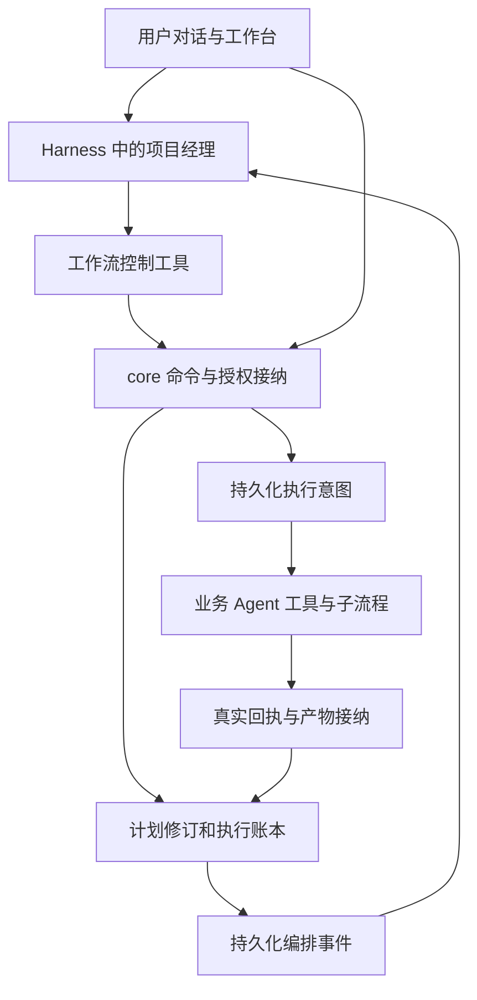

# Harness 驱动工作流改造方案与实施计划

日期：2026-11-11。状态：待实施。

DevDesk 将由运行在 Harness 中的项目经理 Agent 决定工作流如何推进。用户通过项目经理对话启动工作、调整计划、处理返工、修改运行中的工作流或绕过阶段；core 提供执行工具、状态接纳、授权检查和真实事实存储。

运行时变化采用新的运行计划修订。已经派发的任务保留原合同和来源，后续执行采用生效的新计划；阶段跳过、检查豁免和实际执行成功分别记录。此次交付先制定方案，不修改产品代码、运行实例或数据。

## 1 目标与设计决定

本次改造作出以下选择：

1. 每个根 WorkflowInstance 配置一个编排 Agent，默认使用项目经理 Role。它覆盖该根实例及其 Task 子流程，不为每个子流程再创建项目经理。Project 级入口可以选择和查看多个根实例，具体写操作始终绑定一个根实例。
2. 项目经理拥有独立、持续可恢复的编排会话。它不占用业务 Step，不依赖某个 Step 正在运行，也不通过普通讨论提案冒充工作流命令。
3. 新步骤的派发、业务结果接纳、返工和整体完成由项目经理通过工具提出。core 继续采集真实回执、执行授权动作和检查结构条件；不再遍历所有就绪节点后自主启动下一步。
4. 用户可在运行中修改实例计划，包括步骤、Stage、依赖、输入来源、角色绑定、Skill、Spec、完成条件及人工门禁。全局模板发布与实例采用分开处理。
5. 允许绕过业务阶段及业务检查，包括评审、测试或人工确认要求。能否自主操作取决于明确的编排授权；原始执行事实、资源权限、调用归属和 Git 操作一致性继续成立。
6. 采用单一的新执行合同。旧数据通过显式离线转换保留；生产运行不长期维护旧自动推进器与新编排器两套路径，也不通过删除数据库完成升级。
7. 首个可用实现使用现有 Codex 原生工具桥。Harness 接口保持统一；当前 DSH 缺少动态平台工具桥，未补齐前不能配置为编排执行器，仍可作为不需要该桥的业务 Step 执行器。

验收目标是：改变一个已有业务流程、调整阶段顺序或绕过阶段，可以通过对话及配置完成；新增真实外部能力或执行协议时才需要增加产品代码。

## 2 当前代码基线

代码基线为 `e0826a9`，包含人工 Approve、原始执行 evidence 及默认资源更新。实施前重新核对工作区和数据结构版本，保留并整合并行工作中的修改。下列引用指向当前实现。

| 位置 | 当前行为 | 本次改动原因 |
|---|---|---|
| [Workflow 领域类型](../../../crates/domain/src/workflow.rs) | Workflow v4；Stage 是分组；Step 有四种执行器、端口、依赖和有界完成规则 | 保留通用定义，增加稳定节点身份、运行计划修订及阶段处置语义 |
| [冻结规则](../../../crates/domain/src/workflow.rs) 中 `validate_configured_tasks` | 禁止修改实例的 plan、inputs、workflow_ref 和角色绑定 | 将不可变边界下沉到计划修订和实际执行合同，实例只切换活动计划引用 |
| [工作流执行器](../../../crates/core/src/configured_runtime.rs) 中 `evaluate_configured_workflows`、`advance_configured_step` | 自动遍历就绪步骤、建立执行意图、展开子流程并自动接纳符合规则的结果 | 拆分状态观察、可执行性查询、显式派发和显式接纳 |
| [工作流编译](../../../crates/core/src/configured_workflows.rs) | 编译完整子流程闭包、Role 绑定、工具及权限；支持草稿发布 | 复用编译器，增加针对运行实例的差异及影响分析 |
| [Session 关联](../../../crates/core/src/agent_tasks.rs) | 原生平台调用依赖 `configured_session` 与确切 StepExecution | 增加独立编排会话关联，避免创建占位 Step |
| [平台工具](../../../crates/core/src/platform_tools.rs) | 九种平台处理器；调用者必须属于 Running Step | 增加编排调用者类型和工作流控制工具，共用持久化意图及回执链 |
| 同文件 `git.advance` | 代码中要求确切候选的人工确认与真实通过测试 | 将业务前置条件放入可修订策略，Git 的真实来源、目标检查和 CAS 保留 |
| [Host 治理入口](../../../crates/host/src/governance.rs) | 普通会话清除平台工具；`tick_workflow_engine` 驱动意图 | 增加受授权的编排会话入口及控制工具白名单 |
| [Host 工作区调度](../../../crates/host/src/workspace.rs)、[Engine tick](../../../crates/core/src/lib.rs) | 多处调用自动工作流评估，与会话、仓库和工具轮询交织 | 所有入口统一切换；观察回执和调度已授权意图继续执行 |
| [Harness 端口](../../../crates/core/src/ports.rs)、[Harness 适配器](../../../crates/adapters/src/harness.rs) | 已有持久 Session、Turn、工具请求、回复、停止与恢复；Codex 注入 dynamicTools | 复用原生通道，不用 shell、日志或模型生成的命令 JSON 代替工具调用 |
| [流程工作台](../../../web/src/components/WorkflowInstanceView.tsx)、[角色对话](../../../web/src/components/RoleConversation.tsx) | 工作流操作与角色讨论分开；当前进度取自实例 steps 和冻结 plan | 增加项目经理入口、计划修订视图及对话操作结果联动 |
| [默认资源](../../../resources/configuration/README.md) | 出厂资源、数据库发布、项目采用、实例冻结相互独立 | 增加编排配置，并将实例修改和发布模板作为不同操作 |
| [数据库基线](../../../sql/README.md) | global 13 / project 44；启动只接受当前结构 | 新增显式转换入口和新结构版本，启动仍只执行当前合同 |

已有的重试、返工、停止证明、子流程路径隔离、人工例外与 evidence 端口继续保留。当前返工按依赖祖先集合失效后继；新影响分析需同时覆盖依赖、实际输入消费、完成规则引用和平台授权引用。

## 3 目标架构

项目经理读取状态，决定下一动作，通过原生工具提交请求。core 接纳请求后持久化意图，Host 在事务外执行；回执接纳后生成编排事件，项目经理再决定接纳、继续、调整或等待。

用户在工作台直接暂停、停止、确认和修改计划，也使用同一组领域命令。即使项目经理不可用，用户仍能查看状态和停止执行。

### 3.1 职责划分

| 主体 | 保留或承担的职责 |
|---|---|
| 项目经理 | 理解用户意图，选择步骤和并发安排，判断材料是否充分，组织作者与评审，提出阶段处置，修改实例计划，申请必要的人类决定，说明进度及限制 |
| Workflow 和 Skill | 定义业务目标、推荐路径、角色分工、交付合同和工作方法；项目经理在当前授权内调整实例采用的内容 |
| core | 校验身份与作用域、编译结构和引用、计算操作条件与影响、持久化计划及决策、派发已授权动作、接纳真实输出、维护幂等和并发控制、隔离失效执行 |
| Host | 事件投递、编排会话恢复、worker 及工具执行协调、公平调度、资源准备和停止 |
| Harness 适配器 | 真实模型会话、工具注册、调用关联、工具回复、终态与停止证明；不决定业务状态 |
| Git 测试及外部适配器 | 执行真实操作并提供与确切版本绑定的回执 |
| 人类 | 给出任务意图，配置或授予编排权限；处理策略中保留的人类专属决定，直接干预执行 |

core 不判断“需求是否足够好”或“这个阶段值得跳过”；它核验判断来源、当前策略和变更后的计划能否成立。缺少产物、授权或真实回执时，返回结构化缺口。

### 3.2 编排角色与业务角色

项目经理是默认编排角色，代码通过 `orchestrator_role_ref` 和 Role→Agent 绑定定位，不识别角色中文名称或 builtin ID。用户可以选择其他业务 Role 承担编排职责。

项目经理执行原有 `planning` 业务任务时，仍通过独立 Step Session 交付 Task Plan。贯穿流程的编排 Session 与该业务 Session 分开记录；相同 Agent 身份也不能充当需要独立身份的评审者。

## 4 领域与存储调整

以下为拟新增或调整的业务合同，具体 Schema 在 P0 固化。

| 对象 | 关键内容及约束 |
|---|---|
| `WorkflowControlPolicy` | 允许的控制操作、根实例范围、可调整的策略、可豁免的业务要求、人类专属决定、编排预算；通过项目配置显式采用 |
| `WorkflowController` | project、owner、root_instance、编排 Role 与 AgentID/修订、Session 后继链、策略修订、状态、事件游标和控制代次；启动准备期尚未绑定根实例时仅有受限创建权限 |
| `ControllerSessionBinding` | 原生 Session 与 Controller 的关联；不使用 `configured_session` 伪装业务步骤 |
| `WorkflowPlanRevision` | 不可变的完整编译闭包、实例输入、角色绑定、策略、父修订、来源模板、变更摘要及内容哈希 |
| `WorkflowInstance` | 保存 `active_plan_revision_id`、控制版本、根/父身份及当前执行投影；旧计划不在原地替换 |
| `StageDefinition` 和 `StepDefinition` | 增加稳定 `node_id`，名称及 key 可编辑；运行身份结合根实例、调用位置、集合成员身份和节点身份定位 |
| `StepExecution` | 绑定 plan_revision、node_id、调用身份、冻结合同摘要、输入来源及实际执行者；重试和返工生成新执行身份 |
| `WorkflowCarryForward` | 新计划复用旧执行结果的明确映射及校验依据；不修改旧执行的计划引用和来源 |
| `WorkflowChangeSet` | typed operations、理由、用户意图或策略授权、基准计划、影响集合、预演哈希、停止和重跑安排 |
| `WorkflowDecision` | 接纳、跳过、豁免等决定；保存真实 actor、范围、执行/产物摘要、理由和授权来源 |
| `TypedMaterial` 和 `MaterialRef` | 外部提供的类型化材料、不可变内容、来源和摘要；可作为输入，不伪装成 Agent 或平台运行结果 |
| `WorkflowActionPermit` | core 对当前策略求值后生成的确切操作许可；绑定计划、候选、目标及有效决定/回执，不由模型填写“已获授权” |
| `OrchestrationEvent` 和 `OrchestrationWakeup` | 有序业务变化、持久化投递状态、触发原因和去重键 |
| `OrchestrationLease` | 根实例的单写者租约及递增 fencing epoch，用于拒绝过期项目经理调用；启动准备期按 owner 排他，并在创建根实例时原子转移绑定 |

计划、决定、carry-forward 和产物采用现有 `governance_records` 的类型化不可变记录。Controller 和实例当前状态为可变投影；执行的冻结合同和终态回执不可改写。唤醒队列与租约使用有唯一约束的专用表，避免仅靠内存或 SSE 驱动。

`WorkType` 增加编排执行类型；Controller 具有独立任务封套，内容包括当前计划引用、业务目标、变化事件、可用操作、缺口、策略及预算。业务 Agent 任务仍按 Step 冻结，升级渲染合同以携带计划修订及稳定执行身份。

Stage 仍是业务分组。阶段进度由成员步骤及处置决定投影；跳过阶段会展开为确切成员及影响集合，不给 Stage 新建一个隐藏的业务执行器。

## 5 项目经理如何持续驱动执行

### 5.1 启动和正常推进

1. 用户打开 Feature 或 Project 的项目经理入口；Host 根据显式项目配置建立 owner 范围的 Controller 和编排 Session。尚未创建根实例时，只开放查看配置/材料及 `workflow.start`；不需要占位 Project、Step 或先运行一个业务节点。
2. 项目经理读取配置并调用 `workflow.start`，core 编译初始计划、创建根实例并原子绑定 Controller，发出 `workflow.started`。已有根实例则直接恢复关联；启动不会自动执行首个业务步骤。项目经理调用 `workflow.inspect` 读取当前计划、状态、可派发步骤及缺失条件。
3. 项目经理调用 `workflow.step.dispatch`。core 核对当前控制代次、计划、依赖、输入、预算和资源范围，原子登记执行与意图，立即返回执行引用。
4. 业务 Agent、工具或子流程实际运行。core 接纳回执，记录为待接纳、等待输入、失败或需要核对，并投递业务事件。
5. 项目经理检查确切产物和评审，调用 `workflow.step.accept` 或提出返工、输入补充、计划修改。core 校验当前规则和所引用的判断。
6. 接纳之后，项目经理决定后续派发。整体完成通过 `workflow.complete` 请求，core 根据活动计划、输出和决定接纳终态。

工具原生返回的 completed 不直接等于业务步骤已接纳。原有 `waiting_confirmation` 应拆分为“等待编排接纳”和“等待人类决定”，避免将每次普通接纳都解释成人工批准。

派发 Workflow 节点仅按冻结配置展开待执行子实例；子实例首步同样由项目经理派发，不保留隐藏的子流程自动推进。子流程完成后，父节点汇集确切成员输出并等待接纳。Control 节点登记无 worker 的屏障和相应待决定项，使用同一控制及接纳合同。

### 5.2 事件投递和会话恢复

唤醒来源包括：用户输入、执行结果、等待输入、评审拒绝、人类决定、计划生效、暂停恢复、资源就绪和核对完成。模型 token、重复轮询及项目经理自己的只读查询不生成新的业务唤醒。

同一根实例默认只有一个活动编排 Turn；事件在执行期间合并排队，每个 Turn 冻结消费的事件范围。事件入队、Turn 创建和消费游标更新使用持久化去重键。失败或重启后可以重投递，但领域命令和外部副作用依靠各自幂等键接纳。

工具调用携带宿主生成的 Controller、Session、Turn、worker 和 lease epoch；调用参数不能自行声明真实 actor。租约过期、会话接替或用户接管之后，旧 Turn 的新写请求被拒绝。已接纳意图继续按原身份收取回执，不能因租约变化丢弃真实外部结果。

重启时先恢复账本和观察未完成操作，再投递事件。原生 Session 无法恢复时建立有 Snapshot 和来源的新后继 Session；权威状态来自数据库，不能仅靠对话记忆恢复。

### 5.3 并发与预算

编排与业务执行分别排队，保留控制操作处理能力。总并发为 1 时，项目经理派发后结束当前 Turn，再让业务 Step 执行；等待子任务的工具立即返回执行引用，不占住原生请求等待整个子流程。

Controller 配置每次唤醒的 Turn、工具调用、时间和 token 预算，以及自动恢复次数。无可行动变化时进入等待；反复读取相同状态不能无限唤醒。预算耗尽或 Harness 不可用时暂停编排并展示原因，core 不切回旧自动推进逻辑。

人工暂停首先禁止新派发；用户仍可对话、查阅及修改计划。需要修改活动部分时进入 quiesce，停止受影响执行者。无论暂停或取消，回执采集和停止核对继续运行。

### 5.4 有界执行委托

为避免每个纯工具步骤都调用一次模型，后续提供 `workflow.segment.dispatch`：项目经理明确指定一组节点、确切计划、允许的规则接纳及停止边界，core 执行该有限范围。

委托遇到人类专属决定、内容拒绝、输入缺口、失败、未知副作用、预算耗尽或计划变化即停止并唤醒项目经理。委托不含“永久执行所有就绪节点”，也不能替新计划自动扩大执行范围。最小闭环先实现单步派发，有界委托作为后续优化。

## 6 向 Harness 提供的工具

下表名称是拟定的公共工具合同。已有命令沿用领域语义，原生函数名继续通过 `devdesk_` 可移植映射生成；P0 固化命名及 Schema。

| 工具 | 主要输入 | 结果与作用 |
|---|---|---|
| `workflow.start` | owner、确切 Workflow 修订、输入、Role 绑定及控制前置条件 | 创建根实例和初始计划并绑定当前 Controller；同 owner 已有活动根实例时返回关联或冲突，不重复创建 |
| `workflow.inspect` | root/instance、可选子树范围 | 当前计划、控制版本、执行投影、可派发节点、缺口、待决定项及能力；有界分页 |
| `workflow.events.read` | root、cursor、limit | 有序业务事件及下个游标；UI SSE 仅作通知 |
| `workflow.outputs.read` | output/material IDs、分页范围 | 经作用域核验的正文、类型和来源；不暴露任意宿主路径 |
| `workflow.execution.inspect` | execution ID | 冻结任务、真实执行者、回执、产物、授权及当前适用性 |
| `workflow.step.dispatch` | plan revision、node/invocation IDs、控制前置条件 | 登记执行意图；返回 queued/running 引用及真实缺口 |
| `workflow.step.accept` | execution ID、input/output digests、判断引用、理由 | 按当前合同接纳产物；Agent 不能直接写 completed 或上传伪造工具回执 |
| `workflow.step.input` | execution ID、补充材料或用户消息引用 | 沿确切执行续轮；变更任务或端口时改走 ChangeSet |
| `workflow.step.retry` | 原 execution、理由 | 原合同下技术重试；新执行身份，旧执行须停止并核对 |
| `workflow.step.rework` | 节点/调用范围、理由、影响确认摘要 | 业务返工及后继失效；默认沿当前计划，改合同需 ChangeSet |
| `workflow.execution.stop` | execution/子树、原因 | 请求停止真实 worker/工具，返回停止中或已停止；不声称撤销副作用 |
| `workflow.pause/resume/cancel` | instance/子树、原因、暂停方式 | 流程控制；取消后的外部结果继续记录和核对 |
| `workflow.change.preview` | 当前计划、typed operations、理由 | 编译后的计划差异、失效/复用集合、输入缺口、待停止项和授权要求；无执行副作用 |
| `workflow.change.apply` | 同一 changeset、preview hash、计划及影响前置条件 | 持久化变更操作，必要时异步 quiesce，最终原子切换新计划 |
| `workflow.materials.import` | 类型修订、内容、来源/既有 Document 或 Artifact | 生成封存的 TypedMaterial；不赋予平台测试或 Git 回执身份 |
| `workflow.decision.request` | 确切操作或 ChangeSet hash、理由、可选项 | 登记当前策略要求的人类决定，立即返回 pending；不阻塞原生工具通道 |
| `workflow.execution.reconcile` | 未知操作引用、可核验的观察来源 | 恢复真实观察与核对；自然语言声明不能制造外部回执 |
| `workflow.complete` | 当前计划、最终输出引用、总结和例外引用 | 接纳根实例或子流程终态，明确已完成、已绕过及未验证范围 |
| `workflow.segment.dispatch` | 明确节点集合、计划、预算和停止边界 | 有界委托，列为单步闭环完成后的优化 |

阶段跳过、业务豁免、输入重绑及 Task 范围修订均通过 ChangeSet，不再另加任意改状态的工具。全局 `workflow.publish` 和项目默认配置变更是独立权限，不因项目经理能修改实例就自动授予。

现有 `workspace.current/snapshot`、`materials.capture`、`tasks.create/complete`、`tests.run`、`git.candidate/advance/publish` 继续由显式业务节点调用。项目经理通过派发相应节点组织这些操作；无需直接获得全部工程写工具。

### 6.1 工具调用的一致约束

写命令统一具有 `command_id`、root、计划修订、控制前置条件和理由；创建命令尚无 root 时使用确切 owner 和配置修订。宿主补充真实调用者及授权；同 ID 同参数返回首次结果，不同参数复用 ID 拒绝。工具结果区分请求已接纳、实际运行完成、业务结果已接纳。

`workflow.inspect` 应返回 `allowed_actions` 和结构化诊断，例如 `missing_material`、`active_writer`、`approval_required`、`stale_plan`、`scope_violation`，项目经理据此调整，不解析错误文案决定行为。

## 7 编排权限与用户指令

WorkflowControlPolicy 将工作流控制权限与文件写权限分开。项目经理保持工作副本只读，也可以在授权范围修改计划；这类操作使用工具效果 `workflow_control`，不能为调用控制工具而把 filesystem 升成 full access。

默认授予项目经理：查看本根实例及子树、派发和接纳普通节点、停止/暂停、重试返工、编辑实例计划和绕过普通业务阶段。策略显式列出可豁免要求、必须由人类决定的操作，以及是否允许改变 Task 范围。资源范围、工程写入、网络及发布权限仍由既有 Permission 与执行器落实。

用户在当前对话明确要求“采用这份设计并跳过设计阶段”，且当前控制策略覆盖该操作时，项目经理执行预演与应用，不重复请求相同许可。需要人类专属决定时，只对确切变更申请一次，绑定操作摘要、计划、候选及有效期/失效条件。

人类决定由已认证的 Web/原生交互入口记录。项目经理可以解释或请求决定，不能调用人类批准接口为自己签名；普通聊天文本中的“用户已同意”不构成授权。既有人工 Approve 继续作为人类例外入口，与模型报告分开保存。

控制策略本身、授权边界、外部凭据和组织级强制约束不属于项目经理可自行修改的实例内容。人类可通过相应配置入口明确调整这些边界。

## 8 运行时更新工作流

### 8.1 支持的修改

ChangeSet 使用类型化操作，支持增删/调整 Stage 与 Step、依赖、任务正文、输入来源、输出端口、完成条件、确认策略、预算、角色绑定及所选配置修订。新引用必须属于当前项目可见范围并重新编译完整闭包。

实例计划可直接从既有修订派生，不要求先发布全局模板。将实例方案保存为可复用 Workflow 是另一个明确发布动作；其他 Feature 和默认模板不随实例修改变化。

新增依赖不能把已执行动作重新解释为“当时已经满足”；如果要求新的执行顺序，需要对相关节点重新执行或显式记录对应业务豁免。修改已完成节点的正文、Spec、输入或授权会影响它在新计划中的适用性，旧事实保留。

### 8.2 变更应用流程

1. 项目经理读取活动计划和相关执行事实，提交 `change.preview`。
2. core 编译新图并检查稳定节点身份、引用、端口类型、Role 绑定、Spec、Standard 和资源范围；返回完整影响集合与预演摘要。
3. 项目经理补足材料、明确替代输入和需要豁免的规则。已有控制授权足够则直接 apply；人类专属决定先绑定本次预演摘要。
4. apply 先持久化变更请求并阻止受影响范围的新派发。受影响范围有 worker、原生工具请求或外部副作用时，进入 `waiting_quiescence`，在事务外停止并观察。
5. 停止后再次校验预演前置条件。停止期间到达的回执按旧执行合同保存；若影响范围需要扩大或用户修改了同一范围，返回冲突并重新预演。
6. 全部条件满足后，在项目数据库事务内写入不可变 PlanRevision、处置决定、carry-forward 和新执行投影，原子切换活动计划及代次，撤销旧派发授权。
7. 投递 `plan.changed` 事件。项目经理基于新计划重新查询并推进；受影响的新执行使用新的 Session/任务封套。

变更操作状态为 `prepared → waiting_quiescence → applied`，也可为 `conflicted/failed/cancelled`。尚未 applied 时旧计划仍是权威计划，受影响范围保持封锁。每个根实例只允许一个 applying 变更；无关结果可以继续采集，不影响停止和事实接纳。

apply 使用计划代次、受影响执行状态/摘要及控制版本作为前置条件。token 流和只读查询不推动控制版本，避免无关 UI 更新造成持续冲突。命令已登记后不得在事务内调用 Harness、Docker、Git 或网络。

### 8.3 影响分析和成果复用

影响图包含显式执行依赖、实际端口消费、CompletionRule 引用、Spec/交付合同、确认/许可引用、Task 依赖及子流程调用。只看 Step.dependencies 不足以判断成果有效。

仅在任务合同、输入值和来源、Agent/工具及权限绑定、相关判断和代码版本均满足新计划时复用旧结果，并建立 carry-forward。Spec、端口、源码或输入发生语义变化时，相关评审、测试、候选和决定必须重做或被明确处置。

移除已完成节点只改变它在新计划中的作用；历史输出和外部副作用仍可查看。把计划指针切回旧版本不会回滚 Git 或已创建的 Task；恢复旧方案也是一次新的变更预演。

已完成根实例保持终态。继续新增工作创建有 predecessor 的后继实例，显式引用可以复用的历史材料，不直接把历史完成实例改回 Running。

同根实例内跨计划复用平台回执需核验 carry-forward 和原始调用来源。后继根实例可以引用历史文档，但历史材料导入不会自动产生新根的工作空间授权或 Git/测试许可；默认重新取得对应操作事实，避免绕开当前 `platform_grant` 的根范围检查。

### 8.4 子流程与 Task

子流程修改必须指定完整调用身份。修改某一 Task 的实例闭包只影响该 Task；采用新的 Task 模板可以作用于明确选中的尚未展开成员，不能替换已经运行的兄弟实例。

foreach 成员采用稳定业务对象 ID 和调用位置定位，不能使用数组下标或“最近会话”。集合成员增删、依赖变化和父节点完成条件一并预演，已完成兄弟成员只在合同仍匹配时复用。

Workflow 图变化不隐式修改真实 Task 的范围和依赖。需要重划实际任务时，ChangeSet 包含明确的 `revise_task_scope` / `revise_task_dependencies` 操作，保存 Task 修订并同时验证两张 DAG；已创建工作副本或已接纳代码会进入相应影响分析。新 Task 仍通过显式创建工具产生，已存在 Task 不因移出流程而被删除或伪装成完成。

## 9 绕过阶段和业务规则

“绕过”是对当前计划的正式处置，不把产物缺失、评审拒绝或测试失败改成成功。Changeset 记录确切 Stage/节点、原因、替代来源、被调整的要求、授权及后继影响。

| 用户意图 | 操作语义 |
|---|---|
| 阶段尚未开始，直接跳过 | 展开阶段成员；调整依赖、输入、完成规则和最终输出；生成 bypass 决定 |
| 阶段有正在运行的任务 | 先封锁和停止受影响成员及子流程，核对副作用，再应用 bypass |
| 已有线下设计，跳过设计编写 | 导入封存的设计材料，将下游 design 输入绑定到 MaterialRef；不制造设计 Agent 执行 |
| 评审不通过，决定带问题继续 | 保留拒绝报告；对确切检查和产物建立 waiver；后续显示例外接纳 |
| 本次不做某项测试 | 新计划移除/豁免该业务要求，记录未验证范围；不生成成功测试回执 |
| 移除某个人工确认点 | 核对修改该门禁的控制授权，再修订当前计划；不补造人的签名 |
| 跳过阶段，但下游还要求其产物 | 返回确切输入缺口；提供替代材料、改绑来源或调整下游要求后才可应用 |
| 跳过最后的发布阶段 | 调整最终输出和完成要求，交付未发布的结果；不把本地文件声称为已合入远端 |

步骤原有的 condition=false 跳过与主动 bypass 分开记录。阶段视图展示正常完成、规则跳过、主动绕过、带例外接纳和未验证项，不能统一渲染成绿色通过。

规则引用也必须更新：如果跳过 Red，而 Task 的整体完成规则仍要求 `before(red, implementation)`，预演需明确修订或豁免该要求。Standard 中的覆盖要求也按确切规则处理；项目强制约束需要相应授权，不能只删除节点绕开。

允许空业务流程的前提是新计划仍声明合理的最终交付及处置说明。下游最终输出引用不存在时拒绝应用，不能依靠整体 completion=always 自动宣称原目标已经实现。

## 10 core 保留的约束及 Git 处理器调整

### 10.1 始终由 core 验证的事实

- 真实调用者、项目/owner 边界、控制授权、文件与网络权限，以及活动执行者的身份和代次。
- 配置引用、DAG、输入输出结构、离线 Schema、确切来源与摘要。
- 已派发合同、历史产物、原始报告和真实终态回执的不可变性。
- 幂等、并发冲突、外部操作意图、真实停止证明及未知副作用核对。
- Git 候选的实际来源、父提交、diff、目标版本、CAS/lease 和观察到的远端结果。

业务阶段顺序、测试是否必需、评审独立性、内容通过标准、人工门禁和交付覆盖属于计划/项目策略。项目经理可以在明确授权内调整或豁免；core 仍核验这一调整的范围与来源。

### 10.2 拆分业务门禁与操作协议

目前 `git.advance` 同时验证真实候选、人工确认、候选测试和本地推进。这一实现需改为：

1. core 从当前计划及项目策略计算本次接纳需要的证据和决定，生成 WorkflowActionPermit。
2. 正常路径引用实际候选测试、评审与人工确认；允许例外的路径引用确切 waiver 和授权。每项要求明确是 satisfied、waived 或 missing。
3. Git 处理器验证 permit 与当前计划、候选、目标、owner 和操作身份匹配，并执行真实 Git 一致性检查。
4. permit 在候选、目标、输入、授权或相关计划变化时失效。正在执行的已授权 Git 动作作为独立外部操作收取回执，再由新计划判断是否采用。
5. 发布和 Feature 完成报告分别说明实际合入结果、测试覆盖及例外；业务豁免不会把测试 failed 改为 succeeded。

这项调整是支持“绕过测试/确认阶段后继续接纳”的必要工作。仅给流程编辑器增加跳过按钮不能实现该能力。

## 11 默认配置和交互调整

默认项目配置增加编排 Role 和控制策略；Capability 中显式包含工作流控制工具，Agent 引用新的项目经理 Skill。Skill 覆盖状态检查、派发、等待、返工、运行时变更、阶段绕过和最终报告，不能仅依靠一段角色职责实现协议。

默认 Feature 拆分为可单独选择的业务 Stage，保留当前 21 个业务步骤：

| Stage | 当前步骤映射 |
|---|---|
| 需求 | requirements、requirements_review |
| 设计 | source_workspace、design、design_review |
| 任务规划 | planning、plan_review、tasks |
| Task 实施 | implementation 及其明确子流程调用 |
| 整体验证 | workspace、release_recipe、tests_snapshot、verification |
| 交付整理 | closure、closure_review |
| 接纳发布 | mainline、candidate、candidate_tests、candidate_review、advance、publish |

Task 的 19 步按独立测试、Red 基线、实现与 Green、文档复验、独立评审、候选接纳及交接分组。Stage 名称与分组均为配置，core 不识别这些名称。保留本轮新增的 red_baseline 和 implementation.evidence 合同，原始日志及文件内容继续通过显式端口传递。

工作台提供：

- 当前 Feature 的项目经理对话入口，以及它负责的根实例和 Session 后继来源。
- 当前阶段、正在执行的节点、等待项、下一动作说明和控制预算状态。
- 实例计划编辑与差异预览，展示将停止、重跑、复用或绕过的内容；常规操作不要求用户手写 JSON。
- 带来源的对话操作卡片；“已登记修改”“正在停止”“新计划生效”分别反馈。
- 可追溯的计划历史，按执行查看当时合同与产物，而非用最新任务正文展示旧记录。
- 直接暂停、停止和接管入口；人类决定绑定确切对象，过期预览不能提交。

## 12 代码改动范围

新增文件名为建议拆分，避免继续扩张 `configured_runtime.rs`。

| 模块 | 计划改动 |
|---|---|
| `crates/domain/src/workflow.rs` | 稳定节点、计划引用、输入来源、执行状态及新的不变量 |
| 新 `crates/domain/src/orchestration.rs` | Controller、控制策略、决定、permit 和编排事件合同 |
| 新 `crates/domain/src/workflow_change.rs` | ChangeSet、影响计算、carry-forward 和阶段绕过规则 |
| `crates/core/src/configured_workflows.rs` | 编译新计划闭包、策略与增量预演，复用既有结构检查 |
| `crates/core/src/configured_runtime.rs`、`workflow_runtime.rs` | 拆出观察、派发、接纳、完成，移除旧就绪节点自动推进 |
| 新 `crates/core/src/orchestration.rs` | Controller 生命周期、事件消费、租约和命令入口 |
| 新 `crates/core/src/workflow_changes.rs` | 变更操作、quiesce、原子切换及恢复 |
| `crates/core/src/agent_tasks.rs`、`conversations.rs`、`ports.rs` | 编排 Session 类型、任务封套、后继恢复及原生调用来源 |
| `crates/core/src/platform_tools.rs` | 调用者类型、控制工具路由、工具效果授权和 Git permit 接纳 |
| `crates/host/src/governance.rs`、`workspace.rs`、`integrations.rs` | 编排入口、原生工具注册、事件调度、公平性和所有 tick 入口切换 |
| `crates/adapters/src/harness.rs`、`integrations.rs` | Codex 工具桥复用、编排能力探测和供应商边界 |
| `crates/adapters/src/lib.rs`、`catalog.rs`、`sql/` | 新数据版本、队列与租约持久化、索引及离线升级入口 |
| `schemas/` | Workflow/任务/运行实例新合同、控制策略、ChangeSet、RPC、工具及迁移清单 |
| `resources/configuration/` | 新默认 Workflow、项目经理 Skill/Capability/Agent、控制策略和工具资源；保持完整 manifest 引用图 |
| `web/src/components/WorkflowInstanceView.tsx`、`RoleConversation.tsx`、`WorkflowManager.tsx` | 项目经理入口、计划变更、阶段处置、历史及异常反馈 |
| `crates/adapters/tests/`、`tests/entrypoints/`、`web/tests/` | 核心合同、跨进程恢复、原生工具桥、浏览器及真实工程回归 |
| `docs/domain.md`、`protocol.md`、`sql/README.md` 等 | 更新当前合同，原历史计划报告保留其历史范围 |

## 13 数据和协议升级

Workflow 定义和实际运行合同升级到 v5，业务 Agent renderer 升级为 `agent-task/v5`；编排任务使用独立 `orchestration-task/v1`。Spec/Standard 和普通 Proposal 的内容合同无变化时保持原版本。global/project 正式结构编号在 P0 核对并登记，避免与现有未提交改动冲突。

执行显式离线转换，运行时只接受新活动合同。转换入口先 dry-run，列出源版本、待转换实例、活动执行者和未知副作用；停止 Host 并取得执行者停止/核对结果后建立一致备份。原数据库、Artifact、凭据和仓库均不得删除重建。

转换过程保存旧配置及执行快照为不可变历史材料，生成新计划修订和稳定节点映射。已完成结果在合同等价时建立 carry-forward；未开始节点按新合同建立执行身份。被中止的旧活动执行保留原状态和停止证据，后续使用新执行，不把旧 worker 接到新任务正文。

全局库与多个项目库使用升级 journal、确定性映射和可重入检查点。跨库转换完成前阻止新的执行启动；不宣称多 SQLite 文件拥有一个原子事务。中断后恢复转换，不自动回退成旧调度器。旧会话与任务正文可只读查看，不保留旧业务执行路径。

数据库升级回退使用一致备份并停止新 worker；计划修订的恢复通过新的 ChangeSet，二者不能混用。升级旧开发数据的运行方式从历史“重建”调整为本方案的显式转换，需同步 SQL 和运行说明。

## 14 分阶段实施计划

各阶段按依赖推进。最小可演示闭环为 P0 至 P3；完整运行时变更及绕过能力需完成 P4、P5，最终交付需完成 P8。以下阶段均是待实施工作。

| 阶段 | 工作与交付 | 进入下一阶段的条件 |
|---|---|---|
| P0 固化合同 | 新领域对象、调用者/授权模型、工具 Schema、状态图、迁移映射、默认控制策略；在本目录补充 CONTRACT.md | 明确哪些决定由 Agent 作出、哪些事实由 core 验证；所有工具都有状态前置条件、幂等键和失效条件 |
| P1 拆分执行内核 | 分离 observe/inspect/dispatch/accept/complete；执行合同独立绑定计划；覆盖现有 Agent/Tool/Workflow/Control | 无项目经理命令时不会启动下一步；真实回执、停止、重试、输入和子流程行为均可独立验证 |
| P2 提供编排工具桥 | ControllerSessionBinding、真实 actor、控制权限、原生工具与回执投递；Codex 贯通，DSH 能力明确报告 | 项目经理在无 Running Step 时可合法操作根实例；跨范围、伪造 actor、旧 lease 和重复请求被正确处理 |
| P3 建立持续项目经理 | 持久化事件、单写者、Session 恢复、预算、等待及公平调度；默认项目经理 Skill 初版 | 对话启动并完成一个包含 Agent、工具和子流程的流程；Host 重启后继续，编排不可用时可人工停止且不自动推进 |
| P4 运行计划修订 | ChangeSet 预演与应用、活动执行停止、影响图、carry-forward、调用点/Task 隔离、后继实例 | 可运行中添加/删除步骤、改正文及输入、改变依赖；中断和迟到回执不污染新计划 |
| P5 阶段绕过与业务豁免 | TypedMaterial、Stage bypass、检查 waiver、Standard 处置、ActionPermit；拆开 git.advance 业务门禁 | 跳过设计可用真实替代材料继续；授权下绕过测试/确认仍能真实接纳，报告明确未验证项且不伪造通过 |
| P6 默认资源和工作台 | 七个 Feature Stage、Task 分组、新角色能力与工具资源；对话卡片、变更编辑、历史和接管 | 用户通过对话或工作台完成相同操作；刷新后结果一致，不要求输入执行 ID 或 JSON |
| P7 委托和运行调优 | 有界 segment、事件合并、预算及大计划分页；如交付范围包含 DSH 编排，此阶段单独补齐原生工具注册和回复适配 | 单并发无死锁；计划修改可中断委托；DSH 未实现工具桥时 UI/编译明确拒绝其编排配置 |
| P8 升级和完整验收 | 离线转换、当前合同文档、打包；实际 Codex、Docker、Git/GitHub 及跨进程/浏览器验证；提交 EXECUTION.md | 下节验收矩阵完成，旧数据和凭据保留，生产路径无旧自动调度回退 |

实施中的模块拆分可以分提交进行，正式切换时只启用新合同。不得为了阶段演示在生产中加入按 builtin ID、角色名或流程版本选择旧自动执行路径。

## 15 验收矩阵

| 编号 | 场景 | 必须观察到的结果 |
|---|---|---|
| A01 | 输入和依赖已就绪，但项目经理尚未派发 | 只展示 allowed actions，不自动启动业务 Step |
| A02 | 项目经理正常组织一个完整 Feature | 所有派发、接纳、返工、阶段处置和最终完成都有真实工具调用与授权来源 |
| A03 | 用户运行中新增一步并改变后续依赖 | 新计划生效，未受影响产物复用；旧执行仍展示旧合同 |
| A04 | 修改正在执行的任务 | 先封锁和停止受影响执行者；旧回执按旧来源落账，不能满足新任务 |
| A05 | 用户提供设计并要求跳过设计阶段 | 新材料封存并显式重绑输入；设计阶段展示 bypass；后续能够执行 |
| A06 | 跳过阶段后留下缺失端口或规则引用 | 预演给出具体缺口，不能仅通过标记 skipped 解锁 |
| A07 | 评审拒绝后授权带问题继续 | 原拒绝及检查保留，产生绑定确切产物的 waiver，不改写 approve |
| A08 | 授权绕过测试或人工门禁后接纳候选 | 策略产生有效 permit，实际 Git 完成；报告标明豁免及未验证范围；候选/目标变化使旧 permit 失效 |
| A09 | 两个调用点及两个 Task 使用同一子流程 | 修改只影响指定 invocation；兄弟结果及 Task DAG 保持正确来源 |
| A10 | 双项目、过期编排会话和人类接管 | 跨根写入、旧 fencing epoch、自行扩权和模型伪造人类批准全部拒绝 |
| A11 | 并发修改或过期预演 | 变更冲突清晰返回，活动计划与决定不能部分生效 |
| A12 | 在请求登记、停止、回执持久化、计划切换、原生回复前后中断 | 重启可恢复；重放不重复已确认的业务作用，未知外部结果先核对而非盲目重试 |
| A13 | 取消或暂停时有工具正在执行 | 继续采集事实；取消不被解释成副作用撤销；独立暂停子流程不会被父级恢复覆盖 |
| A14 | 总并发为 1、事件重复或模型不可用 | 编排与业务轮换，无等待死锁和空转；预算耗尽显示可恢复原因 |
| A15 | 旧库显式转换及转换中断 | 项目、材料、Artifact、会话、凭据及历史结果保留；重入一致，无删库和旧运行回退 |
| A16 | 对话修改与 Web 直接修改、刷新及移动布局 | 同一权威状态、同样授权和冲突语义；差异、绕过和历史来源可读 |
| A17 | 定义非 TDD 的调查或材料工作流 | 同一编排工具和内核可以执行，代码不识别默认阶段名 |
| A18 | 默认 Task evidence 和人工 Approve 回归 | 原始运行/文件内容按端口传递，人工例外独立留痕，新增编排不能冲淡已有合同 |

验证先做领域及 core 状态/影响测试，再做 SQLite、HTTP、原生工具桥和浏览器回归。模型夹具可验证调度合同；真实编排能力需使用实际 Codex 调用，真实工程能力需取得 Docker 测试和 Git/GitHub 回执，报告分别标明范围。

最终检查包含 `cargo test --workspace --locked`、`npm --prefix web run build`、`./scripts/check/check.sh`，以及明确环境下的真实工程验收与独立包验证。日志、截图和中间 JSON 写临时目录；本计划目录只保存 Markdown 契约、计划及执行报告。

## 16 关键实施顺序

优先完成独立编排身份、显式控制命令和持续会话，再实施计划修订及绕过。只有自然语言入口而底层仍自动推进，不能算 Harness 驱动；只有可编辑 JSON 而活动执行、输入缺口、后继失效和 Git 业务门禁未处理，也不能算运行时流程修改已完成。

完整交付以 A01 至 A18 的实际结果为准。实例计划、原始执行合同、真实外部事实和用户决定各有明确来源，用户能够通过项目经理直接改变后续执行方式。
