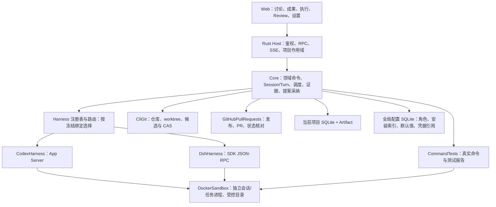

# DevDesk 真实交互与工程接入实施计划

日期：2026-11-08。状态：R0–R8 在 macOS Web 上验收通过（2026-11-08）。Ubuntu 宿主与 Keychain 改善按用户后续要求继续。用户已授权实施及独立 GitHub 测试仓库；阶段证据见 [实施报告目录](./)。以下原调研基线保留为计划输入，实际通过项以阶段报告和验收产物为准。

基线：[原始设计 v0.2](../devdesk-v0.2/PLAN.md)、[原型实施计划](../devdesk-prototype/PLAN.md)、[领域补强计划](../domain-hardening/PLAN.md)、[当前架构](../../design.md)、[真实适配器契约](../../real-adapter-contract.md)。本计划授权实施时，取代原型计划中“真实 Harness/Git/Docker 延期”的本轮停止线；原有领域不变量继续有效。存储采用已实现的全局配置库与每项目工程库，SQL 位于 `sql/`，计划及所属报告统一位于 `docs/plans/<计划名>/`。

## 1. 用户已确认的目标

1. 首批真实 Harness 同时支持 Codex 和 DeepSeek Harness（DSH），设置页可选择默认值，初始默认 Codex；保留全部 Sim 实现。
2. DSH 为 [deepseek-ai/deepseek-harness](https://github.com/deepseek-ai/deepseek-harness)，参考源码位于 `/Users/hengliu/workspace/deepseek-harness`。
3. 运行时复用指安装与分发产物去重：同一版本不为项目、角色或 Session 再打包一份。允许为不同 Session 启动独立进程；明确不同版本可以并存。
4. 项目和角色使用独立 Session；同一角色在同一业务范围内的连续讨论续用原 Session。Task 会话独立于 Feature 会话。
5. 前端可以与角色 Agent/Harness 直接讨论 Requirement、Feature，产出 Design 并拆分 Task/Test。
6. 完成真实闭环：讨论 → 需求/设计 → 拆分 Task → Docker 内实施与测试 → GitHub PR → Review 与合入。
7. Agent 定义需求分析师、架构师、开发、测试、评审等角色。身份、运行时、模型和执行环境分别配置并冻结。

本轮继续采用 Rust + Web 完整客户端。Swift UI、Hugging Face、通用插件市场、多用户/远程调度、Archive 冷数据执行及 data 目录搬迁不纳入本轮交付。

## 2. 交付结果与支持边界

最终用户可通过 Web 完成：配置与诊断运行时/模型/凭据/Docker/GitHub；登记仓库；与角色持续讨论；查看结构化建议和差异；采纳或编辑需求、设计、任务和测试计划；启动真实任务；查看工具调用、测试、diff、资源和审批；正式 Review；完成 Task → Feature → Mainline 接纳并核对 GitHub PR。

必须同时满足：

- 至少一个真实 Feature，两个可独立执行的 Tasks，分别使用 Codex 与 DSH；角色、Session、worktree、容器和历史隔离。
- 需求和设计有结构化验收映射，Task/Test 来源可追溯；规划、实现、候选和收尾仍分别正式交付与 Review。
- 代码修改、构建和测试发生在 Docker 内；Rust 宿主协调器执行受控 Git/PR 操作、封存产物和工程事务。
- 每次 Merge 接纳同一已验证单父候选，目标恰好增加一个提交；GitHub PR 的真实 merged 状态完成核对后才满足本轮远端交付门禁。
- 模拟与真实证据严格区分，缺配置或供应商失败明确阻塞，不自动回退 Sim。
- 关闭或切换项目不改变已冻结输入；运行中资源依原归属调度和处置，重启先核对外部事实。

### 2.1 本轮选定的 GitHub 合入策略

沿用原始设计第 13 章：**本地 Git 为目标推进权威，GitHub 为 PR 与远端同步系统**。本轮先交付这一种策略，不同时实现 GitHub 服务端 squash/merge queue 的另一套推进路径。

具体使用“单父候选提交 + 候选发布分支 + 本地 CAS + 远端精确 lease 快进 + PR 间接合入核对”，见第 8 节。GitHub 对 head 提交从 base 可达的 PR 可以记录间接合入，实际支持范围必须由 R0 与真实验收证明。[GitHub PR 合入语义](https://docs.github.com/en/pull-requests/reference/pull-request-merges)

本轮验收使用独立测试仓库，并明确该仓库允许应用账号进行这类受控快进更新。若仓库规则强制平台合入、merge queue，或该路径会绕过必需的 GitHub 检查/评审，则诊断为本轮策略不兼容并阻塞；不修改保护规则，不使用管理员 bypass。后续 GitHub 服务端权威策略需单独设计候选与实际提交的对应证明及目标并发规则。用户在讨论中确认的“真实 PR 及合入”在本轮通过上述本地权威策略交付。

## 3. 当前实现盘点与必须补齐的缺口

| 已有基础 | 本轮补齐 |
|---|---|
| `ports::{Harness, Git, Tests, Sandbox}`、`ExecutionAdapters` 和注入构造器 | 真实生命周期接口、运行时注册/路由、双供应商配置；去除公共接口对 simulation scenario/outcome 的依赖 |
| Session/Context/Snapshot、Run/Attempt/Delivery/Review | Project 讨论会话、消息/轮次、双向审批、提案与采纳；连续讨论会话与单次 Run 解耦 |
| Definition 的 Agent/Skill/Spec/Standard 不可变修订 | 结构化角色职责、指令、工具权限、默认绑定和实际注入证明 |
| `Origin` 只有 human/simulated，绑定校验只允许 simulation | 新增真实外部来源与 live 能力门禁，逐条校验供应商、对象与代码/环境版本 |
| `SimGit`、逻辑 worktree、模拟 revision | 仓库检查、真实 worktree、代码对象保留、候选构造、目标/写许可与恢复 |
| `SimTests.validate(request, outcome)` | Docker 中真实启动命令、结构化测试报告、断言失败/环境失败区分与取消 |
| `Sandbox.resource/cleanup`、逻辑资源 | 容器创建/检查/执行/导出/停止/删除；容器进程和资源所有权证明 |
| EffectRecord / MergeAdvance 意图、回执和核对 | 会话输入派发、容器/Git/PR 操作的外部查询及去重，不把内核幂等误作外部 exactly-once |
| 全局 SQLite v1、项目 SQLite v13、项目作用域 SSE | 分别追加结构升级；项目讨论/角色会话和事件分流；应用重启恢复后台项目的真实资源 |
| Web 编辑、流程、历史、设置 | 角色讨论工作台、结构化成果、审批卡片、真实环境诊断、diff 与执行状态 |

不能只把四个 Sim 实例替换为真实实例后宣布完成。应逐项审计 `sim-*`、`sim-rev-*`、`logical-*`、固定模拟结果、`Origin::Simulated`、simulation-only 校验及 UI 提示的使用位置，保留模拟分支，给真实路径提供独立事实来源。

## 4. 软件架构与职责

- Agent 和 Harness 不直接写工程 SQLite；模型输出先作为内容或提案，经 Rust 校验和领域命令采纳。
- 适配器持有连接、进程和供应商状态，核心决定工程终态。网络与外部进程调用不持有 SQLite 事务/单写协调器。
- `ExecutionAdapters` 继续作为注入入口；Harness 字段可由注册表路由器实现。路由键来自已冻结 Session/Run 绑定，不能读取当前默认 Harness 来解释旧执行。
- RuntimeInstallation、Session、Resource 分别表示可复用安装、会话和运行实例。一次清理只处理拥有的实例，不卸载共享二进制或清除其他会话。
- GitHub PR 不承担本地 worktree 创建职责；本地 Git 不代替远端 PR 状态。两者有独立操作记录与核对状态。

## 5. 领域对象与持久化契约

### 5.1 角色与配置

预置五个稳定 Agent 身份，均采用不可变修订：

| 角色 | 默认职责 | 默认权限 |
|---|---|---|
| 需求分析师 | 澄清问题、约束、范围及验收条件，提出 Requirement/Feature | 讨论与只读材料，提交提案 |
| 架构师 | Requirement → Design，解释接口/决策，拆分 Task/Test/依赖 | 只读代码、规划产物提案 |
| 开发 | 按冻结 Task scope 实现行为、修复问题、说明变更 | 仅当前 Task 沙箱代码目录可写 |
| 测试 | 制定测试、建立 Red、执行/解释测试，审查覆盖 | Test scope 内授权写入、受控测试命令 |
| 评审 | 独立检查冻结交付、候选及证据，给出逐项结论 | 只读交付/候选，无自行批准实现的权限 |

`AgentRevision` 至少包含 role、instructions、Skill 修订引用、tool_policy_ref、允许的工作类型和输出 schema 引用。Harness/model 默认偏好属于执行绑定配置，不改变角色身份。评审身份根与开发身份根不同，不能通过克隆开发 Agent 修订规避独立性。

默认解析顺序：会话显式选择 → 项目角色绑定 → 项目默认 → 全局默认。全局初始默认 Codex，五个预置角色默认继承。每次新建 Session/Attempt 固定最终解析值、安装摘要、适配器版本、模型配置和权限。更改默认值不修改已有 Session/Run；用户显式更换已有会话的 Harness 时创建后继 Session，并保留来源快照。

### 5.2 会话与连续讨论

扩展现有 Session，不再令其随一个 Run 结束而消失：

- 显式 scope 为 Project、Feature 或 Task；同一 scope、Agent 身份/修订、Harness 安装/配置和权限锁匹配时才复用。
- Project 下的需求探索可在 Feature 创建前开始。进入 Feature/Task 的新范围时新建对应 Session，通过明确的 Context/Snapshot 继承材料；不同 Task 不共用可变会话。
- Session 与 Run 使用关联表，支持一个 Session 顺序参与多个 Run。历史 `session_id`、owner、Run 关联迁移保留，不倒填无法证明的外部会话/环境身份。
- 每次实际运行的 ExecutionInstance 追加留存，并通过 Session/Run 关联定位；连续讨论不能覆盖旧实例的 PID、容器、环境、起止时间和回执。
- `ConversationTurn` 属于 Session：保存客户端消息 ID、输入摘要、幂等键、派发状态、外部消息/turn ID、起止时间、终态、消费边界和可能关联的 Run。Project 讨论轮次不伪造 Feature/Attempt/Run。
- 消息与工具事件追加保存：user、assistant、tool、approval、status；分片有序号和去重键。长内容和脱敏原始协议帧存 Artifact，数据库保留索引和持久化边界。
- 同一 Session 同时只接纳一个活动轮次；后续输入明确排队或提示忙碌。断线重连重放已持久化事件，不重新提交同一用户输入。
- `PendingInteraction` 区分运行时工具审批、Agent 澄清问题、提案采纳和正式 Review；回答绑定项目/Session/turn/request ID。迟到、跨作用域或已取消的回答被拒绝。

### 5.3 讨论成果与正式对象

新增 `Proposal` 作为讨论产生的待采纳成果，类型包括 Requirement、Feature、Design、TaskPlan/TestPlan：

- 包含结构化内容、schema 版本、来源 Session/Turn、目标对象/预期 revision、依赖修订、状态及正文 Artifact。
- 结果优先使用供应商支持的结构化输出，统一经过 schema 校验；无该能力时使用明确约定的结构化结果工具/块，校验失败展示原因，不能靠自由文本关键词推进状态。
- 用户可编辑、采纳、拒绝。采纳使用一个幂等领域命令，校验所有目标版本、依赖与引用后原子创建/修订相应对象；旧提案 stale 时要求重新确认影响。
- Project 范围先形成可独立保存的 Requirement 修订，再以明确修订创建 Feature。扩展当前 Feature-only Document 归属约束，采用明确 Project/Feature/Task owner；跨项目引用拒绝。正式 Design、Task 和 Test 继续绑定确定需求/设计修订。
- Feature 规划创建 Requirement Delivery/Review 与 Design/Task/Test Plan Delivery/Review；两个门禁通过后固定 initial Snapshot，再实例化可执行 Tasks。
- 保留当前手动创建 Task 的命令用于补充和修订；已采纳 TaskPlan 中的条目应有稳定 ID，可一次按依赖实例化，不能只把拆分结果留在 Markdown。
- Proposal accepted 只表示内容已进入领域库，和 Delivery accepted、Merge completed 分别记录。

### 5.4 执行、来源与存储

- 新增明确的 external 来源及 provider/adapter/version/receipt 引用，保留 human/simulated。真实测试结果必须绑定实际代码对象、Test 修订、命令、容器/镜像摘要、退出码和报告。
- 既有 simulation 项目及证据保持历史身份。本轮新建 live 项目；可显式复制需求等内容，不能把模拟测试或合入结果改成真实事实。
- 全局库保存安装索引、角色/配置修订、默认 Harness、凭据引用、Docker/GitHub 连接配置。
- 项目库保存会话、轮次、消息、提案、Requirement/Design/Task/Test、执行、工作树与远端引用、资源和操作历史。现有 Project 行和目录摘要规则保持。
- 为 `sql/global/` 和 `sql/` 分别追加升级脚本；R0 固定实际起始版本，实施阶段分配新版本，保留已提交脚本。新库初始化与旧库升级必须得到一致结构。
- Session/Artifact/Snapshot 的 owner 扩展必须同时修改类型、外键/索引、加载/保存、分页、归档预览和协议 schema，不用空 Feature ID 或任意 JSON 绕过现有约束。

## 6. 运行时安装去重、协议与会话管理

### 6.1 安装去重

`RuntimeInstallation` 以 provider + 明确版本/build identity + OS/CPU 为唯一安装键，记录 canonical_path 或 image/layer digest、内容摘要、来源、许可与可用性。

1. 同一键重复登记同一内容返回原安装 ID；相同版本键而内容摘要不同视为冲突，要求明确新的 build/version identity。
2. 项目、Agent、Session 只引用安装 ID；角色提示、profile、凭据引用及会话数据不再附带运行时副本。
3. 默认优先复用登记的已有安装；需要受管理安装时，采用 staging → 校验 → 原子发布，安装锁阻止并行重复下载/解包。
4. Docker 使用公共运行时基础镜像/层。同版本相同平台的角色/项目容器共用该层，角色配置通过小型只读文件注入，不为每个角色重新构建含运行时副本的镜像。
5. macOS arm64 与 Linux arm64 是不同平台产物，不能把宿主二进制放进 Linux 容器执行。本轮真实执行默认使用固定 Linux 运行时镜像；如另注册宿主版本，只登记一次，并在界面说明平台差异。应用发行包不按角色内嵌多套运行时。
6. 首版允许一个 Session 一个独立 worker 进程/容器，连续轮次复用该 Session worker。进程数量不等于安装副本数量；空闲回收后依实际能力恢复原 Session，或创建带来源的新 Session。
7. 升级只供新绑定选择，保留仍有引用的旧安装。进程/容器结束不会触发卸载共享安装。

### 6.2 Codex

首选 App Server 的 stdio JSONL 接口，由 Rust 管理子进程协议连接；Web 只连接 DevDesk Host。确认版本后保存握手、事件和审批 fixture。

协议基线包括 initialize/initialized、thread start/resume、turn start/interrupt、流式消息和运行时审批。协议消息形状按该固定版本校验，不与 DevDesk RPC 或 DSH 帧格式混用。[官方 App Server 文档](https://learn.chatgpt.com/docs/app-server)

角色指令、cwd、模型与权限按受支持字段显式注入并留证；缺少所需能力时阻断该工作类型。原生 thread ID、DevDesk Session ID 与 turn ID 分别保存。认证支持官方登录能力或 API key 路径，以实际目标环境验证为准；容器内优先使用受支持的设备登录/专用凭据流程，不假设宿主 Keychain 登录可直接复制。模型由可用目录及明确配置选择，不把文档示例模型硬编码为产品默认。

调研时本机 `codex --version` 为 `0.167.0`，`app-server --help` 可用；仅执行了帮助/版本查询，未进行真实模型调用。R0 需验证目标 Linux 产物后固定实施版本。

### 6.3 DeepSeek Harness

以用户提供的本地源码为研究依据，调研 HEAD 为 `5aeed699a011563980a9597f9fc8bc3ee2889066`，CLI package 标记 `0.2.2-rc.1`。执行时重新核对来源和构建身份；本地路径不是发行包的固定依赖。

已核对的 SDK 表面：

| 行为 | 当前源码契约与接入要求 |
|---|---|
| 启动 | 通过支持的 `dsh --profile sdk` 及受控 `--patch`，使用明确 `DSH_HOME`；不自造私有 bin 或直接装载插件内核 |
| 传输 | SDK JSON-RPC 2.0、逐行帧；stdout 只放协议，stderr 收集诊断；Rust 可直接实现客户端，无需额外捆绑 Python SDK/runtime |
| 初始化 | cwd/provider/model/reasoning 等配置作用于进程；角色 persona 由 profile 的 system-prompt 配置注入，并冻结该配置摘要 |
| Session | `session/prompt`、`session/query`、`session/resume`、`session/wait`；未知 ID 可懒创建，恢复必须显式 resume，不能拿未知原 ID 当新会话 |
| 事件 | `session.event`、`session.status`；进程事件可能包含全部 Session，应按归属过滤；本轮默认一 Session worker，仍验证过滤 |
| 输入回执 | `messageId` 是入队证明，不是最终答案。串行化输入，先订阅，再发送，匹配 inbox 接纳事件及活动区间，等待持久化终态/相关工作静止 |
| 人机交互 | `approval/request` 及 `user-question/ask` 分别映射至对应 UI 卡片；关闭/取消后拒绝迟到回答 |
| 停止 | 当前 SDK 没有独立 per-session close / prompt-cancel RPC；不得杜撰 `session/cancel`。用专属 worker 的 shutdown/停止进程及其容器实现强制停止，并记录能力和实际停止证明 |
| 恢复 | 相同持久化目录与兼容配置下验证原生 resume；未知结果先核对日志/队列，不能恢复后重复派发旧输入 |

DSH 停止界面区分原生 turn interrupt 与 worker forced stop。强制停止后，原 Session 可为 interrupted，Run 是否确认 cancelled 取决于用户取消意图和所有执行者已终止的证明；无法证明时保留资源/写许可及 needs_reconciliation。继续讨论可在明确的新 Session 导入快照，并展示恢复来源。

固定 profile 时将 `maxTokensAsSuccess` 等默认宽松成功投影关闭；预算耗尽、max_tokens 或缺失所需交付不能只依据 SDK 的 success 标记判为本轮工作成功。由原始 finish reason、结构校验和实际证据共同判断。

DSH 自带 profile 具备可扩展插件和日志上传配置。DevDesk 管理的 profile 固定必要插件集合，关闭自动插件改写、自动更新和默认的额外会话日志/遥测上传，保留用户显式启用选项；角色内容作为数据安全生成，不能拼成可执行 YAML/JS。模型推理请求仍按用户选择的供应商配置发出。

源码依据：`packages/sdk/protocol/src/types.ts`、`packages/sdk/server/src/server.ts`、`packages/sdk/server/README.md`、`packages/bundle/sdk-app/cordis.patch.yml`、`apps/cli/reference/README.md`。其中服务端 README 明确列出无 per-prompt result 与无 per-session cancel 的限制。

### 6.4 协议运行原则

- 独立 read pump 持续接收响应、通知、审批；不能等待某个请求时停止消费服务端请求。
- 首版关闭未经 DevDesk 编排的自动子 Agent/团队与自扩展能力。后续若启用原生子会话，先记录完整父子/资源归属并计入额度；子会话不能隐式成为领域 Task 或独立 Reviewer。
- 用户输入先落意图，发送后保存入队/turn 回执。传输超时、进程失联、重复通知不触发自动重发模型请求。
- 规范化事件至少包含 project、Session、Turn、Run（可空）、provider、external IDs、sequence 和 payload hash。原始帧脱敏后保存，未知字段可保留，未知终态不能按成功处理。
- API key、访问令牌、登录回调参数不入普通 RPC 日志、Artifact 或 Snapshot；全局库保存凭据引用。握手/登录帧先脱敏，再进入审计管道。

## 7. Docker 与真实测试边界

本轮默认让真实 Harness 的执行 worker 运行于 Docker，讨论容器采用只读材料/代码视图，实施容器只挂载当前工作单元的授权代码目录。这样文件编辑和 shell 工具都在同一隔离边界；宿主只承担协调器职责。

- 固定镜像 digest、平台、工具链、非 root UID/GID、CPU/内存/PID 上限、超时和网络策略。绑定挂载按实际可写范围设置，不能依赖提示词保证隔离。[Docker bind mounts](https://docs.docker.com/engine/storage/bind-mounts/)、[资源约束](https://docs.docker.com/engine/containers/resource_constraints/)
- R0 验证 Harness 自身沙箱与 Docker 的兼容组合；默认不使用 privileged、host PID namespace 或 host network 来绕过嵌套限制。需要调整运行时内部权限策略时，仍由外层容器的挂载、用户和资源约束维持边界，并保存验证结果。
- 不挂载工程数据库、整个 data、用户 HOME、Docker socket 或宿主 GitHub 凭据。推理凭据按引用最小化注入对应 worker；测试子进程移除推理凭据；测试沙箱默认不需要模型网络。
- CommandTests 使用独立、无模型/GitHub 凭据的测试容器，不共享 Harness 的凭据挂载或 PID namespace；仅清理子进程环境变量不足以证明同容器内凭据不可见。测试容器仍可复用同一工具链镜像层。
- 不把已有 worktree 的 `.git` 文件简单视作容器可用仓库。R0 验证 linked worktree 的 gitdir/common-dir 路径映射；仅提供必要只读 Git 元数据或隔离的 Git 视图，保护 `.git` 指向，防止写其他 refs/工作树。Git 提交与 refs 推进由协调器执行。
- Git 协调器在每次操作前重新核对 repository、worktree ID、归属、真实路径、`.git` 和干净/脏状态。禁止跟随 Agent 修改的 Git 定位去操作宿主其他仓库。
- 所有测试由 `CommandTests` 通过 Sandbox 执行，记录 argv、cwd、限定 env、Test 定义/recipe 版本、代码 SHA/tree、镜像 digest、容器与进程身份、stdout/stderr、退出码、测试报告。
- TDD Red 需要明确的预期断言失败及结构化报告；语法、依赖、权限、超时或环境失败不能满足 Red。Green/候选验证必须绑定对应代码和环境，不接受 Agent 文本自报测试通过。
- 首批真实测试 recipe 选支持结构化报告的固定小项目，例如 Python/pytest + JUnit XML。命令和报告解释器属于版本化项目测试配置，按 argv 执行，不从聊天正文直接拼宿主 shell。
- 开发/测试角色在同一 Task worktree 中顺序取得写许可；候选验证在独立固定副本中运行。其他 Task 不可写此工作树。
- Session worker 复用不等于一直保留可写挂载。角色/Run 交接时，先确认旧工具和子进程静止，再撤销旧写访问或停止/重建相应容器；证明完成前不授予第二写者。数据库租约到期本身不能阻止仍活着的进程写文件。
- 成功、失败、取消都先收集已有产物和执行报告，再处置资源。导出失败保留回执与实例以便重试；无法导出的强制终止记录缺失边界，不能伪造完整快照。
- 容器、进程和卷用 project/session/run/operation labels 关联。清理只删除本应用拥有的资源；安装、基础镜像和共享服务保留。
- macOS SDK/XCTest/签名任务本轮检测后明确标为该 Docker 环境不支持，不声称完成原生构建；未来本机 Sandbox 另行接入。

## 8. 本地 Git、worktree、PR 与单提交合入

### 8.1 仓库和工作树

项目配置已有本地仓库，登记 GitHub remote 和 mainline；先检查路径、所有权、Git 版本、remote、当前状态与目标策略。克隆可作为显式动作；不隐式改动任意非空用户目录。

- Feature 使用 `feature/<feature-id>` 独立分支/worktree；Task 使用 `task/<task-id>`，从已接受规划及固定 Feature 基线建立。
- 创建、检查、保留、移除工作树使用稳定 operation ID；中断后按 `git worktree list --porcelain`、分支和目录核对，不无条件重建。
- 工作树创建与工程事务分阶段：先保存意图，再 Git 调用，再记录实例；失败/未知结果保留可核对状态。Feature/Task 尚未取得真实工作树时不得进入可执行状态。
- 受管理 Git 操作禁用非预期 hook/fsmonitor/交互提示，控制环境和凭据来源；不执行仓库提供的任意宿主脚本。
- 脏文件、未跟踪文件、外部用户修改、现有冲突都需明确处置。清理和升级不得无条件 reset/clean/delete 用户材料。

### 8.2 候选与 PR

对 Task → Feature、Feature → Mainline 均采用以下顺序：

1. 保存源交付、原始提交对象、补丁和 Snapshot；固定源版本及预期目标 `B`。
2. 在隔离位置完成 rebase/冲突处置，再 squash 成候选 `C`；验证 `C` 只有一个父提交且该父为 `B`，保存 source-to-candidate 映射。冲突修复需要新的可审计执行和证据。
3. 对 `C` 运行规定测试并创建候选 Delivery，由独立 Reviewer 验收。目标变化则使旧候选/Review stale，创建新候选与新交付。
4. 发布本应用拥有的 `devdesk/candidates/<merge-id>` 分支，head 精确为 `C`；创建指向目标分支的真实 PR。该 PR 在描述中标明来源 Feature/Task 和原始分支，发布分支与原始源 worktree 分支分别记录，避免重写原始开发历史。
5. PR 存储 repository/provider ID、number/url、head/base refs、head SHA、expected base、local/remote state 和核对时间。操作 ID 写入可查询 marker；超时后按 repo/head/base/marker 查已有 PR，不能盲目重建。
6. PR 可在验证中以 draft 形式建立；正式推进前必须是绑定同一 `C` 的已验证、已评审交付，且满足本仓库适用的远端检查/评审策略。

### 8.3 本地与远端推进

1. 对目标仓库/分支和目标 worktree 获取写许可；再次核对 `B`、源交付、候选及 Review。
2. 保存 MergeAdvance 意图，以明确旧值 `B` CAS 接纳本地 `C`，同步目标 worktree/index，恰好增加一个普通单父提交。
3. 远端推进使用明确 expected SHA 的 lease，且预先验证是 `B → C` 的快进：如 `--force-with-lease=refs/heads/<target>:<B>`。该参数仅提供精确比较；程序仍禁止非快进历史改写及规则 bypass。[Git push lease 语义](https://git-scm.com/docs/git-push)
4. 远端已变化则 remote_state=needs_reconciliation；已经发生的本地接纳保留，不假装回滚。若 `C` 已从新远端目标可达，记录同步已观察；否则基于新目标重新构造/验证发布候选并建立新的推进记录，保留旧尝试，禁止盲目再推进。
5. 核对远端包含本次候选、GitHub PR 确实 merged、适用规则结果和目标工作树一致性。远端暂未返回 merged 时等待/轮询，不用 closed 代替 merged，不手工写成功状态。
6. 成功回执丢失时查询原操作：目标是 `C` 或包含 `C` 可证明此候选已接纳；身份/来源无法证明则继续 needs_reconciliation。不得重复生成候选提交充当原操作成功。

GitHub REST 的合入接口 `sha` 校验 PR head，不能作为 base 的 CAS。当前选定路径不把 GitHub 服务端生成的另一 SHA 冒充本地已测试的 `C`。[GitHub Pull Requests API](https://docs.github.com/en/rest/pulls/pulls)

主干有严格 PR-only / queue 规则时，本轮阻塞此策略。后续要支持服务端权威推进，必须单独实现并验收，而不是在失败时自动切换。

目标协调覆盖本地接纳、远端同步及核对全过程。若本地已接纳 `C`，远端却产生不包含 `C` 的分歧，冻结该目标的新写入并显示双方 head、原候选与操作记录；先形成显式协调方案，再创建新操作和候选。协调期间保留 `C` 的可达引用及用户改动，不能把旧 local-applied 操作重新执行，也不能自动 reset 本地目标来“对齐”。这类状态可以以待人工协调退出故障测试，不能标作远端交付完成。

## 9. 公共接口、API 与模块改造

接口继续定义在 `crates/core/src/ports.rs`，供应商实现放在 adapters。保留 `*Port` 兼容导入和已有 Sim 的稳定 identity；接口行为升级须同时更新所有实现/fixture 与兼容性报告。

| 能力 | 需要新增/调整的公共契约 |
|---|---|
| Harness | probe/capabilities、open/resume Session、submit/observe Turn、interrupt 或 forced-stop、回答交互、export snapshot、close worker；所有输入带冻结绑定及作用域 |
| Git | inspect repository、ensure/list/remove worktree、capture source、prepare candidate、advance CAS、observe/reconcile、publish/fetch refs；显式 GitContext |
| PullRequests | 独立 trait：inspect repo policy、ensure/update/read PR、query checks/reviews、reconcile；不塞进 Harness 或改名 SimGit 来代替 |
| Sandbox | ensure/inspect/start/exec/export/stop/remove；明确 SandboxDefinition、ExecutionLocation、Resource 和操作 ID |
| Tests | execute/reconcile 返回真实、类型化结果；移除公共签名中的模拟 outcome 参数，故障注入保留在 Sim/测试配置中 |
| RuntimeRegistry | 注册/校验安装，按安装 ID 和 frozen profile 取得 worker；这是基础设施服务，安装与会话有不同生命周期 |

建议命令/查询（实施时统一命名并更新 `schemas/rpc.schema.json`、`docs/protocol.md`）：

- 全局：`runtime.register/probe`、`settings.update`、`agent.create/revise`、`credentials.configure/status`；秘密不通过普通 query 返回。
- 讨论：`session.open/list/read`、`conversation.send/cancel`、`interaction.answer`；发送即返回稳定 Turn/operation ID，后续通过持久化事件读取。
- 成果：`proposal.generate/read/revise/adopt/reject`；复用或扩展 `feature.create`、`document.revise`、`task.create`，保留 expected_revision 和幂等。
- 工程：`workspace.inspect`、`worktree.ensure`、`attempt.start/...`、`review.submit/request`、`merge.request/apply/reconcile`、`pull_request.sync/read`。
- SSE 游标按项目作用域持久化；可按 Session/Turn 过滤，多会话复用连接时仍逐条校验归属和 last-event-id。

主要文件落点：

- `crates/domain/src/`：角色/会话/提案/安装引用/来源、工作树与 PR 状态、绑定和不变量。
- `crates/core/src/`：会话与提案用例、协议无关调度、真实来源门禁、操作/恢复；保留 effects/advances 原则。
- `crates/adapters/src/`：`codex/`、`dsh/`、`git/`、`github/`、`docker/`、`runtime/` 和真实 Tests；保持 `simulation/` 独立。
- `crates/adapters/src/{lib,catalog}.rs`、`sql/`、`sql/global/`：双库结构、加载/保存、只追加修订与相应升级。
- `crates/host/src/{main,workspace}.rs`：配置装配、注册表、API/事件、启动/退出核对；不能在活动项目切换时遗漏非活动项目的真实资源。
- `web/src/`：抽出 RoleConversation、ProposalPanel、InteractionCard、RuntimeSettings、GitStatus/Diff 等组件；UI 不实现工程门禁。
- `schemas/`、`fixtures/`、`tests/`、`docs/`：协议/报告、实际被测试加载的录制协议 fixture、验收与用户文档。

## 10. 可由 Codex 执行的阶段任务

按以下顺序推进；每阶段完成代码、专项测试、文档和报告后进入下一阶段。不要在核心能力未成立时用 Sim 结果填补 live 路径。阶段报告放 `docs/plans/real-engineering-integration/`。

### R0 — 固定接入与验收基线

- [x] 盘点当前工作树、76 项既有 Rust 测试和 Web/HTTP 检查；保护已有 `sql/`、`docs/plans/` 等未提交调整，不从旧 HEAD 覆盖工作成果。
- [x] 固定 Codex Linux 产物/协议与 DSH source/build identity、Node/本机依赖、Docker 镜像/CPU；确认两套运行时的许可和分发方式。
- [x] 在隔离目录验证双供应商 handshake、真实两轮讨论、角色 persona、结构化输出/工具输出、权限、凭据、恢复和停止。保存脱敏 transcript 与能力矩阵，不启动真实目标仓库实施。
- [x] 验证 DSH 输入归属/终态区间，worker forced stop 和 Session 恢复/后继策略；不把 enqueue 或 idle 单独判为请求成功。
- [x] 验证 Docker 内两种运行时、认证、UID/目录、linked worktree Git 视图和公共 runtime 层去重。
- [x] 在专用 GitHub 测试仓库证明候选分支 PR 的真实间接合入、精确 lease 拒绝目标变化、保护规则不兼容时阻塞；该试验不操作 DevDesk 当前仓库。
- [x] 输出 `R0-compatibility.md`：固定版本、来源、命令、观测、兼容能力、已知限制及实际凭据前置条件。协议或隔离能力不可满足时阻塞其依赖项；仅缺真实凭据时，可先推进已确认契约下的 R1/R2 和无凭据实现，但保留 R0 的真实验证未完成状态，不宣称依赖该验证的阶段已通过。不能擅自删减 DSH 或真实闭环目标。

退出条件：两种供应商与 Docker、GitHub 策略都具备有证据的实现路径；具体协议字段和停止策略不再依赖猜测。

### R1 — 领域模型、接口与双库升级

- [x] 落实第 5、9 节类型、owner/关联、状态与来源；区分讨论轮次和工程 Run，扩展 Session/Artifact/Snapshot 的 Project 归属。
- [x] 实现配置/角色/绑定解析、live 证据检查及 Harness 路由器；Sim 保留并采用同一公共契约。
- [x] 为双库追加版本升级、加载/保存、分页和命令/事件；增加 atomic proposal adoption、旧 revision/stale 和跨项目拒绝测试。
- [x] 验证空库初始化、已有全局 v1/项目 v13 升级、旧模拟数据/identity/恢复历史保留，以及失败后重试。

退出条件：公共模型可表达完整流程，模拟回归继续通过，live 路径拒绝 simulated 测试/合入证据。

### R2 — 共享安装与 Docker 资源服务

- [x] 实现安装登记、摘要校验、缓存锁、同版本去重、不同版本并存和引用保留；发行打包按安装引用/公共层组织。
- [x] 实现 DockerSandbox 的创建、exec、事件/日志、导出和停止/清理；不允许 Agent 获得 daemon 管理权限。
- [x] 提供统一 RuntimeWorker 启停/stdio/超时/退出证明；一 Session worker 默认策略和受控 per-session profile/config。
- [x] 增加重复安装并发、平台/摘要不匹配、Docker 不可用、越界挂载、进程失联、导出失败和幂等清理用例。

退出条件：两个角色/项目可引用同一安装而会话/进程/可写目录隔离；实际修改与命令发生在容器内。

### R3 — 双 Harness、角色与设置页

- [x] 实现 CodexHarness 和 DshHarness 的已验证协议、会话持久化、事件归属、双向交互、停止和恢复。
- [x] 提供五个角色修订及 provider-specific 指令映射；DSH 使用受控 persona profile patch，Codex 使用支持的原生字段，验证实际生效。
- [x] 设置页登记/诊断安装与认证、选择模型、选择默认 Harness（初始 Codex）、项目/角色继承与显式覆盖；显示能力与不可用原因。
- [x] 运行中的 Session 保持原绑定；新建 Session 采用当前默认。同一角色连续讨论确实使用同一供应商 Session，角色/项目/Task 切换创建不同 Session。
- [x] 同时通过原设计 H01–H09 的适用项；原生恢复与 forced-stop 等能力差异有明示，不用统一的虚假“支持取消”掩盖。

退出条件：前端可用两种真实 Harness 连续讨论、回答问题/审批、查看历史，并经过重启验证。

### R4 — 真实仓库、worktree 与 GitHub 基础

- [x] 实现 CliGit 仓库检查和 Feature/Task worktree 创建/检查/处置；持久化真实位置和外部标识。
- [x] 实现 GitHubPullRequests 的凭据、remote/策略检查、稳定 marker、PR 发布/读取及状态映射，接入操作账本。
- [x] 验证 Git 操作不执行非预期宿主 hook，linked worktree 的容器视图不能改其他 refs 或定位到其他仓库。
- [x] 覆盖重复创建、目录/分支冲突、脏文件、源目标变化、API 成功后超时和跨项目误路由。

退出条件：两个 Tasks 的真实 worktree 可并行存在，PR 操作可核对且不会因重试重复创建。

### R5 — 讨论到 Requirement/Feature/Design/Task/Test

- [x] 增加角色讨论工作台：项目/Feature/Task 范围、角色/Harness/Session 指示、流式内容、工具/审批状态和历史分页。
- [x] 实现 Requirement/Feature、Design、Task/Test 结构化提案和采纳差异；未有 Feature 的项目讨论可保存需求。
- [x] 采纳提案通过 Rust 命令创建/修订对象并按 R4 创建真实 worktree，外部操作未完成时显示 pending/blocked，不能伪装就绪。
- [x] 将规划交付、独立 Review、初始 Snapshot 和 TaskPlan 实例化接成前端完整流程；保留手动编辑和显式新修订。
- [x] 验证 SSE 重连不重复发消息、跨项目/角色隔离、重复采纳幂等、需求变化使相关提案和证据 stale。

退出条件：用户通过真实对话建立可追踪对象，两个 Tasks 有确定 scope、Tests、独立 Session 与 worktree。

### R6 — Docker 内真实 TDD、交付与评审

- [x] 实现 CommandTests/TestRecipe、结构化报告解析和完整来源绑定，取消公共接口的模拟 outcome 输入。
- [x] 接通 Task Red → 开发实现 → Green → docs/verify DAG；测试角色与开发角色分工，写许可按真实目录协调。
- [x] 封存 diff、实际测试/日志、运行实例、Session Snapshot 和报告，形成真实 Delivery；独立角色 Reviewer 按冻结版本进行正式 Review。
- [x] 覆盖真正断言失败、环境/语法失败、错误代码或容器证据、取消、导出故障、失败清理与人工重试。

退出条件：两个 Task 能分别用 Codex/DSH 在 Docker 内完成实际修改和测试，并获得有真实证据的交付决定。

### R7 — 候选、GitHub PR 与完整合入

- [x] 完整实现第 8 节候选、发布分支、PR、同候选 Docker 验证/Review、本地 CAS 与精确 lease 远端同步。
- [x] 分别跑通 Task → Feature 与 Feature → Mainline；后者包括 Feature 自身完整测试与文档收尾，不从 Tasks 完成直接跳过。
- [x] 扩展 Merge 的 local/remote 状态及分阶段操作记录，支持推送成功但回执丢失、本地完成远端失败、目标竞态和间接合入等待。
- [x] 在目标变化时重建候选/交付，不复用失效证据；保持每次成功接纳单提交、旧源对象和快照可追溯。
- [x] 在 GitHub PR merged 与实际目标一致前保持远端交付门禁未满足；严格策略不兼容则无副作用阻塞。

退出条件：真实 Feature 在前端完成最终交付，真实 PR 状态和本地/远端代码可独立核验。

### R8 — 故障恢复、真实验收与运行包

- [x] 启动时按全局索引检查所有项目的待核对操作和带标签资源；不能只恢复上次活动项目而遗留其他项目的真实执行者。无活动项目授权时只核对/展示，不自动重发工作。
- [x] 应用退出停止接纳新工作，保存事件/快照并确认拥有进程/容器停止；浏览器关闭和切换项目采用现有持续执行语义。
- [x] 执行第 11 节矩阵、H01–H09 和 INV01–INV13 在本轮范围内的映射；延期 Archive/原生环境项明确标记。
- [x] 更新领域、架构、协议、接入、演示、设置和运行包文档；记录安装依赖、真实测试材料、兼容报告、限制和原始日志位置。
- [x] 默认离线回归与需要真实凭据/网络的 live 套件分别运行。真实套件未执行时只能报告未验收，不能用 skip 代替本轮完成。

退出条件：全部必需真实用例有实际结果与 Artifact 引用，发行包引用同版本共享运行时，没有按角色捆绑重复载荷。

## 11. 验收矩阵

| 编号 | 场景 | 通过证据 |
|---|---|---|
| A01 | 设置初始 Codex，切换 DSH，再回 Codex | 新会话采用选择，旧会话/Attempt 锁不变，实际 provider IDs 可查 |
| A02 | 同角色连续三轮讨论，切换角色/项目/Task | 连续轮次复用原外部 Session；其他范围 ID/历史/目录独立 |
| A03 | 同版本安装被多角色/多项目引用；并发登记 | 只有一份同平台安装或同一 Docker runtime layer，安装摘要/引用可查；不同版本并存 |
| A04 | 断网/鉴权失败/限流/供应商超时 | 可读错误，未假装成功，未自动改用 Sim 或重复提交消息 |
| A05 | Project 对话先生成需求，再建立 Feature | 需求修订在 Feature 前可保存，Feature 正确绑定，来源消息可追踪 |
| A06 | 需求→设计→两个 Task/Test 计划→正式 Review | 结构化验收映射完整，两个门禁、Snapshot 和真实 worktree 均存在 |
| A07 | 重复采纳、旧版本提案、跨项目提交 | 幂等返回原结果；stale/越界拒绝；领域状态不被聊天直接修改 |
| A08 | 两个 Task 分别用 Codex 与 DSH 并行实施 | 独立 Session/容器/worktree，真实文件修改，global/project/Harness 并发与写许可有效 |
| A09 | Red 断言失败 vs 环境失败，Green 与候选重验 | 真实命令/报告及对应 SHA/镜像绑定；环境失败不能满足 TDD |
| A10 | 独立 Agent Review 与人工例外 | Reviewer 身份根独立；逐项证据、理由和 Override 留存，失败事实未改写 |
| A11 | Task 和 Feature 各自 rebase+squash 接纳 | 每次目标只新增一个单父提交，候选验证/评审绑定完全一致 |
| A12 | 真实 Task/Feature PR 与远端交付 | PR head 等于候选、目标包含该候选、merged 状态核对通过；local/remote 状态分别可查 |
| A13 | 两 Task 同时基于旧目标、外部写者推进目标 | CAS/精确 lease 拒绝旧值；重建并重新验证，无丢提交/重复推进 |
| A14 | 严格保护规则不兼容本轮合入策略 | 无绕过/修改规则或管理员 fallback，保持明确 blocked |
| A15 | DSH forced-stop，Codex interrupt，迟到回执 | 展示真实停止方式；终态/资源/写许可有证明；其他 Session 不受影响 |
| A16 | 模型输入已入队后断连/崩溃 | 重启按入队/外部 ID 与日志核对，不再次发出同一输入；未知结果保留待核对 |
| A17 | Git/容器/PR 已成功但回执落库前崩溃 | 查询原对象后补记，不重复创建、删除或接纳 |
| A18 | 导出失败、清理失败、共享镜像与运行时 | 保留产物边界/回执和资源，人工重试有效；共享安装不被删除 |
| A19 | 切换项目及应用重启 | 活动库正确、跨项目请求拒绝、后台项目真实资源纳入恢复检查 |
| A20 | 原型数据升级与 Sim 全回归 | 原记录/身份/来源保持，旧库可读，模拟证据不能满足 live 门禁 |
| A21 | 容器边界及凭据最小化 | 无工程库/HOME/socket/其他 worktree 写权限；测试进程无模型/GitHub秘密；协议日志脱敏 |
| A22 | 完整 Feature 收尾与运行包 | 完整 Feature Tests、Doc、最终 Snapshot、主干候选/Review、真实 PR merged、资源归属与共享运行时证明齐全 |

真实用例使用独立临时本地仓库、专用 GitHub 测试仓库和明确归属的容器，不使用 DevDesk 当前开发仓库作为被管理项目。测试输入可采用两个验收条目的小型导出功能；断言追踪、约束与实际行为，不比较模型自由文本逐字相同。

自动化分层：纯领域测试；录制协议回放/模拟供应商故障；临时真实 Git；本机真实 Docker；双 Harness 最小真实会话；GitHub 远端集成；Web 全流程。`fixtures/` 中的样本必须被测试实际读取，记录来源协议版本和脱敏方式。

R8 提供统一 `scripts/check-live.sh` 入口，参数包含 `--providers codex,dsh`、显式的本地测试根目录和 `--github-repo <owner/test-repo>`；运行时/模型/凭据引用通过已登记的配置加载。入口先校验隔离资源范围，缺前置条件以非零退出并列出未验收项，不能跳过后返回“全部通过”。支持按 Git、Docker、Harness、GitHub、Web 分组执行，以便先定位故障，再运行完整闭环。输出带版本、步骤、结果和 Artifact 定位的机器可读报告。

## 12. 执行规则与完成判定

供后续 Codex 执行：

1. 先读本计划与现有领域/协议/适配器契约，核对当前工作树和阶段证据；以实际状态为准，不把文档中的“已完成”当作测试已运行。
2. 当前轮只制定计划；只有用户要求实施时才开始 R0。执行时按 R0→R8 推进，不以当前 Sim-only 停止线阻挡本计划内已授权的真实接入。
3. 供应商版本与兼容细节在 R0 用实际证据固定。尤其 DSH 不假定支持额外 RPC 或每 Session persona 参数；若必需能力无法实现，保存已完成工作并报告具体障碍，不用模拟/空实现替代。
4. API、类型和 SQL 变更同步所有消费者与 schema；追加升级脚本、保持旧身份，禁止删库升级或批量把历史模拟来源改为真实。
5. 真实凭据缺失时继续完成无凭据的实现/契约测试，列出真实验收的明确前置条件；最后不得把缺凭据而跳过的用例记作通过。秘密由支持的凭据管理/环境配置提供，不要求把 key 写进计划、测试文件或普通日志。
6. 真实资源使用专用测试范围。依据用户授权执行正常领域操作，禁止为了让测试通过而修改目标仓库保护策略、使用管理员 bypass 或删除用户工作。
7. 每阶段报告设计变动、改动文件、实际命令/结果、失败与恢复、延期项和本阶段退出条件；作者自检与独立评审分开标注。协议/跨库/外部副作用不宣称分布式原子性。
8. 基础回归沿用 `./scripts/check.sh`；新增有界 live 测试入口和配置说明。通过适当专项检查后再进入下一阶段，不为节省时间把真实完整闭环降为只聊天演示。
9. R8 按 A01–A22 逐项给出通过证据。仅在双 Harness、角色会话、真实 worktree、Docker 实施/测试、真实 PR/单提交接纳、恢复与历史均满足后标记本轮完成。

## 13. 调研依据与可复核入口

### 本项目

- [原设计](../devdesk-v0.2/PLAN.md)：第 3/5/6/7/9/12/13/14/15/16/21 章。
- [原型范围](../devdesk-prototype/PLAN.md)、[领域补强](../domain-hardening/PLAN.md)、[分库验收](../project-databases/project-databases.md)。
- 代码：`crates/core/src/ports.rs`、`crates/core/src/{lib,effects,advances}.rs`、`crates/domain/src/{lib,execution}.rs`、`crates/adapters/src/{lib,catalog}.rs`、`crates/host/src/workspace.rs`、`web/src/main.tsx`。

### 官方与供应商资料

- [Codex App Server](https://learn.chatgpt.com/docs/app-server)：协议、会话、事件、交互、认证；执行时对固定版本重验。
- [DeepSeek Harness](https://github.com/deepseek-ai/deepseek-harness)：本计划的协议细节以本地上述 HEAD 的源码为准，不以滚动主分支替代已验证版本。
- 本地 DSH：`/Users/hengliu/workspace/deepseek-harness/packages/sdk/protocol/README.md`、`packages/sdk/protocol/src/types.ts`、`packages/sdk/server/{README.md,src/server.ts}`、`packages/sdk/client/src/{launch,types}.ts`、`packages/bundle/sdk-app/cordis.patch.yml`、`apps/cli/reference/README.md`。
- [Git worktree](https://git-scm.com/docs/git-worktree)、[Git push](https://git-scm.com/docs/git-push)。
- [GitHub Pull Requests API](https://docs.github.com/en/rest/pulls/pulls)、[PR 间接合入](https://docs.github.com/en/pull-requests/reference/pull-request-merges)。
- [Docker bind mounts](https://docs.docker.com/engine/storage/bind-mounts/)、[Docker resource constraints](https://docs.docker.com/engine/containers/resource_constraints/)。

以上为原调研依据；实施与验收结果以 [R8 最终报告](R8-acceptance.md) 和其中的实际证据为准。
