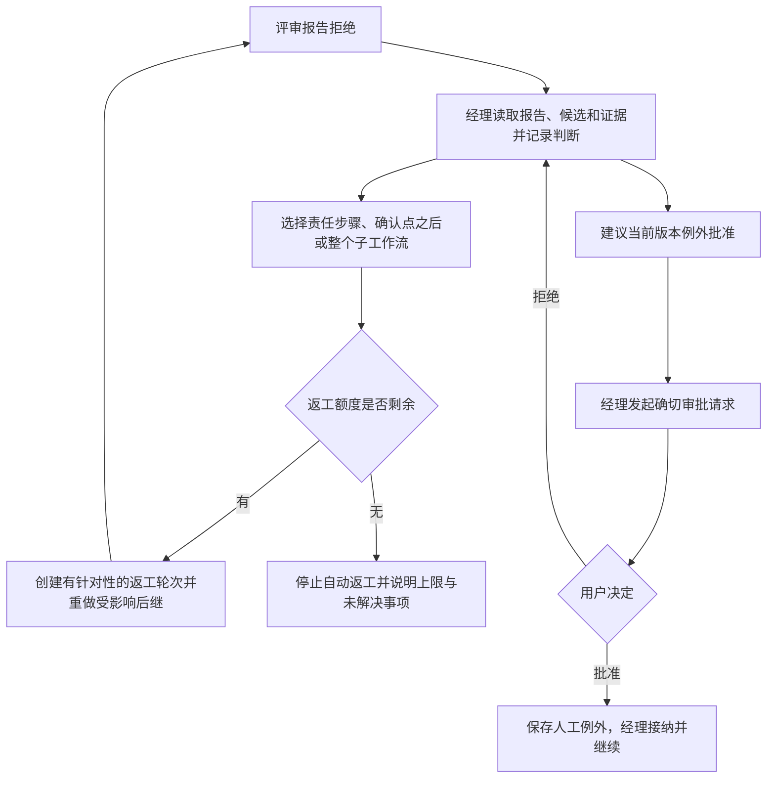

# 评审拒绝后的经理决策、有限返工与人工批准

状态：待实施。本轮仅做代码及 4318 现场的只读调研、编写方案；未派发、返工、批准或修改现场工作流。日期：2026-11-18。

## 1. 目标

评审不合格后，由项目经理读取确切评审报告及相关材料，自主判断应返工，还是建议对当前版本作人工例外批准。返工明确支持三种起点：产出被拒文档的责任步骤、某个有效确认点之后、对应的整个子工作流。经理在 Workflow 定义的范围与额度内选择；经理建议 Approve 时，必须形成真实审批请求，由用户签署。达到返工上限后停止自动返工，不自动转为批准。

同时修复用户指出的两个界面问题：项目经理页缺少可操作的人工审批卡片；阻塞点“查看详情”跳到了执行记录，应改为工作流程中的对应步骤。

此次沿用现有源配置、工作流命令、人工决定与执行历史，不建立另一套独立审批系统。经理负责判断，内核负责额度、授权、版本及证据一致性；页面负责呈现和提交用户决定。

## 2. 已核实的事实

### 2.1 4318 的现场

| 对象 | 本轮只读观察 |
|---|---|
| 根实例 | `f2cb0370-139f-c86d-53f5-60ba7f994341` |
| Task 子实例 | `39549120-494c-60fc-2a79-fb55bdb85472` |
| 当前评审执行 | `c2fdec27-413e-9305-3b97-f0a22dd4ae38`，`review` 第 5 轮，`awaiting_acceptance` |
| 评审报告 | `f889b8fc-0c6c-af89-aafd-98d21517e4b2`，`approve=false`；scope 检查通过，content、evidence 不通过 |
| 拒绝原因 | 自动测试、TDD 和版本关联成立；同候选的 M-001～M-004 浏览器观察与页面分发清单核验缺失 |
| 候选 | `89ac7b8f39ec3a53b1c05908d6f13c503f380d7f`；对应候选测试已通过 |
| 实施执行 | `implementation` 仍为第 3 轮已完成。评审第 5 轮不等于 Task 已重新实施 4 次 |
| 经理交互 | 当前没有 pending 的真实审批请求；已有的是要求补充验收证据的通知 |

本案例不能解释为自动测试失败，也不能把重新跑评审当作已经补齐证据。经理应判断哪些问题能由重新实施及补证解决；若建议接受未完成的浏览器验收要求，必须列明具体缺口和风险，向用户请求对该候选的例外批准。

### 2.2 代码与配置缺口

| 现有位置 | 当前行为 | 本次需要补齐 |
|---|---|---|
| `ExecutionBudget.retry_limit`、`workflow_retries.rs` | 限制同一业务轮次的技术 retry；业务 rework 增加 round，没有对应业务额度上限 | 新增独立的业务返工策略及持久化额度，不能把技术 retry_limit 改个名字复用 |
| `workflow.step.approve` | 已支持 Human 对确切执行作显式例外，保存 manual_approval 和 override_completion，保留原报告 | 复用现有人工签署事实，接通经理申请入口与用户处理链路 |
| `workflow.decision.request` | 允许 CONTROL_TOOLS 中的操作及 step.confirm；step.approve 不在请求白名单 | 允许申请 step.approve，但继续禁止 Agent 直接执行该人工操作 |
| `prepare_controller_decision` | 对 step.confirm/accept 验证目标并形成确认；没有 step.approve 分支 | 用户批准申请时形成 manual approval，随后由经理接纳结果 |
| 编排 Skill v4、候选评审任务指令 | 要求拒绝后返工/补证，并明确不申请人工放行 | 按用户的新要求改成“经理研判 → 有限返工或请求人工例外” |
| `WorkflowController.tsx` | agent 模式隐藏兜底步骤审批卡片；真实决定、通知又按实例筛选 | 根经理页汇总子实例的真实待审批请求；通知和待审批不能混为一谈 |
| 阻塞点链接 | `ReadingLink` 的 detail 固定为 records | 改为 overview，携带实际项目、Feature、Task、实例和执行定位信息 |

相关实现依据：[返工](../../../crates/core/src/workflow_retries.rs)、[人工决定](../../../crates/core/src/workflow_controls.rs)、[调用授权](../../../crates/core/src/workflow_authorization.rs)、[经理界面](../../../web/src/components/WorkflowController.tsx)、[编排方法](../../../configurations/skills/workflow-orchestration-v4.md)。

## 3. 拟定的 Workflow 配置

建议在 Workflow 顶层增加两个可选的类型化配置集合，区分评审处理规则与共享返工预算。下面是拟议字段，不是当前已支持的接口：

```json
{
  "rework_policies": {
    "task_implementation": {
      "entry_step": "implementation",
      "allowed_targets": [
        "producer_step",
        "after_confirmed_checkpoint",
        "child_workflow"
      ],
      "max_reworks": 3
    }
  },
  "review_policies": {
    "implementation_review": {
      "review_step": "review",
      "rejected_when": {
        "op": "equals",
        "source": {
          "step": "review",
          "port": "result",
          "pointer": "/approve"
        },
        "value": false
      },
      "rework_policy": "task_implementation",
      "allow_human_approval": true
    }
  }
}
```

- 建议出厂上限为 **3 次额外业务返工**，不包含首次执行，即最多首次加 3 轮；数值在 Workflow 编辑器中配置，0 表示不允许自动返工。
- 同一逻辑工作的三个返工方式，以及共享该策略的实现评审、候选评审，使用同一总额度。不能切换方式或评审节点后重新获得 3 次。
- `entry_step` 仅提供默认入口；`allowed_targets` 声明可选方式。经理还须提交具体的文档来源、责任执行、确认锚点或子调用身份，不能把一个固定入口当作所有拒绝的处理办法。
- 拒绝条件使用已有规则原语，返工入口使用实际步骤引用；内核不按 `review`、`implementation` 或业务标题硬编码。
- 发布时检查评审节点、报告端口、策略引用、预算及返工入口的依赖关系。已有步骤的重命名、删除和计划替换必须同时校验策略引用。
- 默认 Task 的两个实现相关评审先接入。其他评审按作者工作配置入口：PRD 对应需求，Design 对应设计，任务规划对应规划；不能把所有拒绝一律送回 Task 实施。
- Feature 整体评审如定位到某个 Task 的实现问题，经理选择实际子实例和该 Task 已冻结的实施策略；不得为了修复一个 Task 重建全部 Task。跨子实例选择须校验根范围、工作归属及实际调用关系。
- 未声明新策略的冻结流程保持既有行为。配置或预算变化只有通过显式计划变更后才生效。

顶层策略属于后续处置规则。采用或调整策略时应保留已产生的报告和原执行合同，不能为了挂接策略重跑评审、清空失败记录，也不能从当前项目默认配置重新解析历史执行资产。

## 4. 项目经理的处理流程



### 4.1 研判和返工

经理必须读取报告中失败项及其对应材料，说明问题、影响、推荐处理及原因。研判随实际控制命令留存，绑定 review execution、report output、候选和当前计划；不能只把报告摘要转发给用户代替决策。

选择返工时，向新任务传递失败报告、问题归因、返工范围和验收要求；原实施、报告、测试及决定保留。重新执行实际受影响的后继快照、测试、文档、候选与独立评审；代码未变化时不盲目重做实施，代码变化后不复用旧候选的成功测试冒充新代码通过。

证据缺失时应指定补证责任和实际执行内容。本现场的浏览器观察缺口不能通过重复生成相同 HTML 或重跑相同评审消除；可在返工任务中要求实际补齐，或者明确建议对具体缺口作人工例外。

相同输入、相同缺口没有变化时，经理不得循环派发评审或重复催请批准。资料确需澄清时保留提问入口，但不把所有评审拒绝都自动归类为“等待用户补证”。

#### 三种返工方式及选择原则

| 方式 | 适用条件 | 实际执行边界 |
|---|---|---|
| 产出文档 A 的责任步骤返工 | A 的上游输入有效，问题集中在 A 的内容、结构或作者应提供的证据 | 从来源身份找到 A 的生产步骤，由其冻结的责任 Agent 执行后继轮次；使依赖 A 的评审及实际后继失效并重做，不仅重跑评审 |
| 从某个确认点之后返工 | 当前多个结果受到同一错误影响，但存在仍然有效的已确认基线 | 绑定确切确认记录、产物与输入版本；保留确认点自身，从其后的实际依赖入口重做需要重做的部分，保留不受影响的并行分支 |
| 重新执行对应子工作流 | 子流程的外部输入有效，但其内部多个阶段、执行过程或结果链需要整体重建 | 创建原子调用的后继子实例，按指定代码基线和已确认输入从头执行；保留 Task、调用血缘、原实例和共享额度，不扩大为整个 Feature 重建 |

经理的准则是选择**覆盖根因的最小合法影响集合**，而不是机械地按三种方式依次升级。重跑一个 Task 子流程，有时比回到 Feature 的某个确认点之后更小。选择时分别回答：A 自身是否有问题、A 的输入是否有问题、哪些后继结果因此失效，以及哪个范围可以恢复一致的产物和证据链。

“阶段 Agent”在执行合同上落实为实际产出 A 的步骤与责任 Agent；不能仅按页面阶段标题找人。一次评审涉及多份文档时，经理要指出本次返工的具体 output ID 和生产执行，必要时形成多个相关修复目标。

“前一个被确认阶段”应解释为依赖路径上**最后一个仍然有效的确认锚点**，不是页面上紧邻的上一阶段。人工确认点必须保留真实 Human 决定，其他可复用检查点按 Workflow 的接纳规则声明，不能把“工具已结束”自动等同于用户确认。若锚点的输入已变或其结论也被否定，应回到更早的有效锚点，或先走变更及重新确认；不能保留已知错误依据。

子流程重执行须显式声明重新执行所用的代码基线。特别是包含 Red→Green 的流程，不能在已经实现成功的代码上反复从头执行，再通过破坏既有行为制造 Red。旧代码与证据先封存，恢复或建立执行基线通过受版本校验的平台动作完成。未知未封存修改仍须核对，重启子流程不能绕过 Git 保护。

#### 返工预演与决定记录

三种方式都应先给出只读预演：拒绝报告和 A 的版本、所选方式、确认/代码锚点、将保留与失效的步骤/产物/人工确认、需停止的执行者、预算变化，以及影响到的父调用和其他 Task。经理记录为什么该范围足以解决问题，以及为什么不需要扩大范围。

正式提交携带该预演及原始版本。内核重新校验来源、授权、确认是否仍有效、受影响执行者是否静止及额度；成功后统一创建后继身份和历史。若选择会改变已确认的需求、设计、范围或受保护决策，走既有真实人类决定；不能把返工方式扩大解释为修改这些依据的授权。

文档 A 变化后，旧确认只随原产物保留，不可用于新 A；未变化且确认仍有效的边界产物无需重新确认。子工作流重执行后，父调用的旧结果以及消费它的后继结果必须正确失效，其他子工作流不因名称相同被重跑。

### 4.2 申请并处理 Approve

复用 `workflow.decision.request`，新增对 `operation=workflow.step.approve` 的申请支持。**只开放申请，不把 step.approve 加入 Agent 可直接执行的控制工具。** 用户通过 `workflow.decision.resolve` 签署后，由内核生成已有的人工确认事实，经理再调用 step.accept。

申请及决定绑定：当前计划、实际步骤/执行、input_digest、完整 outputs、拒绝报告 ID、候选版本，以及需要例外接受的失败项和范围。内核从真实输入补充或核对候选引用，不能信任模型手写的 SHA。

申请卡片应说明经理为何建议 Approve、哪些检查未通过、已验证了什么、接受的风险、批准后的影响及拒绝后的处理。人工理由必填，可展示经理建议供用户明确确认或编辑。批准只作用于当前确切结果，不能泛化成以后评审一律通过。

原报告继续为 `approve=false`；界面显示“评审未通过，用户已例外批准”。后续候选评审的冻结上下文须带入该实际决定引用和覆盖范围，避免再次把已批准的相同缺口当作未处理。新问题、新候选、新执行或已变的材料不在旧批准范围内。

人工例外不伪造测试、Git、停止证明、来源或身份独立性事实。真实测试失败、未知副作用、来源不符等条件仍由独立的执行/发布约束校验。是否例外接受当前评审的业务结论，交给用户决定。

用户拒绝后，经理读取意见重新判断；有额度可组织实施，额度耗尽则停止自动重做。不能把拒绝按钮直接转换为“重跑当前评审”，也不能对同一份被拒请求反复申请。

## 5. 业务返工额度与持久化

1. **计数范围**：返工策略所绑定的逻辑工作预算身份，而非当前执行 ID、review round、返工方式或临时子流程 ID。身份首次冻结后随父子调用替换和计划后继继承。同一 Task 新建子实例、重启或换节点 ID，不能自动获得新额度。
2. **计数事件**：成功提交一次业务返工决定并创建新业务轮次，计 1 次；首次执行不计。该轮内的作者修复、相关测试和复审不是逐步骤重复扣费。仅重跑评审不冒充完成了一次业务修复，也不能成为经理规避处理拒绝的空转路径。
3. **避免绕过**：责任步骤返工、确认点后返工、整个子工作流重执行、上游重置和受影响计划变更均经过相同预算检查。一次动作实际重做多个逻辑工作时，预演并原子检查各自额度；每个受影响工作该轮计一次。首次执行前的准备调整及纯阶段分组调整不计业务返工。
4. **技术失败**：Git 预检、版本冲突或被拒的命令不扣额度。已接纳业务轮次的启动故障用原轮次的技术 retry/reconcile 恢复，不重复扣业务额度，也不通过新建业务轮次重置技术预算。
5. **并发与幂等**：额度检查、递增、决定记录和执行替换在同一资源级乐观事务中提交；同一命令重放不重复计数，两个前端/经理争抢最后一次额度只能成功一个。
6. **权威事实**：优先使用现有 governance 事实和原生命令回执保存版本化预算、不可变消费记录及关联执行。以精确预算资源读取/CAS 为热路径，不在每次 inspect 中扫描全项目历史，不新增展开配置副本。
7. **到达上限**：返回明确的 used/limit/remaining 和阻塞原因。经理可以提出人工例外申请或请用户明确调整预算；系统不自动提高上限，也不自动批准。显式提高上限须保留已用次数及调整依据。
8. **已有工作采用**：不能用 `round - 1` 估算。可由真实已开始的实施及返工决定重建基准；无法可靠还原时，在采用预览中明确历史覆盖范围和起算基准，由用户决定。不得默认为“历史使用 0 次”以掩盖已有执行。

## 6. 项目经理页和阻塞定位

### 6.1 可操作的人工处理区

- 根项目经理页集中汇总当前根及全部实际子实例的待处理事项，显示 Task/步骤来源；不能依赖用户先展开某个子流程，也不能只取子实例第一页。
- 区分“待经理研判”“待用户 Approve”“已拒绝/过期”“额度耗尽”。待经理研判可以显示阻塞材料和处理进度，不能伪装成已经发起审批。
- 经理创建真实请求后，在经理页直接显示报告、失败项、建议、额度及批准/拒绝按钮；用户无须进入执行记录寻找操作。
- 继续复用 ManagerInteraction 及现有决定接口。修正按当前实例过滤导致的子审批遗漏；根聚合后以 request ID 去重，避免父子卡片重复提交。
- agent 模式仍以经理实际发起的请求作为审批卡片依据。不能仅取消兜底卡片过滤，绕过“经理先判断”要求。
- 用户签署后刷新准确卡片、待办计数和经理状态，事件唤醒经理继续；不要求用户再发送“继续”。过期请求展示原因并禁止按旧参数提交。

### 6.2 阻塞点跳转

“查看详情”改为“查看流程阻塞点”，导航到 `tab=execution&detail=overview`，绑定真实 `project_id`、所属 `feature_id`/`task_id`、`instance_id`、`execution_id`。

目标页须展开父调用、子流程、阶段和对应步骤，按需加载步骤/子流程分页，滚动并聚焦目标；刷新、前进后退、跨当前项目导航仍正确。不能依赖当前 URL 恰好保留了 Feature，也不能把 Task ID 误当 Feature ID。原轮次已归档时明确提示并提供历史入口，不静默跳到新轮次。

执行记录和评审报告仍保留各自的独立阅读链接。本次改变的是阻塞点主要导航目标。

## 7. 实施分期与改动位置

| 阶段 | 工作与主要位置 | 退出条件 |
|---|---|---|
| P0 合同与现场夹具 | Domain 类型、Workflow/工具 Schema；将本次拒绝原因及嵌套实例关系脱敏为测试夹具 | 配置结构、预算计数、人工例外范围、状态及去重键有明确合同；不包含真实运行秘密 |
| P1 返工起点与预算内核 | `workflow_retries`、`workflow_change_preview/commit`、子流程重建、资源读写适配器 | 三种方式都有预演、确认/代码锚点、正确的父子失效和共享额度；CAS/重放/重启正确；仅评审重跑及纯分组不误扣 |
| P2 经理决策和人工签署 | `workflow_controls`、`workflow_readiness`、`controller_runtime`、冻结任务渲染 | 经理能请求 step.approve，用户签署后经理接纳；原报告及硬约束保留，后续评审能读到确切例外依据 |
| P3 界面和导航 | `WorkflowController`、`WorkflowProjectManager`、`ManagerInteraction`、`WorkflowInstanceView`、阅读路由、`WorkflowManager` | 根经理页能处理子审批；阻塞点准确定位；显示经理选择的返工方式、范围和理由，Workflow 中可编辑额度、允许的返工方式及人工例外开关 |
| P4 默认配置与采用 | 编排 Skill、Task/Feature、依赖 Capability/Agent/Standard 及 defaults；相关协议文档 | 移除与新行为冲突的“拒绝后不申请人工放行”指令；发布必要新修订；本地目录每身份仅保留最新版本，引用图闭合 |
| P5 联调与验收 | Rust、浏览器、公共 RPC，必要的专用真实模型/端口场景 | 下列验收矩阵通过，分别记录夹具和真实服务验证；现场采取显式采用，不覆盖原快照 |

Role 现有职责已涵盖分工、风险和验收归属，主要修改 Skill 的处理方法及 Workflow 的具体策略。策略授权来自 Workflow，能力与文件权限仍来自 Profile。

当前 4318 的旧 Session 冻结了旧 Skill。实施后若要在该现场验证，需先保存计划/报告/决定，明确采用新策略和额度基准，并通过后继经理会话切换到新 Skill/Capability；不能假定修改本地 Markdown 就改变正在运行的会话。全程保留用户现场数据和原拒绝；不为演示擅自签署任何现存审批。

## 8. 验收矩阵

| 场景 | 必须证明 |
|---|---|
| 本次浏览器证据缺失案例 | 能看见待经理处理、经理的实际判断；选择 Approve 后经理页出现真实申请；“查看流程阻塞点”定位到 Task 的当前 review |
| 经理选择重新实施 | 从定义的入口创建针对性新轮次，带入报告；新代码重新测试/独立评审；历史报告保留 |
| 文档作者返工 | 找到 A 的实际生产步骤；仅重做必要依赖后继，保留有效输入；新 A 不沿用旧 A 的确认 |
| 确认点后返工 | 从真实有效的确认记录之后恢复；锚点本身保留，无关并行分支不重跑；过期或已被否定的锚点拒绝采用 |
| 子流程重执行 | 建立后继子实例并采用指定的合法代码基线；父调用及受影响后继失效；Task 身份、原历史和已用额度保留，不重建其他 Task |
| 混合三种返工方式 | 使用共享总额度；从方式一切到方式三不能重新获得额度；一轮内多个修复步骤不重复扣费 |
| 上限 0/1/3 | 首次不计；上限边界准确；达到后不再自动重新实施，不自动批准 |
| 技术 retry、CAS 冲突和命令重放 | 技术重试不重复扣业务额度；未提交动作不扣；同一命令只扣一次 |
| 上游重置、新子实例及计划后继 | 同一逻辑工作的预算继续累计；不能通过间接重置实施绕过上限 |
| 评审第 5 轮、实施第 3 轮 | 页面不把评审轮次误显示为实施返工次数；相同拒绝不导致经理空转 |
| 用户批准 | 原 approve=false 不变；决定绑定当前结果，经理显式接纳后继续；后续评审可核对例外范围 |
| 用户拒绝及额度耗尽 | 经理读取拒绝意见，按余量决定；无余量则明确停止，不循环申请同一批准 |
| 旧计划/候选/执行的批准及并发签署 | 拒绝过期或越权请求；跨项目无效；并发不重复确认、不突破最后一次额度 |
| 非当前页的子任务审批 | 根页准确列出、计数、去重并可操作，不被 20 条分页或子组件折叠隐藏 |
| 阻塞定位 | 进入工作流程而非执行记录；父子展开、分页、滚动/焦点、刷新和前进后退均正确，无空白页 |
| 正常评审通过、原有人类门禁及硬约束 | 正常通过不新增人工批准；已有门禁不被跳过；测试失败、未知副作用、来源/版本错误仍阻塞 |

本计划不把已有按钮、模型通知或第 5 轮评审计数视为新能力已经完成。实施时按阶段补充执行记录和实际验证结论。
