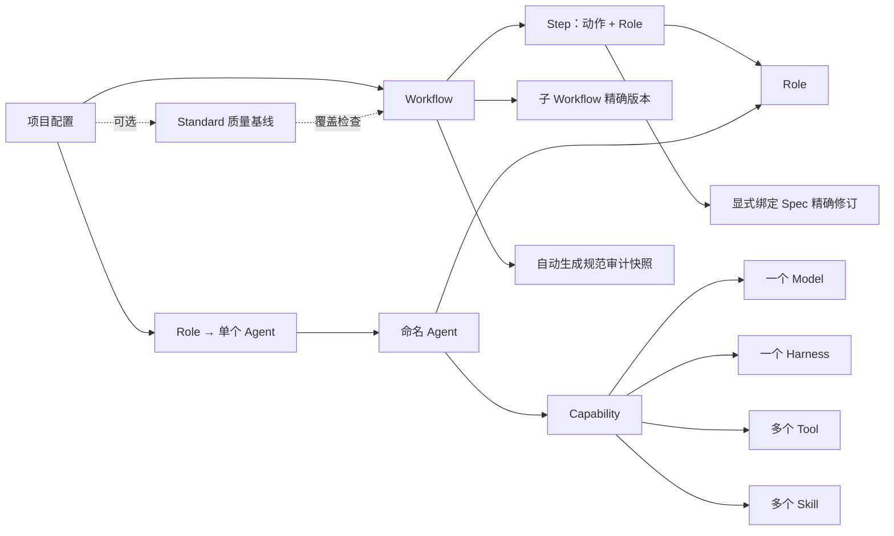

# Role、Capability、Workflow 与项目配置重构

日期：2026-11-09。状态：已按最新讨论更新为执行计划，待实施。本轮只更新计划与索引，产品实现从 P0 开始。

本计划承接当前版本化配置、项目分库、Workflow 编译和原生执行机制，替代“内建默认套件”作为新项目配置入口。历史实现与验收仍以原计划为准；本文不表示这些改动已经实现。

## 1. 实施基线

以下内容综合用户已明确的关系、最新导航调整及上一轮 Spec/Standard 建议，作为下一步实施依据。Spec/Standard 采用“Step 显式绑定、可选基线、自动审计快照”的具体方案，不再保留多种相互冲突的实现路径。

1. Role、Capability、Agent 各自管理，在同一左侧分组内通过独立页内 tab 切换。Role 定义职责；Capability 是一个 Model、一个 Harness、多个 Tool 和多个 Skill 的可命名组合；Agent 是一个 Role 与一个 Capability 的可命名组合。
2. 每个需要 Agent 的 Workflow Step 选择一个 Role。Workflow 不选择 Agent，不保存某个项目的 Agent 默认值。
3. 项目管理负责将 Workflow 所需的每个 Role 绑定到一个 Agent。本轮只支持单选 Agent，不引入候选池、多 Agent 投票或同一步骤的多 Agent 调度。
4. Role 的 Scope 为 Global，或一个/多个指定项目。Global 与指定项目互斥。
5. Step 显式绑定一个或多个 Spec 精确修订；Standard 是项目可选的质量基线，检查规范覆盖及落点，不向 Step 分配或注入另一份 Spec。规范审计快照自动生成，不能依赖用户再次维护同一集合。具体契约见第 5 节。
6. 子流程引用独立命名、可保存和编辑的 Workflow。阶段只用于组织展示，子流程具有执行语义。
7. Workflow 有独立列表和名称；进入编辑后只保留两列：左侧阶段、步骤、子流程，右侧所选节点的配置。移除现有编辑器最左侧栏。
8. 新项目必须显式选择或新建 Workflow，并完成 Role→Agent 及必要规范配置；不再自动采用内建默认套件。Standard 可选；未选时仍校验 Workflow、Spec 和内核强制规则。
9. 五个配置入口为项目管理、工作流程、角色与 Agent、规范、基础组件。组内用独立页内 tab 管理相关概念；Permission 位于设置中。具体划分见第 4 节。

## 2. 概念关系与责任边界

| 概念 | 管理的内容 | 引用关系与边界 |
|---|---|---|
| Role | 名称、Markdown 职责说明、可见范围 | 描述承担什么职责，不选择模型、工具或具体 Agent |
| Model | 模型提供方、标识、参数及已有能力声明 | 被 Capability 单选引用 |
| Harness | 运行协议、版本、构建配方及安装管理 | 被 Capability 单选引用；安装与凭据仍在实际执行前核验 |
| Tool | 工具身份、实现和输入输出契约 | 被 Capability 多选引用；保留当前适配器支持范围 |
| Skill | 可复用的方法、知识和操作说明 | 被 Capability 多选引用，不随 Role 编辑自动生成 |
| Capability | 名称、Model、Harness、Tools、Skills | 独立版本化；不包含 Role、Workflow 或 Standard |
| Agent | 名称、Role 引用、Capability 引用 | 一个 Agent 恰好组合一个 Role 和一个 Capability；由项目选择使用 |
| Workflow | 名称、阶段、步骤、子流程引用、依赖和动作配置 | Step 声明 Role 和 Spec 精确引用；项目负责绑定 Agent |
| Spec | 名称、Markdown 规范、适用动作和已支持的检查规则 | 由 Step 显式引用，构成该执行节点的规范要求 |
| Standard | 名称、可复用质量基线、动作选择器与必需 Spec | 项目可选；校验 Workflow 的规范覆盖，不修改 Step 绑定 |
| Project 配置 | Workflow、Role→Agent 绑定、可选 Standard | 将定义组合为可执行配置，冻结有效规范及基线校验依据 |
| Permission | 权限修订、继承和执行授权 | 保持现有权限语义；Tool 可用不等于获得授权，Capability 不包含 Sandbox 或凭据 |
| 规范审计快照 | 逐 Step 的 Spec、动作、Role、输出及检查方式 | 从配置自动生成，用于变更比较和追溯，不是人工维护的另一份 Standard |



执行时唯一的参与者解析链为：Step/执行节点的 Role → 本项目已保存的 Role 绑定 → Agent → Capability → Model、Harness、Tools、Skills。缺失时明确阻塞，不读取旧默认套件，不按名字猜测角色，也不临时挑选另一个 Agent。

系统执行的确定性动作可以没有 Role，例如分支、汇合和部分快照、资源清理动作；不得为了填满表单而给这些动作创建虚假的模型执行。动作结果继续由 core 接纳。

## 3. 身份、修订、Scope 与删除

### 3.1 身份和版本

- 沿用稳定定义身份、不可变修订、可编辑草稿和内容摘要。名称是展示属性，不作为引用键。
- Workflow Step 声明稳定的 Role 身份；Agent 修订固定确切 RoleRevision 与 CapabilityRevision。项目配置校验两者属于同一 Role 身份，并展示实际采用的职责版本。
- CapabilityRevision 固定 Model、Harness、Tool、Skill 的精确修订；AgentRevision 固定 RoleRevision 与 CapabilityRevision。
- 项目保存时固定 WorkflowRevision、各 Role 的 AgentRevision、可选 StandardRevision 及其校验依据。Feature 创建时继续冻结完整闭包，包含子流程、Role、Capability、底层资源、逐 Step 的有效 Spec 绑定、规范审计快照、基线判定及权限解析依据。
- 修改 Role、Capability 或 Agent 不自动改写其他定义或项目配置。界面提示可升级版本，由用户显式保存新的引用。已创建 Feature、Task、Run、Session 和恢复请求保持原锁。
- 不把 Agent 的身份按 Role+Capability 内容哈希合并。不同命名 Agent 可以具有相同组合，已有 AgentID、实例与经验来源必须保持可追溯。

### 3.2 Scope 与存储位置

- Role 的产品 Scope 表示可见范围：Global 或非空项目集合；项目集合去重并校验项目存在。Global 选择后清除具体项目选择。
- 多项目共享 Role 只有一个定义身份和一条版本历史，不能在每个项目复制一份后声称它们是同一个可编辑 Role。
- 实施时将定义可见范围与数据库归属、工程材料归属分开表达。多项目可见性由全局目录统一索引；项目的会话、执行事实和材料仍属于原项目数据库。
- 旧 Global/单项目 Scope 必须可读取，单项目 Role 对应单元素项目集合。通过追加目录/可见性记录及新修订完成升级，不原地改写旧不可变修订。
- Agent 的可用范围不得大于其 Role、Capability 及所有依赖的共同可见范围；选择器过滤和保存时的 Rust 校验必须一致。隐藏下拉选项不能代替后端校验。
- 已冻结历史可继续读取；Scope 收窄不能删除原执行材料。新绑定、新 Feature 创建须重新检查可见性，受影响项目显示配置需要调整。

### 3.3 执行职责与删除

- 用户 Role 身份、名称与内核已有 analyst/architect/developer/tester/reviewer 执行职责标签分开。当前标签用于动作兼容、测试写范围和独立评审校验，不能按角色名称推断。
- 本轮保留已有执行职责兼容约束；Role 页面可在高级设置中维护对应类型，不将任意 Markdown 职责说明当成可执行授权。
- Role、Capability、Agent 支持新建、编辑、删除。删除表达为停止新使用并保留历史，不物理删除已被引用的修订。
- 删除前列出当前项目配置、Workflow 或其他定义的引用；仍在使用时先完成显式换绑，不能自动生成替代 Agent 或偷偷替换配置。
- 普通参考条目可以停用，不能再有“删除某个角色会自动升级默认套件”的分支。

## 4. 页面与导航

五个配置入口如下。概念自身仍有独立表单、修订和引用；组内 tab 可深链接，刷新后恢复选中 tab、对象和草稿状态：

| 左侧入口 | 页内 tab / 内容 | 管理边界 |
|---|---|---|
| 项目管理 | 项目列表、项目配置 | Workflow、Role→Agent、可选 Standard、配置完整性与覆盖检查 |
| 工作流程 | Workflow 列表、所选流程编辑 | 阶段、步骤、子流程、Role、Spec 与动作配置；编辑区只有两列 |
| 角色与 Agent | Role / Capability / Agent | Role 管职责和 Scope；Capability 管技术组合；Agent 将两者命名组合 |
| 规范 | Spec / Standard | Spec 执行要求；可选基线的覆盖规则；自动审计快照和差异作为关联详情展示 |
| 基础组件 | Model / Harness / Tool / Skill | 被 Capability 引用的可复用组件；不在 Capability 表单中重复维护其正文 |

Permission 保留在设置的独立权限页内 tab，与系统数据、凭据、平台配置区分。工作总览、执行与交付、角色讨论、历史记录继续承载已有工作内容；这五个配置组不意味着把整个应用限制为五个左侧入口。

组内 tab 独立保存草稿与选中对象。选择器展示其他概念的摘要并可跳转编辑，跨页/跨 tab 新建依赖后返回保留原稿。Role 与 Capability 页面不因同组而产生自动派生、联动保存或重复编辑；Capability 的 Model/Harness/Tool/Skill 都是引用。

不再将概念清晰等同于每个实体拥有独立左侧入口。相关概念通过同一组内的独立 tab 管理，减少导航长度，同时保持编辑责任独立。

### 4.1 Workflow 两列编辑器

- Workflow 列表独立展示所有可见流程，支持名称检索、新建、编辑、复制和查看历史；进入一个流程后不再把流程列表作为第三列。
- 顶部保留流程名称、保存状态、版本、保存/校验操作和返回列表入口。
- 左列按阶段展示步骤与子流程节点；阶段支持新增、改名、排序和删除。删除非空阶段需要迁移或显式处理其节点及依赖，不能静默丢失步骤。
- 右列编辑所选阶段、步骤或子流程。步骤配置包含动作、单选 Role、多选 Spec、依赖、输入输出、条件、确认、重试等内容；不出现 Agent 选择器。Spec 选择器按适用动作和可见范围过滤，后端执行同样的校验。
- 子流程节点可以新增、命名、替换引用、移除和跳转编辑。子流程名称与所引用 Workflow 名称分别保留；一个子 Workflow 可以被多个父流程复用。
- 保存不完整内容保留为草稿；项目只能采用通过校验的可用修订。编辑已被使用的流程产生新修订，不改变原执行。
- 编辑 Workflow 时直接展示每个 Step 绑定的 Spec 名称、版本和检查方式。使用某项目预览时只读展示有效 Agent 和可选 Standard 的覆盖检查结果，项目绑定统一在项目管理中保存。

## 5. Spec、Standard 与规范审计的执行契约

### 5.1 唯一的执行规范来源

- 新 Workflow 契约中，Step 通过 `spec_refs` 显式引用 Spec 精确修订。Spec 是独立可复用定义，一个 Step 可引用多个 Spec，同一个 Spec 可用于多个 Step。
- 每个适用 Spec 在执行请求和对应评审输入中完整可追溯；校验结果记录它来自哪个 Step、哪个 Spec 修订及哪种检查方式。不能只把正文显示在界面而仍使用旧 Standard slot 决定实际检查。
- 动作契约声明该类节点是否必须有规范；正式工程执行和评审所需规范不能留空。纯分组、分支、汇合和其他无规范要求的系统节点允许空列表。
- 根据动作类型和必要的 phase/交付种类校验 Spec 适用性。选择器不展示不适用项，后端拒绝伪造、跨 Scope 或不存在的引用。
- 已发布子流程保留自己的 Step→Spec 绑定。父流程引用确切子流程修订，不能通过外层项目配置替换其内部 Spec；需要调整时保存新子流程修订并显式更新父引用。
- Markdown 要求、人工评审要求和已有自动检查器分开表达。新增规范文案不等于实现自动检查器；本轮复用已有检查能力。

### 5.2 Standard 作为可选质量基线

Standard 是独立维护的要求集，描述某类 Workflow 必须覆盖什么规范、落在哪类动作上。它不自动向 Step 增加、替换或移除 Spec。

- 项目可不选择 Standard；仍然必须通过 Workflow、Spec、Role、Capability 与内核强制门禁校验。界面不为继续流程而偷偷选择默认 Standard。
- 基线规则包含受控的动作选择器、必需 Spec 精确修订和最低匹配节点数；选择器可以区分动作、phase、交付种类等已有可解释上下文，不提供任意代码或表达式执行。
- 每条规则要求匹配节点数达到显式下限，并检查每个匹配 Step 覆盖指定 Spec。最低数量避免“根本没有评审步骤，却因为没有匹配项而通过”的空集漏洞。
- Spec 版本是否满足基线根据显式引用判断，不从版本号或自然语言推断新版本一定更严格。采用新 Spec 时同步修订需要更新的基线和引用。
- 选择项目基线后，配置校验返回符合/缺失/不匹配及具体 Step、规则、Spec 引用。缺失覆盖阻止该配置用于新执行；已经冻结的运行保持其原配置及判定。
- 更换 Standard 只改变符合性判定，不改变 Step 行为。不符合时由用户显式修订 Workflow/Spec 绑定或更换基线，不生成隐式覆盖。
- 同一个 Workflow 可以在不同项目接受不同基线检查，其 Step 执行规范始终来自同一 Workflow 修订。
- 基线检查递归展开子流程。必须验证规范的落点和适用动作，不能仅确认某个 Spec 出现在整个 Workflow 的某个位置。
- 配置符合性与真实执行证据分开。覆盖检查通过不能代替测试、Review 或工程验收通过。

例如，《生产交付基线》可要求至少存在一个适用的实现节点，所有此类节点绑定《单元测试规范 v2》，并要求至少一个独立评审节点绑定《交付评审规范 v1》。Step 的选择、检查器和实际结果分别保留；基线本身不替代这些执行步骤。

### 5.3 自动生成审计快照

- 校验/保存可用 Workflow 修订时自动生成规范清单；项目配置及 Feature 冻结时记录完整解析上下文。无需用户另建 Standard 来复述这份清单。
- 快照至少记录父子流程调用路径、Step 稳定标识、动作及上下文、Role、Spec 修订、输出契约和检查方式；项目快照另含配置修订、有效 Agent/Capability、可选 Standard 及其判定。
- 变更比较覆盖规范新增/移除/版本升级、落点迁移、适用动作变化、检查方式变化、节点删除及子流程变化。只比较 Spec ID 集合不足以发现覆盖减少。
- 展示配置要求的变化，不自动将自然语言变化判断为质量提高或降低；需要人工评估时明确标识。
- 审计快照属于由已冻结定义派生的只读结果；历史判定、执行事实和产物引用不能被重新计算后的快照覆盖。

### 5.4 兼容与内核约束

- TDD、独立 Review、冻结候选、人工确认和 CAS/lease 等内核不变量仍强制存在。取消基线选择或删除一项 Spec 不能豁免这些规则。
- 当前 v1 Standard 通过 planning/implementation/merge slot 选择 Spec 并参与评审。旧配置锁及已运行流程继续按原契约解释，不能把既有检查降格为说明文字。
- 升级未冻结项目默认配置时，根据原 WorkflowRevision 与实际采用的 StandardRevision 解析已有有效规范，生成显式绑定 Spec 的派生 Workflow 修订，保留来源关系和等价检查。不同旧 Standard 对应不同解析结果时不得覆盖同一份共享 Workflow。
- 子流程转换递归固定对应派生修订。转换不能证明等价时标记项目需补配置，保留原配置与历史读取；不得用空 Spec 列表宣布迁移成功。

## 6. 子流程及实际执行

当前实现只允许 Feature 的 task 子流程引用。实现本计划须补足真正的通用子流程调用，不能只新增树节点或删除前端限制。

- 普通子流程调用显式引用一个已保存的 WorkflowRevision，并声明输入、输出和调用节点身份；Task 集合迭代继续使用已有 tasks.foreach 语义，两者不得混为一谈。
- 新增受版本管理的子流程调用动作契约；对引用闭包进行循环、深度/规模、作用域、端口、条件和取消传播检查。
- 父流程完成取决于其调用的子流程实际终态及输出；子流程失败、人工等待、重试和恢复应在父视图中准确显示。
- Stage 只负责组织。改名、排序或删除 Stage 不得被解释为完成、取消或重跑工程步骤。
- 收集所有可达子流程及执行配方需要的 Role。项目不能只绑定顶层可见 Role，而在运行子流程后才发现缺少执行者。
- 现有正式执行内部含 test_author/red/implement/green/docs/verify 节点。其需要模型的节点也须关联明确 Role，使用项目绑定；界面可展开显示。不能仅替换顶层 Step，然后内部仍调用硬编码默认 Agent。
- 每个实际模型执行节点只解析一个 Agent；同一工作树的写互斥、独立测试作者、只读评审和既有恢复协议保持有效。
- 采用有版本区分的新配置与 Workflow 编译契约。旧配置锁继续按原契约恢复，不能用新编译器重新解释已运行计划。

## 7. 项目管理与接入流程

项目配置唯一负责以下关系：

```text
ProjectConfigurationRevision
  workflow_ref: WorkflowRevision
  standard_ref: Option<StandardRevision>（可选质量基线）
  role_agent_bindings: RoleIdentity -> AgentRevision（每个 Role 一个）
  specification_snapshot: 展开后的逐 Step 规范引用及上下文
  baseline_check: 可选 Standard 的覆盖判定及依据（未选择时明确为空）
```

- 选择 Workflow 后递归列出主流程、子流程及执行配方所需 Role；只呈现实际所需角色，不固定要求 UI 总是显示五行旧 slot。
- Agent 候选必须属于该 Role 身份，并满足 Scope、Capability、Model/Harness 协议、工具和动作要求；相同执行职责标签不代表相同 Role。
- 配置保存采用 expected_revision 和幂等键，完成逐 Step Spec 校验及可选基线覆盖检查后追加新修订。展示每个 Role 的有效职责版本、Agent 和 Capability 摘要，以及规范清单和基线判定。
- 新项目接入包括：登记仓库/项目 → 选择或新建 Workflow → 查看逐 Step Spec 并按需选择 Standard → 为所有所需 Role 选择或新建 Agent → 校验并确认项目配置。缺失 Spec 回到 Workflow 编辑；不在项目页生成第二份 Step 规范覆盖。
- 允许先登记项目基础信息形成“待配置”记录，以支持创建只对该项目可见的 Role。配置未完成时禁止 Feature/正式工作流调度，重启后可继续配置，不后台补入任何套件。
- 配置完成、仓库就绪和运行环境/凭据就绪是不同事实。项目管理分别展示，不把保存配置视为已成功 clone 或已核验 Harness。
- 重新打开已配置项目使用其保存配置，不重复强制向导，也不自动更新引用。更换默认配置只影响之后创建的 Feature。
- Workflow 页面可以链接“在项目中使用”，最终配置仍在项目管理中保存；不在两个页面分别提供可写的项目默认绑定。

## 8. 取消默认套件与历史升级

1. 删除 DefaultSuite 产品页面及“新项目自动使用套件”的说明，停止用 defaults_bundle 驱动新项目、Role CRUD、Agent 创建、运行环境准备或 Feature 冻结。
2. Role 新建/编辑只保存 Role。停止自动派生 Skill、Sol High/Codex Agent、AgentID，停止对项目配置的联动覆盖。
3. Model、Harness、Tool、Skill、Role、Capability、Agent、Spec、Standard、Workflow 可以有普通参考条目；参考条目与用户创建对象遵循相同可选、版本和删除规则，没有聚合套件升级行为。
4. 将旧 Agent 的 Model/Harness/Tools/Skills 精确组合提取为 Capability 修订。仅在有效组合完全一致时复用 Capability；保留顺序语义，不自动合并 Agent 身份。
5. 将旧角色键和 Workflow slot 转换为明确 Role 身份；旧项目的有效 Agent 绑定转成 role_agent_bindings。缺失或不可证明的关系标记需补配置，不能猜测。
6. 把旧项目已经采用的套件快照转换为显式项目配置，保留来源引用和审计事件；按第 5.4 节为旧 Workflow+Standard 组合生成等价的 Spec 绑定。旧 Standard 是否转成可选基线取决于是否能形成可证明的覆盖规则，不将已有执行检查丢失。
7. 旧 Role/Agent 的额外指令、权限、approval、实例和经验必须保持实际语义。相同指令可明确归并，不能把不同 Agent 指令误当成重复文本删掉；保留必要的旧格式兼容读取。
8. 已冻结 Feature、Task、Run、Session、旧 Harness 安装和历史 defaults_bundle 记录保留。历史记录可以展示来源，正常产品流程不再依赖它们。
9. 追加必要 SQL 迁移和可恢复的转换记录；升级幂等，中断可重试。不得修改已发布 SQL、删库重建或用用户数据初始化来替代迁移。
10. 新 Capability、Agent、可见范围、Standard、Workflow 和项目配置同步 Schema、协议、查询 DTO、构建/运行包及回归。保留前一轮 Schema 修正及其测试，不夹带回退。

## 9. 实施顺序与阶段完成条件

| 阶段 | 实施内容 | 完成条件 |
|---|---|---|
| P0 契约和兼容样本 | 将本文落实为数据/API/编译契约，固定 Role 可见性/存储边界、Step Spec、可选基线、审计快照与 v1→新契约映射；补齐旧配置夹具 | 交付 CONTRACT.md、DTO/Schema 变更清单和迁移映射；没有悬空的规范分配来源 |
| P1 Role、Capability、Agent | 独立领域类型、CRUD/query、依赖与 Scope 校验、修订和删除；新增迁移读取支持 | 创建 Role 无派生副作用；Agent 只显式组合 Role 与 Capability；原生有效执行配置可解析 |
| P2 Spec、可选基线与审计 | Step Spec 显式引用及检查器解析、Standard 覆盖规则、审计快照/差异、旧 slot 兼容 | 缺失规范、错误落点、零匹配节点和版本不符可诊断；无基线项目仍可使用合法配置 |
| P3 Workflow 编译 | 单 Role 节点、Spec 输入冻结、配方角色引用、独立子流程调用、循环/端口/作用域校验和运行恢复 | 子流程真实推进；实际执行和评审使用所绑 Spec；失败、取消与恢复可追踪 |
| P4 项目配置与接入 | 项目 CRUD/查询扩展、Role→Agent 单选、Standard 可选、覆盖检查、显式接入、冻结闭包 | 新项目缺配置无法调度；无基线的合法配置可用；选定基线不符合时阻塞；旧项目保持有效选择 |
| P5 页面分组 | 五个配置入口及组内独立 tab、Workflow 列表和两列编辑器、跨页草稿恢复和引用选择 | 分组与 tab 职责符合第 4 节；无重复 Agent/项目绑定表单，编辑不丢稿 |
| P6 升级与切换 | 完成旧 Agent/套件/项目配置转换及 Workflow+Standard 的等价规范派生，移除默认常量和聚合接口依赖 | 旧库升级/重启幂等，不同旧 Standard 不互相覆盖，冻结执行可恢复，新库无需 defaults_bundle 可用 |
| P7 验收与文档 | Rust、HTTP、浏览器、原生执行及发布包回归；同步文档和执行报告 | 第 10 节全部具备对应证据；报告区分离线与真实资源测试 |

阶段按 P0→P7 顺序推进；P0 落实已经确定的实施基线，产出精确字段、接口及兼容契约。每阶段完成当前层行为与回归后进入下一层，阶段证据统一记入本目录 EXECUTION.md。实施开始先核对工作区，保留本会话已完成的 Schema 修正及其回归；本文尚未产生任何产品实现或新验收结论。

主要修改边界：

- domain：`governance.rs`、`agents.rs`、`defaults.rs` 及配置类型；必要时拆成单独模块。
- core：`governance.rs`、`builtin_defaults.rs`、`workflow_runtime.rs`、`live_runs.rs`、`conversations.rs` 及 Standard/项目配置解析。
- host/adapters：治理路由、全局目录、项目接入、Scope 查询、配置同步、持久化迁移和原生绑定解析。
- Web：拆分 `AgentCatalog.tsx` 的概念表单，重构 `RoleManager.tsx`、`WorkflowManager.tsx`、导航及样式；按第 4 节组织五个入口和各自 tab。当前 `DefaultSuite.tsx` 的产品职责移除。
- schemas/docs：增加 Capability 等契约，更新 Agent、Workflow、Standard、项目配置、导航和运行说明。

## 10. 必须通过的验收

### 概念和页面

- 五个配置入口及组内 tab 可独立进入，刷新和深链接保持当前组、tab 和对象；没有重复维护同一概念的表单。Permission 在设置中独立管理。
- Role Markdown 编辑/预览、Global/多项目 Scope、新建编辑删除有效；保存 Role 不创建或修改 Skill、Capability、Agent、项目配置。
- Capability 的 Model/Harness 单选、Tool/Skill 多选真正保存修订；不兼容组合由后端拒绝。
- Agent 命名、Role/Capability 引用及版本正确，编辑资源不让旧 Agent 或已保存项目暗中变化。
- Workflow 列表可列出并编辑多个命名流程；编辑区只有两列。阶段、步骤和子流程增删改及排序准确处理依赖和未保存草稿。
- Step 用 Role 声明执行者，用 Spec 声明规范；项目管理每个 Role 只选一个 Agent。Agent 属于同一执行职责但不同 Role 时不能误绑定。
- 规范组包含 Spec 和 Standard 两个页内 tab。Step 多选 Spec 并显示精确版本；Standard 只维护基线规则。项目允许不选择基线，选择后展示具体覆盖检查结果。

### 调度、升级和历史

- 展开子流程及内部配方后，所有必需 Role 均在项目配置中显示并得到绑定；系统动作无虚构 Agent Run。
- 子流程有真实输入输出、等待、失败、重试、取消、恢复和引用环拒绝；父子进度与事实一致。
- 实际执行与评审收到绑定的全部 Spec，覆盖不同交付上下文和多 Spec；错误适用动作或越权引用由后端拒绝。不削弱 TDD、独立 Review 和合入确认。
- 未选择 Standard 的合法项目可保存和启动；选择基线后，缺少 Step/Spec、版本不符和错误落点可阻止新配置使用。更换基线不会改写 Step。
- Spec 集合相同但规范落点、动作、Role、输出或检查方式变化时，审计快照必须报告差异；基线覆盖通过不被展示为执行验收通过。
- 新项目不自动套用默认值；待配置状态重启后可继续，配置完成前不能触发正式工程执行。
- 旧项目升级后规范检查等价；同一旧 Workflow 配合不同 Standard 的两个项目得到各自正确的派生绑定。重复启动不生成重复 Capability/Agent/Workflow/项目配置；升级中断可恢复，旧数据库及产物不丢失。
- 旧配置锁和已运行流程继续读取与恢复；修改/删除定义不改写冻结执行和经验归属。
- 在真实原生适配器上至少验证需求讨论、Task TDD、独立 Review、子流程和项目隔离；按既有平台与专用仓库前提记录结果，不将夹具测试写成真实模型验收。

### 检查入口

实施期间按改动新增领域、编译、迁移和 HTTP 契约回归；前端新增独立 Playwright 场景，覆盖导航分组与页内 tab、编辑草稿、项目向导和跨页引用。最终运行：

```bash
cargo fmt --all -- --check
cargo test --workspace --locked
npm --prefix web run build
./scripts/check/check-permissions.sh
./scripts/check/check.sh
```

Schema 回归须覆盖新增 Capability、Agent 依赖闭包、Role 多项目可见范围、Step 的 Spec 显式绑定、可选基线覆盖、审计快照以及新旧 Workflow 契约。真实验收、运行包和平台检查按实际可用环境执行并明确记录边界。

执行报告保存在本目录 Markdown 文件中；日志、JSON、截图、临时数据库及验收产物写入临时目录。

## 11. 下一步实施入口与交付物

- 从 P0 开始，先补全 CONTRACT.md，给出 Role 可见范围、Capability/Agent 引用、Step Spec、Standard 规则、子流程调用、项目配置及迁移的具体 DTO/API/Schema。契约遵循本文的一套关系。
- P1–P6 随阶段补充有意义的回归：每个可保存实体、绑定解析、覆盖失败、子流程实际执行和迁移均需要后端证据，再通过 HTTP/浏览器验证完整用户流程。
- P5 将五组配置入口及页内 tab 落地，并验证所有可编辑页面的保存、重载、删除、引用过滤、跳转返回和草稿恢复。
- P7 汇总实际检查命令、通过/失败、外部资源前提、未完成项和版本迁移结果。历史报告不能代替本次实现的验收；仅通过编译或展示页面不代表完成计划。
- 最终交付包括产品代码、追加迁移、Schema/协议与操作说明、自动化回归、CONTRACT.md 和 EXECUTION.md。计划目录只保留 Markdown。
