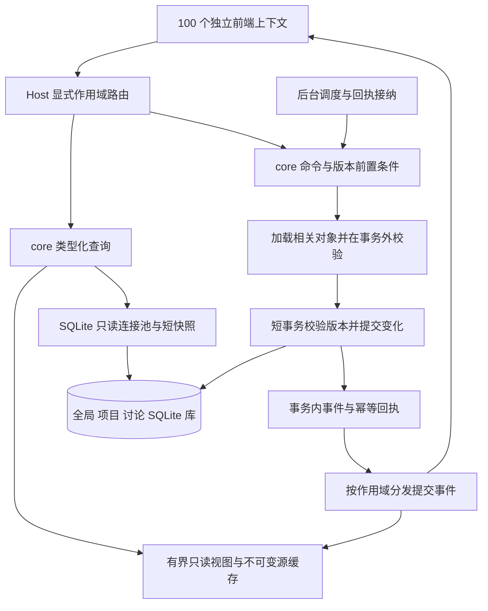

# 单 Host SQLite 底层并发重构方案

状态：实施中，P0–P4 已有部分实现与验证，P5 已开始、P6 尚未实施；逐项结果见 [实施记录](EXECUTION.md)。设计基线日期：2026-11-16。数据库确定继续使用 SQLite。本计划规定设计约束、技术方案、阶段顺序和 [100 前端验收合同](ACCEPTANCE.md)，阶段代码交付不表示已经通过完整容量验收。

本方案把前端项目上下文、全部修改入口的冲突保护、执行页延迟和后台调度一起重构。核心要求是一个 Host 在工作流持续推进时服务至少 100 个活跃前端；通过明确作用域、按需读取、短事务和资源级乐观校验取得性能，显示和派生视图允许最终一致。

## 一 核心约束与实施范围

| 约束 | 必须达到的行为 |
|---|---|
| 单 Host | 一份数据集由一个 Host 管理；保留 `.devdesk.lock` 所有权锁，不能靠增加 Host 通过容量验收。 |
| SQLite | 保留全局库、每项目工程库和全局讨论库；本轮不引入其他数据库服务。 |
| 独立项目上下文 | 每个标签页独立选择、切换和读写项目；请求、事件与产物都显式指定作用域，不读取共享 active project。 |
| 并发读取 | 合法读请求始终可并发进入，使用独立快照或已提交只读视图；不等待全局/项目业务锁。 |
| 乐观写入 | 写请求并发处理，以资源版本、唯一约束和短事务保护提交；应用层不设项目/全局串行写锁或单写队列。 |
| 完整覆盖 | 设置、配置、凭据、安装、运行控制、回调、Host 生命周期及后台写入均有明确前置条件；不能因绕过普通 Command 分派而漏检。 |
| 最终一致 | 目录摘要、缓存、跨库投影和其他前端的显示可以稍后收敛；权威提交、幂等、授权和执行事实仍满足原子性与领域约束。 |
| 持续运行 | 工作流、会话和真实 worker 的推进不依赖显示中的项目；浏览器增加不能造成调度饥饿。 |

“项目独立”指前端选择与请求上下文独立。同一项目仍只有一份权威数据，多个前端选择同一项目时会看到彼此已提交的修改。

有界连接池、内存缓存发布和 Engine 注册可以有短暂的内部同步，但不能把业务校验、状态恢复、SQL 读取、编译、序列化或外部 I/O 包在全局/项目互斥锁里。100 客户端场景内不得通过拒绝普通读请求来避免竞争。

本轮不改变不可变源修订、冻结计划、权限交集、真实执行回执、未知副作用核对、独立项目数据和禁止自动合入 GitHub PR 等领域规则。当前数据集标记与 SQL 基线仍以 [存储说明](../../storage.md) 为准；设计中的新结构不提前宣称已进入现有基线。

## 二 当前瓶颈与调研基线

2026-11-16 在当前开发环境的 debug Host 进行了 RPC 取样，并对 SQLite 在线备份运行关闭调度器的隔离查询。以下是定位数据，不是 release 容量成绩。

| 场景 | 观测 |
|---|---|
| 运行中 Host 的 `query.ui_bootstrap`，单次 | 约 2.4 ms，返回约 13.6 KB。 |
| 运行中 Host 的 `query.workspace`，含 Feature 详情，单次 | 约 35.4 s，返回约 3.75 MB。 |
| 运行中 Host 的 `query.workflow_instance`，单次 | 约 2.0 s，返回约 0.99 MB。 |
| 隔离副本，同类 Feature 主查询，单请求 | 约 6.6 s，返回约 3.75 MB。 |
| 隔离副本，两个同类主查询同时发出 | 分别约 6.6 s、12.9 s；后一个请求的 `catalog.gate_wait` 约 6.39 s。 |
| 隔离副本，不带 Feature 详情的主查询，3 次 | 中位约 6.3 s；每次 5 次完整项目快照，快照累计约 6.0 s，约 9835 次源引用恢复。 |

原始 JSON、线程采样和复制数据位于本次临时证据目录，目录名前缀为 `devdesk-design-investigation-rjeu3fe7`；临时文件不作为长期文档链接，也不保证后续仍存在。P0 必须重新生成完整、可归档的基线身份和原始样本。运行中与隔离场景条件不同，不能把两者相除当成工作流开销比例。

已确认的结构问题：

1. [Workspace 分派](../../../crates/host/src/workspace.rs) 把 `query.workspace` 纳入 `template_catalog_query`，在整个 RPC 期间持有 `template_gate`，不同前端甚至不同项目的重查询都会排队。
2. [工程 Store](../../../crates/adapters/src/lib.rs) 以 `Mutex<Connection>` 执行 `snapshot()`，加载、解码、配置视图刷新与历史恢复在连接占用期间进行；读请求之间以及后台与前端之间互相竞争。
3. `query.workspace` 在 core、Host 补充项目摘要、配置健康检查和模板来源包装等位置重复取得完整状态；分页在完整恢复后执行，无法限制读取和恢复成本。
4. [存储端口](../../../crates/core/src/ports.rs) 的 `transact(FnMut(&mut EngineeringState))` 依赖写锁保护“加载全部状态 → 修改 → 比较 → 保存”；直接删除写锁会引入丢失更新和基于旧状态通过的业务校验。
5. [执行页](../../../web/src/App.tsx) 收到事件后重新加载工作台，管理/流程组件继续加载实例、目录和轮询状态；新的对象引用也可能触发重复读取。每个标签页都有自己的请求链。
6. [后台调度](../../../crates/host/src/workspace.rs) 的多个阶段重复读取工程状态，与查询共用存储；75 ms 定时目标不能解释成实际每轮只消耗 75 ms。
7. 共享 active project 和仅部分入口遵守版本检查，使得简单放宽路由或删除互斥锁无法满足正确性。

两个并发重查询的排队已在无调度器场景复现。后台运行、浏览器渲染和网络各占多少开销，需要 P0 分别测量，不能用该样本宣称已完成 100 前端验收。

## 三 目标结构与模块职责

| 模块 | 重构职责 |
|---|---|
| domain | 保留纯规则；明确对象版本、控制代次、读写前置条件和需要共同校验的业务约束。 |
| core | 定义类型化查询与提交端口；准备变化、验证业务读集合；统一人类、Agent、后台及回调的提交规则。 |
| adapters | SQLite 连接池、只读快照、索引、资源级 CAS、事务回执、事件读取、不可变源缓存及实际外部 I/O。 |
| host | 构造可信作用域与 Actor，按 ID 取得 Engine；执行请求预算、事件分发与生命周期，不直接决定业务终态。 |
| web | 标签页项目上下文、按查询键复用请求、分页与懒加载、资源级失效、草稿基线及冲突处理。 |

## 四 独立前端项目上下文

### 请求路由

Host 把作用域解析为明确的内部类型：全局配置、全局讨论或指定项目。客户端继续使用易于表达的 `project_id` / `scope` 字段，具体 RPC 字段由 P0 合同盘点后冻结；普通项目请求必须给出项目 ID，缺失时返回 `project_required`，不能退回某个全局活动项目。

项目 Engine 注册表按稳定 ID 复用实例。未加载项目使用按 ID 合并的初始化操作，初始化只影响该项目；创建连接、恢复状态和外部操作不持有整个注册表的锁。请求取得 `Arc<Engine>` 后固定使用该实例。不存在、已停用、数据库损坏和作用域不符分别返回明确错误，不能偷偷打开另一个项目。

`project.open` / `project.open_github` 的产品语义改为登记、检查或准备指定项目，返回 ID 和准备状态，不修改所有客户端的选择。创建完成后的导航由发起请求的前端完成。后端共享 `active`、持久化 `active_project` 及依赖它的正常分派在前后端同步切换时移除；现有字段的停用和错误语义必须更新 Schema 与回归，不能保留隐式 active 回退。

### 前端与关联入口

URL 为标签页上下文的权威表达；可用 `sessionStorage` 保存本标签页最近选择，不以跨标签页同步的 `localStorage` 值强制切换其他页面。项目变化时取消旧查询订阅，失效旧异步响应；缓存键至少包含 Host 实例、作用域、项目、资源及查询参数。

RPC、SSE、Artifact、历史、原始 JSON 新标签页、讨论、工作台链接和平台工具都携带明确作用域。下载不能因为另一标签页切项目而改变所属库。全局讨论与全局配置保持各自的命名空间；共享认证 Cookie 不是项目上下文。

跨项目只读比较显式声明源、目标和可见性。共享配置仍可由多个项目采用，不能把项目选择独立误实现为复制整个数据集或隔离共享配置。

## 五 SQLite 并发读与短事务提交

### 连接与读取

保留 WAL、外键检查和持久化保证；不以关闭同步、跳过摘要验证或把权威事实只留在内存中取得成绩。SQLite WAL 允许独立快照并发读取，但每库只有一个物理写事务，见 [SQLite WAL 官方说明](https://www.sqlite.org/wal.html)。

读和提交都从有界连接池借用独立连接，不共用一个包围业务处理的 `Mutex<Connection>`。P1 的初始调优值为每个热库 4 个读连接、2 个提交连接，Host 合计上限 64 个；这些是压测起点，不是对每个项目永久预分配的配额。冷库连接按需建立并有界淘汰，100 个前端不要求建立 100 个数据库连接。

只读连接设置 `query_only`，在短读事务内取得同一响应所需的行与版本，随后释放连接；解码、视图组装和响应序列化尽量在连接外完成。普通查询不得调用写事务、`sync_shared_configuration`、`publish_project` 或外部发现。跨库读取以各库版本向量表达采样时刻，允许最终一致，不宣称多个库共享一个原子快照。

连接级的外键、busy、同步等参数在每个连接建立时统一验证；只读连接不被当作提交连接复用。池连接不能携带上次请求的未结束事务、临时授权或项目上下文。

业务读取不取得模板门或项目写锁。连接池满时只允许有界资源等待，等待时间纳入请求指标；在标准 100 前端负载下出现普通读拒绝或持续超时视为容量失败。

### 准备变化与原子提交

新端口按用例加载相关对象，返回值及其版本读集合。core 在事务外校验和准备有限变化，提交端口只接收明确的写集合、版本前置条件、幂等身份及待提交事件，不再接受任意修改整个工程状态的闭包。

端口至少区分固定查询上下文、带存在性/版本的 `ReadSet`、有限的 `PreparedChangeSet` 和含结果/新版本/事件定位的 `CommitReceipt`；名称可随实现风格调整，语义不可合并为另一个全状态闭包。现有依赖 `EngineeringState` 全局扫描的规则须改为明确的用例输入，不能构造缺少历史或依赖的“部分 EngineeringState”让旧校验误以为对象不存在。

提交过程为：

1. 以作用域与 `command_id` 查找已提交回执；相同身份和指纹重放结果，不因对象版本已变化而失败。
2. 用独立连接开始短 `BEGIN IMMEDIATE` 事务，获得 SQLite 自身的物理写事务资格；不在此前持有应用层项目/全局写锁。
3. 再次检查幂等记录、相关资源版本、创建对象的不存在条件，以及唯一约束/外键/业务读集合。版本变化使整个事务失败，不能只检查准备阶段读过的旧值。
4. 执行带版本条件的有限更新，核对受影响行数；同一事务提交业务变化、资源版本、幂等回执和持久化变化事件。
5. 提交后释放连接，再发布缓存失效与事件通知。通知丢失由持久化游标补读修复。

`BEGIN IMMEDIATE` 只覆盖小量读取、CAS 与 SQL 变更；编译、完整状态恢复、源闭包展开、Artifact 封存、容器/模型/Git/网络操作全部在其外。SQLite 内部串行化短写事务是引擎约束，不能把它扩大为应用层串行化整条请求。

`SQLITE_BUSY` 使用短等待和带抖动的有界技术重试，初始总竞争预算 100 ms、最多 3 次，由压测再固定参数。回滚后可以重试相同前置条件，不能自动把用户版本换成新版本。`SQLITE_BUSY_SNAPSHOT` 必须结束旧快照；重新取得权威状态后仍须验证原业务前置条件，不能在旧事务内盲目重试。预算耗尽返回独立的 `storage_busy`，不能伪装成版本冲突或无限等待；标准负载下暴露该错误将使验收失败。

同一个连接只归本次借用者使用。连接池及 Engine 注册表内部短同步与数据集所有权锁可以保留，业务读写串行锁和单写任务队列必须退出热路径。

### 业务约束与写偏差

仅对最终更新行做 CAS 不足以保护所有业务约束。动作若依赖其他对象、当前 head、授权、计划、活动轮次或剩余额度，其相关版本或谓词也要进入提交校验。唯一活动 Turn、源 head、执行占位等用唯一索引或有限的约束版本保护；避免两个事务各自看到“可用”后同时违反总量或互斥规则。

全局并发额度使用持久化的执行配额/租约和版本校验管理。跨全局库与项目库的配额预留、派发意图及确认继续采用可恢复协议：先预留，再记录/核对采用，失败释放，未知效果保留待核对。不能用最终一致的运行计数超发，也不能通过一个项目大锁保护所有工程。

## 六 全部修改入口的版本与幂等合同

### 入口清单与强制覆盖

P0 建立唯一的入口清单，按实际副作用登记作用域、资源、操作类型、版本来源、幂等键、权限、外部效果和测试。不能仅用 `query.` 前缀或 HTTP 方法推断只读。新增修改入口若没有并发合同及缺失/过期版本测试，检查必须失败。

| 修改入口 | 前置条件与保护 |
|---|---|
| 可变业务对象、设置、草稿、绑定和来源选择 | 资源当前 revision；批次提交相关资源的版本集合。全局设置不使用全项目版本作为代替。 |
| 不可变源发布、修订、停用和模板重置 | 确切基修订、该身份当前 head、目录代次及相关引用版本；向旧源再发布不能绕过已移动的 head。 |
| 创建项目、Feature、会话或资源 | 目标身份不存在，使用版本 0/显式 absent 条件与数据库唯一约束；依赖已有对象时另校验其版本。 |
| 追加消息、材料、事件或执行输出 | 所属流/目标的版本或期望序号、稳定客户端消息/操作身份与唯一约束；禁止仅依靠随机追加 ID。 |
| 派发、接纳、批准、停止、重试和计划变更 | 确切执行/步骤、活动计划、control version/epoch、输入输出身份和授权版本；不靠宽松接受任意较旧根 revision。 |
| 凭据保存/删除、OAuth、登录、安装准备与取消 | 每个资源或意图的 revision/代次；先 CAS 保存意图，外部步骤完成后按原意图接纳回执。 |
| OAuth GET 回调及外部回执 | 服务端保存的一次性 state 绑定作用域、发起身份、意图版本与过期时间；原子消费，重复/迟到回调不能覆写后继资源。 |
| `/setup`、`/shutdown` 和会话建立 | Host 实例身份及生命周期/会话挑战版本；setup 验证未初始化，shutdown 验证当前实例，不能让旧页面影响重启后的实例。 |
| 后台调度、worker 回执与恢复写入 | 服务端生成的对象版本、执行身份、租约与控制代次；使用同一提交端口，不能绕过版本检查直接落库。 |

认证握手的版本可以由服务端短期挑战维护，不要求未登录客户端先读取受保护业务对象；它不能成为持久化业务修改的无版本旁路。回调携带服务端签发的意图身份，不要求第三方伪造普通人类 Command。

### 版本粒度与存储

已有明确 revision 的权威记录继续使用自身版本；缺少版本的设置、凭据引用、来源选择等增加资源版本。可使用独立的 `resource_versions` 元数据表，以 `(kind, resource_id)` 唯一标识，不为整个项目引入一个不断变化的大版本。

不可变源的内容版本与可变 head/目录选择版本分开。步骤运行和控制许可分别有版本，更新日志不能让无关配置编辑冲突；批准必须绑定确切产物和授权请求，不能因为放宽根实例版本检查而接纳过时决定。

单资源请求可继续用 `expected_revision`；多资源请求需要显式前置条件集合，由入口合同正规化为 core 类型。字段形状在 P0 冻结并同步 Schema、Rust 和 TypeScript，本文不把示意结构作为当前 API。浏览器使用编辑/动作基线版本，不能保存前自动读取新版本来掩盖旧表单冲突。

幂等键至少包含数据集、作用域和 command ID；参数指纹与可信 Actor 保持绑定。同一 ID 同参数的并发请求只能生成一份权威业务结果；跨作用域不复用结果，同 ID 不同参数拒绝。长操作返回已持久化的 operation ID，重放不重复派发副作用。

错误统一区分缺少前置条件 `precondition_required`、资源冲突 `revision_conflict`、目录冲突 `catalog_changed`、技术竞争 `storage_busy` 和作用域错误。冲突响应给出安全的资源身份、预期/当前版本及重新读取定位，不包含凭据正文。客户端保留草稿，展示变化并让用户重新确认；不自动覆盖或无限重提。

## 七 按需读取与有界缓存

### 查询与页面

| 页面需求 | 目标读取方式 |
|---|---|
| 工作台启动与项目目录 | Host 能力、显式选择项目的摘要、分页项目目录及必要版本；不恢复工程历史。 |
| 执行与交付首屏 | 当前 Feature、根实例/步骤摘要、当前驱动、阻塞点、操作所需版本和计数；不携带全部配置正文与历史。 |
| 项目经理和流程 | 仅按当前面板取得管理信息或步骤页；控制状态与可选配置目录独立加载。 |
| 历史、材料、上下文和讨论 | 按 owner/session/execution 与游标在 SQL 中筛选和分页，摘要与正文分开。 |
| 原始 JSON、冻结任务与大型产物 | 明确打开时才恢复所需闭包或读取内容，摘要/来源继续校验，不阻塞普通状态读取。 |
| 规范和资源选择 | 复用现有配置快照，只取得必要资源类型和确切引用；展开编辑器后再加载完整选项。 |

新增类型化端口和有界 DTO，禁止“先恢复整库，再在内存取一页”。索引依据项目/owner、资源类型、状态、会话、时间与事件游标建立；必要时对现有治理 JSON 提取查询字段建立索引。新增索引和元数据在 SQL 基线中显式登记。

既有配置专用快照继续复用；`source_definitions` 仍是配置唯一存储，不增加展开计划或展开配置的持久化副本。运行摘要如需物化，只保存可从权威事实重建的有限字段与来源版本，不能成为第二套可独立编辑的执行终态。

### 缓存与历史恢复

不可变源以确切引用、内容摘要和编解码合同缓存，首次载入/新发布时校验，已校验值以共享不可变对象复用。历史引用永远读取其确切修订，当前 head 不能替代原绑定；缓存损坏或引用缺失继续报错。

运行查询缓存以项目、资源和版本标识，进程总字节、单项大小及淘汰均有界。旧快照可以服务尚未完成的读取，新提交只发布新版本或使相关条目失效；不能通过请求内反复深拷贝状态实现快照。

普通首屏和状态查询的完整工程 snapshot 次数与 Workflow 编译次数都必须为 0。显式预览、确切任务读取和恢复用例可以执行必要编译/恢复，但只加载所需闭包；完整 `EngineeringState` 仅可留在离线诊断、备份/导出或过渡测试中，最终不得保留为正常命令或调度的隐式回退。

## 八 事件分发 最终一致与前端刷新

业务变化与持久化事件在同一项目或全局库事务中提交。事件包含作用域、资源身份、变化类型与新版本，游标只对应已提交事件。通知在提交后发送，失败或回滚不得推进版本。

Host 按作用域复用事件读取和分发，100 个 SSE 订阅者共享已有提交通知与有界缓冲，不各自每秒扫描全部项目。慢客户端不能阻塞提交或其他客户端；缓冲溢出时要求按游标补读或重建指定视图。事件重放保持项目隔离、顺序、去重和 Last-Event-ID 语义，全局配置与全局讨论使用不同流身份。

前端按资源失效查询，合并同键在途读取，只刷新当前可见面板；其他资源的事件不触发整个 `query.workspace`。折叠区域和后台标签页停止不必要轮询，恢复可见后按游标和版本补齐。父组件对象引用变化不能单独触发重读，依赖应为稳定资源 ID 和相关 revision。

页面可短暂显示旧的已提交版本，显示版本必须单调前进。命令成功响应返回相关新版本和事件定位；发起端立即展示保存结果或等待对应版本的视图，其他前端按事件收敛。收敛时间门禁见验收合同。迟到响应、乱序通知和重连不能让页面倒退；未保存草稿保持其编辑基线，不被自动刷新覆盖。

最终一致只用于派生视图。动作提交仍重新校验权威权限、版本、计划和执行事实；跨库目录较旧不得授权操作或把未知副作用当成未发生。

## 九 后台调度与运行资源

调度改为按持久化待办索引、提交唤醒及下一截止时间加载候选；避免每轮扫描全部历史和无变化序列化比较。每个阶段共享有限的本轮读取上下文，同一轮不重复执行已经处理的派发、轮询或 Workflow 评估。

项目间采用有界、公平的推进预算，控制计算与前台查询分别统计；外部轮询、容器和网络操作在数据库事务外完成。定时器用于补偿丢失唤醒，不能在一轮超过间隔后无限补跑历史 tick。运行配额以权威预留和停止证明维护，不使用最终一致 UI 摘要派发。

模型/工具事件按批次接纳有限变化，保留原生顺序、唯一身份和完整正文；通知可合并，但不能丢失执行证据。停止、取消、恢复、迟到结果与跨项目租约沿用既有领域围栏，通过资源 CAS 接纳。

WAL checkpoint 由有界维护任务处理，读事务保持短小；监测 WAL 大小、读快照年龄、checkpoint 阻塞和提交时延。维护不能等待前端断开后才能完成，也不能通过关闭持久化或强制终止合法读取通过门禁。

## 十 分阶段实施计划

阶段可以分批提交代码，但每阶段的合并条件必须同时覆盖行为与正确性。下表是依赖顺序，不是并行启用两套权威写入路径的方案。

本轮根据用户后续指示先完成本机 100 并发阶段验收，全部代码、正确性、真实工作流及本机负载门禁通过后整合 main，独立负载机的正式容量验收缺口保留。具体区分与资源隔离规则见 [本机阶段门禁](ACCEPTANCE.md#本轮本机阶段门禁)，不把同机测试标为正式参考环境验收。

| 阶段 | 主要交付 | 完成门禁 | 状态 |
|---|---|---|---|
| P0 合同与可重复基线 | 完整入口清单、作用域与前置条件类型、指标边界、release 基线、100 客户端负载和数据生成入口设计。 | 所有现行修改入口均有归属；单/双请求排队可复现；记录 SQL、恢复、锁/池等待、浏览器与调度的独立证据。 | 实施中 |
| P1 并发读取与新存储端口 | 读/提交连接池、短读快照、有限对象读取与提交端口、版本元数据和索引设计；热路径可观测。 | 并发读取彼此不等待业务门锁；回滚/快照一致性正确；SQLite 内部竞争和应用锁等待可区分。 | 实施中 |
| P2 全部写入口乐观提交 | 按资源族开发命令、后台和回调，按数据库及共享约束一致切换；幂等回执与事件原子提交，移除旧全状态写闭包和业务写锁。 | 修改清单覆盖率 100%；缺失/过期前置条件、同版本竞争、多对象写偏差、重放与外部意图恢复全部通过。 | 实施中 |
| P3 独立项目上下文 | Engine 按 ID 路由，URL/标签页上下文，所有关联入口显式作用域；移除共享 active 依赖。 | 两前端分别读写 A/B 并连续切换，另一前端不变；RPC/SSE/Artifact/新标签页无串项目或隐式回退。 | 实施中 |
| P4 执行页按需读取 | 工作台/执行摘要、分页详情、不可变源复用、查询缓存与懒加载；移除普通查询隐式写入。 | 普通查询 0 次全工程恢复、0 次 Workflow 编译、0 次业务写入；请求/响应大小与无负载页面门禁通过。 | 实施中 |
| P5 事件与调度收敛 | 按作用域事件分发、资源级失效、慢订阅者处理、索引待办和调度预算、WAL 维护。 | 事件丢失/重复/乱序/重连可恢复；工作流无饥饿；100 订阅者不放大为 100 份历史扫描。 | 实施中 |
| P6 容量与发布验收 | 固定 release 构建、100 活跃前端矩阵、长时间运行、真实 Docker/Git 工作流和全量回归。 | [验收合同](ACCEPTANCE.md) 所有必选场景、正确性与性能指标通过；原始证据可复核。 | 待实施 |

### 阶段实施顺序与防止中间态丢失更新

P0 先冻结协议和版本粒度；P1 的读取优化可独立验证，但旧写路径尚未迁移时仍保留原保护。P2 可以按资源族开发与离线对比，但启用新写路径必须以数据库及共同业务约束为切换边界：同库所有人类/Agent/后台/回调写入均采用版本提交后，才撤销旧写锁和闭包入口。全状态闭包可能读取其他资源来验证业务，因此不能仅因两个入口写不同的表，就让旧闭包与新 CAS 并行写同一库。

需要细分切换边界时，必须证明两侧没有共享业务读集合、版本或配额，并有交错提交测试；否则整库同步切换。过渡期新提交可在独立副本中影子验证，生产库只能保留一套权威写入语义。不能在旧闭包仍可落库时先删除 `writer` 锁，或仅给新路径增加版本字段却允许旧路径不推进该版本。

P3 在新提交端口与显式作用域校验就绪后切换前后端。兼容包装如暂时保留旧 RPC 名称，也必须转换成新式有限查询/提交，不能默认读取 shared active；前后端不兼容应明确拒绝，不能用旧语义兜底。

P4 和 P5 在相应资源的读写语义稳定后推进；已有配置加载优化已完成的部分继续保留，历史计划不被本方案改写。先前计划中未实施、与全工程恢复/缓存/事件有关的工作以本方案的并发和正确性门禁收敛，不能重复建设两套来源或执行事实。

每阶段核对需要同步的 `docs/*.md`、SQL、RPC Schema 和生成/手写类型。完成后在本计划登记真实交付状态，另行形成执行报告；不能只更新表格而没有代码和原始验证证据。

## 十一 数据集兼容与运行现场

新增版本元数据、索引或运行事实结构需要显式 SQL 基线和数据集兼容决策；P1 实施分支为资源版本与回执元数据使用 global 21 / project 54；方案确认时的 global 18 / project 48 不自动迁移，不授权删库或重建用户数据。结构不变的阶段可继续打开兼容数据；结构不兼容的阶段使用独立空数据集并清楚拒绝旧基线。

正在执行的工作流继续由原 Host 管理，不原地替换其数据库或共享 worker 状态。性能与正确性验证使用在线备份或专用测试数据；离线副本不启动原 worker，不复制生产凭据作为普通压力夹具。需要切换正式现场时，另行明确备份、停止证明、兼容/导入范围和恢复核对，不能把压力测试当作现场升级。

跨库事实仍通过可恢复意图与回执收敛，不能宣称所有库原子提交。旧数据支持或导入若成为实际需求，须有单独明确合同与测试；不在本计划中暗含自动转换。

## 十二 完成定义与失败处理

P6 完成意味着全部入口遵守明确作用域和乐观前置条件，正常请求不再依赖 shared active、模板业务门锁、全状态写闭包或全工程恢复；100 前端在真实工作流持续推进时通过指定负载、延迟、资源和正确性门禁。

若 SQLite 在上述结构完成后仍无法通过，保留失败的 SQL、写事务占用、busy 重试、checkpoint、CPU、请求速率与工作流证据，定位到具体瓶颈后再讨论后续数据库决策。当前方案不预先换库，也不通过降低负载、延长超时、改为多 Host、关闭后台推进或放松冲突/持久化规则宣布完成。

实现定位：[Host 路由与调度](../../../crates/host/src/workspace.rs)、[HTTP 与 SSE](../../../crates/host/src/main.rs)、[Store 与快照](../../../crates/adapters/src/lib.rs)、[全局库与设置](../../../crates/adapters/src/catalog.rs)、[core 存储端口](../../../crates/core/src/ports.rs)、[现有配置只读视图](../../../crates/host/src/configuration_read.rs)、[前端工作台](../../../web/src/App.tsx)、[原有离线性能入口](../../../tests/performance/configuration_loading.py)。
