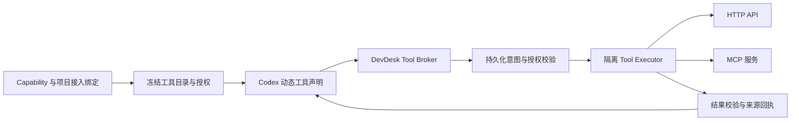

# 工具与技能接入计划

日期：2026-11-09。状态：已实施并完成分阶段验收。实现记录见 [EXECUTION.md](EXECUTION.md)，使用说明见 [工具与技能接入](../../tool-skill-integrations.md)。以下保留本次领域与交付合同。

## 1. 本轮立即修正的范围

原生工具组 `implementation=harness.native` 沿用 Harness 自身的工具协议。其表单隐藏输入、输出 JSON Schema，说明无需手工填写契约，访问范围由实际权限决定。保存时忽略旧界面遗留的 Schema 源码缓冲区；已有记录的契约元数据保留，新记录使用兼容占位值，不改写不可变历史。

本轮不增加空壳接入页面，不将保存一段 JSON 视为工具已经可调用。以下阶段完成后才交付新的左侧导航和实际接入能力。

## 2. 领域关系

| 概念 | 职责 | 与已有对象的关系 |
|---|---|---|
| IntegrationRevision 接入源修订 | 描述 HTTP API、MCP 服务或 Skill 包的来源和连接/导入方式 | 可提供多个 Tool 或 Skill；不代表已经授予执行权限 |
| ToolRevision 工具修订 | 一个可调用动作的名称、说明、参数契约、可选结果契约及执行映射 | HTTP/MCP 接入源发布动作，Capability.tools 多选确切修订 |
| SkillRevision 技能修订 | Markdown 工作方法，以及可选的引用材料与明确工具依赖 | Capability.skills 多选；继续使用已有 Skill 身份与修订体系 |
| IntegrationBindingRevision 接入绑定 | 某作用域中采用的接入源修订、账户/凭据引用、执行配置及限制 | ProjectConfiguration 显式选择；配置锁冻结确切绑定 |
| ToolExecutionGrant 执行授权快照 | 从所选工具、绑定、Permission 和当前工程范围求出的实际权限交集 | 派生、不可变；不是另一个绕过 Permission 的授权入口 |
| ToolCall 调用事实 | 关联 Session/Turn/Run 的请求、派发、结果、取消与核对记录 | 为证据与诊断提供来源，不直接接纳 Delivery 或推进 Workflow |

保持已有关系：Role 定义职责；Agent 固定 Role 与 Capability；Workflow Step 指定 Role/Spec；Project 为 Role 单选 Agent。接入功能不向 Step 增加 Agent、密钥或连接表单。

API/MCP 提供可调用动作；Skill 提供使用方法和材料。Skill 不伪装成带输入输出 Schema 的函数，也不因正文提到工具便自动安装、授权或加入 Capability。一个 Skill 可以声明 `requires_tools`，在 Capability 保存时检查并由用户明确匹配对应工具修订。

AgentID 经验仍属于 Feature/Task 的历史上下文，不重新作为 Tool 或 Skill 导入。

例如，内部工单 API 接入源发布 `search_ticket`、`create_ticket` 两个 Tool，文档 MCP 发布 `search_docs`；架构设计 Skill 可以声明需要 `search_docs`。架构师 Capability 只选文档检索与架构 Skill，项目经理 Capability 可另外选创建工单动作；项目分别为这些来源绑定账户。以上是关系示例，不自动创建资源或授予写权限。

## 3. 导航和页面

增加独立左侧导航 **工具与技能接入**，页内组织为：

| tab | 管理内容 |
|---|---|
| HTTP API | 接入源、动作映射、OpenAPI 导入、凭据绑定、连通检查和测试调用 |
| MCP | 服务来源、传输/协议版本、工具发现、变更差异、选中工具及绑定 |
| Skills | Markdown 编辑、文件/包导入、来源、引用材料、工具依赖和修订 |
| 原生工具 | 随 Harness 提供的工具组、支持说明、适用 Harness；不编辑虚构调用契约 |
| 调用记录 | 按项目、Feature/Task、AgentID、Run、接入源和工具筛选实际调用 |

基础组件页保留 Model、Harness；现有 Tool/Skill 的管理入口迁移到新页，不复制两套可写目录。旧深链接重定向到同一资源，旧 ID 与 Capability 引用保持有效。角色与 Agent、Workflow、Project、规范及 Permission 的职责不变。

所有接入编辑器使用列表与详情，支持新建、修改、发布新修订、复制、停用和引用检查。正文默认渲染 Markdown，源码模式编辑；HTTP 参数提供表单及高级 Schema 模式。MCP 发现的协议契约只读展示，变更经重新发现和发布处理。

页面分别显示“定义已保存”“凭据可用”“执行环境就绪”“已完成测试调用”。连通成功不等同于所有工具可用，手工测试成功也不等同于 Agent 已获得该工具。

## 4. 接入源、作用域及配置锁

1. 新接入源/绑定支持 Global、Project 作用域，复用现有可见性与项目隔离。全局接入源不等于所有项目共享账户。
2. Integration 的来源配置、Tool 描述和 Skill 材料分别有稳定身份、版本、前序修订与内容摘要。凭据仅保存不透明引用，不进入这些对象的正文或导出文件。
3. ProjectConfiguration 增加按确切 IntegrationRevision 选择的 `integration_bindings`；全局默认绑定可供预填，但项目保存时必须形成明确选择。
4. Capability 引用 Tool/Skill 确切修订，同一接入源不能混用互相冲突的动作目录版本。名称与别名冲突在发布/组合阶段报错，不按展示名称猜测调用目标。
5. Feature 配置锁与讨论运行绑定冻结 Tool/Skill、来源、描述快照、接入绑定、执行后端及授权摘要。已有 Feature 和 Session 不自动追随“最新发现结果”。
6. 变更接入源、工具目录、绑定账户、权限或材料时，新运行采用新锁。已有讨论复用权限切换方案的静止边界与后继 Session；不得原地替换正在工作的原生线程。
7. 同一账户、租户、权限范围内的凭据轮换不保存旧 token。账户或授权范围变化产生新绑定；旧锁无法继续满足原权限时明确阻塞，不悄悄扩大访问。
8. 更新/停用拒绝新的选择，历史仍可读取；另设紧急停用状态，在派发前强制拒绝调用。两种行为不能共用一个含糊的“删除”按钮。

## 5. HTTP API

### 5.1 可执行动作定义

每个动作包含固定接入源、HTTP method、相对 path 模板、参数映射、返回处理、影响类型、超时与结果大小限制。模型只能填写经 Schema 校验的业务参数，不能指定任意目标 URL、账户或认证 Header。

- 输入 JSON Schema 必须实际校验调用参数；无参动作也有明确对象契约。
- 明确将输入的 JSON Pointer 映射到 path/query/header/body，规定 URL 编码、缺失/null、数组和对象序列化；不对模型字符串做 shell 求值。
- 认证 Header 由绑定注入，不允许模型参数覆盖 Authorization、Host 或凭据字段。参数校验在实际请求之前完成。
- `output_schema` 可选，存在时对选定状态码和 MIME 的结构化结果进行真实校验；文本、文件和二进制结果使用相应类型及受作用域约束的 Artifact 引用，不强塞为 JSON 对象。
- 分开记录网络/协议错误、HTTP 业务错误、结果契约错误和副作用状态。请求可能已产生副作用时，结果不合法也不能当作“肯定未执行”后自动重发。
- 影响类型为 read_only/write/destructive/unknown；HTTP method 或服务端提示只作参考。是否允许或需要批准由冻结授权决定，不额外覆盖用户已配置的审批策略。

Schema 定义与调用实例均需校验，明确支持的方言（首版 JSON Schema 2020-12，以及 MCP 兼容所需的 draft-07 子集）、离线引用和复杂度限制。未知方言/关键特性不能忽略后宣称已校验。通过运行时 SchemaValidator 端口接入校验器，不能只依赖现有测试环境的 jsonschema。连通检查不执行写动作；用户显式发起的测试调用仍经过同一权限与回执流程。

首版支持 HTTPS JSON API、文本响应和显式文件结果；支持 Bearer/API key 凭据绑定。OAuth 授权码+PKCE、刷新与撤销作为后续阶段交付；未实现的授权方式明确不可用，不能用一个“已连接”状态掩盖缺口。

### 5.2 OpenAPI 导入

以 [OpenAPI 3.1.2](https://spec.openapis.org/oas/v3.1.2.html) 为首版导入基线，支持 3.1.x 的已声明子集；3.0/3.2、复杂序列化及尚未实现的认证方式须返回具体不支持项，不静默丢字段。导入是辅助生成可执行映射，发布前仍需完整校验。

用户选择 server、operation、可见名称与认证方案，预览生成的工具和参数映射。Security Requirement 的 OR/AND 关系按所选方案解析，不把多个替代认证误当作全部必需或全部可省。远程 `$ref` 不在运行时任意联网读取；导入时通过用户提供的有界依赖包解析并固定摘要。外部 servers/重定向不成为模型可任意切换的目标。

不提供可注入任意 JavaScript、Python 或 shell 的“请求转换脚本”字段。复杂转换以后作为有版本和隔离运行合同的独立适配器实现。

## 6. MCP

### 6.1 传输与版本

提供 Streamable HTTP 与 stdio 两种接入方式，分别显示执行位置。远程地址、认证引用和本地命令/包版本属于接入定义，不能从模型输入中替换。

协议必须按明确版本实现。首批覆盖 `2025-11-25` 与 `2026-07-28`，分别有适配器和契约测试：旧版本使用初始化与会话流程；新版采用逐请求元数据，不能沿用同一套握手和 HTTP 会话假设。协商/降级只能在已实现的版本集合内完成，固定实际采用版本并记录原因。依据见 [旧生命周期](https://modelcontextprotocol.io/specification/2025-11-25/basic/lifecycle)、[新版版本兼容规则](https://modelcontextprotocol.io/specification/2026-07-28/basic/versioning)与 [Streamable HTTP](https://modelcontextprotocol.io/specification/2026-07-28/basic/transports/streamable-http)。

### 6.2 发现、选择与调用

- 发现结果按接入源修订、绑定账户及授权范围隔离，处理分页和重复名称；不能将一个账户发现的私有工具目录暴露给其他作用域。
- 用户明确选择导入的工具，发布为可引用 ToolRevision，保存远端原名、描述、输入 Schema、可选输出 Schema 和描述摘要。Capability 选择具体动作，不因接入 MCP 服务便授予其全部工具。
- 工具目录变化先产生差异：新增、移除、描述/契约变化及权限提示变化。通知或重新发现不改写已选修订；已有锁遇到不可验证的契约漂移时阻塞并要求重新发布。
- 遵守对应版本的 `tools/list` / `tools/call` 语义，保留协议错误、工具业务错误和结构化/多模态内容的区别。可选输出契约只验证它适用的结构化内容，依据 [MCP Tools](https://modelcontextprotocol.io/specification/2026-07-28/server/tools)。
- `readOnlyHint` 等服务端注解不构成授权；采样、交互询问、roots、resources、prompts 和长任务扩展必须逐项声明支持。首版工具接入不把 MCP prompt 自动转成 Skill，也不为服务端发起的新模型请求偷偷使用 DSH 或额外模型预算。
- 不支持的交互/扩展返回明确协议结果。需要用户输入的流程与当前审批策略不兼容时在预检暴露，不进入无法完成的等待。
- stdio 使用参数数组启动已固定版本/摘要的运行包，进程位于受控执行环境中；不在宿主上直接运行任意导入的命令，不自动执行 `npx -y` 或 Skill 正文中的安装命令。stdout 只解析协议，stderr 单独脱敏采集；取消、重启和清理均跟踪所属进程。

## 7. Skill 导入与维护

保留当前 Markdown Skill，增加来源和可选包信息，已有 Skill ID 不迁移成 Tool ID。来源支持手工编辑、单个 `SKILL.md`、受检的目录/ZIP 包；Git 来源以用户选择的确切 commit 和包摘要导入，不跟随分支静默更新。

使用 SKILL.md 的名称、描述、正文及可选 references/assets 组织材料；这是指令资源，与可调用 MCP 动作互补，参见 [OpenAI 官方 Skill 说明](https://developers.openai.com/plugins/concepts/skills)。

1. 导入检查包大小、文件数、路径、链接及重复身份，材料存储到独立受控目录，不直接覆盖项目源码或用户全局 Codex 配置。
2. 首版导入 Markdown 和静态参考材料。含 `scripts/` 的包显示“脚本执行未启用”；要运行脚本，必须另行注册成受控 Tool 并获得权限，不能因安装 Skill 自动执行。
3. 将 `requires_tools` 与 Capability 已选工具进行明确匹配，缺少依赖时显示缺口并阻止标为就绪。不要仅从自然语言猜测或自动授权工具。
4. 准备 Session 时冻结正文与资源清单。既有纯 Markdown 继续按已实现的指令注入方式使用；包含引用文件时，按实际 Harness 支持物化到只读资源位置并保留内部链接。
5. 若启用 Harness 原生 Skill 发现/调用，则按固定版本做一致性校验，避免同时注入两份内容或自动发现未选择的 Skill。无论使用哪种机制，都要证明所选正文与材料确实进入该次执行。

## 8. Codex 与工具执行通路

建议由 DevDesk 统一执行 HTTP/MCP 工具，Codex 通过受控动态工具桥调用；不在 Codex 配置里再建立一份绕开 DevDesk 选择、日志和权限的 MCP 目录。

[OpenAI 官方 App Server 文档](https://learn.chatgpt.com/docs/app-server)将动态工具的 `dynamicTools` 与 `item/tool/call` 标为实验接口，要求显式启用实验能力。已只读核对本机 `codex-cli 0.167.0` 的生成 Schema，确实包含动态工具声明、调用请求和结果响应；这只证明接口存在，不等于已经完成运行时接入或验证 Docker 中的实际二进制。

P0 必须对固定 Docker Harness 的确切版本、镜像和协议摘要建立本地回环测试。适配器只在实际工具集合非空且运行合同支持时启用对应实验能力；不能为了接工具顺带开启 plugins/apps、宿主配置扫描或其他实验能力。

调用链：

- Tool Broker 负责确切工具映射、调用身份、授权和回执；API/MCP 客户端负责协议 I/O。Core 通过执行端口派发，数据库事务内不联网、不启动服务进程。
- 动态工具名称使用确定的 namespace/别名映射，避免与原生工具及不同接入源重名；模型输出的名称必须精确命中当前锁内目录。
- 请求需校验 thread、turn、Session、Run 和所属 worker 操作。以这些身份及 callId、输入摘要形成幂等键，不能仅凭远端数字 request ID 去重。
- Codex 待响应的工具请求与持久化 ToolCall 分开记录，结果接纳后向正确原生请求回复一次；支持同一 Turn 多次/并发调用，不能在轮询线程同步阻塞等待整个远程调用。
- DevDesk 规范化结果保留内容块、结构化数据、错误和来源。按固定 Codex 合同映射到其支持的文本/图片/音频返回项；已验证的 JSON 可序列化为文本交还，原始结构继续保留在回执中。输出 Schema 校验外部结构化结果，不校验 Codex 消息封套；不能转换的内容保留受限 Artifact 并明确提示，不静默丢弃或泄露带凭据 URL。
- 测试调用走同一个执行端口与校验路径。模型调用必须来自活动授权 Turn，不开放一个接受任意 Tool ID、宿主路径和 URL 的通用宿主代理 RPC。
- 首轮真实模型验收只使用 GPT-6.1 Sol High / Codex；DSH 不调用模型。未实现其他 Harness 桥时按能力矩阵拒绝，不能仅把工具说明加入 prompt 后标记为支持。

## 9. 权限、凭据和执行位置

接入管理与 [Permission 运行时绑定计划](../permission-runtime-bindings/PLAN.md)共享权限解析，不另设一个不受约束的工具调用系统。该计划正在其他工作中实施，本计划开工前须核对其最终契约，保留已完成改动。

- 可调用集合是 Capability 工具、绑定授权、有效 Permission、项目范围和执行后端支持能力的交集。模型能看到工具说明不代表调用已经被授权；原生工具的细粒度限制仍以 Harness 实际支持为准。
- HTTP/MCP I/O 由受控 Tool Executor 在解析出的沙箱内执行，首版使用现有 Docker 后端；Broker 不利用宿主网络权限替模型绕过禁网。HTTP API/远程 MCP 的出站网络必须满足冻结的 Harness/Sandbox 约束，再与绑定的目标 origin、方法和资源范围取交集。
- stdio 服务的根目录、文件映射、网络与生命周期继承明确执行范围；不得挂载整个数据集、宿主凭据目录或 Docker socket。工具访问代码文件时映射到当前 worktree 的许可范围。
- 接入可见范围与远端操作范围分开配置，例如“可在项目 A 使用”不等于“可访问远端所有仓库”。静态仓库/资源 ID 等绑定约束由执行器重新校验，模型参数不能覆盖。
- 密钥通过既有系统凭据设施存储，按接入/账户保存不透明引用；普通表单、导出、SQL、协议日志和模型上下文不保存认证秘密。Tool Executor 只拿该接入必需的凭据，不拿模型供应商或其他服务凭据。
- 现有凭据助手若需扩展允许的服务/账户命名，应作为显式助手升级处理，不在重编译 Host 时静默替换；普通接入配置更新不要求重新录入无关密钥。
- URL 的 origin、解析后的地址、重定向和本地服务授权均受绑定约束。允许用户有意接入本机/内网 MCP，但不能让模型通过动态 URL、DNS 或重定向扩大范围。
- 根据实际 Permission 决定可自主执行、需要批准或应拒绝；批准绑定确切调用参数与工具修订，参数变化不可复用。`never` 不得被执行器转成新的审批流程。

## 10. 调用记录、失败和恢复

ToolCall 至少记录项目/Feature/Task、AgentID、Session/Turn/Run、调用 ID、工具/接入/绑定修订、参数摘要、授权摘要、实际执行器、开始/结束、结果来源及 Artifact 引用。认证秘密及声明敏感字段脱敏，不将服务响应中的凭据回显直接发给模型。

状态分为 prepared、dispatched、awaiting_approval、succeeded、failed、cancelled、needs_reconciliation；另记 remote_effect 的 not_applied/applied/unknown，避免将结果获取失败等同于远端动作未发生。

1. 重复派发同一个调用：摘要相同则返回已有状态/结果；摘要不同则冲突。服务支持幂等键时，按已冻结映射发送同一个键。
2. 未获得派发回执或执行结果时，按既有“意图—外部执行—回执”协议恢复。副作用未知的调用不盲重试，也不承诺通用 exactly-once。
3. 取消只说明停止等待或已证明进程终止，不能声称远端业务已回滚。副作用不明进入核对，支持人工记录有来源的处理结果。
4. 超时、并发、返回大小和分页均有默认限制及可调上限。结构化结果不能默默截断后标为校验通过；超限返回明确状态或受限 Artifact 引用。
5. API/MCP 结果是带来源的外部数据。调用成功不能直接修改工程状态、通过 Review、合入代码或代用户确认 Workflow 节点。
6. 新接入源版本不追溯更新旧调用，重放历史视图读取原始回执；旧 Feature 因环境缺失不能运行时显示缺失项，不伪造恢复成功。

## 11. 持久化与兼容

扩展版本化配置记录存储接入源、绑定、工具描述/来源和 Skill 包清单，ToolCall 使用具备唯一调用身份与查询索引的持久化事实。全局库保存共享定义；项目库保存作用域绑定、运行锁与调用事实。跨项目查询沿用受控只读投影。

- ToolDefinition 新版本使用按实现区分的结构：native、http_api、mcp。仅可调用外部动作要求真实输入契约，输出契约可省；native 无这两个字段。不能只给 `implementation` 增加枚举却没有执行处理器。
- 旧 ToolDefinition v1 及当前占位 Schema 只读兼容，不改变历史内容或哈希；已有 Capability/Agent/Feature 引用有效，导出标明合同版本。
- 接入发现、连通检查、实际测试、授权和停用记录分开，不混入配置正文作为可变字段。
- 追加迁移，不修改已有 SQL。迁移编号在开工时按全局/项目最新编号分配，避免与正在实施的 Permission 迁移冲突。
- 同步 RPC、JSON Schema、权限能力矩阵、默认目录、导入/导出合同和文档；不为演示预置虚假 API 密钥、伪连接或外部成功证据。

拟增命令族：`integration.create/revise/retire`、`integration.discover`、`integration.publish_tools`、`integration.binding.*`、`integration.test`、`skill.import/export`、`tool.call.cancel/reconcile`。查询提供目录、发现差异、绑定有效状态、引用和调用记录。具体 payload 与权限语义在 P0 契约中确定，写操作沿用 command_id/expected_revision；产生 I/O 的操作先持久化意图。

## 12. 分阶段实施与验收

| 阶段 | 工作 | 完成条件 |
|---|---|---|
| P0 契约与协议验证 | 对齐 Permission 最终合同；定义接入/工具/绑定/调用事实；验证固定 Codex 动态工具回环、两个 MCP 版本及传输差异 | 契约、Schema/能力矩阵和真实协议夹具明确；不以本机 CLI 有字段替代容器回环证据 |
| P1 资源与冻结 | 追加迁移、接入 CRUD、来源/凭据引用、范围、项目绑定、调用锁、引用/停用检查 | 新旧数据升级幂等；旧锁不变；跨项目、别名冲突和不完整依赖被拒绝 |
| P2 HTTP 与执行通路 | Tool Broker、隔离 Executor、Codex 桥、输入/输出校验、HTTP 映射、测试调用和恢复 | 使用本地真实 HTTP 服务验证读/写、错误、权限、幂等、取消及副作用未知，不只测表单 |
| P3 MCP | 两个已列版本、stdio/Streamable HTTP、账户隔离发现、分页、差异发布与工具调用 | 本地真实 MCP 服务覆盖两类传输和两套版本语义；旧描述漂移、失联和不支持扩展均可诊断 |
| P4 Skill | 保留 Markdown CRUD，导入与材料清单、依赖匹配、只读物化、原文/来源冻结 | 选中的正文和资源进入执行；未选 Skill、越界材料和未授权脚本不进入运行 |
| P5 独立接入页面 | 新左侧导航、五个内页、原入口迁移、Capability 选择、项目绑定、就绪状态和调用记录 | 浏览器完成 API/MCP/Skill 接入、组合、测试、保存、重载、停用及旧链接导航 |
| P6 认证完善 | OAuth PKCE、刷新、撤销和账户变更；已有 Bearer/API key 共用审计 | token 不进入浏览器/日志；同账户刷新连续，账户/范围变化不扩大旧锁权限 |
| P7 完整验收 | 双 profile HTTP/浏览器、升级与隔离、真实 Codex 选工具执行、API/MCP 各一条完整链路 | 新建接入→选择具体 Tool/Skill→绑定项目 Agent→真实调用→查询回执→重启恢复；DSH 不调用模型 |

P5 可以在后端合同稳定后并行推进界面开发，但没有执行通路和权限验证的接入必须显示未就绪。实现时不因赶进度跳过 P2 的回执与隔离，也不要求一次性支持市场插件、任意语言脚本、所有 OAuth 流程或全部 MCP 扩展。

验收重点：

- JSON Schema 既验证定义合法性，也验证真实参数和适用结果；没有输出 Schema 的文本工具可正常工作。
- 一个 MCP 服务有多个工具，Capability 只选其中一个时，其余动作在执行端被拒绝。
- 同一服务的两个账户、同名工具、两个项目及两个冻结版本不会串用目录、凭据、授权或结果。
- HTTP 写调用成功但回执丢失，重启后进入核对，不再次执行写操作；重复测试命令复用原调用。
- Skill 内含逗号、空行、代码块和相对资源链接均保持原文/包摘要；工具依赖缺失可见，正文不能触发自动安装。
- 禁网、只读 worktree、受限工具集合及审批拒绝在实际 Executor 生效，宿主 Broker 不扩大权限。
- 本轮立即修正的原生工具组隐藏 Schema，旧源码草稿不阻止保存，旧不可变记录不改写。

计划目录仅保存 Markdown；协议 Schema 导出、运行日志、截图、数据库与测试服务输出放 `/tmp` 或被忽略的测试目录。正式执行报告区分契约夹具、真实 HTTP/MCP、Docker 和真实模型证据，不混称已经接入所有服务。
