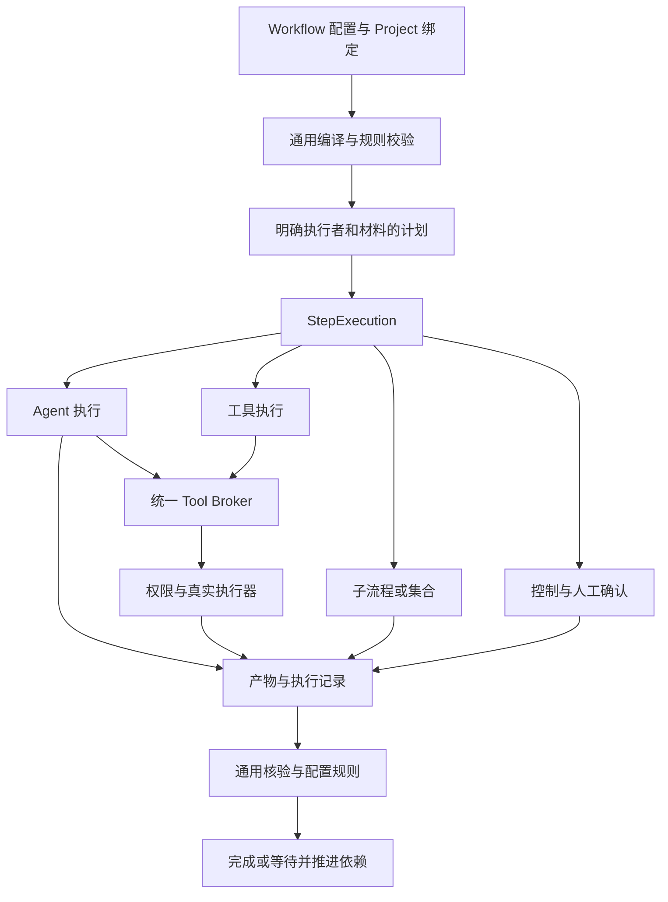

# Workflow 通用步骤与业务配置改造计划

日期：2026-11-10。状态：已通过用户 Review，实施与本机验收完成；具体证据和平台限制见执行报告。执行进度见 [EXECUTION.md](EXECUTION.md)。

取消 Workflow 的业务标准动作目录。业务阶段、角色、工作方法、任务指令、交付类型和验收策略由配置定义；代码提供通用编排、Agent 与工具执行、权限、证据核验和持久化能力。新增一个业务步骤、角色或交付物，不应要求修改 Rust 分支、前端选项或发布 Schema 中的业务枚举。

本计划以当前工作区和提交 `206deae` 为审查起点，承接 [Step 任务指令改造](../workflow-step-task-instructions/PLAN.md)、[工具与 Skill 接入](../tool-skill-integrations/PLAN.md)、[默认配置资源](../configuration-template-reset/PLAN.md)。当前代码存在其他未提交修改，实施时需重新核对实际基线并保留无关改动。

根据本次用户要求，项目尚未上线，过时配置、冻结任务和运行记录可以删除后重建。此次直接建立新数据结构和新默认配置，不迁移旧数据，不维护旧 Workflow 执行器、转换器或双版本运行路径。实际清理属于计划执行阶段。

## 1 Review 的主要决策

| 决策 | 本计划采用的方案 | 影响 |
|---|---|---|
| 标准动作 | 删除业务动作目录和动作选择器。Step 仅区分 Agent、工具、子流程和控制这几类执行机制。 | 新增讨论、调研、编写、评审等业务行为只需配置。 |
| 任务指令 | `Step.task_instructions` 是本次 Agent 任务的唯一正文来源。 | Skill 保存方法，Role 保存职责，Stage 保存背景，不建立另一套 Prompt 资源库。 |
| 绑定执行者 | Stage 可配置默认 Role，Step 可以覆盖；Project 继续将 Role 绑定到 Agent。 | 同一阶段允许多个执行者，同一 Workflow 可以用于不同项目。 |
| 角色与权限 | 业务 Role 使用用户定义的身份；删除五种执行职责对权限、工作类型和输出格式的推导。 | 权限由实际 Permission 和执行资源范围确定，角色名称没有隐含授权。 |
| 内置工程方法 | TDD、阶段划分、评审内容、人工确认和交付要求转为默认 Workflow、Skill、Spec 及完成规则。 | 默认工程行为继续可用，用户可以建立其他工程方法。 |
| 数据处理 | 清理指定开发数据集并重建，更新浏览器草稿命名空间及测试数据。 | 不为未上线记录增加兼容成本。源码、用户仓库和外部凭据不属于过时运行数据。 |
| 实施范围 | 同时清理后端、Host、前端、Schema 和默认资源中的业务硬编码。 | 不以移除下拉框或把枚举搬进 JSON 作为完成。 |

## 2 业务配置与代码的边界

判断依据是“变化的含义”：某个值变化代表用户改变工作方法或业务要求，应成为配置；变化代表程序支持了一种新的执行协议或存储机制，可以由代码实现。

| 应进入配置 | 应由代码实现 |
|---|---|
| 阶段、步骤、角色的名称、数量、顺序与依赖 | DAG、子流程展开、集合迭代、暂停、取消、重试和恢复 |
| PRD、架构设计、开发、测试、评审等任务及方法 | Agent/Harness 协议、工具调用协议、进程和容器生命周期 |
| 角色可用的 Model、Skills、Tools 和 Permission 选择 | 对真实权限、资源归属、路径范围和工具能力的执行校验 |
| 文档种类、结构、字段、输入输出关系 | Schema 校验、不可变产物、确切引用及来源核验 |
| 要检查哪些内容、需要哪些测试、是否独立评审及人工确认 | 核对声明的证据和决定是否真实、有效、属于当前输入与执行 |
| 默认模型选择、角色绑定、业务预填值、正常运行预算 | 真实支持的适配器、固定构建资产、协议版本、不可突破的资源上限 |

配置不能仅凭一段文字创造执行能力。配置选择一个测试执行器时，该执行器必须已有真实实现；声明一个测试报告格式，也不能让模型生成的 JSON 成为真实测试回执。对外展示的能力必须与实际执行器一致。

## 3 当前代码审查与改造清单

以下为已定位的生产路径。实施 P0 继续逐文件核对调用关系，并把每项落到具体改动和回归，不把测试样本中的固定名称误判为产品限制。

| 编号 | 当前硬编码与位置 | 问题 | 处理方式 |
|---|---|---|---|
| H01 | [动作目录](../../../crates/domain/src/governance.rs)、[动作合同](../../../crates/domain/src/agent_task.rs)、[动作 Schema](../../../schemas/workflow-action.schema.json) | 13 种业务或系统动作决定可定义的步骤。 | 删除业务目录，按通用执行方式编译和派发。 |
| H02 | [Workflow 结构校验](../../../crates/domain/src/configuration.rs) 的阶段、配方 key、依赖和角色检查 | `implementation` 等阶段必须包含指定节点；节点名称参与合法性判断。 | 依赖与执行者全部取自 Workflow，工程方法约束由配置规则表达。 |
| H03 | [流程语义校验](../../../crates/domain/src/governance.rs) 的 `validate_workflow_semantics` | 以动作与阶段名称识别需求、规划、收尾及前置评审。 | 改为校验显式端口、完成规则及受控工具的前置条件。 |
| H04 | [AgentRole 和 AgentProfile](../../../crates/domain/src/agents.rs)、[Role 和 Agent 组合](../../../crates/domain/src/governance.rs) | 五种职责限定业务角色、可做的工作和输出种类。 | 业务 Role 不再使用固定职责枚举；执行能力与输出由配置引用决定。 |
| H05 | [Agent 投影](../../../crates/core/src/governance.rs) 的 `install_agent_profile` | 根据 Role 推导 `TaskWrite/TestWrite/ReadOnly`、工作类型和输出 Schema。 | 从明确配置和资源授权生成执行描述，不从业务身份推导。 |
| H06 | [编译器](../../../crates/core/src/workflow_definition.rs)、[Host 执行解析](../../../crates/host/src/workspace.rs) | 阶段映射到特定 Role、Session 和 work type；存在默认 Reviewer/Tester ID 回退。 | 统一解析有效 Step 与 Project 绑定，缺失即诊断，不选择内置业务身份补齐。 |
| H07 | [live_runs](../../../crates/core/src/live_runs.rs)、[repositories](../../../crates/core/src/repositories.rs)、[live_merges](../../../crates/core/src/live_merges.rs) | 节点 key 决定是否调用模型、写入何处、如何测试及如何找实现版本。 | 显式执行器、工作空间引用、访问范围、输入和证据关系替代名称判断。 |
| H08 | [任务组装](../../../crates/core/src/agent_tasks.rs)、[工作提示](../../../crates/core/src/workflow_prompts.rs) | 根据内置配方节点和动作选择任务、输出协议；部分来源按阶段反查。 | 只按 StepExecution 的确切关联组装任务，采用配置声明的输出类型。 |
| H09 | [交付类型](../../../crates/domain/src/deliverable.rs)、[前端端口](../../../web/src/components/WorkflowDeliveries.tsx) | 交付类型只有说明和格式，真正端口仍由标准动作推导。 | 扩展现有 Delivery 类型，Step 显式声明端口和结构，统一前后端解析。 |
| H10 | [ProposalContent](../../../crates/domain/src/conversation.rs)、[提案处理](../../../crates/core/src/proposals.rs) | 输出被限定为 requirement/design/task_plan/test_plan 等种类。 | 普通业务产物使用通用提案与交付类型；创建 Task 等平台操作保留真实工具合同。 |
| H11 | [正式输出解析](../../../crates/domain/src/stage_answer.rs)、[模型确认](../../../crates/core/src/model_approvals.rs) | 评审必须含 traceability、scope、tests、failure_paths 四项；模型报告按 Attempt/Review 特例寻找。 | 检查项来自 Spec/评审配置，报告按执行及被评审版本关联；决定与人工确认分开。 |
| H12 | [领域验收](../../../crates/domain/src/lib.rs) 的交付检查 | `d.kind` 和节点 key 决定必需文档、TDD 顺序、测试覆盖与收尾证据。 | 拆为通用证据核验和配置规则；默认 TDD 约束完整迁到默认配置。 |
| H13 | [输入有效性](../../../crates/domain/src/governance.rs)、[返工及阶段命令](../../../crates/core/src/lib.rs) | 按 phase、文档 kind，甚至 `Structured Task Plan` 标题寻找输入和失效范围。 | 使用显式输入引用、消费记录和反向依赖计算失效、返工及完成状态。 |
| H14 | [Spec 和 Standard](../../../crates/domain/src/configuration.rs)、[配置 UI](../../../web/src/components/AgentCatalog.tsx) | 适用范围和覆盖规则依赖固定 action/phase；前端另列业务选项。 | 用 Role、交付类型、显式步骤标签及真实落点匹配，取消动作选择器。 |
| H15 | [Workflow 编辑器](../../../web/src/components/WorkflowManager.tsx)、[Role 编辑器](../../../web/src/components/RoleManager.tsx)、[前端映射](../../../web/src/components/configuration-ui.tsx)、[工作台](../../../web/src/main.tsx) | 阶段名、节点名、职责列表、配方生成、启动收尾等业务 UI 写在组件中。 | 表单与工作台读取定义和可用运行意图；复制默认子流程替代前端生成固定配方。 |
| H16 | [默认身份](../../../crates/domain/src/defaults.rs)、[模板权限应用](../../../crates/host/src/workspace.rs) | 拼接 builtin ID、按前缀识别默认身份，业务选择与发布资产常量混合。 | 默认选择从当前配置目录解析，来源用模板元数据；构建协议常量留在适配层。 |
| H17 | [测试配方](../../../crates/domain/src/testing.rs)、[权限](../../../crates/domain/src/permission.rs)、适配器与发布资产 | 运行超时、文件数量等正常预算与技术能力、路径约束混合。 | 正常预算进入执行配置；保留执行器支持范围和资源上限，不虚构新 runner。 |
| H18 | [TaskScope 与 Document](../../../crates/domain/src/lib.rs)、[快照与清单 Schema](../../../schemas/manifest.schema.json) | requirement/design 特定字段承担通用材料关联，业务 kind 进入状态和导出。 | 材料以类型、修订及关系引用表达；导出和历史 UI 按真实类型展示。 |
| H19 | [Harness 挂载](../../../crates/adapters/src/harness.rs)、[权限适配](../../../crates/adapters/src/permissions.rs)、[Host 路径解析](../../../crates/host/src/workspace.rs) | `WorkType/ToolPolicy` 决定工作目录和挂载方式，测试写入要求 `tests/<suite>/`。 | 适配器执行明确资源路径与访问模式；测试目录来自配方和授权，不强制业务目录布局。 |
| H20 | [模型服务商描述](../../../crates/domain/src/model_provider.rs)、[模型入口](../../../crates/host/src/model_providers.rs) | 名称、默认服务商和默认端点与 SDK 路由、协议绑定在同一代码分支。 | 可变展示和选择元数据归入现有配置；实际协议、SDK 路由支持、认证与端点安全校验留在适配层。 |
| H21 | [共享 Status](../../../crates/domain/src/lib.rs)、[工程状态推进](../../../crates/core/src/lib.rs) | Planning、Developing、Validating 等业务阶段与运行、排队、资源释放状态混在同一枚举。 | 业务进度由 Workflow/Stage 投影；技术对象使用明确生命周期，不用业务阶段驱动调度。 |

已有 [resources/configuration](../../../resources/configuration/README.md) 是正确的默认来源。此次继续使用其资源嵌入、数据库可编辑副本和重置机制，清理残留的默认身份回退和重复派生，不另建第二套配置文件系统。

## 4 目标概念与配置归属

| 概念 | 改造后的职责 | 明确移出的内容 |
|---|---|---|
| Role | 用户定义的身份、长期职责、可见范围。 | 固定 execution_role、角色隐含权限、角色专属输出枚举。 |
| Capability | Model、Harness、可用 Skills 和 Tools 的精确组合。 | 业务阶段和特定任务正文。 |
| Agent | Role、Capability、Permission 选择和长期补充指令。 | 某个 Workflow 专属任务和按角色名称产生的隐含能力。 |
| Skill | 可复用方法、参考材料及工具需求。 | 具体 Step 的临时目标和运行事实。 |
| Workflow | 显式输入输出、阶段、步骤、依赖、子流程、集合和整体完成规则。 | 业务动作白名单、固定工程阶段。 |
| Stage | 阶段背景、可选默认 Role、展示分组。 | 隐藏执行配方、自动改变权限和产物类型。 |
| Step | 本次工作、执行者、Skill 要求、材料、产物、资源范围及完成规则。 | 根据动作附带的隐式任务和依赖。 |
| Delivery 类型 | 交付物名称、内容说明、格式及可选结构 Schema。 | 自行证明测试、审批或 Git 操作已真实发生的权力。 |
| Spec | 可复用验收依据和内容检查项。 | 固定四种检查 key、动作白名单。 |
| Standard | 可选的规范覆盖与流程要求基线，核对真实匹配落点。 | 根据整个 Workflow 中是否出现某个字符串推断满足要求。 |
| StepExecution | 一次 Step 轮次下的具体执行关联和事实。 | 用 phase、最近 Session 或固定节点 key 猜测任务来源。 |

Stage 默认 Role 只在该 Stage 内生效；子流程使用自己的配置，外层不隐式覆盖。编译时将有效 Role 展开到每个实际 Agent Step，Project 必须提供完整绑定。工具与控制步骤不创建占位 Agent。

业务阶段名称和进度展示随配置变化。执行生命周期仍由代码明确规定，例如排队、运行、等待、完成、失败、取消和待核对；不允许配置任意改写终态或把未完成执行显示为成功。

### Step 的声明

| 字段分组 | 计划表达的内容 |
|---|---|
| 标识与组织 | 稳定 key、名称、Stage、用户定义的 tags。 |
| 执行方式 | `agent` 引用 Role，`tool` 引用真实工具，`workflow` 引用子流程，`control` 表达独立屏障。 |
| 任务 | Agent Step 必填 Markdown `task_instructions`；其他执行方式不接受无效 Agent 提示词。 |
| 技能 | `required_skill_refs` 指定本次必须提供的确切 Skill，必须属于绑定 Agent 的可用集合。其余可用 Skill 由 Agent 按需使用。 |
| 输入 | 名称、类型、确切来源；工具参数允许受限的常量和输入引用映射。 |
| 输出 | 自定义端口名、Delivery 类型修订；工具结果映射及受信引用分别声明。 |
| 执行范围 | 引用当前工作空间、访问范围和执行预算；在 Permission 允许范围内收窄。 |
| 交互 | 是否允许多轮输入、轮数与预算。 |
| 推进 | 依赖、入口条件、完成条件、人工确认、失败处理、技术重试和业务返工范围。 |

第一版不引入任意脚本求值、模板表达式、运行时联网加载提示词或动态执行器安装。工具参数映射和条件使用有界的结构化引用。业务自定义来自数据与组合，新增真实协议由适配器实现。

### 任务指令与模型输入

每个 Agent Step 只有一份可编辑任务正文。例如“根据输入的需求与项目约束，使用 PRD Skill 澄清权限模型并提交需求文档”。方法细节引用 Skill，验收引用 Spec，正文不复制这些资源，也不通过自然语言代替端口绑定。

任务组装统一包含：有效 Role 与 Agent 指令、可用及必用 Skills、Stage 背景、Step 任务、确切输入材料、Spec/检查项、授权范围以及输出合同。UI 预览和实际派发调用同一组装器。不同 Step 使用独立执行关联；多轮输入、重试和权限后继均明确继承当前任务来源。

删除 `execution_recipe`。原公共任务和节点任务应重新整理成各个独立 Agent Step 的任务正文；共同方法放入 Skill。默认资源不再维护隐藏的父任务加子任务拼接规则。

“已向 Agent 提供 Skill”可以记录，“Agent 严格遵循了所有 Skill 方法”需要根据产物和证据判断，系统不伪造这样的运行保证。

### 一个不依赖内置阶段的配置实例

| 配置 | 内容 |
|---|---|
| Role | 新建“安全研究员”，职责是分析输入材料中的风险，不选择五种内置职责。 |
| Agent | 将该 Role 与已有模型、Harness、调研 Skill、工具及只读代码权限组合。 |
| Stage | 新建“安全调查”，默认使用安全研究员。 |
| Step 一 | “整理风险”，任务指令为“依据输入的架构说明，使用调研 Skill 分析权限边界，提交风险清单；缺少关键材料时向用户确认”。 |
| 输入和输出 | 输入引用已声明的架构材料；输出引用自建 JSON 风险清单类型，字段包括风险、依据和建议。 |
| Step 二 | “核对风险”，覆盖 Stage 默认 Role，使用另一个 Agent，引用第一步的确切产物。 |
| 完成要求 | 检查项为用户配置的“权限隔离”“外部依赖”；需要人工确认时配置确认门禁。 |

这一流程不产生 Requirement、Attempt、Task、Git 候选或 TDD 证据，也不要求这些对象存在；所有新增业务名称都只出现于配置与运行材料。完整默认工程流程则组合相同机制与真实工程工具。

## 5 输出与业务材料

扩展现有 Delivery 类型，不新增平行的业务类型注册中心。Markdown、文本、JSON、diff 等格式是通用载体；PRD、Design Doc、Task Plan、Review 等名称是可编辑的类型定义。JSON 类型可提供离线校验的结构 Schema；Schema 禁止联网引用，并受深度和大小限制。

普通 Agent 输出采用统一封套，包含本轮工作结论、摘要、命名产物和证据引用；各产物按声明类型校验。`needs_input` 可进入现有人工交互，`blocked` 保存原因。模型返回“完成”只表示模型的执行结论，Step 是否完成由产物、证据与配置规则共同决定。

普通提案保存类型修订、内容、输入来源、作者和修订链。取消 `ProposalContent` 对业务文档种类的枚举限制。PRD、设计和测试计划的相互关系使用显式输入与产物关系表达，不能靠标题或“查找最新某种文档”关联。

由计划创建 Task、申请工作空间、提交代码候选等会产生实际系统对象的操作，通过受控平台工具执行。工具具有真实参数合同，例如创建 Task 集合必须验证成员身份、范围和依赖 DAG；任意 JSON 产物不会因名称是 Task Plan 就自动创建 Task。

保留 Project、Feature、Task 作为当前工程归属和执行范围。此次不将产品扩展为任意业务实体建模平台；需要解除的是这些对象对 PRD、规划、实现、收尾阶段和文档种类的内置假设。TaskScope、Attempt 和 Document 的材料引用改为通用引用集合，业务关联放到默认定义中。

## 6 完成规则与真实证据

把当前交付验收拆成两层，并共用一个规则求值入口。

通用核验始终检查身份、归属、摘要、引用是否存在、来源是否可信、结果是否仍适用于当前输入，以及权限和真实副作用。业务配置指定需要哪些产物、检查、执行结果和决定。模型内容判断按 Skill、Spec 和任务进行；结构校验通过不能替代内容判断。

第一版规则仅支持有界、类型化的组合：全部或任一条件、产物存在及结构有效、确切引用一致、集合覆盖、先后依赖、执行结果满足预期、执行者身份不同、以及绑定确切内容的人工决定。引用使用输入端口、输出端口和执行结果，不依赖业务节点名称；不提供任意代码表达式或以自然语言为可执行规则。

规则定义仍是代码协议，但规则的参数、组合和适用落点来自配置。Standard 可以要求实际落点具有特定 Spec 或完成要求，编译器核对展开后的 Step；仅添加同名 tag 或把某个 Spec 放在无关位置不能通过覆盖检查。

### 默认工程方法如何保留

| 当前行为 | 配置中的表达 | 系统继续核验 |
|---|---|---|
| Red 后实现、再 Green | 默认子流程依赖与完成规则。 | Red 为实际断言失败；环境失败不算 Red；Red/Green 使用同一测试定义及声明的代码版本。 |
| 独立评审 | 评审 Agent Step、只读范围及独立性规则。 | 与产物作者比较实际 Agent 身份根，换一个修订不能冒充独立身份。 |
| 四项内容检查 | 默认 Spec 中的检查项。 | 检查 key、引用和报告结构符合当前配置；允许用户新增安全、性能等检查项。 |
| 模型判断后人工决定 | 完成配置中的确认要求及允许的例外策略。 | 模型结论与人工决定分别保存，拒绝覆盖须有明确决定和理由，输入变化使旧确认失效。 |
| Feature 收尾要求 | 默认 Workflow 的汇合、测试、文档、评审及整体完成规则。 | 声明的 Task 集合和结果真实完成，候选和证据版本一致。 |
| Git 接纳 | 工具步骤及冻结的前置条件。 | 源候选、预期目标、批准和真实 Git/远端回执；目标变化不沿用旧批准。 |

默认工程 Workflow 保留完整质量要求。用户可以通过配置定义不使用 TDD 或不同确认策略的流程。权限、来源真实性、资源互斥和真实 Git 结果属于平台事实，不能通过配置把模型自述替换为这些事实。

Spec、Standard 和输入失效判断一并去除 action/phase。Spec 适用范围与 Standard 选择器使用 Role 身份、交付类型身份和用户标签；实际运行仍绑定精确修订。选择器只确定检查落点，随后必须核对该落点真实的输入、输出、Spec 和完成规则。

## 7 通用执行与平台工具

### 工具执行入口

现有工具主要是 HTTP/MCP 工具与 Harness 原生工具，不能直接承担全部平台内部操作。新增受控平台工具实现，复用 Tool 定义、目录、授权、调用记录和 Broker，不用伪造 MCP 服务、回环 HTTP 或任意内部 RPC 转发来访问内核。

平台工具只映射已实现、版本化的处理器，如运行测试、管理工作空间、保存提案、创建 Task 集合、构建/应用候选和捕获快照。工具的说明、参数/返回 Schema 和默认可用组合来自配置资源；真实执行处理器与不可变技术约束由代码实现。它们不重新组成一个限制业务 Step 类型的“标准操作目录”。

同一工具支持两种有明确身份的调用者：活动 Agent Turn，以及已冻结的 Workflow 工具 Step。后者使用 StepExecution 授权，不伪造 Agent、Session 或用户点击。适配现有只接受活动 Turn 的 Broker 校验和调用唯一键。Agent 可用工具是 Agent 配置、Step 限制、Permission、作用域和适配器支持的交集；直接工具 Step 也受相同资源及前置条件限制。

默认将高影响的平台接纳操作放在显式工具 Step，Agent 负责提出产物和工作请求。Agent 调用工具也不能代人作决定或绕过当前冻结的前置条件。工具返回普通 `success: true` 不构成工程证据，内部执行回执由实际处理器生成并核对。

### 调度与恢复

StepExecution 明确关联 WorkflowInstance、完整调用路径、Step、round、执行序号，以及可选 Agent Run、ToolCall 和工作空间。Agent Run 可以不属于特定业务 Attempt；工具 Step 不要求虚构 Agent Session。现有 Effect、测试请求和执行资源增加对真实执行归属的关联，清除对固定配方节点的依赖。

通用调度负责依赖就绪、派发、交互、完成规则、取消及恢复。模型 Reject 是有效内容判断，不自动归类为模型调用故障；技术重试与业务返工区分，未知外部结果先核对。工作空间写互斥、停止证明、迟到结果丢弃及 Effect/MergeAdvance 的意图和回执协议继续复用。

`Attempt.phase` 不再决定执行行为；如保留 Attempt，职责限于一次工作空间上的工作轮次及交付关联。输入变化和返工沿显式消费关系传播，不再按“需求阶段”“收尾阶段”扫描材料。

子流程允许单次调用和固定集合迭代，集合开始时确定成员、来源及依赖。仍使用现有 TaskGroup 语义管理实际 Task；普通集合不凭空创建工程 Task。空集合是否允许、并发额度与失败汇合策略明确配置，默认工程集合不能用空集合冒充交付完成。

## 8 现有动作的去向

此表只用于本次改造核对；新运行路径不保留这些字符串的派发分支。

| 现有动作 | 新表达 |
|---|---|
| `agent.interact` | 普通 Agent Step，配置任务、交互、输入和输出。 |
| `attempt.execute` | 普通子流程，内部是显式 Agent 与工具 Step；删除隐藏执行配方。 |
| `delivery.review`、`merge.review` | 普通 Agent Step，输入确切交付或候选，输出配置化评审报告。 |
| `proposal.adopt` | 产物确认与受控采纳工具，采纳条件由配置声明。 |
| `merge.prepare`、`merge.apply` | 候选工具与接纳工具，复用真实 Git 执行端口及前置条件核验。 |
| `snapshot.capture` | 快照工具，捕获声明的实际来源。 |
| `resource.cleanup` | 正常执行资源生命周期；需要显式等待释放时使用受控工具或完成条件。 |
| `tasks.foreach` | 子流程的集合执行配置，显式引用任务成员及 Task Workflow。 |
| `branch`、`join` | 条件、依赖和控制屏障；无需业务动作类型。 |

默认 TDD 子流程展示为“编写测试 → 运行预期失败测试 → 实现 → 运行通过测试”，再与文档、最终验证和独立评审组合。名称和顺序由配置决定，执行器只识别 Agent、真实测试工具、引用和规则。

## 9 配置管理与编辑体验

继续使用同一条配置链：随包资源建立数据库副本，UI 通过 API 编辑，发布形成修订，Project 显式选择。新增 Role、交付类型、检查项或 Workflow 后立即可选，不要求重建应用。修改随包资源仍需重新构建应用才能改变出厂默认，这与运行时编辑数据库配置分别表达。

所有新增结构都接入现有导入/导出、草稿、修订、模板来源及重置。业务名称和有效选项来自当前数据库；技术执行方式和已支持协议可以由能力接口描述。清理前端、后端和 Schema 中重复维护的业务名称表；UI 不按 builtin ID、phase 或 Step 名字选择表单和按钮。

模型服务商的显示名、默认选择和端点预填值与已有模型目录统一管理。固定 SDK 的真实协议、路由标识、必要环境变量映射、凭据隔离和端点校验继续由适配器负责；配置不能把当前 SDK 不支持的路由标记为可用。此次不增加新的模型协议或凭据系统。

Workflow 两列编辑器保留。普通 Agent Step 的主要表单是执行者、任务指令、Skills、输入、输出及完成要求。工具、子流程和控制节点作为明确的其他执行方式；不再出现“标准动作”或固定配方编辑器。Stage 默认 Role 显示继承来源，Step 覆盖可见。

Role 页面允许创建新的业务身份。Agent 页面明确展示可用 Skill、Tool 和实际权限。Delivery 页面编辑内容及结构，Spec 页面编辑检查项，Standard 页面编辑覆盖要求。先提供常用字段和受控规则编辑，复杂 Schema 可以有源码/预览入口，避免要求用户编辑整份 Workflow JSON。

执行工作台从当前定义和运行状态生成可用操作、业务名称、产物和确认入口。通用执行、停止、重试、返工、批准等意图由代码处理；“启动 Feature 收尾”和特定文档页签改为配置定义的节点与产物视图。Role 讨论、经验、跨项目隔离和连接设置保留既有行为。

## 10 数据结构与开发数据重建

新 Workflow 和编译器采用 v4，任务渲染器采用 `agent-task/v4`。Role、Agent、Delivery、Spec、Standard、Tool、Project 配置、执行锁、RPC 和 Snapshot/Manifest 按实际变更同步升级合同。各合同独立版本化，具体资源修订号和数据库基线号在 P0 核对后确定，不把所有版本机械设为同一个数字。

直接更新 SQL 基线及当前初始化路径，删除过时合同、默认结构、兼容解析和仅服务旧语义的测试。旧基线只返回明确的开发数据需重建诊断，不在启动时进行破坏性自动清理，不增加迁移链。

执行时先定位本次使用的开发数据根目录、对应 Host 和其管理的资源，停止活动 writer 后清理。清理范围包括旧全局与项目数据库、关联的过时 Artifact/索引/运行记录，以及旧浏览器草稿和测试数据。应用能够从空数据集初始化新默认，再通过 UI 完成配置和运行。

用户源代码仓库、独立工作区、系统凭据与模型登录文件不作为旧记录删除。遗留托管 worktree、容器和临时目录先按所有权停止与释放，不能仅删除数据库后留下失去管理的 writer。开发数据清理无需设计长期迁移或历史保留工具。

删除旧数据不意味着取消新系统的任务留存能力。新运行仍保存当次采用的配置、输入和真实回执，用于自身恢复、调试和结果核验；此次不为历史执行保留旧合同。

## 11 分阶段实施

依赖顺序为 P0 → P1 → P2 → P3 → P4 → P5 → P6 → P7。每阶段先完成对应测试，再进入后续集成；阶段交付不能只包含占位字段和未接入执行的 UI。

| 阶段 | 工作与交付 | 完成条件 |
|---|---|---|
| P0 全面审查与合同 | 逐文件核对 H01—H21；补查 adapters、Host、Schema、前端及构建默认。建立 `AUDIT.md`，每项标记迁入配置、保留技术实现或删除。编写 `CONTRACT.md`，确定 Step、角色、输出、规则、工具和执行关联及数据清理范围。 | 所有已知业务分支有目标配置或删除方案；保留的硬编码说明技术理由。新旧概念和默认资源逐项对应。 |
| P1 领域与配置 | 实现自由 Role、通用 Step、Delivery 结构、通用提案、Spec/Standard 规则与参数预算；更新 Schema、SQL 基线、模板引用解析和配置 CRUD，同时提供最小可用的新格式默认配置。 | 新业务角色、交付类型、检查项可通过 API 创建和读取；无动作、阶段、角色业务枚举限制；空库初始化及资源构建校验可用。 |
| P2 编译与最小执行闭环 | 实现通用编译器、有效 Role/Skill 校验、显式输入输出、StepExecution、任务预览与派发。贯通一个自定义 Agent Step 及其现有 HTTP/MCP 工具调用；独立工具 Step 的身份扩展在 P3 完成。 | 自建“调研并生成风险清单”无需新增代码分支即可运行、提交产物、校验完成；预览与实际任务一致。 |
| P3 资源与平台工具 | 提取真实工作空间、测试、候选、采纳及快照工具；统一 Broker 的 Agent/Workflow 调用身份、权限、Effect、取消和核对。去除 Role/phase/node key 到权限及执行器的推导。 | Agent 与独立工具 Step 均能调用真实已支持工具；不伪造 Session；写入范围、真实测试和 Git 核对保留。 |
| P4 完成规则与工程集成 | 改造内容检查、模型决定、人工决定、交付接纳、输入失效与返工；解除 lib/live_runs/Host 对文档 kind 和阶段名称的分支。接入子流程、集合、整体完成与工程资源归属。 | 自定义检查项有效；任务 Reject/人工处理正确；真实来源、TDD 证据关系、独立性和精确候选规则均按配置工作。 |
| P5 默认业务资源 | 补齐完整默认 Feature/Task/子流程、Role/Agent/Capability、Skill、Spec/Standard、交付类型、平台工具描述和任务 Markdown；统一默认身份与模型服务商可变元数据，选择全部由资源解析。 | 完整默认工程方法可由配置追溯；新增非 TDD 流程无需代码修改；无内置业务 Agent ID 回退。 |
| P6 完整配置与工作台 | 改造 Workflow、Role/Agent、Delivery、Spec、Standard、Project、任务预览、执行和产物视图；删除标准动作、配方、阶段和职责硬编码 UI。 | 浏览器从空库完成自建、保存、发布、绑定、执行、等待、确认及返工；任务和产物原文往返正确。 |
| P7 清理与最终验收 | 清理已定位的过时开发数据并重建；删除旧动作合同、执行分支、默认回退与失效测试。更新长期架构/协议/使用文档、发布资源与 `EXECUTION.md`。 | 硬编码清单逐项闭环；完整检查、原生执行、重启恢复及独立包通过；旧数据无需迁移。 |

P2 开始使用独立临时空数据集验证，P7 才切换日常开发数据集。清理已有数据不是前置实现依赖，也不以日常数据能继续读取作为新模型的验收目标。

### 代码改动范围

| 范围 | 主要文件及改动 |
|---|---|
| Domain | `agents.rs`、`governance.rs`、`configuration.rs`、`agent_task.rs`、`conversation.rs`、`deliverable.rs`、`stage_answer.rs`、`lib.rs`：移除业务枚举和分支，定义通用执行、材料与规则。 |
| Core | `workflow_definition.rs`、`workflow_runtime.rs`、`agent_tasks.rs`、`workflow_prompts.rs`、`live_runs.rs`、`live_merges.rs`、`model_approvals.rs`、`proposals.rs`、`project_configuration.rs`、`repositories.rs`、`lib.rs`：按显式配置推进，复用实际执行端口。 |
| Host 与适配器 | `crates/host/src/workspace.rs` 及治理/工具/模板入口；`crates/adapters/src` 的存储、Harness 和工具实现：取消内置身份回退，接入通用运行与工具身份。 |
| 配置与发布 | `resources/configuration`、模板加载与构建校验、`schemas`、`sql/global/schema.sql`、`sql/project/schema.sql`：采用唯一新合同，移除旧定义。 |
| Web | Workflow/Delivery/Role/Agent/Project 编辑器、任务预览、实例视图和 `main.tsx`：选项来自定义，按通用执行机制与实际状态展示。 |
| 验证与文档 | Rust/HTTP/浏览器/真实探针、独立包；更新 `docs/domain.md`、`docs/design.md`、`docs/protocol.md`、运行说明和 Schema 索引。历史计划保留其历史属性。 |

## 12 验收标准

### 配置变化不修改产品代码

| 编号 | 场景 | 必须证明 |
|---|---|---|
| A01 | 新建“安全研究员”Role，绑定已有执行能力。 | 无需增加 AgentRole、前端职责选项或默认身份分支；权限来自明确选择。 |
| A02 | 新建“竞品调研”阶段和 Agent Step，输出“风险清单”。 | 仅通过 UI/API 配置任务、Skill、材料和输出即可实际运行。 |
| A03 | 新建 JSON 交付类型并作为下一 Step 输入。 | 原生结果按当前 Schema 校验；错误字段拒绝；确切产物和来源被下一步消费。 |
| A04 | 将四项默认检查改为安全、性能等自定义项目。 | 预览、派发、结果解析、报告和确认使用同一组配置；不再要求旧四个 key。 |
| A05 | 增删阶段、重命名所有业务 Step key，或交换满足依赖的步骤位置。 | 除明确引用及语义规则外，不因名字或内置 phase 改变执行方式。 |
| A06 | 使用一个不含 PRD、TDD 和候选合入的普通分析 Workflow。 | 能完成有效业务工作，不被工程专属阶段与证据要求阻塞。 |
| A07 | 删除或替换所有出厂业务角色和 Agent，使用自建配置。 | 不回退到 builtin Reviewer/Tester，不按 ID 前缀恢复隐含默认。 |
| A08 | 同一 Stage 默认一个 Role，评审 Step 使用另一个。 | 继承及覆盖明确，项目所需绑定完整，子流程不被外层隐式覆盖。 |
| A09 | 同一 Agent 执行两个任务或同一子流程被调用两次。 | 任务、输入、结果和确认按调用路径、Step 与轮次隔离。 |
| A10 | 运行时编辑并发布任务、Skill 或 Spec。 | 新执行按明确选择采用配置；实际任务来源可见，预览与派发一致。 |
| A11 | 测试配方使用用户定义的目录布局和预算。 | 不强制 `tests/<suite>/`；按明确路径授予访问并保护冻结测试，超出技术上限仍拒绝。 |
| A12 | 修改已支持模型服务商的显示名、默认选择或端点预填值。 | UI 和新配置读取当前元数据；未实现协议仍拒绝，固定 SDK 与凭据规则不被配置绕过。 |

### 执行真实性与故障处理

默认工程配置必须实际走通需求、规划、Task 集合、测试、实现、文档、独立评审、人工处理及候选接纳。另验证删除 TDD 规则后，一个合法的其他工程方法可以运行，证明要求已成为配置。

必须拒绝伪造测试/工具回执、错归属产物、旧版本批准、同身份伪装独立评审、越权文件写入和目标已变的候选。缺少真实执行器的配置不能显示为已支持。只读判断、测试文件保护和工作空间范围取实际授权，不取 Role、节点名或提示词。

覆盖模型有效 Reject、产物结构错误、缺失 Skill/Tool、用户多轮输入、工具超时、停止 writer、权限后继、技术重试、业务返工、输入变化、Host 重启和未知副作用核对。断言基于真实持久化状态及外部回执，避免只比较生成配置与实现常量。

### 检查与交付证据

优先复用并改写现有 `configuration_resources`、`agent_tasks`、`workflows`、`workflow_references`、`tool_integrations` 和 `schema_contracts` 测试。新增覆盖集中在自由业务定义、规则执行、统一工具身份和真实恢复边界，删除仅为旧业务枚举背书的测试。

各阶段运行相关 Rust 回归及 Web 构建；最终执行 `cargo test --workspace --locked`、`web` 构建、适用 Playwright、HTTP/运行准备入口和仓库检查脚本。编辑多个 TSX 组件时执行既有 React 检查技能。依据实际改动运行真实测试/Git/容器探针，不把模拟模型或适配器夹具写成原生模型验收。

原生验收至少包含一个自由定义业务 Workflow 和完整默认工程 Workflow，并核对实际任务、工具与产物；两个已支持 Harness 都需通过合同及工具桥回归。真实模型调用使用当前可用且明确配置的后端，缺失的真实环境或账户能力按具体范围记录。独立发布包从空目录、无源码路径初始化、编辑新定义并运行，确认所有默认和合同已嵌入。

`AUDIT.md` 最终逐项列出清理结果及保留常量的理由。对生产代码复查固定业务名、ID 前缀、角色/阶段推导、固定检查项和前端业务枚举；默认资源、合法测试样本和技术协议不以“必须没有这些单词”的机械搜索作为通过标准。

## 13 范围控制与交付完成条件

此次改造横跨现有工程主链，重点是移除业务变化对代码分支的依赖。复用 Permission、Tool Broker、Effect、Git 端口、Artifact 和现有版本化配置，不重写模型供应商、Docker、认证或凭据系统；不引入任意脚本引擎、完整 BPMN、无限递归、Role 继承或新的实体建模平台。

如果某项规则确实属于新的执行协议，P0 必须说明为什么需要代码支持，不能用名为“配置”的旧业务分支掩盖它。相应能力只有在处理器、Schema、权限、UI 与测试都贯通后才能标记可用。

全部完成需要同时满足：H01—H21 审查闭环；A01—A12 均有执行证据；默认工程及另一种业务方法可配置运行；旧动作和配方运行路径删除；过时开发数据已清理重建；长期文档、Schema、默认资源和独立包一致。发布新配置无需修改产品代码，是此次改造的核心验收条件。
