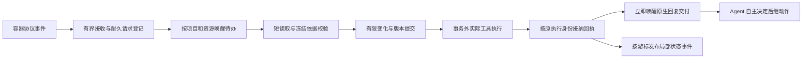

# Workflow 执行性能与运行稳定性改进方案

状态：独立 worktree 实施中，未宣布全部性能门禁通过。日期：2026-11-16。起点 main `026c05d`，并发基础整合 `d3ae7d4`，main 最新整合 `38ec1ff`（至 `b75439d`）。具体责任、共享文件和联合门禁见 [分工边界](SCOPE.md)，真实执行证据见 [运行验收](LIVE.md) 与 [第二轮独立优化](INDEPENDENT.md)。当前 Feature、项目经理及 Task 保持停止，不恢复业务流程。

目标是消除工作流执行期间的平台衔接延迟，并使 Docker 拒绝、Host 退出和经理超时可以定位、核对及恢复。重点覆盖“工具请求 → 派发 → 实际执行 → 回执接纳 → 回复 Agent → 推进后继动作”，保留原有工作流、Agent 自主决策、Spec 与人工审批语义。

## 1 基于 main 的现有实现

已合入的 [配置加载 W0–W3](../configuration-loading-performance/EXECUTION.md) 和 [W4–W7](../configuration-loading-performance/W4-W7.md) 是本方案的基础。

| main 已有能力 | 本方案的使用方式 |
|---|---|
| 配置专用只读快照、确切源引用与目录索引 | 继续使用 `ConfigurationCatalogSnapshot`，执行读取按冻结的确切引用加载，不重新实现配置目录或展开存储。 |
| 版本化配置查询 memo、成员索引和有界缓存 | 复用已验证的缓存与失效机制；运行状态使用独立资源版本，不能因每条讨论事件使全部配置缓存失效。 |
| `performance::Trace/Span`、RPC/启动计时与响应字节 | 扩展到调度、平台调用和回执交付；保留现有指标名称及配置加载回归。 |
| SQL 游标事件读取、提交后通知、pending hint | 复用通知和有界补读；把工作流待办和回执接纳纳入同一套唤醒机制。 |
| 浏览器 `QueryCache`、消费者取消、版本防倒退 | 为执行摘要/步骤页增加独立查询键和局部失效，不另建一套前端缓存。 |
| 离线备份与配置性能测试入口 | 复用构建身份、备份和采样方法，新增开启调度器的执行性能入口。现有关闭调度器的成绩不能替代工作流运行验收。 |

核对当前代码，工程运行路径仍存在完整状态恢复、业务锁及顺序阶段。配置优化验收也明确把完整 `workspace` 排除在零完整快照门禁外，因此不能把已有配置页面成绩视为执行链性能已通过。

[单 Host SQLite 底层并发方案](../single-host-concurrency/PLAN.md) 已在另一个 worktree 实施，核对时提交至 `35bcaee`，尚未合入 main。其 P1/P2 的连接与有限提交端口、P4 的执行摘要、P5 的调度与事件是共享基础工作；本方案细化 Workflow 的调用链、预算和恢复验收。两份方案共用一套存储/事件实现，不建立相互竞争的提交入口。完整 100 前端能力仍以其 [验收合同](../single-host-concurrency/ACCEPTANCE.md) 为准。

权限恢复 memo、Docker 诊断、经理失败投影和 Host 启动日志已在 main 提交，并在本分支与运行恢复修复整合。UI 采用 main 已提交内容，本分支不重复开发。后续代码验证与共同目标不能计入旧 main 基线的性能成绩。

## 2 现场证据与归因边界

以下来自本次运行的只读审计与采样。期间构建、源码及运行负载发生过变化，只用于定位；F0 必须重新建立同条件基线。

| 现象 | 已取得的证据 | 可支持的结论 |
|---|---|---|
| 经理工具衔接慢 | debug 期间 65 次已交付调用，平台登记至回复登记 P50 61.028 s、P95 122.697 s、最大 165.238 s | 平台调用链本身存在分钟级等待；此区间不包含收到回复后的模型思考。 |
| release 后仍有延迟 | 切换后仅 3 次经理调用，为 8.953–13.357 s；普通经理查询 5 次为 0.314–0.336 s | 优化构建有帮助，但查询耗时不能代替工具往返；3 个样本不足以宣布问题解决。 |
| `spec.lint` 等待 | 18:13:15.504 请求登记，18:14:52.816 平台调用入队，18:15:50.183 结果登记，18:15:55.405 回复登记 | 总计 159.901 s；入队前 97.312 s、入队至结果 57.367 s、结果至回复 5.222 s。中间一段混有排队、校验及提交，不能称为检查器纯运行时间。 |
| Task 工作区约 3 分钟、Red 快照约 2 分钟 | 对应步骤起止墙钟时间 | 包含派发、外部操作、接纳与推进；现有记录不能证明磁盘读取或 Git 本身耗时这么久。 |
| 经理 600 s 超时 | 该轮 5 次串行工具往返合计 492.862 s；超时判断直接比较 `now - turn.started` | 平台等待消耗约 82% 的配置预算；超时不能主要归因于经理推理。 |
| Host CPU 热点 | 一次约 1 s 采样中，656/1068 个样本处于 `conversation_running → snapshot` 路径，包含历史恢复及权限重建 | 用于计数的调度动作也恢复完整历史；采样比例不是长期 CPU 占比。 |

时间区间以持久化登记为边界，尚不含请求在容器内产生至 Host 观察前的所有等待。原始数值及关联 ID 位于本次临时证据目录 `/tmp/devdesk-platform-investigation-20261116`；不把临时文件当作永久可重放交付物。

当前代码中的具体放大因素：

1. [外层调度](../../../crates/host/src/workspace.rs) 顺序运行工作流、仓库、会话与 `Engine::tick`；[内层 tick](../../../crates/core/src/lib.rs) 又执行部分相同阶段。慢阶段使后续回执、取消和经理控制排队。75 ms 定时器只是唤醒频率，不是每轮耗时上限。
2. [会话运行数](../../../crates/core/src/conversation_runtime.rs) 为一次计数取得完整 `EngineeringState`。[Store](../../../crates/adapters/src/lib.rs) 在连接互斥期间读入历史、恢复冻结源与配置，运行阶段之间多次重复这些操作。
3. 当前 `transact` 加载并克隆完整状态，再序列化前后状态比较；空轮询和频繁控制状态更新也可能支付此成本。写锁保护整个用例，读取又与其共享连接。
4. [经理工具驱动](../../../crates/core/src/controllers.rs) 使用调用开始时的快照，执行并保存结果后 `continue`，交付回复依赖后续驱动。Agent 平台调用还要经过工作流意图、平台调用和回复记录。耐久边界必须保留，但没有必要在边界之间等待一次完整历史扫描。
5. 纯读与实际执行、回执、模型处理未分段计量；目前无法把每次延迟精确归到 SQL、源恢复、锁等待、外部 I/O 或交付。

## 3 目标执行结构

持久化意图、外部副作用和接纳回执保持独立。调度执行器可以并发执行有限工作项，但不是单写队列；权威竞争由版本校验和 SQLite 短事务决定。模型/工具不在数据库事务或项目业务锁内运行。

### 3.1 运行读取与冻结源

通用连接与版本读取机制由 single-host-concurrency 提供；本分支实现 workflow 对其使用，包括运行提示/计数、冻结上下文复用及空阶段跳过。新增的是运行专用薄端口，不是第二套通用 Store。

在 core 存储端口增加用例级的类型化读取，返回相关记录、版本与确切冻结引用；拟议类型包括运行配额计数、待办页、活动 Turn、单次工具请求/回执、控制器摘要和步骤页。名称在 F0 固定，不提前作为已实现 API。

- `conversation_running` 改为有界 SQL 计数/运行视图，保持原来的活动 Turn 与实际未撤权执行条件。配额最终在提交时校验，不能把缓存计数用于超发授权。
- pending 查询按状态、执行身份及游标读取，分页在 SQL 层发生；过去的成功调用和已结束会话不参与每轮解码。用 `EXPLAIN QUERY PLAN` 验证访问路径。
- 将不可变计划、Role/Skill/Spec/Delivery 闭包与可变步骤状态分开加载。按确切源修订共享已验证对象；缓存键包括数据集与冻结身份，不读取当前默认替换历史依据。
- 权限规则闭包可按输入内容及资产身份复用；实际派发、停止与接纳继续核对当前执行绑定、安装、资产、epoch 和撤权事实。不能通过长期缓存一个“允许执行”布尔值省略授权。
- 不构造缺少依赖的部分 `EngineeringState` 来调用原有全局校验。只有完整恢复/历史诊断入口保留完整快照能力。

执行查询复用已有配置快照，但运行修订与配置修订分开：一次工具状态提交不重新编译整套配置，一次目录变更也不强迫全部历史 Turn 恢复。

### 3.2 有限变化与短提交

通用有限提交与连接机制属于 single-host-concurrency 的 P1/P2；本分支负责 workflow 用例的接入与减少无变化复制，不重复实施通用机制。

复用底层并发方案 P1/P2：独立只读连接、资源读集合、有限变化、幂等回执与提交事件。同库命令、后台调度、回调和人类动作必须共同遵守版本与提交语义。

Workflow 的提交前置条件至少覆盖活动计划、实例/步骤控制版本、controller epoch/租约、Turn/worker 身份、输入/输出摘要、停止证明及授权依据；不同动作按依赖选取，不能用无关的项目大版本造成全局冲突。

无变化观察直接结束，不克隆和序列化全部状态；控制器租约按确切续期阈值更新，未变化的状态不反复写回。提交只更新实际变化行与必需事件。

**启用边界：**旧全状态闭包仍可写同一库时，不能先删除旧 writer 锁、同时启用新 CAS 写入。F2 必须按同库共享业务约束整体切换；细分边界需要交错提交证明。迁移期间可以在隔离副本影子比较，不允许两套权威路径并行落库。

### 3.3 调度与回执交付

跨项公平调度、公共通知分发和全局配额合同由 single-host-concurrency 提供。本分支负责 workflow 的重复阶段、空轮询、就绪结果交付与调用层配额传递，避免平台等待；不重写项目路由/公平队列。

- 消除外层和内层重复驱动，定义一次调度轮的所有者；计数、待办与依赖只在相关版本变化时重新读取。
- 提交后通知立即唤醒对应项目/执行的待办；worker 协议事件直接唤醒其接纳器。保留有界低频补扫以修复通知丢失，重启从耐久待办重建。
- 调度工作项设置批量/时间预算，并按项目公平轮转；取消、停止和已完成回执不被慢 Git、Docker 或模型调用阻塞。外部 I/O 使用有界执行池及完成通知，不能仅提高线程数并继续复制全状态。
- 在回执已提交后立即唤醒原生回复交付，不等待下一次全工程 tick。交付仍绑定原 request、worker operation 与 epoch；断线、迟到或重复回复不得附着到新 worker。
- 只自动排空已经就绪的技术状态转换。业务派发、接纳与返工仍由现有 root driver 或经理已经授权的 segment 决定；不把“快路径”改成平台代经理做业务选择。
- 控制器摘要明确已有 segment、子流程身份和版本，步骤与子流程使用独立分页游标。减少重复查询与错误派发，不替 Agent 选择业务步骤。

### 3.4 计时预算、Docker 与 Host

| 问题 | 改进设计与边界 |
|---|---|
| 经理墙钟预算含平台等待 | 拆分活动执行时间、平台请求等待、人工等待及总墙钟。分别设置明确的配置预算；保留独立总墙钟上限、平台调用 deadline 和无进展 watchdog，不能靠无限暂停计时或简单放大 600 s 掩盖卡死。已有冻结计划保持原预算语义，新语义经配置修订与后继执行采用。 |
| Docker create exit 1 无原始原因 | 在 create/inspect/start/协议初始化各段计时，保留有界脱敏诊断类别和执行身份。历史首次失败的具体原因无法追溯确定，不能写成权限或镜像问题已查明。仅 inspect 确证容器不存在且输入未发送时归 technical/not_applied；daemon 不可核对继续 unknown。 |
| Host 中断 | 当前证据指向旧前台 Host 随工具轮次中断被回收，实际信号未保存。正式入口明确前台开发与持续运行生命周期；记录实例、PID/进程组、退出码、信号和关闭阶段。HTTP 健康与运行日志共同验证，不能把旧库的 running 当成进程仍活着。 |
| 技术恢复 | 取得停止/撤权证明后，核对原意图、容器和输入消费事实。已知未应用可按稳定操作身份受控重试；未知结果先 reconcile。经理已消费的输入不自动重发，后继 Session 使用已接纳事实，次数/退避有界且可见。 |
| 暂停与停止 | 流程暂停阻止后续派发；“立即停稳”还必须停止当前 worker 并取得撤权证明。定义用户停止与业务失败的独立展示，避免取消一个子步骤后仅显示“子流程执行失败”。 |

本次按用户要求停止现场时，经理已暂停，根及子流程 `paused=true`，活动 Turn 与未撤权 writer 均为 0。当前实现将被停止的子实施节点记为 cancelled、向根投影为 failed；这是此次控制停止后的状态，需要保留原始记录。未来恢复先核对已结束 Turn 及其产物，不能直接重发原输入或改库抹去该状态。

### 3.5 执行页与现有优化回归

执行页全部改造归 single-host-concurrency P4；本分支不修改 Web 产品代码，仅核对整合兼容性。

`WorkflowController`、`WorkflowInstanceView`、`WorkflowProjectManager` 改为共享当前实例摘要，步骤、材料正文、上下文和历史按 Tab 与分页请求。摘要不携带完整 plan、所有会话正文或整套配置。

使用 main 已有 `QueryCache` 和消费者取消；键包括 Host/数据集、显式 project、实例/资源、查询参数和版本。工程事件只失效相关运行视图，配置事件继续走原配置序列。后台或折叠视图不持续发重查询；断线恢复从持久化游标收敛。展示可最终一致，操作必须携带用户实际看到的版本，不能保存前自动换成最新版本。

## 4 实施顺序与交付

| 阶段 | 交付与主要位置 | 依赖与完成条件 | 状态 |
|---|---|---|---|
| F0 链路基线与观测 | 扩展 `performance.rs`、Host 调度与 native bridge span；生成运行负载和时间线。 | main 与候选补丁分别冻结；每种慢调用能分解为排队、读取/恢复、外部执行、提交和回复。见 [验收](ACCEPTANCE.md)。 | 已取得实际 T0→T6、逐调用 manager/action/result/delivery 与 startup 分段；正式样本仍待联合 |
| F1 运行专用读取与冻结上下文 | core 类型化读取、活动计数、待办/回执页、冻结对象复用；摘要与正文分离。 | 复用 main 配置读取；热路径不恢复无关历史，历史增加 10 倍仍满足绝对及比例门禁。旧写保护暂保留。 | 计数/空阶段/冻结权限复用已实施；全量隔离待公共读模型 |
| F2 外部依赖：有限变化与短提交 | 与底层并发 P1/P2 共用连接及提交实现，切换 Workflow/会话/相关同库入口。 | 全部共享读写集合、幂等和配额竞态通过；符合整体切换要求后才能撤销旧写锁。 | 依赖并发计划，尚未切换旧事务 |
| F3 Workflow 阶段与原生交付 | 唯一驱动所有者、事件唤醒、公平轮转、事务外 I/O、回执快速交付。 | F1/F2 就绪；回复不等待完整 tick，慢外部操作不拖延其他项目和取消。 | 已独立实现原生启动轮询、本机工具定向衔接、去除回复全恢复；公共唤醒/一般慢 I/O/跨项公平待联合 |
| F4 稳定性与预算 | Docker 分段诊断、Host 生命周期、分类恢复、分段预算、暂停/停止状态。 | 故障注入和真实停止证明通过；新计时语义有配置修订，不改写历史冻结预算。 | 诊断/撤权/回执恢复已实施；预算策略保持原状 |
| F5 外部依赖：执行页与回归 | 执行摘要/分页/局部失效，复用已有 QueryCache；配置加载 W0–W7 回归。 | 普通读取零完整恢复/编译/写入；不引入串项目、草稿覆盖或缓存授权。 | 归并发计划，本分支未重复实施 |
| F6 持续工作流验收 | 同条件 before/after，0/1/100 前端、历史增长、真实 Docker/Git 与故障恢复。 | [执行性能验收](ACCEPTANCE.md) 通过；完整 100 前端声明还须满足底层并发合同全部门禁。 | 实际 Git/Docker、Codex 原生与 Host 停机恢复已运行；完整负载、历史矩阵与原生 SLA 未通过 |

F0 先完成。F1 可先独立交付只读收益；F4 的诊断可提前交付。F3 的新写入调度依赖 F2，不能用一个新项目锁临时替代。每个阶段聚焦单一主题，独立提交与验证；已合入的配置优化不回退、不重复计入收益。

## 5 数据与完成边界

当前暂停现场为 global 18 / project 48；本独立分支整合的并发基础已采用 global 19 / project 49，对方后续基线仍可能演进。本分支不自行变更 SQL 或兼容协议，不部署到当前现场。优先使用现有权威表与查询；若索引、运行元数据或版本字段需要变更，在对应阶段明确新 SQL 基线和兼容合同。本方案不授权自动迁移、删库或重建当前数据集；不兼容测试使用专用数据集。

性能回放使用在线备份或专用测试数据，禁止启动备份中原来的 worker、复制生产凭据作为压力夹具或用当前暂停 Feature 做吞吐测试。恢复真实 Feature 是后续独立动作，须先完成现场核对。

完成必须证明平台技术衔接达到约定延迟，后台持续推进，故障有可解释的分类和可核对恢复，原有业务与权限规则不变。更换 release、缩减工作流、减少历史、延长超时或仅通过离线配置测试，都不能单独构成完成。
