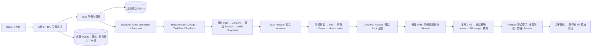
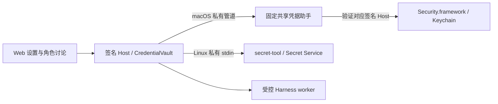

# 真实工程接入

本轮把真实讨论、规划、Docker 实施与测试、GitHub 候选接纳接入同一个 Rust 工程内核。Sim 保留为离线演示和故障夹具。项目在登记仓库后进入 `live`；模型讨论可以在创建 Feature 前开始。真实验收进度与原始结果见 [阶段报告](plans/real-engineering-integration/R1-progress.md) 和 [实施计划](plans/real-engineering-integration/PLAN.md)。

## 配置与运行

当前实际验收平台是 macOS Apple Silicon、Docker Desktop，容器内为 Linux/aarch64。需要 `docker`、已登录的 `gh`、同版本本机 Codex CLI；完整构建还需要仓库声明的 Rust、Node/npm。Linux 容器已实际运行两套 Harness；Linux 宿主已接入 Secret Service（需 libsecret-tools 与桌面 D-Bus），实际 Ubuntu 验收待执行，不将 macOS 的结果外推为 Linux 宿主验收。

首次构建共享运行时：

```sh
docker build -t devdesk/codex:0.167.0 containers/codex
docker build -t devdesk/dsh:0.2.2-rc.1 containers/dsh
```

基础 Node 镜像和 npm 版本写在 Dockerfile；登记时把本机镜像的不可变 ID、平台和版本写入全局库。不同构建可并存，需要明确选择安装；不能用可变 tag 替换已经冻结的 Session。相同版本/摘要只登记一次，各角色使用同一安装和镜像层，不按角色复制二进制。

构建并启动 host 后进入设置页：

1. 登记本机 Codex，通过官方网页完成 OAuth，再检查登录状态。认证服务使用数据集专属 CODEX_HOME；不会读取桌面 Codex HOME。
2. 输入 DeepSeek 官方 API key，保存到 macOS Keychain。普通配置、查询、SQLite、报告只保留不透明引用。后台由固定共享凭据助手通过 Security.framework 读取，并禁止自动弹窗；设置页可显式一次授权，开发/发行构建使用稳定签名身份。Linux 使用 Secret Service；详见 [系统凭据](system-credentials.md)。
3. 登记两套 Linux 镜像。初始默认 Harness 为 Codex；可切换全局默认，并设置项目、角色偏好。讨论入口也可明确选择安装和模型。
4. 使用专用 GitHub 仓库创建独立项目，在设置中诊断并登记仓库。存在保护规则、不完整策略或缺少权限时阻塞；不会更改规则或尝试管理员绕过。

优先级为显式选择 → 角色偏好 → 项目偏好 → 全局默认。配置变化影响后续会话；运行中的 Session、Attempt、Run 保留原角色修订、安装、模型、权限、凭据引用和适配器构建。技术重试沿用原锁，构建不兼容时明确阻塞，不能静默换配置。

## 对象与工作流程



- RuntimeInstallation 是共享安装；Agent Definition 是不可变角色修订；Session 是具体范围和绑定下的会话；RuntimeExecution 是一次实际 worker/测试容器生命周期。讨论 Turn 不伪造工程 Run。
- Project 可先保存 Requirement；Feature 固定来源需求修订。Proposal 由完成轮次提取或显式编辑，采纳使用正式领域命令，检查目标版本、输入修订、归属、验收映射和依赖图。
- Requirement Delivery Review 通过后才派发设计阶段；计划 Delivery Review 通过后生成 initial Snapshot，TaskPlan 的稳定 key 才能实例化为真实 Task/worktree。
- Tester 仅写冻结的 `tests/<suite>/` 目录；Developer 可以修改所属 Task worktree，测试目录只读。缺失目标模块与依赖/语法/环境错误分别处理，只有实际断言失败能满足 Red。
- CommandTests 从固定 Git blobs 创建独立、无模型/GitHub凭据、无网络的测试容器。固定 TestRecipe 指定文件、镜像和超时；报告绑定 Run、代码 SHA、测试定义、执行实例、实际退出码和停止证明。
- Task → Feature 每次构造一个以预期目标为唯一父提交的候选，独立验证和评审。目标变化后旧候选不能接纳，必须重建并重验。GitHub PR 的 head 必须是同一候选；本地推进、远端同步、PR merged 分别留痕。
- Feature 收尾是独立 Attempt：Tester 可在 Feature 测试目录补齐/修订完整测试，随后全量测试、文档、复验、Review。此阶段不伪造新的 Task Red。`Delivery.source_deliveries` 冻结已经完成接纳的 Task 交付；评审包包含其原始 Red/Green、Review、远端回执和当前固定版本 diff。

## 副作用与恢复

数据库事务先保存输入/操作意图；Docker、Git、供应商和 GitHub 调用在事务外执行，回执先保存再投影领域状态。Git 操作 ID 按用途分开，候选与推进可以共享同一个 Merge ID。PR 创建前按冻结分支和 marker 查询，丢失回执后核对原 PR；不调用 GitHub 平台 merge 接口。

所有工程工具在所属容器内运行，无法访问 Docker socket、宿主 HOME 或其他 worktree。`.git`、项目本地 Harness 配置和插件入口被屏蔽。Codex 使用受控权限 profile；DSH 使用公开 SDK/profile 扩展、工具白名单与 bwrap 包装，保留私有 PID/网络空间并隐藏 `/state`、协调配置和 `/proc`。不通过放开 Docker 特权解决嵌套沙箱问题。

正常终态先停止 worker、封存脱敏协议和运行报告，再清理容器。停止回执区分 Codex interrupt ACK、DSH forced stop、正常静止和恢复停止。清理失败保留归属，可显式重试；共享镜像和安装不删除。应用退出处理所有已打开项目的所属执行者，切换项目或关闭浏览器不会取消后台工作。

恢复不重发已派发但结果未知的输入。未知轮次保留待核对状态，停止原执行者并保留协议；需要显式处理后才能创建后继会话。尚未封存的工作树修改不会被技术重试覆盖。记录与封存产物保留；不能以删库或清空工作树恢复。

## 验证

离线回归使用 `./scripts/check.sh`，包含 Rust、HTTP、debug/release Chromium 流程。真实测试使用专用数据集、仓库和带归属标签的容器；原始结果在 `docs/plans/real-engineering-integration/`。A01–A22 与分层证据见 [最终验收](plans/real-engineering-integration/R8-acceptance.md)。统一入口为 `scripts/check-live.sh --providers codex,dsh --root <独立数据集> --github-repo <owner/test-repo>`，默认 `--mode full`，可选 `--groups git,docker,harness,github,web,workflow,recovery`。恢复组需要 `--allow-host-restart`，只停止可证明归属该数据集和端口的 Host。`--mode verify-existing --reports <已有报告目录>` 只复核已有实际对象，不发新模型任务；报告明确区分两种模式。全新闭环使用独立报告目录与随机源码前缀，不能重跑已实现同名任务冒充 Red。

首批 Tests 仅支持无依赖的 Node `node:test` 固定文件配方。其他语言、依赖下载、网络测试和严格分支保护下的其他合入策略需要新的适配契约，不在现有执行路径中隐式放开。

Ubuntu 实机验收步骤见 [Ubuntu Web 验收](ubuntu-web-acceptance.md)；当前 Linux 宿主验证状态与 macOS 分开记录。

系统凭据边界：



Host 重编译复用助手，助手既不随项目/角色复制，也不进入工程沙箱。其升级与 Host 升级分开；普通凭据调用禁用系统交互，显式授权入口才允许一次系统授权。
