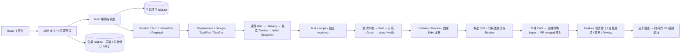
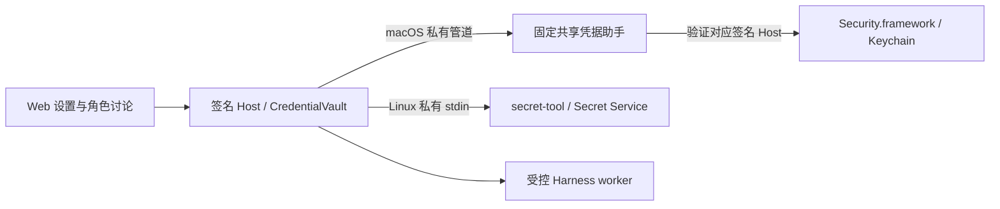

# 真实工程接入

Web 统一使用真实 GitHub 项目。打开项目时自动登记仓库并检查、克隆；讨论与工程任务根据实际选中的 Harness 按需准备运行环境。后端继续保留模拟适配器、历史数据和离线夹具，Web 不再提供模拟项目或模拟场景入口。历史来源不会改写。

## 配置与运行

宿主需要可用的 Git、已登录的 GitHub CLI，以及运行中的 Linux Docker Engine / Docker Desktop。macOS / Linux 的 DSH 凭据仍使用系统凭据库；Linux 需 `libsecret-tools` 与可用的桌面 Secret Service。系统软件安装与账号授权仍由用户完成，DevDesk 管理版本固定的 Harness 安装和镜像。

1. 点击 **打开 GitHub 项目**，填写 `owner/repo`（也接受 GitHub HTTPS / SSH URL）、主分支和可选名称。DevDesk 自动保存仓库接入意图，后台检查权限与规则、克隆并建立 mainline worktree。同一仓库和分支再次打开时复用项目。接入成功前不能创建 Feature 或启动工程执行；失败原因及原操作核对入口显示在仓库状态中。
2. 在设置中为所用供应商授权：Codex 点击 **网页登录**，DevDesk 自动发现可复用的同版本原生组件，或从固定的官方发行版下载并校验 SHA256，使用数据集独立的 `CODEX_HOME` 完成 OAuth；DSH 输入 DeepSeek 官方 API key，保存到系统凭据库。无需手动登记本机 Codex 或两套 Linux 镜像。
3. 在“规范与身份”准备需要的 Harness，选择其精确构建，并创建 Model、Tool 和完整 Agent 组合。每个 Agent 固定 Model、Harness、Skills、Tools、Permission、职责和指令；实例 AgentID 独立选择 Global 或当前 Project。相同配方复用共享镜像。
4. 在“工作流程”从内置 Feature / Task 模板创建、编辑和发布流程；在该页为当前 Project 单独绑定 Workflow、Standard 和五个职责的完整 Agent。发布与 Project 换绑是两个操作。
5. 在“执行与交付”创建 Feature。创建时即冻结治理配置；流程依次驱动需求讨论与交付评审、方案规划、固定 TaskGroup、Task TDD、Feature 收尾和主干接纳。角色讨论显示推荐组合，文档、上下文及测试分别在所属对象的页签查看。

运行时构建配方与 DSH 权限后端随 Host 编译嵌入，发布程序无需源码目录、宿主 Node/npm 或 Rust 工具链即可准备运行时。构建上下文仅包含嵌入的固定文件，完成后清理。镜像 tag 包含配方摘要，登记时保存不可变镜像 ID、版本和平台；有显式固定安装偏好时必须核验原安装，不会静默替换。已有 Session、Attempt、Run 的安装与来源不变。

仓库核对请求在没有其他 Run/Turn 时也会唤醒后台调度，重启后仍处理已保存的请求。首次克隆中断后，核对会先验证所属 bare 仓库和 origin，再下载缺失的主分支；GitHub 的 Git 协调调用固定使用 HTTP/1.1，以避免部分网络下默认 HTTP 传输停滞；网络克隆/续传允许最多 180 秒，保留原目录、对象和操作 ID。

Docker 未安装或未启动时显示环境阻塞，仓库权限或策略不兼容时保留原接入操作，供核对后重试。不会回退模拟执行，也不会修改 GitHub 规则。旧模拟项目不进入正常 Web 项目列表，仍可由后端离线回归读取。

新原生 Session 必须使用完整 Agent 及其 AgentID，不能另外覆盖 Model、Harness 或 Permission。Harness 偏好只作配置建议，不改写已发布组合。Project 默认调整只影响后来创建的 Feature；已有 Feature 后续 Task、Session、Attempt 和候选继续使用创建时的配置锁。技术重试沿用原锁，构建不兼容时明确阻塞。

## 对象与工作流程

- RuntimeInstallation 是共享安装；AgentRevision 是完整不可变组合，AgentID 是固定组合及 Scope 的实例；Session 是实例在具体工作范围下的会话；RuntimeExecution 是一次实际 worker/测试容器生命周期。讨论 Turn 不伪造工程 Run。
- 工作流运行图展示冻结定义，编辑在“工作流程”页面进行。每步可自动推进或等待人确认；默认主干候选完成测试和 Review 后等待确认，随后才应用接纳。
- AgentID 经验先按项目名称、Feature 名称、时间筛选索引，再读取具体快照。Global 实例可跨项目读取自己的经验，Project 实例仅限所属项目；场景恢复创建带来源的新 Session。
- 远端主干前进时，精确 lease 阻止旧候选接纳。在“交付与评审 → Merge 候选”使用“核对并快进主干”，记录冻结远端 SHA 的同步操作；仅允许干净主干 worktree 快进。旧候选及确认失效，从候选准备返工后重新测试、Review 和确认。未知接纳结果须先按原 operation 核对。
- Project 可先保存 Requirement；Feature 固定来源需求修订。Proposal 由完成轮次提取或显式编辑，采纳使用正式领域命令，检查目标版本、输入修订、归属、验收映射和依赖图。
- Requirement Delivery Review 通过后才派发设计阶段；计划 Delivery Review 通过后生成 initial Snapshot，TaskPlan 的稳定 key 才能实例化为真实 Task/worktree。
- Tester 仅写冻结的 `tests/<suite>/` 目录；Developer 可以修改所属 Task worktree，测试目录只读。缺失目标模块与依赖/语法/环境错误分别处理，只有实际断言失败能满足 Red。
- CommandTests 从固定 Git blobs 创建独立、无模型/GitHub凭据、无网络的测试容器。固定 TestRecipe 指定文件、镜像和超时；报告绑定 Run、代码 SHA、测试定义、执行实例、实际退出码和停止证明。
- Task → Feature 每次构造一个以预期目标为唯一父提交的候选，独立验证和评审。目标变化后旧候选不能接纳，必须重建并重验。GitHub PR 的 head 必须是同一候选；本地推进、远端同步、PR merged 分别留痕。
- Feature 收尾是独立 Attempt：Tester 可在 Feature 测试目录补齐/修订完整测试，随后全量测试、文档、复验、Review。此阶段不伪造新的 Task Red。`Delivery.source_deliveries` 冻结已经完成接纳的 Task 交付；评审包包含其原始 Red/Green、Review、远端回执和当前固定版本 diff。

## 副作用与恢复

数据库事务先保存输入/操作意图；Docker、Git、供应商和 GitHub 调用在事务外执行，回执先保存再投影领域状态。Git 操作 ID 按用途分开，候选与推进可以共享同一个 Merge ID。PR 创建前按冻结分支和 marker 查询，丢失回执后核对原 PR；不调用 GitHub 平台 merge 接口。

所有工程工具在所属容器内运行，无法访问 Docker socket、宿主 HOME 或其他 worktree。新配置采用容器全权限，旧受限配置及其状态隔离通过独立 Permission 后端保留；具体选择见 [权限说明](../permissions/README.md)。`.git`、项目本地 Harness 配置和插件入口被屏蔽。受限 Permission 使用 Codex 原生命名 profile 或 DSH 原生 profile、受控工具规则与 bwrap 包装；默认全权限使用供应商原生外部隔离/全权限模式。只有受限后端声明并验证工具状态隔离，全权限以整个容器为信任范围。不通过放开 Docker 特权解决嵌套沙箱问题。

正常终态先停止 worker、封存脱敏协议和运行报告，再清理容器。停止回执区分 Codex interrupt ACK、DSH forced stop、正常静止和恢复停止。清理失败保留归属，可显式重试；共享镜像和安装不删除。应用退出处理所有已打开项目的所属执行者，切换项目或关闭浏览器不会取消后台工作。

恢复不重发已派发但结果未知的输入。未知轮次保留待核对状态，停止原执行者并保留协议；需要显式处理后才能创建后继会话。尚未封存的工作树修改不会被技术重试覆盖。记录与封存产物保留；不能以删库或清空工作树恢复。

## 验证

离线回归使用 `./scripts/check.sh`，包含 Rust、HTTP、debug/release Chromium 流程。真实测试使用专用数据集、仓库和带归属标签的容器；原始结果在 `docs/plans/real-engineering-integration/`。A01–A22 与分层证据见 [最终验收](plans/real-engineering-integration/R8-acceptance.md)。统一入口为 `scripts/check-live.sh --providers codex,dsh --root <独立数据集> --github-repo <owner/test-repo>`，默认 `--mode full`，可选 `--groups git,docker,harness,github,web,workflow,recovery`。恢复组需要 `--allow-host-restart`，只停止可证明归属该数据集和端口的 Host。`--mode verify-existing --reports <已有报告目录>` 只复核已有实际对象，不发新模型任务；报告明确区分两种模式。全新闭环使用独立报告目录与随机源码前缀，不能重跑已实现同名任务冒充 Red。

首批 Tests 仅支持无依赖的 Node `node:test` 固定文件配方。其他语言、依赖下载、网络测试和严格分支保护下的其他合入策略需要新的适配契约，不在现有执行路径中隐式放开。

Ubuntu 实机验收步骤见 [Ubuntu Web 验收](ubuntu-web-acceptance.md)；当前 Linux 宿主验证状态与 macOS 分开记录。

系统凭据边界：

Host 重编译复用助手，助手既不随项目/角色复制，也不进入工程沙箱。其升级与 Host 升级分开；普通凭据调用禁用系统交互，显式授权入口才允许一次系统授权。
